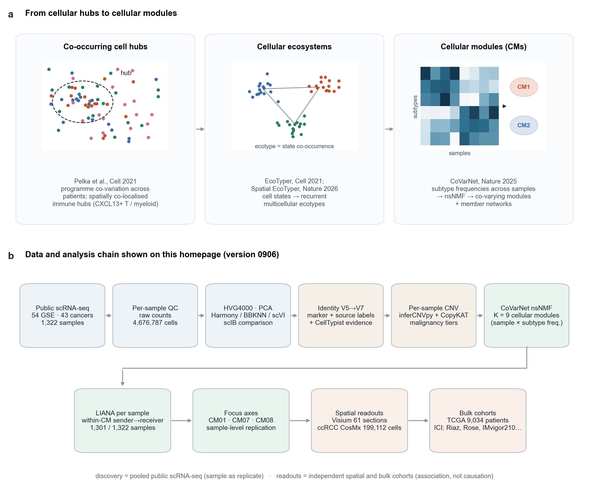
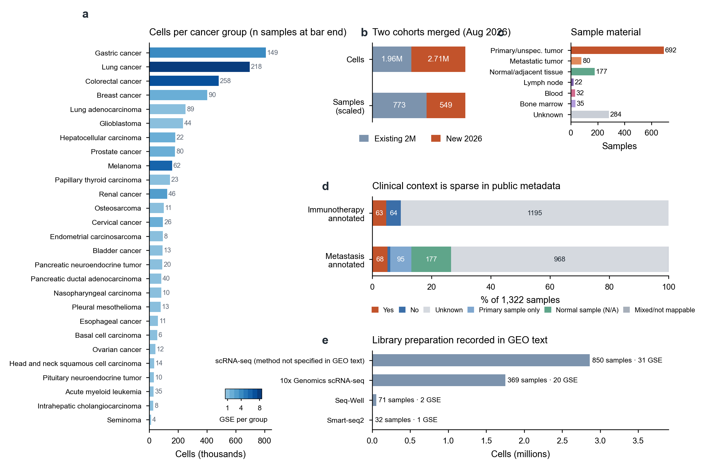
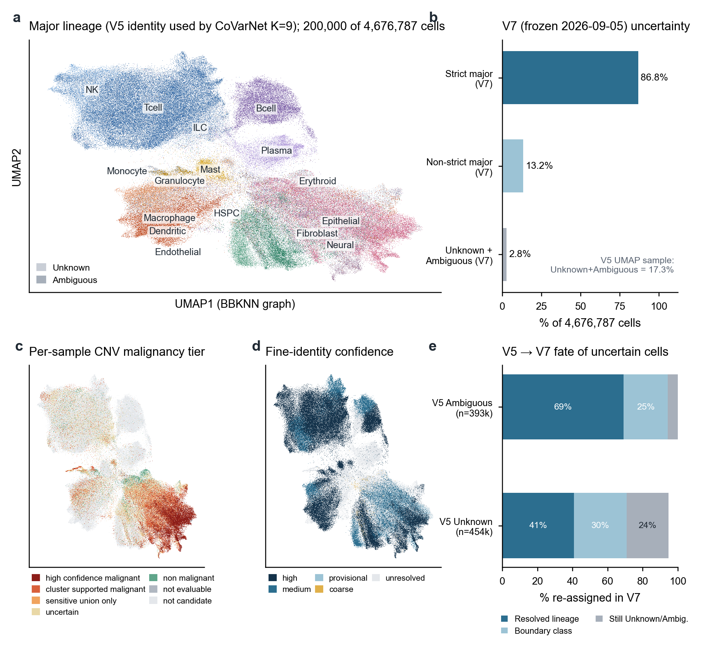
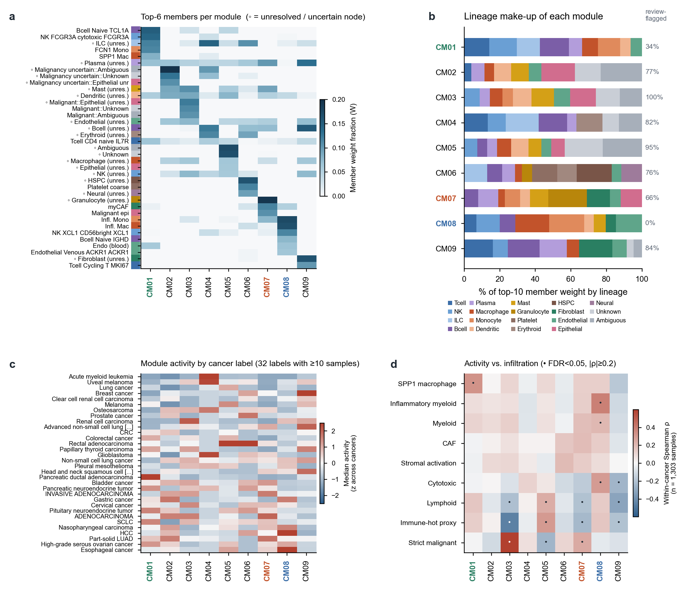
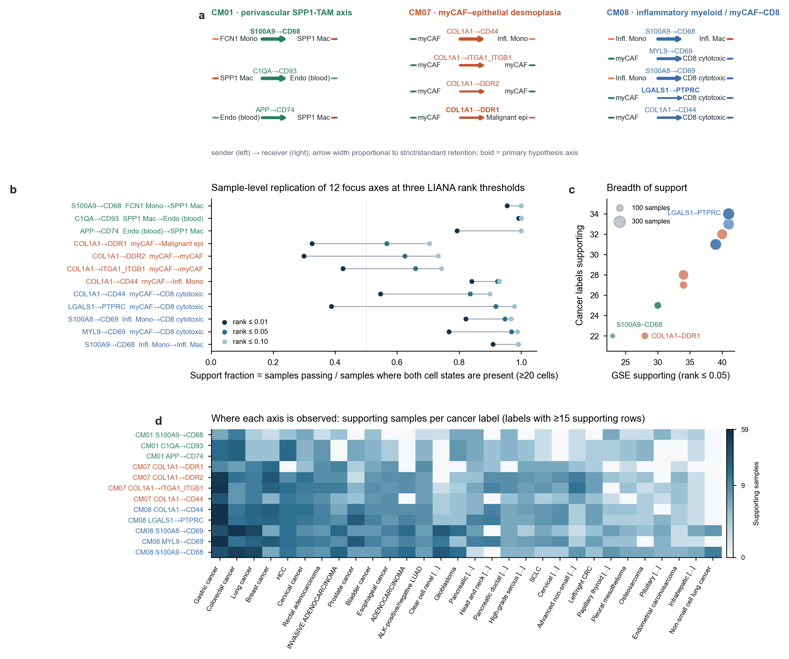
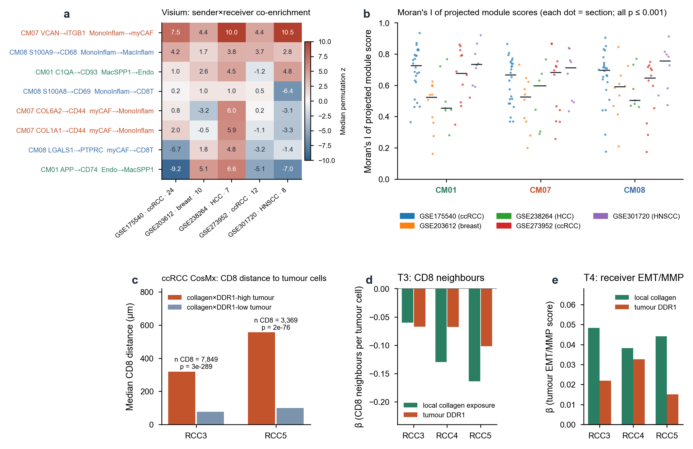
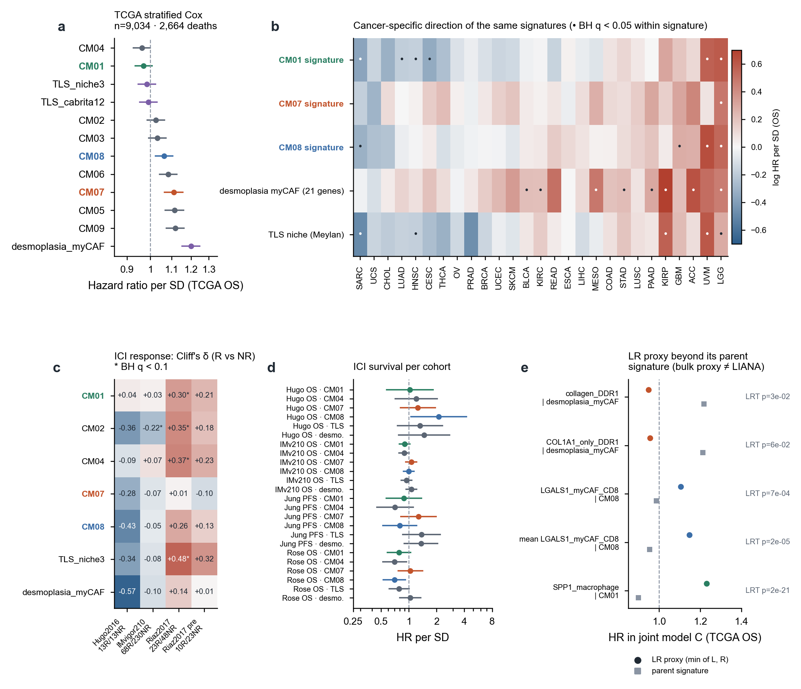

# PanCancer

> **Current research overview (Chinese)**: [research progress, ongoing analyses, and next-stage priorities](docs/homepage/07_current_work.md), updated 2026-11-05, with task dependencies and evidence-linked scientific figures. The historical 0906 narrative below is preserved.

> **Server analysis audit, 2026-11-05**: [current analysis inventory, evidence and handoff (Chinese)](docs/reports/20261105_server_analysis_audit/README.md). This homepage describes the historical September 6 release. The audit separates subsequent V7 recomputation, expanded TME data, spatial validation limits and NMF stability.

**Cellular modules in the tumor microenvironment: organization, processing, and initial readouts of a pan-cancer single-cell atlas**

[简体中文](README.md) · **English** · [Previous homepage: 2026-10-26 CM02 immune atlas](README_20261026_CM02.en.md)

[Introduction](#1-introduction-from-interaction-hubs-to-cellular-modules) · [Questions](#2-two-questions-addressed-by-this-project) · [Data](#3-data-organization) · [Processing and annotation](#4-integration-and-annotation-in-the-0906-release) · [CM landscape](#5-the-k9-cellular-module-landscape) · [CM01/07/08 communication](#6-cellcell-communication-axes-in-cm01-cm07-and-cm08) · [Spatial data](#7-readouts-in-spatial-data) · [TCGA and immunotherapy](#8-readouts-in-bulk-and-immunotherapy-cohorts) · [Open questions and companion pages](#9-open-questions-and-six-companion-pages) · [Reproducibility](#10-resources-reproducibility-and-version-boundaries)

---

## Abstract

Cells in the tumor microenvironment (TME) do not occur independently: particular immune, myeloid, stromal, and tumor cell states increase and decrease together across patients and form local niches within tissue. Previous studies have described this organization through **spatially colocalized immune hubs**, **cell-state ecotypes**, and **cellular modules (CMs) defined by covariation across samples**. This project focuses on CMs and asks two questions: whether CMs are associated with tumor development, progression, and treatment response; and whether tumor–immune–myeloid–stromal communication within CMs is associated with patterns of immune infiltration.

We assembled 54 public scRNA-seq datasets (43 cancer-type labels, 1,322 samples, and 4,676,787 cells), performed per-sample quality control, integration, hierarchical annotation, and per-sample CNV-based malignancy assessment, and used CoVarNet to identify nine CMs (K=9) from sample × subpopulation frequencies. LIANA was then run per sample within CMs. This page presents the processing and results of the 2026-09-06 version, hereafter the “0906 release.” Three modules—**CM01 (FCN1 monocytes–SPP1 macrophages–endothelial cells), CM07 (myCAFs–malignant epithelial cells), and CM08 (inflammatory monocytes/macrophages–myCAFs–CD8 T cells)**—showed support across a relatively broad set of samples in single-cell communication analyses. Subsequent readouts were obtained in Visium/CosMx spatial data and in TCGA and immunotherapy bulk cohorts. The emphasis is on presenting the data, methods, and numerical results faithfully; the scope and unresolved issues of each readout are described in the main text and six companion pages.

**Figure 1 | Research context and the analysis chain presented here.** **a**, Three frameworks for multicellular organization: the spatially organized immune hubs identified by Pelka et al. in colorectal cancer; cell-state ecotypes defined by EcoTyper/Spatial EcoTyper; and covarying cellular modules and member networks derived by CoVarNet using nsNMF on a sample × subpopulation frequency matrix. These schematics are illustrative and contain no real data. **b**, Data and analysis chain for the 0906 release. The upper row shows discovery from aggregated public scRNA-seq data, with samples as replicates. The lower row shows within-CM communication analysis and readouts in independent spatial and bulk cohorts. These downstream readouts are associations and do not establish causality or demonstrate that communication occurs.

---

## 1 Introduction: from interaction hubs to cellular modules

**Niches and interaction hubs.** Cell states in tumors are constrained by neighboring cells: chemokine gradients, extracellular matrix, vasculature, and antigen-presenting cells jointly shape whether T cells can enter, remain, and maintain function. Pelka et al. (*Cell*, 2021) constructed cross-cell-type coordination networks from the distributions of expression programs within each patient's cell types in colorectal cancer. Spatial analyses revealed **immune hubs** comprising CXCL13⁺ T cells, myeloid cells, and malignant-cell programs, with stronger representation in mismatch-repair-deficient tumors. Such studies suggest that a meaningful unit may be **a set of cell states that coexist and interact within the same patient and tissue region**.

**Ecotypes.** EcoTyper (Luca et al., *Cell*, 2021) first recovered states within cell types from pan-cancer bulk and single-cell data, then organized their co-occurrence into multicellular ecotypes associated with histopathology and prognosis. Spatial EcoTyper (*Nature*, 2026) incorporated measured spatial neighborhoods into discovery. This approach focuses on the co-occurrence of states.

**Cellular modules.** CoVarNet (*Nature*, 2025) uses a more direct input: the proportions of cell subpopulations within their parent lineages in each sample. It applies nonsmooth nonnegative matrix factorization (nsNMF) to the resulting sample × subpopulation matrix to identify **cellular modules (CMs)**. Each CM has a set of highest-loading subpopulations (top-N members) and an activity value for each sample; correlations across samples then define a network among members. The original study compared CM remodeling across healthy, adjacent, and tumor tissues and connected modules to coordinated expression programs and outcomes in independent lesions.

**Algorithm overview.** CoVarNet can be summarized as: frequency matrix (normalized within parent lineages, missing values filled with zero, and min–max scaled per subpopulation) → nsNMF with repeated initializations and heuristic rank selection from the cophenetic correlation curve → member loadings in W and sample activities in H → correlation networks among top-N members. The meaning of the input—composition rather than expression—and the scaling procedure determine which questions CMs can address. These are the starting points for [Page 4](docs/homepage/04_covarnet_nsnmf_limits.en.md).

## 2 Two questions addressed by this project

**Question 1: Do CMs play important roles in tumor development and progression?** More specifically, are any CMs elevated in immunotherapy datasets or associated with favorable or unfavorable prognosis, and are the directions of association consistent across cancer types?

**Question 2: Is communication within TME CMs associated with immune infiltration?** For example, is ligand–receptor communication between tumor and immune cells, or between myeloid and stromal cells, consistent with spatial patterns of T-cell infiltration or exclusion? Which axes provide additional information after accounting for their parent CM?

To address these questions, we organized three data categories: pan-cancer scRNA-seq discovery data, including immunotherapy and non-enriched tumor TME datasets; spatial transcriptomics data from Visium and CosMx; and bulk cohorts with clinical endpoints, including TCGA and immune checkpoint inhibitor (ICI) cohorts.

## 3 Data organization

The 0906 discovery collection combines two cohorts: an existing cohort integrated in July (31 GSEs, 773 samples, and 1,963,745 cells), and a cohort newly downloaded and independently quality-controlled in August (23 usable GSEs, 549 samples, and 2,713,042 cells). Together they contain 54 GSEs, 43 cancer-type labels, 1,322 samples, and 4,676,787 cells, with an intersection of 10,432 genes.

**Figure 2 | Composition of the 0906 discovery collection.** **a**, Cell counts by cancer type. Numbers at bar ends indicate sample counts, and color intensity indicates the number of GSEs per group. Gastric, lung, colorectal, and breast cancers contribute the most cells; most cancer types are represented by only 1–2 GSEs. **b**, Cell and sample contributions of the two cohorts. **c**, Sample material: 692 primary or unspecified tumors, 80 metastases, and 177 normal/adjacent tissues, alongside blood, bone marrow, and lymph nodes. Material type could not be determined from public metadata for 284 samples. **d**, Clinical context recoverable from public metadata: immunotherapy exposure could be determined for only 127 samples (9.6%), and metastatic status was unknown for 968 samples. **e**, Library preparation methods recorded in GEO text; methods were unspecified for 850 samples. Data are from the summary tables of the metadata audit dated 2026-08-29.

Figure 2d highlights a limitation throughout the analysis: the discovery data contain little treatment or outcome information, so clinical readouts for Question 1 rely mainly on external bulk cohorts. Dataset selection, the composition and purpose of successive collections, and the later immune-specific atlas and non-enriched TME scope are described in [Page 1: Dataset selection and processing](docs/homepage/01_datasets.en.md).

## 4 Integration and annotation in the 0906 release

**Quality control and integration.** The new cohort underwent adaptive per-sample quality control at two threshold levels (strict/floor) and Scrublet doublet removal, retaining 2,713,042 of 3,282,991 cells (82.6%). One GSE was blocked because `.X` contained log1p values rather than raw counts. After merging, `gse_id` was used as the batch variable, 4,000 highly variable genes were selected with `seurat_v3`, and 50 principal components were retained. Harmony, BBKNN, and scVI were compared. Their composite scIB scores (0.4 × batch + 0.6 × biology) were 0.4917 for BBKNN, 0.4862 for scVI, and 0.4807 for Harmony. Differences were small, and the ranking changed at a batch weight of approximately 0.317. The BBKNN graph was used for downstream lineage reclustering and visualization.

**Annotation.** Broad classes were arbitrated from three evidence streams: author-provided per-cell labels, marker scores calculated using whole-transcriptome library sizes, and CellTypist as supporting evidence only within its applicable scope. Unknown, Ambiguous, and lineage-boundary classes were allowed. Within-lineage Leiden reclustering and expanded marker panels provided fine identities. For malignancy assessment, candidate/reference sets were rebuilt from raw counts within each original sample, followed by inferCNVpy and CopyKAT and tiered evidence assignment. CoVarNet K=9 and LIANA used `final_annotation_v6_identity_v5_malignancy_v3`, hereafter “V5 identities.” V7, frozen on 2026-09-05, revised uncertainty handling and reran CNV on the same cell index; it became the project's annotation reference on 2026-09-06.

**Figure 3 | Embedding and annotation status of the 0906 atlas.** **a**, Broad classes among 200,000 uniformly sampled cells on the BBKNN-graph UMAP, using V5 identities (the CoVarNet input). T/NK, B/plasma, myeloid, stromal/endothelial, and epithelial/neural regions are clearly separated; Unknown and Ambiguous cells are dispersed between them. **b**, Broad-class uncertainty after the V7 freeze: 86.76% are eligible for strict broad-class analysis, 13.24% are non-strict boundary/pending categories, and exactly Unknown+Ambiguous account for 2.78%. In the same sampled cells, V5 Unknown+Ambiguous account for 17.3%. **c**, Per-sample CNV malignancy evidence tiers; high-confidence and cluster-supported malignant cells are concentrated in the epithelial region. **d**, Fine-identity confidence: approximately 47% of sampled cells remain unresolved at the fine level, mainly in epithelial, B/plasma, and some myeloid regions. **e**, Destinations of V5 Unknown and Ambiguous cells in V7: 69% of V5 Ambiguous cells acquire a definite lineage and 25% enter boundary classes; 41% of V5 Unknown cells acquire a definite lineage, 30% enter boundary classes, and 24% remain unresolved.

Figure 3 shows that the 0906 CMs were built from identities containing a substantial fraction of unresolved nodes, which directly enter CM membership (Figure 4b). The hierarchical logic, V7 corrections, subsequent V8/V9 attempts, cluster-first annotation, and scVI working atlas are described in [Page 3: Annotation logic and subsequent revisions](docs/homepage/03_annotation_logic.en.md).

## 5 The K=9 cellular module landscape

CoVarNet was run at the sample level on 4,675,461 cells from 1,303 samples (`--min-cells 100 --normalize minmax --k 9 --final-nrun 30`), yielding nine CMs. Their members and activities are shown in Figure 4.

**Figure 4 | K=9 CM composition, cancer-type activity, and correlations with immune infiltration.** **a**, The six highest-loading members of each CM and their loadings across all nine CMs (W normalized within each CM). Left color bars indicate lineages; ◦ marks unresolved/uncertain nodes. **b**, Lineage composition of the top-10 member loadings in each CM; percentages at right indicate the loading share assigned to nodes flagged for review. CM01 comprises B cells, NK cells, ILCs, monocytes, SPP1 macrophages, and endothelial cells (34% flagged). CM07 includes unresolved granulocytes, myCAFs, malignant epithelial cells, plasma cells, and mast cells (66% flagged). CM08 contains inflammatory monocytes, inflammatory macrophages, NK cells, cytotoxic CD8 T cells, endothelial cells, and myCAFs; all top-10 members are named fine states. CM02, CM03, and CM05 are dominated by malignancy-evidence categories and unresolved nodes. **c**, Median sample activity of each CM across 32 cancer-type labels with ≥10 samples, z-standardized across cancer types within each CM. **d**, Within-cancer-type Spearman correlations between CM activity and infiltration features (n=1,303 samples); dots indicate FDR<0.05 and |ρ|≥0.2. Positive correlations include CM01 with the SPP1 macrophage fraction (ρ=0.32), CM08 with inflammatory myeloid (ρ=0.39) and cytotoxic-cell fractions (ρ=0.30), and CM07 with the strictly malignant fraction (ρ=0.25). CM07 correlates negatively with the immune-hotness proxy (ρ=−0.24). CM03 correlates positively with the strictly malignant fraction (ρ=0.70) and negatively with immune hotness (ρ=−0.45).

**Origins of CM01, CM07, and CM08.** These identifiers refer to the 0825 CoVarNet K=9 model using V5 identities. They were aligned to an earlier 0824 model using the score “sample-activity correlation × 0.65 + cosine similarity of top-10 lineage composition × 0.35”: old CM09→CM01 (0.76), old CM03→CM07 (0.86), and old CM06→CM08 (0.84). They correspond to three mechanistic hypotheses proposed in August—myCAF→malignant epithelium (COL1A1–DDR1), myCAF→T/myeloid cells, and FCN1 monocytes→SPP1 macrophages→T/NK cells—and were therefore selected for follow-up. Other modules in the current K=9 model, including CM03 (high strictly malignant fraction, low immune hotness, and no myCAF among its top-10 members), were not included in this chain. Limitations of CoVarNet, including min–max scaling, heuristic rank selection, and compositional closure, are discussed in [Page 4](docs/homepage/04_covarnet_nsnmf_limits.en.md).

## 6 Cell–cell communication axes in CM01, CM07, and CM08

**Methods.** `liana.mt.rank_aggregate` was run independently in 1,322 original samples, using the consensus resource, within-sample `normalize_total`+`log1p`, ≥20 cells per group, and `expr_prop=0.10`; 1,301 samples completed successfully. Only interactions whose sender and receiver both belonged to a CM's top-10 members were retained, yielding approximately 11.21 million rows. Requiring both magnitude and specificity ranks ≤0.05 retained approximately 382,000 events, summarized as 29,605 consensus interactions. Twelve focal axes were then selected for CM01, CM07, and CM08. The testable denominator required both cell states to be present with ≥20 cells each, and sample support was assessed at three thresholds.

**Figure 5 | Sample-level reproducibility of 12 focal communication axes.** **a**, Sender→receiver relationships in the three CMs. Bold labels indicate prespecified primary hypothesis axes; arrow width is proportional to the strict/standard retention fraction. **b**, Support fractions at rank thresholds ≤0.01, 0.05, and 0.10. The three CM01 axes have support fractions of 0.79–1.00: S100A9→CD68 (FCN1 monocytes→SPP1 macrophages) is supported in all 66 testable samples, and C1QA→CD93 (SPP1 macrophages→endothelial cells) in all 121. CM07 COL1A1→DDR1 (myCAF→malignant epithelium) is supported in 115 of 203 testable samples (0.57), with only 57% of standard-threshold support retained at the strict threshold. CM08 LGALS1→PTPRC (myCAF→CD8 T cells) has a support fraction of 0.92, with 42% retained at the strict threshold. **c**, Numbers of supporting GSEs and cancer types; point size indicates supporting samples. COL1A1→DDR1 spans 28 GSEs and 22 cancer-type labels, with the largest single GSE contributing 12%. **d**, Supporting sample counts by cancer-type label for each axis.

The single-cell readouts indicate only that the corresponding ligands and receptors are jointly highly expressed in the relevant states and show cell-type specificity; they cannot establish that communication actually occurs. Axes such as S100A8/A9→CD68 appear in nearly every sample containing myeloid cells and more closely reflect cell abundance. In the LIANA consensus resource, COL1A1 is the only collagen ligand paired with DDR1. Circular dependence between LIANA results and CM membership, threshold sensitivity, and background axes are discussed in [Page 2: LIANA communication and CMs](docs/homepage/02_liana_cm_communication.en.md).

## 7 Readouts in spatial data

**Visium.** Five datasets contributed 61 sections: two ccRCC datasets, plus breast, liver, and head and neck squamous cell cancers. CM scores were projected onto each spot and Moran's I was calculated. For each communication axis, neighborhood co-enrichment of “ligand × sender-state activity” and “receptor × receiver-state activity” was compared, with z-scores obtained by label permutation. **CosMx.** Three ccRCC tissues contained 199,112 cells and 978 genes. Collagen-high fibroblasts were treated as the source and epithelial cells in the tumor compartment as the DDR1 receiver. Using k=12 neighbors and 999 permutations, analyses evaluated adjacency (T1), CD8 neighbor counts (T3), distances from CD8 cells to collagen×DDR1-high versus -low tumor cells (T3b), and receiver-side EMT/MMP programs (T4).

**Figure 6 | Spatial readouts in Visium and CosMx.** **a**, Median permutation z-scores for communication axes within each Visium dataset (columns labeled GSE · cancer type · section count). VCAN→ITGB1 (CM07, monocytes↔myCAFs) has z>0 in all five datasets (4.4–10.5); S100A9→CD68 (CM08) is positive in 5/5, and C1QA→CD93 (CM01) in 4/5. LGALS1→PTPRC (CM08) and COL1A1→CD44 (CM07) have inconsistent directions across datasets; APP→CD74 (CM01) is strongly negative in three. DDR1 axes were not included in the Visium analysis. **b**, Moran's I for projected CM01/07/08 scores in each section (183 section × CM combinations; all permutation p≤0.001), with medians approximately 0.63–0.67. **c**, Median distances from CD8 T cells to collagen×DDR1-high versus -low tumor cells in CosMx: 319 versus 77 μm in RCC3 and 556 versus 100 μm in RCC5. RCC4 is not shown because its whole-section distance scale differs. **d**, In T3 models, coefficients for local collagen exposure and tumor DDR1 are negative in all three tissues; interaction terms are not significant. **e**, In T4 models, both coefficients are positive for tumor EMT/MMP programs.

The opposing evidence also matters: in the T1 adjacency test, DDR1⁺ tumor cells had fewer collagen-high CAF neighbors. Furthermore, ccRCC malignant cells retain proximal-tubule identity, and normal proximal tubules are themselves DDR1-positive, making ccRCC poorly suited to testing a tumor-specific DDR1 axis. CosMx covered only ccRCC. Visium Moran's I reflects the spatial smoothness of projected scores and does not independently test whether member cells contact each other. Directly testing member colocalization in single-cell-resolution spatial data after module discovery, then investigating communication among contacting pairs, is discussed in [Page 5](docs/homepage/05_spatial_first_validation.en.md).

## 8 Readouts in bulk and immunotherapy cohorts

**Methods.** TCGA analyses used Toil RSEM TPM and survival data curated by Liu et al. (2018), covering 9,034 primary tumors across 27 cancer types. Each CM was scored from marker genes of its member subpopulations by averaging within-cancer-type gene z-scores. A 21-gene `desmoplasia_myCAF` signature and two TLS scores were included as references. Cox models were stratified by cancer type and adjusted for age; hazard ratios (HRs) are per one standard deviation. ICI cohorts included Riaz2017 (melanoma, nivolumab), Hugo2016 (melanoma, pembrolizumab), IMvigor210 (urothelial cancer, atezolizumab), Rose2021 (urothelial cancer), and Jung2019 (NSCLC). Response comparisons used Mann–Whitney tests and Cliff's δ (CR/PR versus PD); survival used Cox models. Bulk proxies for communication axes were defined as the smaller ligand and receptor gene z-score. A parent-CM/signature-only model (A) was compared with a parent-signature-plus-proxy model (C).

**Figure 7 | Readouts in TCGA and ICI cohorts.** **a**, Overall-survival HRs from pan-cancer stratified TCGA Cox models: CM07, 1.11 (95% CI 1.07–1.16); CM08, 1.06 (1.02–1.11); CM01, 0.97 (0.93–1.01); and the reference `desmoplasia_myCAF`, 1.20 (1.15–1.25). **b**, Directions of the same scores within cancer types; dots indicate within-signature BH q<0.05. CM01 has HR<1 in SARC, CESC, HNSC, and LUAD, but HR>1 in LGG (1.82) and UVM (1.77). CM08 has HR<1 in SARC and HR>1 in LGG, UVM, and GBM. **c**, Cliff's δ for ICI response (asterisks indicate BH q<0.1): CM01 is +0.30 in all Riaz2017 samples (higher in responders, q=0.087). No response differences for CM01, CM07, or CM08 were observed in pretreatment-only samples, Hugo2016, or IMvigor210. **d**, ICI survival: CM08 has HR 0.70 in Rose2021 (0.53–0.92, q=0.069), but HR 1.00 in the other urothelial cohort, IMvigor210, and HR 2.11 in Hugo2016 (n=25). **e**, Incremental information from communication proxies beyond parent signatures (TCGA OS, model C): the SPP1 macrophage proxy (CM01) has HR 1.23, while CM01 shifts to 0.90 after its inclusion, with likelihood-ratio-test p≈2×10⁻²¹. LGALS1 myCAF→CD8 proxies (CM08) have HRs of 1.10–1.15, while the CM08 signature approaches 1 in model C. Collagen–DDR1 and COL1A1–DDR1 proxies are collinear with the desmoplasia signature and reverse direction after inclusion; LRT p-values are 0.03 and 0.06, respectively.

These readouts address different aspects of Question 1 and do not support a single uniform conclusion. CM signatures have small effects in pooled pan-cancer analyses and opposite directions across cancer types. In immunotherapy cohorts, only individual cohorts show nominal or borderline-FDR differences, without replication in a second cohort of the same cancer type. Bulk proxies reflect the abundance of the cells expressing ligands and receptors and cannot reconstruct sender–receiver relationships.

## 9 Open questions and six companion pages

The 0906 release followed the complete “CM → communication → spatial → clinical” chain while exposing limitations at each step. Six companion pages examine these issues in detail:

| Page | Content | Main-text connection |
|---|---|---|
| [1 Dataset selection and processing](docs/homepage/01_datasets.en.md) | Composition, cancer coverage, and roles of successive collections: July discovery → August 5M merge → October immune atlas, full-context archive, and eligible TME scope; enriched versus non-enriched material | Section 3 |
| [2 LIANA communication and CMs](docs/homepage/02_liana_cm_communication.en.md) | How within-CM filtering imports membership definitions into communication analysis; threshold sensitivity, abundance-driven background axes, resource gaps, and bulk-proxy interpretation | Sections 6 and 8 |
| [3 Annotation logic and subsequent revisions](docs/homepage/03_annotation_logic.en.md) | V5→V7 uncertainty corrections and per-sample CNV; V8 lineage taxonomies and V9 candidates; October cluster-first annotation and the scVI working atlas | Section 4 |
| [4 Limitations and improvements of nsNMF in CoVarNet](docs/homepage/04_covarnet_nsnmf_limits.en.md) | Min–max scaling and rare nodes, compositional closure, heuristic rank selection, seed/source stability, and alternatives including cNMF and state modules | Section 5 |
| [5 Spatial validation and communication discovery after module identification](docs/homepage/05_spatial_first_validation.en.md) | Put spatial evidence before communication: test member colocalization and local module activity, then evaluate LR and receiver-side responses among contacting pairs | Section 7 |
| [6 Improving CM discovery](docs/homepage/06_cm_discovery_improvements.en.md) | Compare module discovery with and without tumor/epithelial nodes; add a state layer to immune datasets; initial results from the new October scope | Throughout |

## 10 Resources, reproducibility, and version boundaries

**Version boundaries.** Figures 4–7 derive from the CoVarNet K=9/LIANA branch using V5 identities, run on 2026-08-25 and assembled into the [communication evidence-chain release](releases/communication_evidence_chain_20260906/README.md) on 2026-09-06. This branch was not recomputed on V7. V7 ([annotation release](releases/annotation_v7_20260905/README.md)) is the identity and malignancy reference used after 0906. The October 2026 pan-cancer CMs (v20261010), the 2026-10-14 immune atlas CMs, and the 2026-10-30 new TME CMs are independent discovery versions. Their identifiers do not correspond to CM01/07/08 on this page. For the immune-atlas CM02 analysis, see the [previous homepage](README_20261026_CM02.en.md).

**Figures and data.**

- Figure-rendering script: [scripts/render_homepage_v2_figures.py](scripts/render_homepage_v2_figures.py). Figures and SHA hashes: [figure_manifest.json](assets/publication/20261102/figure_manifest.json). Each figure also has a vector PDF version.
- Summary tables underlying the figures (aggregated at sample/cancer-type/cohort level, without cell- or patient-level rows): [homepage_v2 inventories](inventories/publication/2026-11-02/homepage_v2/).
- Full 0906 communication evidence-chain report: [COMMUNICATION_EVIDENCE_CHAIN_CN.md](releases/communication_evidence_chain_20260906/reports/COMMUNICATION_EVIDENCE_CHAIN_CN.md). V7 annotation logic: [V7_REFERENCE_AND_ANNOTATION_LOGIC_CN.md](releases/annotation_v7_20260905/methods/V7_REFERENCE_AND_ANNOTATION_LOGIC_CN.md). These supporting reports are in Chinese.
- Project status and plans: [STATUS.md](STATUS.md), [ROADMAP.md](ROADMAP.md), [run index](inventories/runs.tsv), and [data and publication policy](docs/DATA_POLICY.md).

Cell-level objects, native expression matrices, patient and sample records, coordinate tables, and learned weights remain in the research environment and are registered by logical identifier and SHA hash. This English edition translates the current homepage and its six companion pages; linked historical methods, logs, and release reports retain their original language.

## References

1. Pelka K, et al. Spatially organized multicellular immune hubs in human colorectal cancer. *Cell* 184, 4734–4752 (2021). [PMC8772395](https://pmc.ncbi.nlm.nih.gov/articles/PMC8772395/)
2. Luca BA, et al. Atlas of clinically distinct cell states and ecosystems across human solid tumors. *Cell* 184, 5482–5496 (2021). [PMC8526411](https://pmc.ncbi.nlm.nih.gov/articles/PMC8526411/)
3. Spatial EcoTyper. *Nature* (2026). [s41586-026-10452-4](https://www.nature.com/articles/s41586-026-10452-4)
4. CoVarNet: coordinated cellular modules across tissues and cancer. *Nature* (2025). [s41586-025-09053-4](https://www.nature.com/articles/s41586-025-09053-4) · [Code](https://github.com/QiangShiPKU/CoVarNet)
5. Pascual-Montano A, et al. Nonsmooth nonnegative matrix factorization (nsNMF). *IEEE TPAMI* 28, 403–415 (2006).
6. Dimitrov D, et al. LIANA+ provides an all-in-one framework for cell–cell communication inference. *Nat Cell Biol* 26, 1613–1622 (2024).
7. Kotliar D, et al. Identifying gene expression programs of cell-type identity and cellular activity with single-cell RNA-seq (cNMF). *eLife* 8, e43803 (2019).
8. Jerby-Arnon L, Regev A. DIALOGUE maps multicellular programs in tissue from single-cell or spatially resolved transcriptomics data. *Nat Biotechnol* 40, 1467–1477 (2022).

---

Source homepage updated: **2026-11-02**. English edition: **2026-11-03**. This page presents the data, methods, and readouts of the 0906 release in a paper-style structure; see [STATUS.md](STATUS.md) for execution status.
