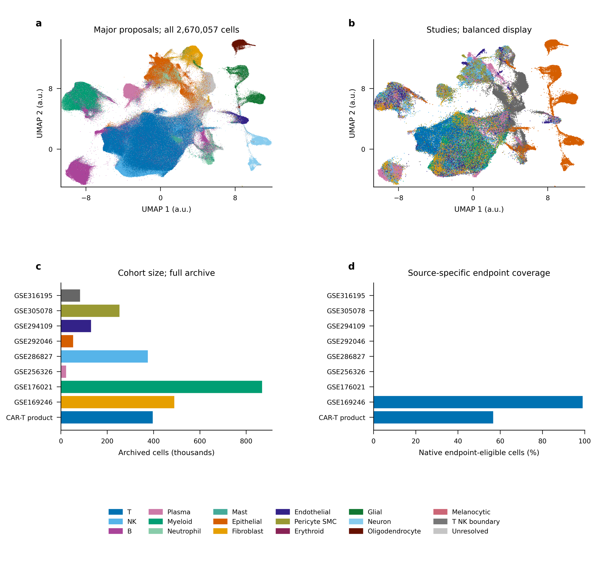
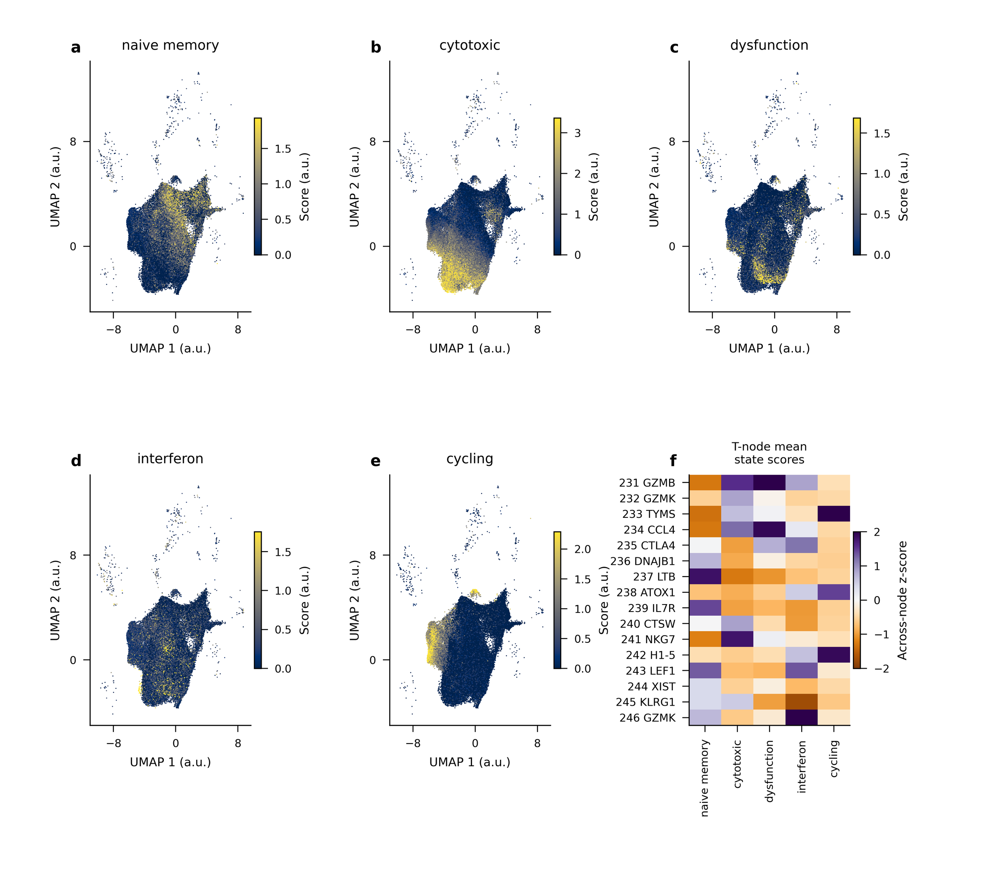
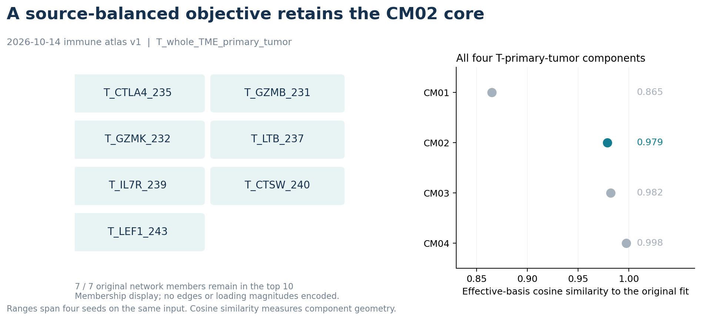
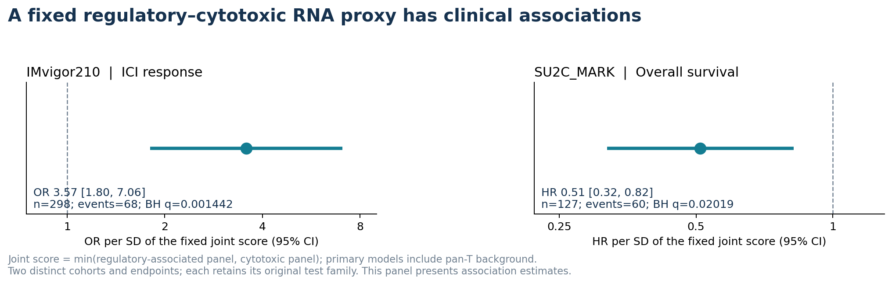
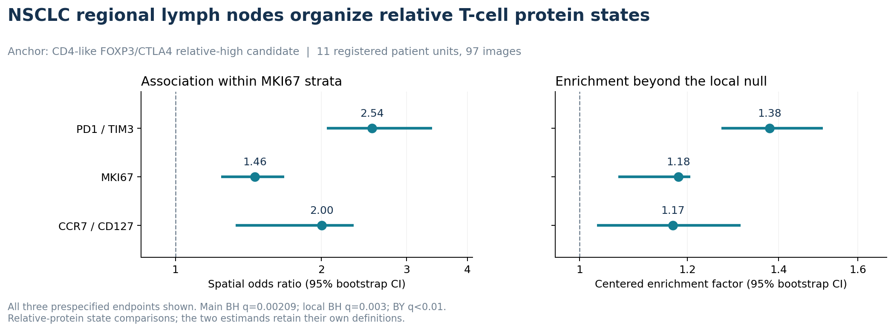

# PanCancer

[**简体中文**](README.md) | [English](README.en.md)

## 从细胞组成到T细胞状态与空间组织的泛癌图谱

**以可追溯的细胞身份为坐标，识别共同出现的细胞组合，并在明确的组织和临床背景中解释这些组合。**

肿瘤微环境由多类细胞共同构成。理解这种生态，需要同时回答三个问题：哪些细胞共同变化，它们处于什么状态，以及它们在组织中如何相遇。PanCancer将泛癌组成图谱、免疫单细胞图谱、临床队列和空间蛋白成像纳入同一套分层分析框架，以 **CTLA4–GZMB相关T细胞共变核心** 为重点，连接组成结构、状态组织与临床关联三个层次。

当前免疫图谱覆盖 **2,670,057个细胞、9个来源、400个物理文库**，提供18个大类、270个描述分群及T细胞的五条连续状态轴。在原发肿瘤T细胞分析范围中，CM02的七个核心成员全部保留于来源等权拟合的前10成员；其固定RNA功能代理在两个免疫治疗队列分别关联治疗应答和总生存；NSCLC区域淋巴结中，调节相关CD4样蛋白状态与三种CD8样状态呈现局部空间富集。

[图谱与版本](#图谱资源与版本坐标) · [CM02核心](#一个经来源平衡检验保留的t细胞共变核心) · [临床关联](#固定rna功能代理连接免疫治疗临床结局) · [空间组织](#nsclc淋巴结呈现具体的t细胞状态组织) · [方法与证据](#方法复现与证据入口)

### 核心发现

| 科学主张 | 最有力的定量证据 | 它回答的问题 |
|---|---|---|
| 建立连接身份与状态的免疫图谱 | 267万细胞；18个大类；270个描述分群；16个T细胞群与5条状态轴 | 哪些细胞可以在同一坐标中比较？ |
| CM02的核心组成经来源平衡后保留 | 有效基底余弦相似度约0.979；七个核心成员全部保留于前10名 | 细胞组合是否依赖来源权重？ |
| 固定的调节相关—细胞毒RNA共富集代理具有临床关联 | IMvigor210应答OR 3.57；SU2C_MARK总生存HR 0.51 | 这种功能主题是否连接患者结局？ |
| NSCLC淋巴结具有可定位的状态配对 | FOXP3/CTLA4相关CD4样状态与PD1/TIM3相关CD8样状态的局部富集倍数1.38 | 相关状态是否在组织中形成邻近结构？ |

这四个层次使用各自的测量对象：**细胞组成CM、RNA功能代理、相对蛋白状态和临床终点**。下文按各自的分母与统计口径展开。

## 一张同时保留组织背景和细胞状态的图谱

**图1｜免疫单细胞图谱的组织背景。** 服务器正式图稿展示跨来源的细胞图谱及组成。图谱细胞总量为2,670,057，物理文库为400；细胞、文库与患者是不同计数单位。来源包含组织、免疫富集材料及CAR产品，模块发现按相应材料范围组织。d面板表示免疫v1冻结时的原生终点资格，后续临床资料桥接按对应新版本登记。[图谱交付与完整来源表](inventories/runtime/2026-10-14/immune_atlas_v1/RESULTS.md)。

图谱的价值来自两个相互配合的层次：

- **保留完整组织背景。** 免疫、基质、血管、上皮及其他组织成分共同提供解释细胞生态的参照。
- **将身份与状态分开。** 一个细胞群可以同时具有记忆、细胞毒、干扰素或增殖相关特征；连续状态轴补充分群标签对这种变化的描述。
- **保留来源和分析单位。** 原发组织、转移组织、血液、免疫富集及CAR产品分别定义分析情境，患者重复材料按相应设计处理。

**图2｜T细胞身份之上的连续状态。** 五条固定RNA评分轴分别描述naive/memory、cytotoxic、dysfunction-associated、interferon和cycling相关表达，右下为T细胞分群的状态概貌。评分及图中“dysfunction”表示相关RNA程序；细胞功能由相应功能设计判定。该图为身份—状态的描述坐标，后文临床和空间分析分别使用冻结的RNA代理及蛋白状态定义。

## 一个经来源平衡检验保留的T细胞共变核心

### CM02将调节相关、效应与记忆相关T细胞成分放在同一组成背景中

本节的完整版本标识为：**2026-10-14免疫图谱CM02，v1，`T_whole_TME_primary_tumor`**；展示名称为 **CTLA4–GZMB T细胞共变**。

**范围口径：** `whole_TME`沿用该历史版本的捕获范围标签；是否经过谱系富集须按原始文库制备证据另审。这里的T细胞CM使用T大类内部比例，解释对象是对应捕获条件下的T细胞组成。

| 冻结核心成员 | 展示marker | 生物学阅读方向 |
|---|---|---|
| `T_CTLA4_235` | CTLA4 | 调节／活化相关T细胞成分 |
| `T_GZMB_231` | GZMB | 细胞毒效应相关成分 |
| `T_GZMK_232` | GZMK | GZMK相关效应／记忆成分 |
| `T_LTB_237` | LTB | LTB相关淋巴细胞成分 |
| `T_IL7R_239` | IL7R | IL7R相关记忆／存续成分 |
| `T_CTSW_240` | CTSW | 效应相关成分 |
| `T_LEF1_243` | LEF1 | LEF1相关naive／memory成分 |

marker和阅读方向帮助理解组成主题，正式细分身份由多marker与来源证据共同定义。**CM02的生物学重点是这些成分如何共同组织，而不是把整个模块压成一个单细胞类型名称。**

### 来源等权后，七个核心成员全部保留

**图3｜改变来源权重，检验同一组成核心。** 在冻结输入、预处理和分解秩下，比较原单位权重与来源等权目标，使用四个固定种子。CM02有效基底相似度为0.979126–0.979140，原始W相似度为0.949640–0.949663，前10成员重叠9个，七个原核心成员全部保留。图右同时展示该范围全部四个分量；左侧排列表示成员归属，不编码网络边或载荷大小。

**这个实验的论证职责，是检验组成核心对来源权重的稳定性。** 它表明该T细胞组合在改变来源相对贡献后保持相近结构，为后续情境生态分析提供了稳定锚点。四个种子共享同一批数据；跨来源迁移使用另外的队列设计评价。

[来源平衡方法](methods/CM-source-balanced-sensitivity-20261024.md) · [统计定义与比较范围](docs/PROJECT_PUBLICATION_EVIDENCE_20261026.md#来源平衡的完整比较)

## 固定RNA功能代理连接免疫治疗临床结局

组成发现提出了一个可检验的功能主题：**调节相关表达与细胞毒表达共同升高时，是否连接临床结局？**

为跨队列检验这一主题，使用预先冻结的多基因面板：分别计算调节相关和细胞毒评分，以两端评分的较小值定义共同富集代理，并在主模型中纳入pan-T背景。面板、方向及读出在新效应计算前固定，不使用结局选择基因或优化切点。

**图4｜两个临床问题中的固定RNA代理关联。** 左图为治疗应答的优势比，右图为总生存的风险比；分别保留原检验家族的BH校正。每个效应对应固定共同富集评分增加一个标准差。

| 队列 | 终点与模型 | 分母／事件 | 主效应及95%区间 | BH q |
|---|---|---|---|---|
| IMvigor210 | 治疗应答；logistic | 298／68 | **OR 3.57［1.80–7.06］** | **0.00144** |
| SU2C_MARK | 总生存；Cox | 127／60 | **HR 0.51［0.32–0.82］** | **0.0202** |

**临床证据的记忆点：固定的调节相关—细胞毒共富集主题，在两个队列分别连接较高的应答优势和较低的死亡风险。** 两个队列承担不同终点的关联检验；RNA代理表达的是功能主题，组成CM保留原细胞比例定义。

该部分评价的是**临床关联**。单端、pan-T背景与联合模型的预测性能属于单独的增量问题；完整既定比较随[配套证据说明](docs/PROJECT_PUBLICATION_EVIDENCE_20261026.md)保留，首页不将关联效应换写为可部署预测性能。

[冻结临床方案与面板](inventories/analysis/2026-10-18/priority_immune_CM_bulk_v1/frozen_plan_before_effects.json) · [家族与比较口径](docs/PROJECT_PUBLICATION_EVIDENCE_20261026.md#临床代理的固定定义)

## NSCLC淋巴结呈现具体的T细胞状态组织

临床代理描述患者层面的功能主题，空间分析进一步回答：**相关状态在真实组织里怎样排列？**

在NSCLC手术相关区域淋巴结中，以CD4样细胞内FOXP3/CTLA4相对较高的候选状态为锚点，比较三种CD8样蛋白状态。预先固定的检查分别考虑MKI67增殖背景和局部组成、邻接度数及空间块背景，以登记患者单位汇总。

**图5｜同一组织情境中的三种状态配对。** 11个登记患者单位、97幅图像；三种预定接收端全部展示。左图为MKI67分层后的空间OR，右图为相对于局部条件零模型的中心化富集倍数，两者属于不同估计对象。

| CD8样接收状态 | MKI67分层空间OR［95%区间］ | 局部条件富集倍数［95%区间］ | 局部正向患者单位 |
|---|---|---|---|
| PD1/TIM3相关 | **2.54［2.05–3.39］** | **1.38［1.27–1.51］** | **11/11** |
| MKI67相关 | **1.46［1.24–1.68］** | **1.18［1.07–1.21］** | **11/11** |
| CCR7/CD127相关 | **2.00［1.33–2.33］** | **1.17［1.03–1.31］** | **9/11** |

三种主关联BH q约0.00209，局部条件检验BH q为0.003，对应BY q均小于0.01；留一患者后的总体方向保持正向。相同的置换分辨率下限不承担三种接收状态的强弱排序。

**空间证据的记忆点：调节相关CD4样状态与多种CD8样状态形成组织邻近，且这种邻近在增殖和局部背景检查后保留。** 这里的状态由相对蛋白水平定义；面板缺少CD3通道，采用CD4-like／CD8-like候选表述。同来源二次家族承接首轮空间观察，定位为该NSCLC情境内的状态组织证据。

### 将组织情境纳入解释

外部黑色素瘤TDLN已用冻结的相对蛋白状态与空间框架完成15项主槽计算及独立数值审核。该来源承担**跨癌种组织情境对照**的职责，主槽、可测分母和结构缺测共同保存在配套证据中。不同组织的效应分别估计，不拼接成统一的Treg—CD8机制。

这种组织情境视角让后续问题更具体：**哪一种状态组合，在什么癌种、治疗阶段和组织区域，具有可重复的生态与临床意义？**

[空间方法](methods/CM02-LN-regulatory-specificity-20261022.md) · [完整空间家族与外部情境对照](docs/PROJECT_PUBLICATION_EVIDENCE_20261026.md#空间组织的完整情境对照)

## 图谱资源与版本坐标

整个项目使用版本明确的资源层，使组成发现、免疫主题和全背景身份扩展能够相互对照。

| 资源 | 核心规模 | 科学用途 | 权威入口 |
|---|---|---|---|
| **2026年10月泛癌CM，v20261010** | 172子群、1290文库、9个CM | 泛癌细胞组成及来源／癌种情境关系 | [来源内与通讯分析](runs/20261012_CM_edge_coverage_v1.md) |
| **2026-10-14免疫图谱，v1** | 2,670,057细胞；400物理文库；9来源 | 免疫主题、T细胞状态与材料分层CM发现 | [正式图谱交付](inventories/runtime/2026-10-14/immune_atlas_v1/RESULTS.md) |
| **2026-10-14免疫图谱CM02，v1** | 原发肿瘤T细胞范围的7成员核心 | CTLA4–GZMB相关T生态重点线 | [带范围的模块命名](inventories/analysis/2026-10-18/immune_CM_naming_v1/CM_NAMES_CN.md) |
| **全背景原生档案扩展** | 9,439,479条观测；65来源键 | 统一身份、来源内本群marker及跨版本对应 | [分层注释方法](methods/full-context-atlas-hierarchical-annotation-plan-20261023.md) |

全背景扩展的来源键、原生观测与独立研究／患者分别登记。2026-10-26服务器核查确认全量投影及13,279个受规则约束子集的本群marker生产结束；坐标精度、独立审计、统一身份、crosswalk和用途视图分别验收，最终统一身份发布由完整验收登记定义。全背景规模与免疫v1的正式分析结果各有版本口径。

### 同一T细胞范围中的其他组成主题

| 2026-10-14免疫图谱v1；`T_whole_TME_primary_tumor` | 描述名称 | 生态阅读方向 |
|---|---|---|
| CM01 | DNAJB1–CCL4 T细胞应激／趋化相关共变 | 应激与趋化相关组成 |
| **CM02** | **CTLA4–GZMB T细胞共变** | **调节相关、效应与记忆成分的共同组织** |
| CM03 | XIST–LTB/LEF1 T细胞混合共变 | 需结合身份和来源阅读的混合主题 |
| CM04 | GZMK–IL7R–CTSW T细胞共变 | 效应／记忆相关组成 |

[全部带范围的描述名称](inventories/analysis/2026-10-18/immune_CM_naming_v1/CM_NAMES_CN.md)提供完整目录；重叠材料范围中的因子实例按各自范围解释。

## 由组成主题走向状态生态

项目接下来的科学组织围绕同一个问题展开：**把共同浸润落实到具体状态、具体组织关系和具体临床增量。**

1. **细胞身份提供稳定坐标。** 结合来源内分群、本群表达证据、参考与作者谱系线索，发布可追溯的新身份及跨版本映射；本群marker与借用父群证据分别记录。
2. **分布读出刻画活跃状态。** 在已有原生表达中比较均值、活跃比例与分位数的测量稳定性，研究少数高活跃细胞是否携带患者层面的协调信号。
3. **组织和临床情境约束生态解释。** 在明确癌种、材料与治疗阶段下，用患者单位比较状态组合、空间位置及相同临床终点，并评价相对单端和一般T背景的增量。
4. **通讯解释服务已定位的状态关系。** 对具有状态与组织依据的候选，联合发送者表达、接收细胞通路／TF响应和空间相容性排列LR证据。

这些是分层推进的问题：组成发现提供主题，状态测量定义对象，空间验证提供位置，临床设计评价用途。

## 方法、复现与证据入口

### 每张主图的论证职责

| 主图 | 承担的论证 | 对应证据 |
|---|---|---|
| 图1：图谱总览 | 统一细胞图谱并保留来源与组织背景 | 免疫v1正式计数、坐标和来源验收 |
| 图2：连续状态 | 身份标签之上存在可描述的RNA状态维度 | 固定T细胞状态评分与分群概貌 |
| 图3：核心稳定性 | 来源贡献改变后，CM02核心组成保留 | 原权重／来源等权；全部四分量与四种子 |
| 图4：临床关联 | 固定功能主题连接队列特异临床终点 | 原临床家族校正与独立数值审核 |
| 图5：空间组织 | 具体蛋白状态在NSCLC淋巴结形成邻近结构 | 增殖分层、局部条件背景及患者单位重采样 |

### 可复现材料

- [首页证据、完整比较及图注](docs/PROJECT_PUBLICATION_EVIDENCE_20261026.md)
- [来源级主张的测量定义与完整比较范围](docs/PROJECT_PUBLICATION_EVIDENCE_20261026.md#各层证据回答不同问题)
- [图像来源与SHA清单](assets/publication/20261026/figure_manifest.json)
- [聚合统计成图脚本](scripts/render_project_homepage_figures_v1.py)
- [图谱分析接口](docs/IMMUNE_ATLAS_V1_HANDOFF.md)与[全部270个描述群](inventories/runtime/2026-10-14/immune_atlas_v1/subcluster_catalog_aggregate_public.tsv)
- [当前状态](STATUS.md)、[科学路线](ROADMAP.md)、[任务板](TODO.md)、[正式运行索引](inventories/runs.tsv)与[完整运行历史](runs/README.md)
- [注释历史发布](releases/README.md)、[数据与公开政策](docs/DATA_POLICY.md)、[论文叙事原则](docs/MANUSCRIPT_NARRATIVE_PRINCIPLES.md)

首页展示经审阅的科学图和来源级统计；原生表达、患者与样本记录、坐标表及学习权重保留在相应分析环境。历史运行及完整比较通过上述入口追溯。

### 核心记忆点

**PanCancer以多来源图谱发现细胞组合，以连续状态解释组合，以组织位置和临床情境赋予组合具体意义。CTLA4–GZMB相关T细胞核心，是这条分层生态主线的重点锚点。**

---

首页证据核对：**2026-10-26**。上述主图按论证顺序排列；实时执行状态见[STATUS.md](STATUS.md)。
