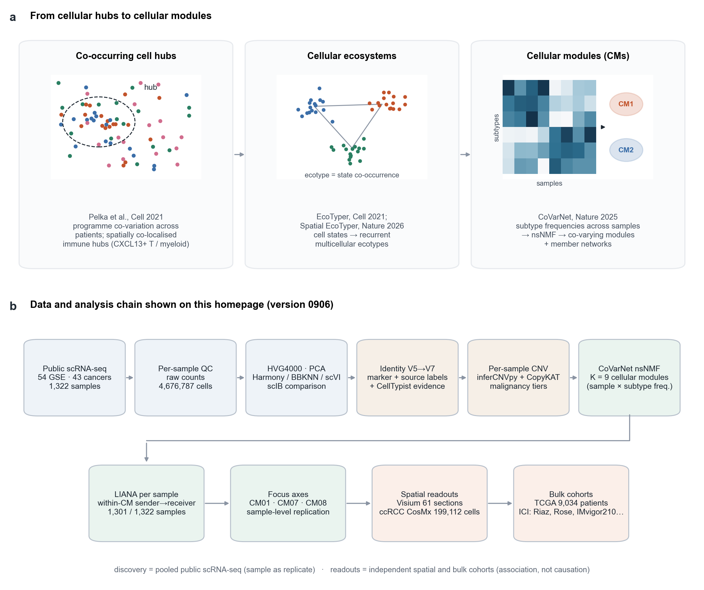
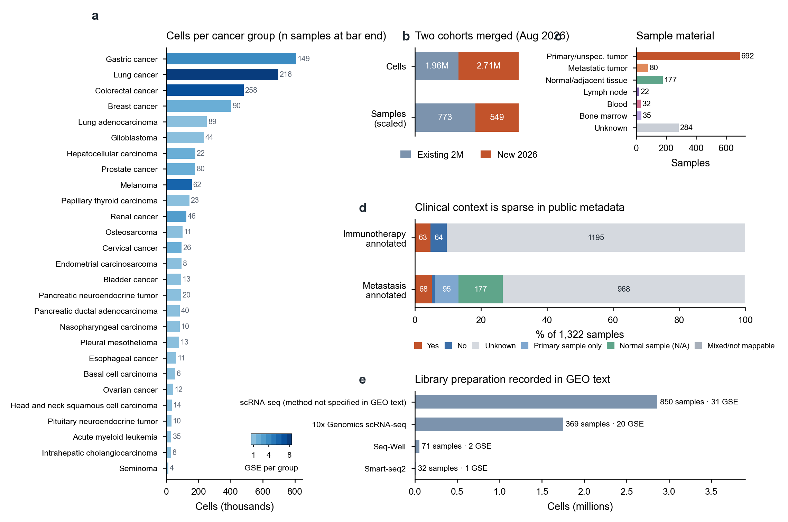
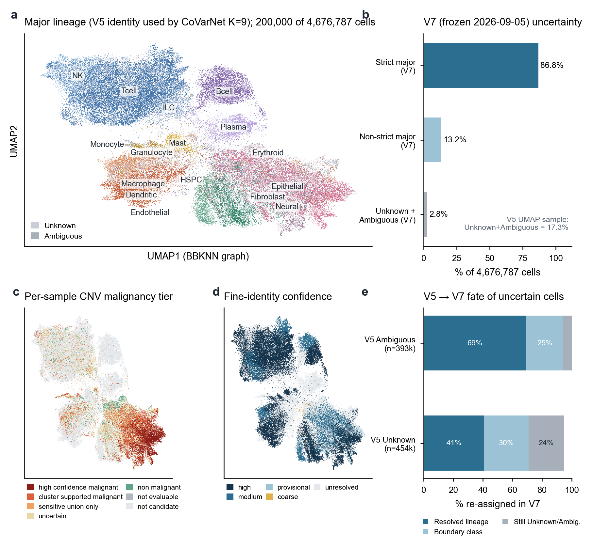
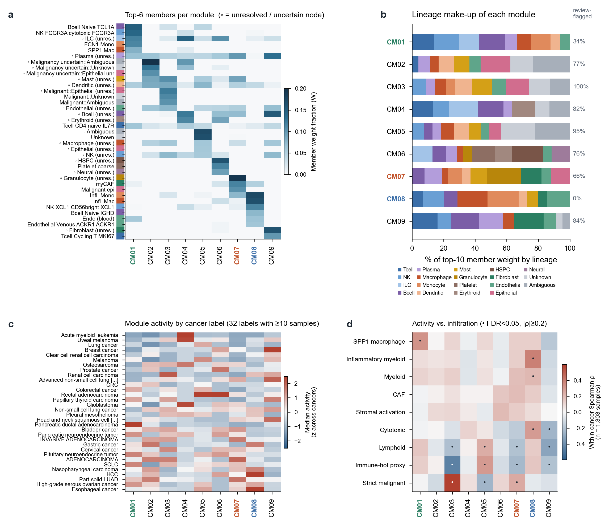
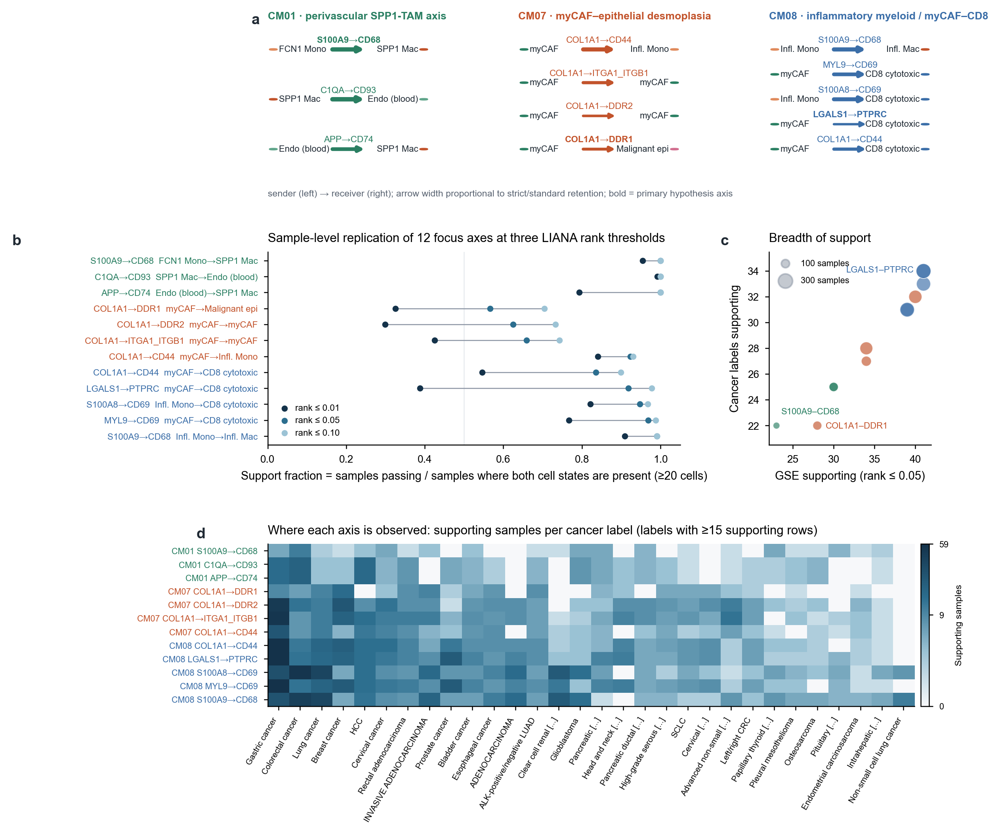
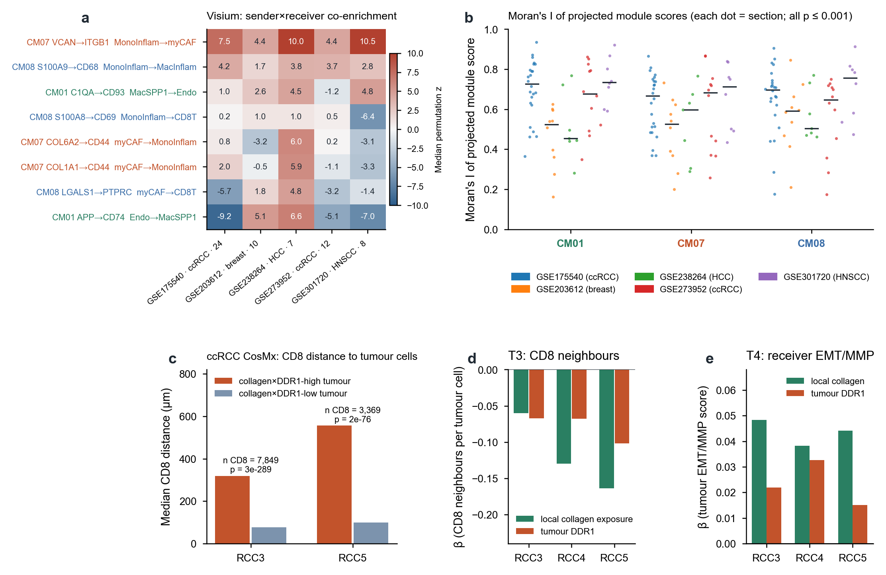
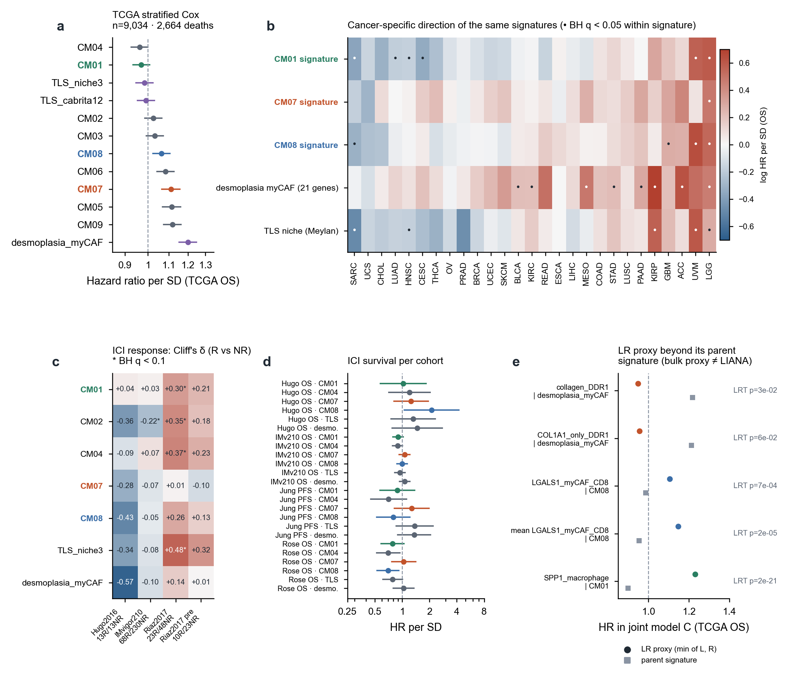

> **2026-11-08 血管空间验证的对照已落实**：[方法、技术检查点与全66比较](inventories/analysis/2026-11-08/v4_vascular_controls_v1/README.md)。状态不作前置；目标/对照EC邻域、共同/单方区域LR及患者级统计已通过合成验证，18作者映射接受。原生矩阵仍待完整接受，尚无新增空间生物学结果；精确CM投射与大类扩展分开。

> **关键组成空间推进**：[CM03大类关系结果](inventories/analysis/2026-11-07/v4_breast_vascular_v1/keymodule_v1/README.md)。14/53张Visium审核通过并新增大类边计算；来源差异明显，不称普遍复现。缺IGHD/XCL1不阻断组成分析；新18份Xenium映射接受、原生矩阵截断后有限恢复中。

# PanCancer

> **研究主线收束为乳腺癌血管相关免疫组成（2026-11-07）**：[空间资源、算法审核与I-SPY2完整结果](inventories/analysis/2026-11-07/v4_breast_vascular_v1/README.md)。状态分析不作前置。新Xenium适合血管/募集轴但缺IGHD/XCL1；I-SPY2 69联合治疗+179对照已核，独立审核18模型、两完整家族均0 BH，原CM03程序缺测保留NA。空间原生获取/身份审核仍待。

> **当前V4的TCGA/ICI与免疫结果已独立审核，成像通讯继续（2026-11-07）**：[完整结果、三图及状态](inventories/analysis/2026-11-07/v4_spatialCellChat_bulk_v1/README.md)。395临床模型、1325免疫检验完成；六ICI完整家族无BH显著，CM03仅见LGG OS探索线索，不能称泛癌/ICI标志物。13成像机会接续，5个Xenium均缺IGHD/XCL1，不作精确亚型复现；原注释/CM不改。

> **当前V4通讯已有全局/响应结果，完整环境比较继续（2026-11-07）**：[完整结果、两张图及运行预计](inventories/analysis/2026-11-07/v4_communication_author_v1/README.md)。正式全局CPDB1,000置换、21个CM—免疫身份响应及CellChat替代算法已完成并独立核验；CM03在作者式响应分支未获q<0.05支持，方向/实测背景分支单列，不混为原文阳性。空间6/53完整通过、niche53/53通过；25组比较3组High已审核，正在CM04 High，通讯剩余规划18–30小时，尚无完整通讯/空间机制结论。

> **V4空间实测进度与原文通讯已启动（2026-11-07）**：[状态、预计与完整计划](inventories/analysis/2026-11-07/v4_communication_author_v1/README.md)。53张CellCharter逐张审核全通过；空间去卷积4/53完整模型/原文打分/独立审核通过、另2张运行，实测80–87分钟/张，两并行剩余规划35–50小时。当前V4通讯CPU流程已从同560,871细胞启动准备：全局CPDB→25CMT比较、CellChat及细胞因子响应；还没有完整通讯或空间支持结论。

> **当前V4全部CM的Visium检验生产中（2026-11-07，尚无最终结论）**：[输入、运行状态、留出诊断与方法](inventories/analysis/2026-11-07/v4_Visium_author_validation_v1/README.md)。3来源53张合格人类切片；同50标签参考已完成250轮回归/1,000后验并独立核验，前两张切片正在GPU拟合。全部14CM将完整比较原文共定位/60近邻有向Moran，并接独立表达—空间CellCharter niche。XCL1 NK留出重放F1约0.64–0.67，仍有近邻身份混淆；不能把运行中或同标签诊断称空间验证成功。

> **全部V4 CM比较与选择（2026-11-07）**：[14模块完整取舍、来源/分母及重拟合证据](inventories/analysis/2026-11-07/v4_CM_selection_v1/README.md)。新增540次受控nsNMF、252因子对应独立核验；优先验证CM03（IGHD B—PECAM1内皮—XCL1 NK），CM06备选。CM09的SPP1因子换种子不稳，CM11受组织/单节点分母影响；当前没有模块完成独立空间与机制验证。

> **当前V4注释的CoVarNet原文CM发现（2026-11-06）**：[全部14因子、完整成员与15张图](inventories/analysis/2026-11-06/v7_selective_CoVarNet_author_v1/README.md)。13来源、164样本、560,871非上皮细胞、45节点；K2–20各30次，原文CCC规则选K14，独立核验通过。11个非空网络中10个含跨父类边；3个因子有近零W成员，部分成员重复，不能称14个独立有效生态系统。来源范围敏感性选K19，稳健性与空间验证待推进。

> **V7保留既有亚型的注释修正（2026-11-06）**：[全部50个标签及恢复审计](inventories/analysis/2026-11-06/v7_selective_subtype_restore_v4/README.md)。2,843,051细胞沿用原亚型/分类名，只有1,218,888个未完成细分或已有父类纠错记录用大类＋marker；共4,061,939细胞。上一版20名称保留为大类诊断，不再作为完整注释展示。

> **V7 B-unresolved与完整当前注释（2026-11-06）**：[16群与6张marker图](inventories/analysis/2026-11-06/v7_B_unresolved_review_v1/README.md) · [全部106冻结／142当前标签值](inventories/analysis/2026-11-06/v7_B_unresolved_review_v1/CURRENT_ALL_ANNOTATIONS.md) · [Excel](inventories/analysis/2026-11-06/v7_B_unresolved_review_v1/V7_current_annotation_20261106.xlsx)。B的157,888目标独立审计通过，101,299大类工作／56,589身份复查；全V7 4,676,787行完整保留，423,375个目标本周期重建，其余明确继承。QC-v4为8,237排除／238暂存／4,668,312保留；导出完整不代表全V7细分终验。

> **V7其他unresolved实查（2026-11-06）**：[红系、血小板、HSPC、ILC的59群完整工作表与16张marker图](inventories/analysis/2026-11-06/v7_other_unresolved_review_v1/README.md)。实际清理后70,778细胞重建，发现父类误标与共享程序；27,074大类工作记录、43,704身份待复查。QC-v3累计2,916排除／238暂存／4,673,633保留；冻结V7不改，最终细分未接受。

> **组织上皮面板扩展（2026-11-05）**：[完整32项基因与文献表](resources/annotation/v7_epithelial_extension_v1/ALL_PANELS.md) · [原始121条基因记录的逐项处置](resources/annotation/v7_epithelial_extension_v1/ORIGINAL_GENE_REVIEW.md) · [保留Lodi模块的185项TME兼容版](resources/annotation/v7_epithelial_extension_v1/TME_V2_COMPATIBILITY.md)。原文件实际26组，拆分后新增25、复用7；V7扩展对照版137模块。11项检查通过，全V7细胞重新注释尚未完成。

> **V7 panel修复（2026-11-05）**：[完整112项基因表与162项旧规则迁移](resources/annotation/v7_panel_repair_v1/README.md) · [Excel](resources/annotation/v7_panel_repair_v1/V7_panel_repair_v1.xlsx) · [文献与算法说明](methods/V7-panel-repair-literature-workflow-20261105.md)。新版规则和验证已交付，全V7逐细胞重新注释仍待完成。

> **当前研究工作总览**：[当前研究进展、正在推进的分析与下一阶段任务](docs/homepage/07_current_work.md)（2026-11-05）。按研究依赖阅读任务、数据/UMAP/CM/空间与临床图件、验证边界及下一步；下文保留历史0906研究叙事。

> **服务器分析最新审计（2026-11-05）**：[系统总览、版本/证据与交接](docs/reports/20261105_server_analysis_audit/README.md)。本首页展示历史0906版本；V7重算、扩展72来源TME、空间验证限制和NMF稳定性请以上述新报告为准。

**肿瘤微环境中的细胞模块：一个泛癌单细胞图谱的组织、处理与初步读出**

[上一版首页（2026-10-26，CM02免疫图谱主线）](README_20261026_CM02.md) · [English](README.en.md) · [Previous English version (2026-10-26)](README_20261026_CM02.en.md)

[引言](#1-引言从细胞互作枢纽到细胞模块) · [问题](#2-本项目提出的两个问题) · [数据](#3-数据的组织) · [处理与注释](#4-整合处理与0906注释) · [CM图谱](#5-k9细胞模块图谱) · [CM01/07/08通讯](#6-cm01cm07cm08的细胞通讯轴) · [空间](#7-空间数据中的读出) · [TCGA与免疫治疗](#8-bulk队列与免疫治疗队列中的读出) · [开放问题与分页](#9-开放问题与六个延伸分页) · [复现](#10-资源复现与版本边界)

---

## 摘要

肿瘤微环境（TME）中的细胞并不是独立出现的：特定的免疫、髓系、基质和肿瘤细胞状态会在患者之间共同增减，并在组织中形成局部的生态位（niche）。已有研究分别从**空间共定位的免疫枢纽（hub）**、**细胞状态生态型（ecotype）**和**跨样本共变的细胞模块（cellular module，CM）**三个角度描述了这种组织方式。本项目以CM为主要对象，提出两个问题：CM是否与肿瘤发生发展和治疗反应相关联；CM内部的肿瘤—免疫—髓系—基质通讯是否与免疫浸润的格局相关。

为此我们整理了54个公共scRNA-seq数据集（43个癌种标签、1,322个样本、4,676,787个细胞），完成逐样本质控、整合、分层注释和逐样本CNV恶性判定，用CoVarNet在样本×亚群频率上识别出9个CM（K=9），并在CM内部逐样本运行LIANA。本页展示2026-09-06版本（下称“0906版本”）的处理流程与结果：其中**CM01（FCN1单核—SPP1巨噬—内皮）、CM07（myCAF—恶性上皮）和CM08（炎性单核/巨噬—myCAF—CD8 T）**三组模块在单细胞通讯层面有较广的样本支持，随后在Visium/CosMx空间数据以及TCGA和免疫治疗bulk队列中做了读出。本页侧重如实展示数据、方法和数值，各读出的适用范围与未解决的问题在正文和六个分页中逐项说明。

**图1｜研究背景与本页分析链。** **a**，三类描述多细胞组织的框架：Pelka等在结直肠癌中识别的空间组织化免疫枢纽；EcoTyper/Spatial EcoTyper定义的细胞状态生态型；CoVarNet在样本×亚群频率矩阵上用nsNMF得到的共变细胞模块及成员网络。示意图为说明用途，不含真实数据。**b**，本页展示的0906版本数据与分析链。上排为发现阶段（公共scRNA-seq汇总，以样本为重复单位）；下排为在CM内部做的通讯分析，以及在独立空间和bulk队列中的读出。下排各步得到的是关联性读出，不构成因果或通讯发生的证明。

---

## 1 引言：从细胞互作枢纽到细胞模块

**生态位与互作枢纽。** 肿瘤中的细胞状态受到邻近细胞的约束：趋化因子梯度、细胞外基质、血管和抗原呈递细胞共同决定T细胞能否进入、停留并维持功能。Pelka等（Cell 2021）在结直肠癌中按患者内各细胞类型的表达程序分布建立了跨细胞类型的协同网络，并在空间上看到CXCL13⁺ T细胞、髓系细胞和恶性细胞程序组成的**免疫枢纽**，且这些枢纽在错配修复缺陷肿瘤中更为突出。这类工作说明，有意义的单位可能不是单一细胞类型，而是**一组在同一患者、同一组织区域中共同出现并相互作用的细胞状态**。

**生态型。** EcoTyper（Luca等，Cell 2021）在泛癌bulk与单细胞数据中先恢复各细胞类型的状态，再按状态的共现组织为多细胞生态型，并将其与组织病理和预后联系；Spatial EcoTyper（Nature 2026）把真实空间邻域纳入发现过程。这条路线的对象是“状态的共现”。

**细胞模块。** CoVarNet（Nature 2025）换了一个更直接的输入：把每个样本中各细胞亚群在其父谱系中的比例组成样本×亚群矩阵，用非平滑非负矩阵分解（nsNMF）得到若干个**细胞模块（CM）**。每个CM有一组载荷最高的成员亚群（top-N members）和每个样本的活动度；成员之间再按跨样本相关构建网络。原文在健康组织—癌旁—肿瘤之间比较CM的重塑，并把模块与协同表达程序及独立病变结局连接起来。

**算法要点。** CoVarNet的流程可以概括为：频率矩阵（按父谱系归一，缺失记0，按亚群min–max缩放）→ 多次初始化的nsNMF，rank由共表型相关（cophenetic）曲线启发式选择 → W给出成员载荷，H给出样本活动 → top-N成员间计算相关网络。这一流程的输入语义（组成比例，而不是表达）和缩放方式决定了CM能回答什么问题，也是[分页4](docs/homepage/04_covarnet_nsnmf_limits.md)讨论的出发点。

## 2 本项目提出的两个问题

**问题一：CM是否在肿瘤的发生发展中有重要作用？** 具体地，是否存在在免疫治疗数据集中升高、或与良好/不良预后相关联的CM；这种关联在不同癌种中方向是否一致。

**问题二：TME中CM内部的通讯是否与免疫浸润相关？** 例如肿瘤与免疫、髓系与基质之间的配体—受体通讯，是否与T细胞浸润或排斥的空间格局相一致；哪些通讯轴在控制所属CM后仍携带额外信息。

围绕这两个问题，我们组织了三类数据：泛癌scRNA-seq发现数据（含免疫治疗和非富集的肿瘤TME数据）、空间转录组数据（Visium与CosMx），以及带临床终点的bulk队列（TCGA与免疫检查点抑制剂ICI队列）。

## 3 数据的组织

0906版本的发现数据由两批合并而成：7月完成整合的已有队列（31个GSE、773个样本、1,963,745个细胞），以及8月新下载并独立质控的队列（23个可用GSE、549个样本、2,713,042个细胞）。合并后为54个GSE、43个癌种标签、1,322个样本、4,676,787个细胞，基因取两批交集共10,432个。

**图2｜0906版本发现数据的组成。** **a**，按癌种分组的细胞数，条末数字为样本数，颜色深浅为该组包含的GSE数；胃癌、肺癌、结直肠癌和乳腺癌贡献了最多的细胞，多数癌种只来自1–2个GSE。**b**，两批队列的细胞与样本构成。**c**，样本材料类型：692个为原发或未注明的肿瘤，80个为转移灶，177个为正常/癌旁组织，另有血液、骨髓和淋巴结；284个样本的材料类型无法从公开元数据确定。**d**，公开元数据中可读取的临床背景：只有127个样本（9.6%）能判断是否接受免疫治疗，968个样本无法判断是否为转移灶。**e**，GEO文本记录的建库方式，850个样本的方法未写明。数据来自2026-08-29元数据审计的汇总表。

图2d提示了一个贯穿后续分析的限制：发现数据本身很少带有治疗和结局信息，因此问题一的临床读出主要依赖外部bulk队列。数据集的选取原则、各时间段数据集的构成与作用，以及后来补充的免疫专用图谱和非富集TME范围，见[分页1：数据集的选取和处理](docs/homepage/01_datasets.md)。

## 4 整合处理与0906注释

**质控与整合。** 新队列逐样本自适应质控（strict/floor两档阈值）并用Scrublet去除双细胞，3,282,991个细胞保留2,713,042个（82.6%）；一个GSE因`.X`为log1p值而非原始计数被拦截。合并后以`gse_id`为批次，选4,000个高变基因（seurat_v3）、取50个主成分，比较了Harmony、BBKNN和scVI三种整合。scIB综合分（0.4×批次+0.6×生物学）分别为BBKNN 0.4917、scVI 0.4862、Harmony 0.4807，差距很小，批次权重约0.317时排名互换；下游采用BBKNN图作为谱系重聚类和可视化的基座。

**注释。** 大类由三类证据仲裁：数据集作者提供的逐细胞标签、按全转录组文库大小计算的marker分数，以及CellTypist（仅在适用范围内作为支持）；允许Unknown、Ambiguous和谱系边界类。谱系内再做Leiden重聚类与扩展marker面板，得到细分身份；恶性判定在每个原始样本内由raw counts重建candidate/reference后运行inferCNVpy和CopyKAT，分层给出证据等级。CoVarNet K=9和LIANA使用的是`final_annotation_v6_identity_v5_malignancy_v3`（下称V5身份）；2026-09-05冻结的V7在同一细胞索引上修正了不确定性逻辑并重跑CNV，自2026-09-06起作为项目注释参考。

**图3｜0906版本图谱的嵌入与注释状态。** **a**，200,000个均匀抽样细胞在BBKNN图UMAP上的大类分布（V5身份，即CoVarNet输入）；T/NK、B/浆细胞、髓系、基质/内皮与上皮/神经分区清楚，Unknown与Ambiguous分散在各区之间。**b**，V7冻结后的大类不确定性：严格大类可用86.76%，边界/待定等非严格13.24%，确切Unknown+Ambiguous为2.78%；同一抽样中V5的Unknown+Ambiguous为17.3%。**c**，逐样本CNV恶性证据等级，高置信与cluster支持的恶性细胞集中在上皮区。**d**，细分身份置信度：约47%的抽样细胞细分身份为unresolved，主要位于上皮、B/浆细胞和部分髓系区域。**e**，V5中的Unknown与Ambiguous细胞在V7中的去向：V5 Ambiguous中69%获得确定谱系、25%归入边界类；V5 Unknown中41%获得确定谱系、30%归入边界类、24%仍未定。

图3说明0906版本的CM建立在一套仍有相当比例未定节点的身份上，这会直接进入CM成员（见图4b）。0906注释的分层逻辑、V7的修正，以及其后V8/V9、cluster优先注释和scVI工作图谱的调整，见[分页3：0906的注释逻辑与后续调整](docs/homepage/03_annotation_logic.md)。

## 5 K=9细胞模块图谱

CoVarNet以样本为单位、在4,675,461个细胞和1,303个样本上运行（`--min-cells 100 --normalize minmax --k 9 --final-nrun 30`），得到9个CM。每个CM的成员与活动见图4。

**图4｜K=9 CM的组成、癌种活动与免疫浸润相关性。** **a**，各CM载荷前6的成员亚群及其在9个CM中的载荷（W按CM内归一）；左侧色条为谱系，◦标记unresolved/uncertain节点。**b**，各CM前10成员载荷按谱系的构成，右侧百分比为其中被标记为需复核的节点所占权重。CM01由B、NK、ILC、单核、SPP1巨噬和内皮组成（34%需复核）；CM07由粒细胞（未细分）、myCAF、恶性上皮、浆细胞和肥大细胞等组成（66%需复核）；CM08由炎性单核、炎性巨噬、NK、CD8细胞毒T、内皮和myCAF组成，前10成员均为已命名细分状态。CM02、CM03、CM05的前10成员主要是恶性证据分层节点和unresolved节点。**c**，样本数≥10的32个癌种标签中，各CM样本活动中位数（按CM在癌种间z标准化）。**d**，在癌种内计算的CM活动与浸润特征的Spearman相关（n=1,303样本），圆点表示FDR<0.05且|ρ|≥0.2：CM01与SPP1巨噬比例（ρ=0.32），CM08与炎性髓系（ρ=0.39）和细胞毒性细胞比例（ρ=0.30），CM07与严格恶性比例（ρ=0.25）正相关、与免疫热度代理（ρ=−0.24）负相关；CM03与严格恶性比例（ρ=0.70）正相关、与免疫热度（ρ=−0.45）负相关。

**CM01、CM07、CM08的来历。** 这三个编号是0825版CoVarNet K=9（V5身份）的编号。它们与更早一轮（0824）CM的对应关系由“样本活动相关×0.65 + 前10谱系组成余弦×0.35”评分：旧CM09→CM01（0.76）、旧CM03→CM07（0.86）、旧CM06→CM08（0.84）。三者分别对应8月提出的三条机制假设——myCAF→恶性上皮（COL1A1–DDR1）、myCAF→T/髓系、FCN1单核→SPP1巨噬→T/NK——因此被选作重点；当前K=9中另有CM03（严格恶性比例高、免疫热度低，前10成员无myCAF）等模块未进入这条链。CoVarNet流程本身的局限（min–max缩放、rank启发式、组成闭合等）以及改进方向见[分页4](docs/homepage/04_covarnet_nsnmf_limits.md)。

## 6 CM01、CM07、CM08的细胞通讯轴

**方法。** 在1,322个原始样本中逐样本运行`liana.mt.rank_aggregate`（consensus资源，样本内normalize_total+log1p，每组≥20个细胞，`expr_prop=0.10`），1,301个样本成功。只保留发送者与接收者同属某一CM前10成员的互作，共约1,121万行；以magnitude与specificity rank均≤0.05筛出约38.2万个事件，汇总为29,605条共识互作。在此基础上为CM01、CM07、CM08选出12条重点轴，按“两种细胞状态都在样本中出现（各≥20细胞）”定义可检验分母，在三档阈值下统计样本支持。

**图5｜12条重点通讯轴的样本级复现。** **a**，三组CM中的发送者→接收者关系，加粗为预设主假设轴，箭头粗细与严格/标准阈值保留比例成正比。**b**，在rank≤0.01、0.05、0.10三档阈值下的支持比例。CM01三条轴的支持比例为0.79–1.00：S100A9→CD68（FCN1单核→SPP1巨噬）在66个可检验样本中全部支持，C1QA→CD93（SPP1巨噬→内皮）在121个中全部支持。CM07的COL1A1→DDR1（myCAF→恶性上皮）在203个可检验样本中有115个支持（0.57），严格阈值下仅剩57%；CM08的LGALS1→PTPRC（myCAF→CD8 T）支持比例0.92，严格阈值下保留42%。**c**，支持的GSE数与癌种数，点大小为支持样本数；COL1A1→DDR1覆盖28个GSE、22个癌种标签，最大单一GSE占12%。**d**，各轴在不同癌种标签中的支持样本数。

单细胞层面的读出只说明“这些配体和受体在对应细胞状态中同时高表达、且具有细胞类型特异性”，并区分不了通讯是否实际发生。S100A8/A9→CD68这类轴在几乎所有含髓系细胞的样本中都出现，更接近细胞丰度的反映；COL1A1→DDR1在LIANA consensus资源中只有COL1A1一种胶原配体与DDR1配对。LIANA结果与CM成员定义之间的循环依赖、阈值敏感性和背景轴问题，见[分页2：LIANA通讯与CM模块的联系及潜在问题](docs/homepage/02_liana_cm_communication.md)。

## 7 空间数据中的读出

**Visium。** 5个数据集61张切片（ccRCC两套、乳腺癌、肝癌、头颈鳞癌）。把CM打分投影到每个spot并计算Moran's I；对每条通讯轴，在邻域内比较“配体×发送状态活动”与“受体×接收状态活动”的共富集，并用标签置换得到z值。**CosMx。** 3例ccRCC组织、199,112个细胞、978个基因：以胶原高表达的成纤维细胞为来源、肿瘤区室上皮性细胞为DDR1受体端，用k=12邻居和999次置换检验邻接（T1）、CD8邻居数模型（T3）、CD8与“胶原×DDR1高/低”肿瘤细胞的距离（T3b）和受体端EMT/MMP程序（T4）。

**图6｜Visium与CosMx中的空间读出。** **a**，Visium各数据集内通讯轴的中位置换z值（列标为GSE·癌种·切片数）。VCAN→ITGB1（CM07，单核↔myCAF）在5个数据集中z均>0（4.4–10.5），S100A9→CD68（CM08）5/5为正；C1QA→CD93（CM01）4/5为正；LGALS1→PTPRC（CM08）与COL1A1→CD44（CM07）方向在数据集间不一致；APP→CD74（CM01）在3个数据集为强负值。Visium分析未包含DDR1轴。**b**，CM01/07/08投影打分在每张切片中的Moran's I（共183个切片×CM组合，置换p均≤0.001），中位数约0.63–0.67。**c**，CosMx中CD8 T细胞到“胶原×DDR1高”与“低”肿瘤细胞的中位距离：RCC3为319 μm对77 μm，RCC5为556 μm对100 μm（RCC4整张切片的距离尺度不同，未画出）。**d**，T3模型中局部胶原暴露与肿瘤DDR1的系数在3例组织中均为负（交互项不显著）。**e**，T4模型中两者与肿瘤EMT/MMP程序的系数均为正。

需要同时展示的是：T1邻接检验中DDR1⁺肿瘤细胞的胶原高CAF邻居反而更少，而ccRCC恶性细胞保留近端小管身份，正常近端小管本身DDR1阳性，因此ccRCC并不适合检验肿瘤DDR1轴；CosMx只覆盖了ccRCC。Visium的Moran's I反映的是投影打分的空间平滑性，并未单独检验成员细胞是否相互接触。如何在模块识别后直接到单细胞分辨率空间数据中检验成员共定位、再在接触对上发掘通讯，见[分页5](docs/homepage/05_spatial_first_validation.md)。

## 8 bulk队列与免疫治疗队列中的读出

**方法。** TCGA使用toil RSEM TPM与Liu 2018整理的生存数据，9,034例原发肿瘤（27个癌种）。每个CM取成员亚群的标志基因构建打分（癌种内z标准化后取均值），另加21基因的desmoplasia_myCAF和两套TLS打分作为参照；分层Cox以癌种为层并校正年龄，HR按每1个标准差计。ICI队列包括Riaz2017（黑色素瘤，nivolumab）、Hugo2016（黑色素瘤，pembrolizumab）、IMvigor210（尿路上皮，atezolizumab）、Rose2021（尿路上皮）和Jung2019（NSCLC）；应答以Mann–Whitney与Cliff's δ比较（CR/PR对PD），生存用Cox。通讯轴的bulk代理以配体与受体基因z分的较小值定义，比较“仅所属CM/父签名”（模型A）与“父签名+代理”（模型C）。

**图7｜TCGA与ICI队列中的读出。** **a**，TCGA泛癌分层Cox的OS风险比。CM07打分HR 1.11（95%CI 1.07–1.16），CM08 1.06（1.02–1.11），CM01 0.97（0.93–1.01）；参照的desmoplasia_myCAF为1.20（1.15–1.25）。**b**，同一批打分在各癌种中的方向（圆点为签名内BH q<0.05）。CM01在SARC、CESC、HNSC、LUAD中HR<1，而在LGG（1.82）和UVM（1.77）中HR>1；CM08在SARC中<1，在LGG、UVM、GBM中>1。**c**，ICI应答的Cliff's δ（星号为BH q<0.1）：Riaz2017全样本中CM01为+0.30（应答者更高，q=0.087）；在仅治疗前样本、Hugo2016和IMvigor210中，CM01、CM07、CM08均未见应答差异。**d**，ICI生存：Rose2021中CM08 HR 0.70（0.53–0.92，q=0.069）；同为尿路上皮的IMvigor210中CM08 HR 1.00；Hugo2016（n=25）中CM08 HR 2.11。**e**，通讯代理相对父签名的增量（TCGA OS，模型C）：SPP1巨噬代理（CM01）HR 1.23，加入后CM01签名转为0.90，似然比检验p≈2×10⁻²¹；LGALS1 myCAF→CD8代理（CM08）HR 1.10–1.15，CM08签名在模型C中接近1；collagen–DDR1与COL1A1–DDR1代理与desmoplasia签名共线，加入后方向翻转、LRT p为0.03和0.06。

这些读出对应问题一的不同侧面，并不指向单一结论：CM签名在泛癌合并时效应很小，而在癌种之间方向相反；在免疫治疗队列中，只有个别队列出现名义或FDR边界水平的差异，且未在同癌种的第二个队列中重复。bulk代理同时反映配体和受体所在细胞的丰度，不能重建发送者与接收者。

## 9 开放问题与六个延伸分页

0906版本把“CM → 通讯 → 空间 → 临床”这条链完整走了一遍，同时暴露了每一环的边界。以下六个分页分别展开：

| 分页 | 内容 | 对应主线中的环节 |
|---|---|---|
| [1 数据集的选取和处理](docs/homepage/01_datasets.md) | 各时间段数据集（7月发现集→8月5M合并→10月免疫图谱、全背景档案与合格TME范围）的构成、癌种覆盖与各自承担的问题；富集与非富集材料的区分 | 第3节 |
| [2 LIANA通讯与CM模块](docs/homepage/02_liana_cm_communication.md) | within-CM过滤如何把成员定义带入通讯；阈值敏感性、丰度驱动的背景轴、资源覆盖缺口；bulk代理的含义 | 第6、8节 |
| [3 0906注释逻辑与后续调整](docs/homepage/03_annotation_logic.md) | V5→V7的不确定性修正和逐样本CNV；V8谱系分类学、V9候选；10月的cluster优先注释与scVI工作图谱 | 第4节 |
| [4 CoVarNet中nsNMF的局限与改进](docs/homepage/04_covarnet_nsnmf_limits.md) | min–max缩放与稀有节点、组成闭合、rank启发式和种子/来源稳定性；cNMF与状态模块等替代方向 | 第5节 |
| [5 模块识别后直接在空间数据中验证并发掘通讯](docs/homepage/05_spatial_first_validation.md) | 把空间放到通讯之前：先检验成员共定位与局部模块活动，再在接触对上做LR与受体端响应 | 第7节 |
| [6 CM发掘的改进](docs/homepage/06_cm_discovery_improvements.md) | 去除/加入肿瘤与上皮节点的模块识别对比；在免疫数据集中加入细胞状态层；10月新范围的初步结果 | 全文 |

## 10 资源、复现与版本边界

**版本边界。** 本页图4–图7均来自V5身份上的CoVarNet K=9/LIANA分支（2026-08-25运行，2026-09-06汇总为[通讯证据链发布](releases/communication_evidence_chain_20260906/README.md)）；该分支没有在V7上重算。V7（[注释发布](releases/annotation_v7_20260905/README.md)）是0906之后的身份与恶性参考。2026年10月的泛癌CM（v20261010）、2026-10-14免疫图谱CM和2026-10-30新TME CM是独立的发现版本，编号不与本页的CM01/07/08对应；免疫图谱CM02主线见[上一版首页](README_20261026_CM02.md)。

**图与数据。**

- 成图脚本：[scripts/render_homepage_v2_figures.py](scripts/render_homepage_v2_figures.py)；图像及SHA：[assets/publication/20261102/figure_manifest.json](assets/publication/20261102/figure_manifest.json)（每张图同时提供PDF矢量版）
- 图中数值对应的汇总表（样本/癌种/队列级聚合，不含细胞或患者行）：[inventories/publication/2026-11-02/homepage_v2/](inventories/publication/2026-11-02/homepage_v2/)
- 0906通讯证据链完整报告：[COMMUNICATION_EVIDENCE_CHAIN_CN.md](releases/communication_evidence_chain_20260906/reports/COMMUNICATION_EVIDENCE_CHAIN_CN.md)；V7注释逻辑：[V7_REFERENCE_AND_ANNOTATION_LOGIC_CN.md](releases/annotation_v7_20260905/methods/V7_REFERENCE_AND_ANNOTATION_LOGIC_CN.md)
- 项目状态与路线：[STATUS.md](STATUS.md)、[ROADMAP.md](ROADMAP.md)、[运行索引](inventories/runs.tsv)、[数据与公开政策](docs/DATA_POLICY.md)

细胞级对象、原生表达矩阵、患者与样本记录、坐标表和学习权重保留在研究环境中，按逻辑标识和SHA登记。

## 参考文献

1. Pelka K, et al. Spatially organized multicellular immune hubs in human colorectal cancer. *Cell* 184, 4734–4752 (2021). [PMC8772395](https://pmc.ncbi.nlm.nih.gov/articles/PMC8772395/)
2. Luca BA, et al. Atlas of clinically distinct cell states and ecosystems across human solid tumors. *Cell* 184, 5482–5496 (2021). [PMC8526411](https://pmc.ncbi.nlm.nih.gov/articles/PMC8526411/)
3. Spatial EcoTyper. *Nature* (2026). [s41586-026-10452-4](https://www.nature.com/articles/s41586-026-10452-4)
4. CoVarNet: coordinated cellular modules across tissues and cancer. *Nature* (2025). [s41586-025-09053-4](https://www.nature.com/articles/s41586-025-09053-4) · [代码](https://github.com/QiangShiPKU/CoVarNet)
5. Pascual-Montano A, et al. Nonsmooth nonnegative matrix factorization (nsNMF). *IEEE TPAMI* 28, 403–415 (2006).
6. Dimitrov D, et al. LIANA+ provides an all-in-one framework for cell–cell communication inference. *Nat Cell Biol* 26, 1613–1622 (2024).
7. Kotliar D, et al. Identifying gene expression programs of cell-type identity and cellular activity with single-cell RNA-seq (cNMF). *eLife* 8, e43803 (2019).
8. Jerby-Arnon L, Regev A. DIALOGUE maps multicellular programs in tissue from single-cell or spatially resolved transcriptomics data. *Nat Biotechnol* 40, 1467–1477 (2022).

---

首页更新：**2026-11-02**。本页按论文结构展示0906版本的数据、方法与读出；实时执行状态见[STATUS.md](STATUS.md)。
