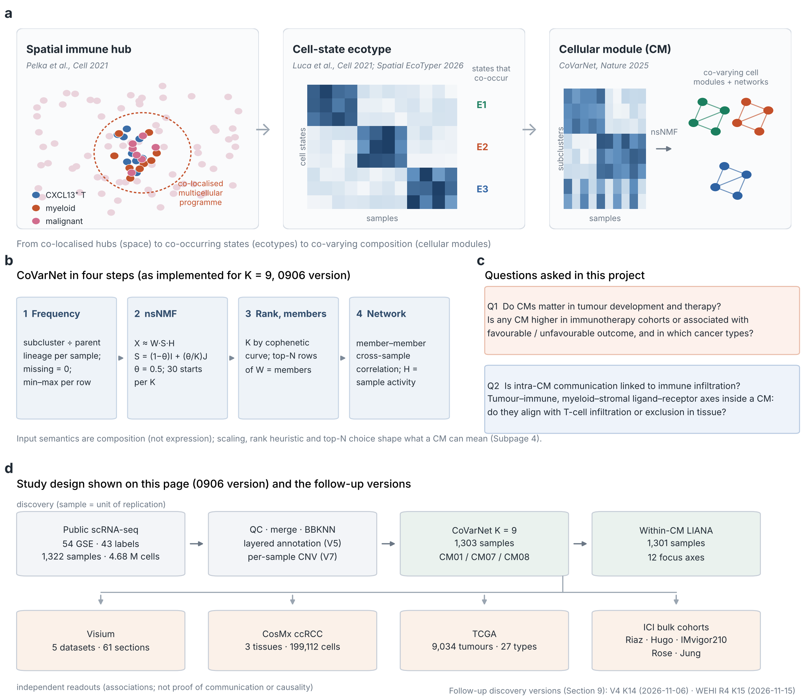
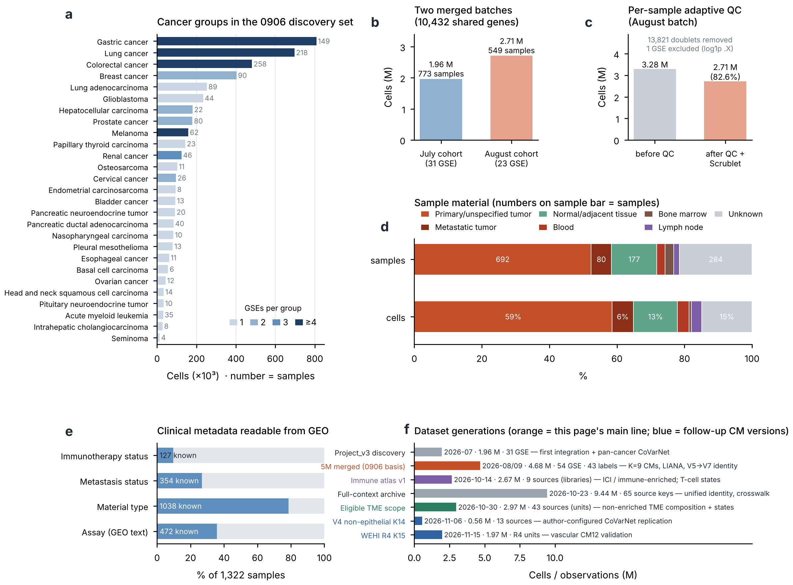
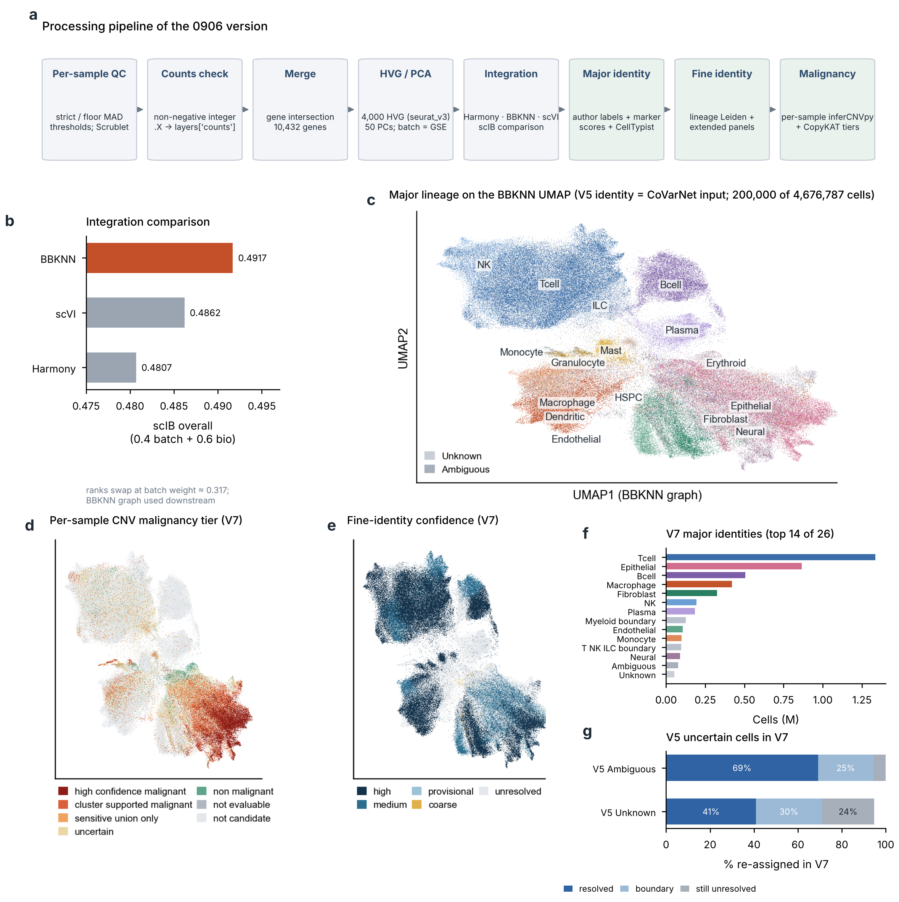
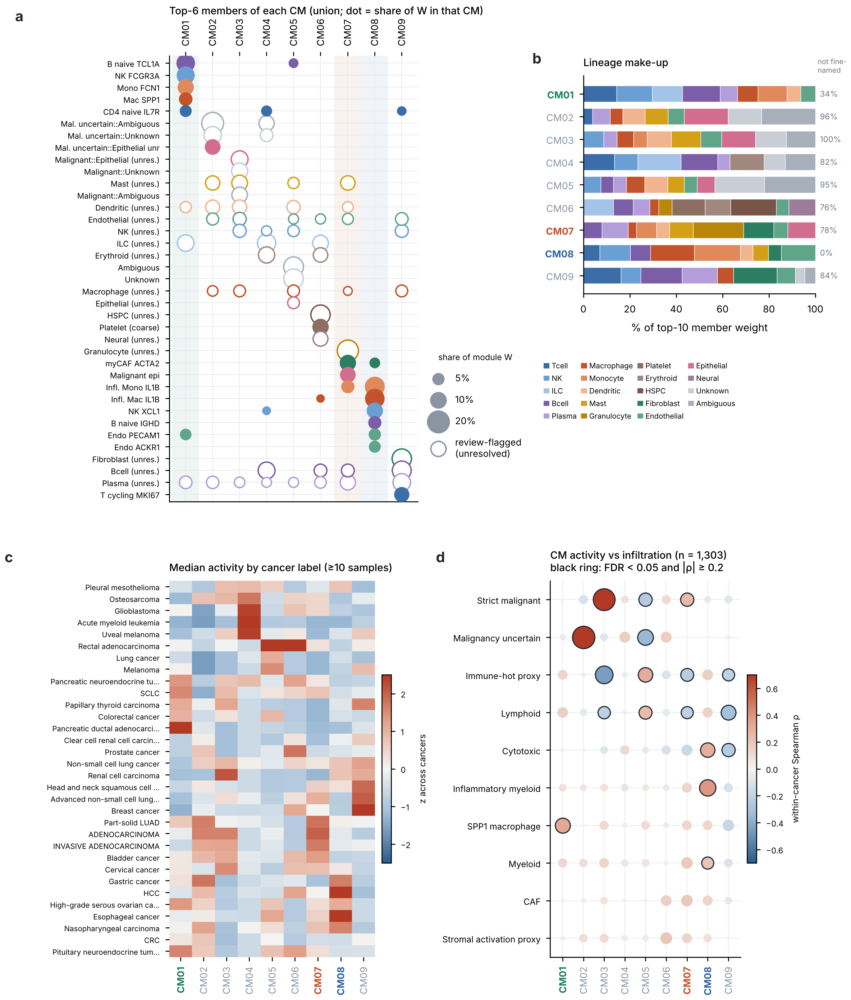
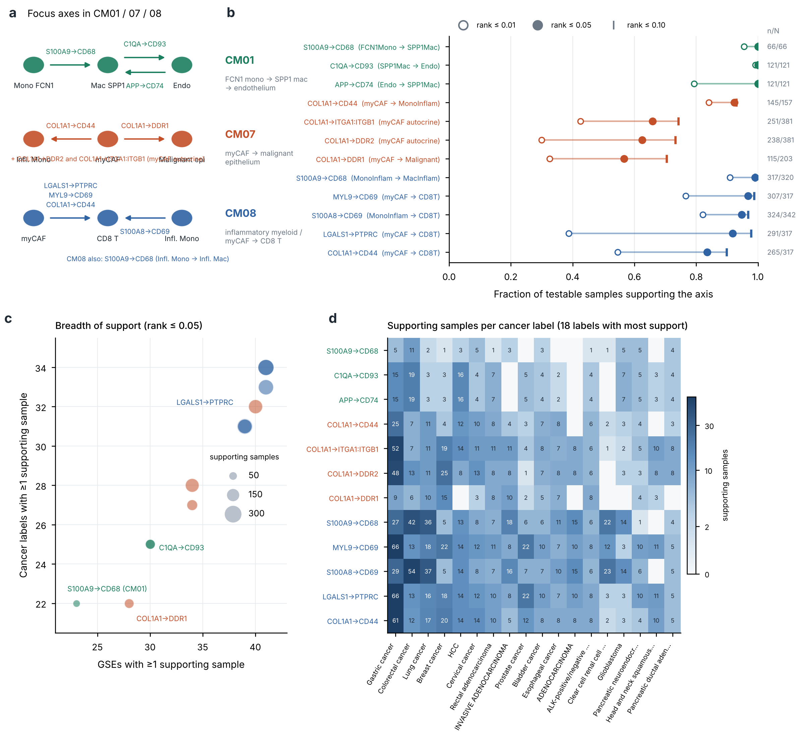
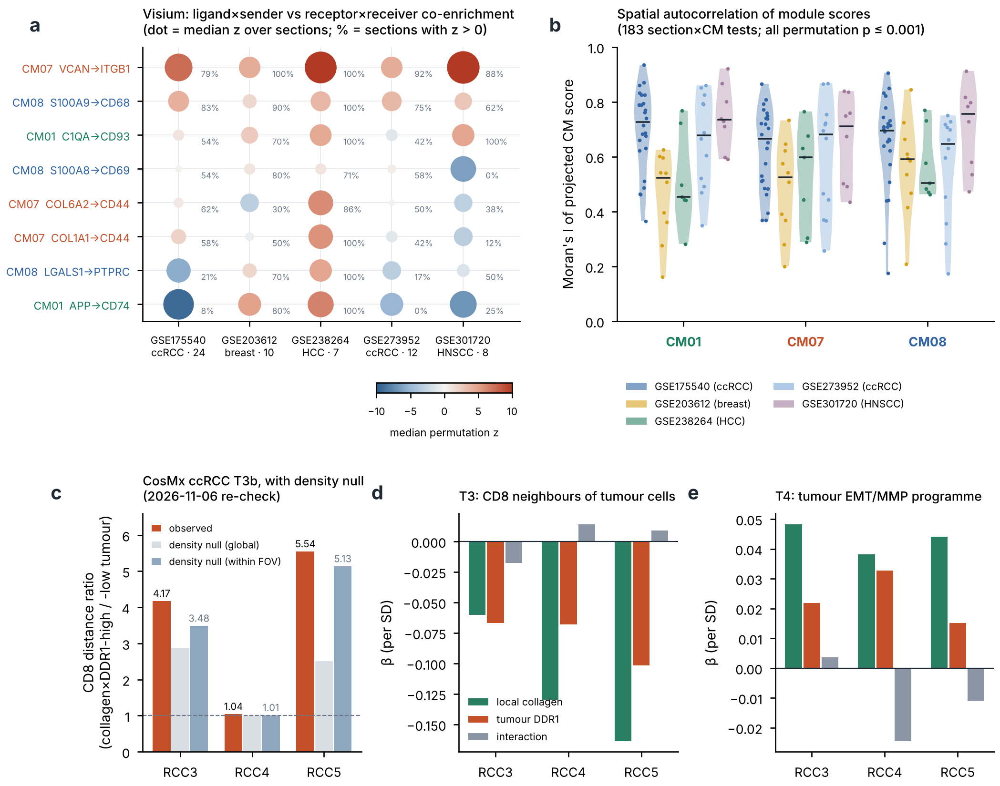
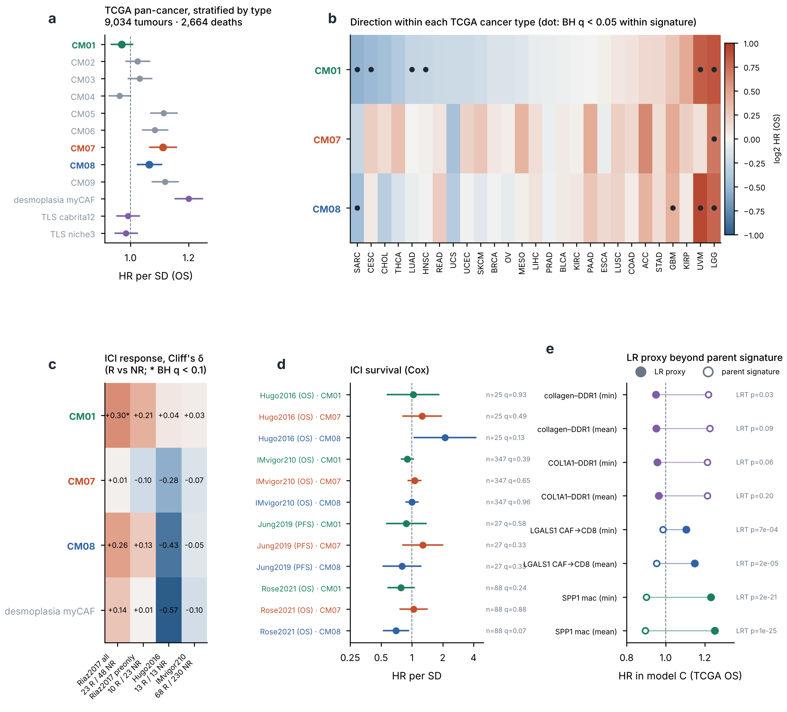
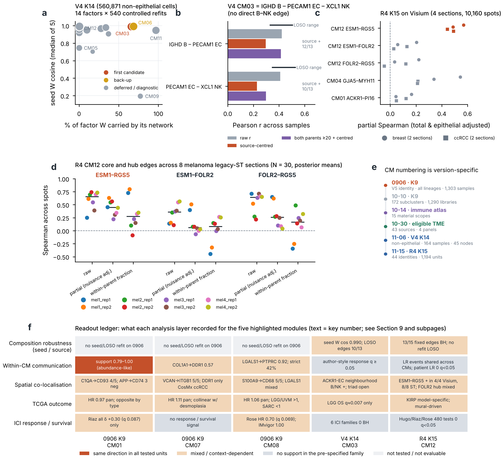

# 肿瘤微环境中的细胞模块：从互作枢纽到可验证的多细胞生态位

**一个泛癌单细胞图谱的数据组织、整合注释、模块发现与空间/临床读出（展示稿）**

[上一版首页（2026-11-02，0906主线与状态通告）](README_20261102_0906.md) · [更早首页（2026-10-26，免疫图谱CM02主线）](README_20261026_CM02.md) · [English (2026-11-02 version)](README.en.md) · [实时状态 STATUS](STATUS.md)

[摘要](#摘要) · [1 引言](#1-引言从互作枢纽到细胞模块) · [2 问题](#2-本项目提出的两个问题) · [3 数据](#3-数据的组织) · [4 处理与注释](#4-整合处理与0906注释) · [5 CM图谱](#5-k9细胞模块图谱与三个重点模块) · [6 通讯](#6-cm内部的细胞通讯) · [7 空间](#7-空间数据中的读出) · [8 临床](#8-tcga与免疫治疗队列中的读出) · [9 后续版本](#9-0906之后同一组问题在新发现版本上的延续) · [10 开放问题与分页](#10-开放问题与六个延伸分页) · [11 资源](#11-资源复现与版本边界)

> **阅读说明。** 本页按论文结构组织，但目的在于**展示**数据、方法、数值和它们各自能回答到哪一步，而不是给出结论。每张图注都写明了数据来源、统计单位和这张图不能说明的东西。版本号很重要：本页主线是**2026-09-06（0906）版本**的K=9模块（CM01/CM07/CM08）；第9节和分页里出现的V4 K14、WEHI R4 K15是之后独立重新发现的版本，**CM编号互不对应**。

---

## 摘要

肿瘤微环境（tumour microenvironment, TME）中的细胞并不是彼此独立地出现。特定的免疫、髓系、基质和肿瘤细胞状态会在患者之间一起增减，并在组织中聚成局部生态位（niche）。已有研究从三个角度描述这种多细胞组织：在组织中直接看到的**空间免疫枢纽（hub）**，由细胞状态共现定义的**生态型（ecotype）**，以及由样本间细胞组成共变定义的**细胞模块（cellular module, CM）**。本项目以CM为对象，提出两个问题：**(Q1)** CM是否与肿瘤的发生发展和免疫治疗相关，例如是否有CM在免疫治疗数据中升高，或与良好/不良预后相关联；**(Q2)** CM内部肿瘤—免疫、髓系—基质之间的通讯，是否与免疫浸润的格局一致。

我们收集并统一处理了54个公共scRNA-seq数据集（43个癌种标签、1,322个样本、4,676,787个细胞），完成逐样本质控、批次整合、分层注释和逐样本CNV恶性判定，再用CoVarNet在样本×亚群频率矩阵上得到9个CM（K=9）。本页展示0906版本：其中**CM01（FCN1单核—SPP1巨噬—内皮）**、**CM07（myCAF—恶性上皮）**和**CM08（炎性单核/巨噬—myCAF—CD8 T）**在CM内部LIANA通讯层面有较广的样本支持，随后分别在Visium（5个数据集、61张切片）、CosMx（3例ccRCC、199,112个细胞）、TCGA（9,034例原发肿瘤）和5个免疫检查点抑制剂（ICI）bulk队列中做了读出。各层读出的方向并不总是一致：例如CM01在泛癌合并时生存风险比接近1，但在不同癌种中方向相反；单细胞层面支持比例很高的轴，在空间中可能方向不一。第9节进一步展示同一组问题在两个后续发现版本（V4 K14，去除上皮；WEHI R4 K15，血管模块）上的读出，第10节和六个分页把每一环的局限与改进方向逐项展开。

**图1｜研究背景、算法和本页的分析链。** **a**，描述多细胞组织的三种框架（示意图，不含真实数据）。左：Pelka等在结直肠癌中看到的空间组织化免疫枢纽——CXCL13⁺ T细胞、髓系细胞和恶性细胞的程序在同一组织区域共同出现；中：EcoTyper把每种细胞类型先拆成状态，再按状态在样本间的共现组织成生态型（E1–E3）；右：CoVarNet直接以“样本×亚群比例”为输入，用非平滑非负矩阵分解（nsNMF）得到共变的细胞模块及其成员网络。三者的输入依次是空间位置、细胞状态、细胞组成。**b**，CoVarNet的四步：(1) 每个样本内各亚群占其父谱系的比例，缺失记0，逐亚群min–max缩放；(2) nsNMF分解 X≈W·S·H，平滑矩阵S把H拉向因子均值，使W更稀疏；(3) 用共表型相关曲线选择K，每个因子载荷最高的top-N亚群为成员；(4) 成员之间按跨样本相关建网络，H给出每个样本的模块活动。**c**，本项目的两个问题。**d**，本页展示的0906版本分析链。上排为发现阶段（统计单位为样本）；下排为独立数据中的读出，它们得到的是关联性结果，不能证明通讯确实发生或存在因果关系。右下角注明第9节使用的两个后续发现版本。

---

## 1 引言：从互作枢纽到细胞模块

**生态位与互作枢纽。** 肿瘤中一个细胞处于什么状态，很大程度上取决于它周围有什么：趋化因子梯度、细胞外基质、血管结构和抗原呈递细胞共同决定T细胞能否进入肿瘤、能否停留并保持功能。Pelka等（Cell 2021）在结直肠癌中，先在每类细胞内部提取表达程序，再寻找跨细胞类型、在患者之间协同变化的程序，得到多细胞协同网络；在空间上，他们看到CXCL13⁺ T细胞、髓系细胞与恶性细胞的程序聚集成**免疫枢纽**，且在错配修复缺陷（MMRd）肿瘤中更突出。这类工作提示：有生物学意义的单位，往往不是一种细胞，而是**一组在同一患者、同一组织区域里同时出现并可能相互作用的细胞状态**。

**生态型。** EcoTyper（Luca等，Cell 2021）在泛癌bulk与单细胞数据中，先为每种细胞类型恢复若干状态，再把在样本间共同出现的状态组合成多细胞生态型，并把生态型与组织病理和预后联系起来；Spatial EcoTyper（Nature 2026）进一步把真实的空间邻域纳入发现过程。这一路线关注的是“**哪些状态一起出现**”。

**细胞模块。** CoVarNet（Nature 2025）换了一个更直接的输入：把每个样本中各细胞亚群在其父谱系中所占的比例排成样本×亚群矩阵，用nsNMF分解得到若干**细胞模块（CM）**。每个CM有一组载荷最高的成员亚群和每个样本的活动度，成员之间再按跨样本相关构建网络。原文比较了健康组织、癌旁和肿瘤之间CM的重塑，并把模块与协同表达程序以及独立病变的结局联系起来。

**本项目关注的算法要点。** CoVarNet的输入语义是**组成比例而非表达量**，这决定了CM本身回答的是“哪些细胞一起变多或变少”。与之配套的几个设计选择会直接塑造得到的模块：逐亚群min–max缩放会放大稀有节点的噪声；同一父谱系内比例之和为1（组成闭合）；K由共表型相关曲线启发式选择；成员由top-N截断决定。这些问题以及cNMF、状态模块等改进方向在[分页4](docs/homepage/v3/04_covarnet_nsnmf_limits.md)中展开。CM是否真的对应一个组织中的生态位，以及模块内部是否真的发生通讯，都需要模块之外的证据——这正是本项目两个问题的出发点。

## 2 本项目提出的两个问题

**问题一（Q1）：CM是否在肿瘤的发生发展中有重要作用？** 具体包括：是否存在在免疫治疗数据集中升高、在应答者与非应答者之间不同、或与良好/不良预后相关联的CM；这种关联在不同癌种中方向是否一致。

**问题二（Q2）：TME中CM内部的通讯是否与免疫浸润相关？** 例如肿瘤与免疫、髓系与基质之间的配体—受体（LR）通讯，是否与T细胞浸润或排斥的空间格局相一致；哪些通讯轴在控制所属CM之后仍携带额外信息。

围绕这两个问题，我们组织了三类数据：**泛癌scRNA-seq发现数据**（包括免疫治疗数据集和非富集的肿瘤TME数据集）、**空间转录组数据**（Visium、CosMx，以及后续版本使用的Xenium和legacy ST），和**带临床终点的bulk队列**（TCGA与ICI队列）。

## 3 数据的组织

0906版本的发现数据由两批合并而成：7月完成统一整合的已有队列（31个GSE、773个样本、1,963,745个细胞），以及8月新下载并独立质控的队列（23个可用GSE、549个样本、2,713,042个细胞）。合并后共54个GSE、43个癌种标签、1,322个样本、4,676,787个细胞；两批取基因交集共10,432个。

**图2｜0906版本发现数据的组成与项目各阶段的数据代际。** **a**，按癌种分组的细胞数；条末数字为样本数，颜色深浅为该组包含的GSE数。胃癌（149个样本）、肺癌（218）和结直肠癌（258）贡献了最多的细胞，而大多数癌种只来自1个GSE——在这些癌种中，“癌种效应”与“研究效应”在统计上无法分开。**b**，两批队列的细胞与样本构成。**c**，8月新队列的逐样本自适应质控：3,282,991个细胞中保留2,713,042个（82.6%），Scrublet去除13,821个双细胞；一个GSE因`.X`中存的是log1p值而不是原始计数被拦截。**d**，样本材料类型：692个为原发或未注明的肿瘤，80个为转移灶，177个为正常/癌旁组织，另有血液、骨髓和淋巴结；284个样本的材料类型无法从公开元数据确定（深色数字为样本数，浅色百分比为细胞占比）。**e**，从GEO元数据中能读出的临床信息：只有127个样本（9.6%）能判断是否接受过免疫治疗，354个能判断是否为转移灶，472个写明了建库方式。**f**，项目各阶段的数据代际（横轴为细胞数或观测数）：橙色为本页主线（0906），紫色为10月免疫图谱，绿色为合格TME范围，蓝色为第9节使用的两个后续发现版本；每行右侧注明来源规模和它在项目中承担的问题。a–e的数值来自2026-08-29元数据审计汇总表。

图2e提示了贯穿全文的一个限制：**发现数据本身几乎不带治疗和结局信息**，所以问题一的临床读出主要依靠外部bulk队列。图2d则说明0906把免疫富集材料（血液、分选细胞）、癌旁组织和肿瘤混在同一个频率矩阵中，而“组成比例”的含义取决于捕获方式。10月以后，数据按用途被拆成非富集肿瘤组织、富集材料、空间数据和临床队列四类分别使用。数据集选取原则、各时间段数据集的构成与作用，见[分页1：数据集的选取和处理](docs/homepage/v3/01_datasets.md)。

## 4 整合处理与0906注释

**质控与整合。** 新队列逐样本使用自适应阈值（476个样本用strict档，73个用floor档），按线粒体比例、总计数和检测基因数过滤，再用Scrublet去双细胞。所有GSE的计数在确认非负且接近整数后复制为`layers['counts']`。合并后以`gse_id`为批次，选4,000个高变基因（seurat_v3）、取50个主成分，比较了Harmony、BBKNN和scVI三种整合方法。scIB综合分（0.4×批次去除 + 0.6×生物学保留）分别为BBKNN 0.4917、scVI 0.4862、Harmony 0.4807，差距很小，批次权重约0.317时排名就会互换；下游采用BBKNN图作为谱系重聚类和可视化的基座。

**注释。** 大类由三类证据仲裁：数据集作者提供的逐细胞标签、按全转录组文库大小计算的marker分数，以及CellTypist（只在其适用范围内作为支持）；允许Unknown、Ambiguous和谱系边界类存在。谱系内部再做Leiden重聚类并结合扩展marker面板，得到细分身份。恶性判定在每个原始样本内由raw counts重建candidate/reference，再分别运行inferCNVpy和CopyKAT，按证据强弱分层。CoVarNet K=9和LIANA使用的是`final_annotation_v6_identity_v5_malignancy_v3`（下称**V5身份**）；2026-09-05冻结的**V7**在同一细胞索引上修正了不确定性逻辑并重跑CNV，自0906起作为项目注释参考。

**图3｜0906版本的处理流程、整合选择、嵌入与注释状态。** **a**，从逐样本质控到恶性判定的八个步骤；绿色为注释相关步骤。**b**，三种整合方法的scIB综合分；三者相差不到0.011，BBKNN作为下游基座的理由是“略高且图结构适合谱系重聚类”，而不是显著更优。**c**，200,000个均匀抽样细胞在BBKNN图UMAP上的大类分布（V5身份，即CoVarNet的输入）：T/NK、B/浆细胞、髓系、基质/内皮与上皮/神经分区清楚，Unknown与Ambiguous散布在各区之间。**d**，V7逐样本CNV恶性证据等级：高置信与cluster支持的恶性细胞集中在上皮区。**e**，V7细分身份置信度：约47%的抽样细胞细分身份为unresolved，主要位于上皮、B/浆细胞和部分髓系区域。**f**，V7全部4,676,787个细胞中数量最多的14个大类；`Myeloid_boundary`、`T_NK_ILC_boundary`等边界类单独计数，不被强行并入某个谱系。**g**，V5中的不确定细胞在V7中的去向：V5 Ambiguous中69%获得确定谱系、25%归入边界类；V5 Unknown中41%获得确定谱系、30%归入边界类、24%仍未定。c–e的UMAP散点复用2026-11-02渲染的栅格（细胞坐标保留在研究服务器上），其余面板由仓库内汇总表重新绘制。

图3的要点是：**0906版本的CM建立在一套仍有相当比例未定节点的身份之上**，这些未定节点会直接进入CM成员（图4a中的空心圆）。0906注释的分层逻辑、V7的修正，以及后来的V8/V9、cluster优先注释、V7 panel修复、选择性保留亚型（V4标签）和十种子共识等调整，见[分页3：0906的注释逻辑与后续调整](docs/homepage/v3/03_annotation_logic.md)。

## 5 K=9细胞模块图谱与三个重点模块

CoVarNet以样本为单位，在4,675,461个细胞、1,303个样本上运行（`--min-cells 100 --normalize minmax --k 9 --final-nrun 30`），得到9个CM。

**图4｜K=9 CM的成员、谱系构成、癌种活动与免疫浸润相关性。** **a**，每个CM载荷前6的成员亚群（取并集）。点的面积为该亚群在对应CM中所占的W份额，颜色为谱系；空心圆为需要复核的unresolved/不确定节点。三列浅色背景分别标出CM01（绿）、CM07（橙）、CM08（蓝）。CM01以naive B（TCL1A）、FCGR3A NK、FCN1单核和SPP1巨噬为主；CM07载荷最高的是一个未细分的粒细胞节点（19.4%），其次才是myCAF、恶性上皮和炎性单核；CM08由炎性单核和炎性巨噬（IL1B）领衔，并包含XCL1 NK、IGHD naive B、PECAM1/ACKR1内皮、CD8 CCL5 T和myCAF，全部是已命名的细分状态。**b**，各CM前10成员载荷按谱系的构成；右侧百分比为其中**不是已命名细分状态**的权重（包括恶性分层节点和unresolved/Unknown节点）：CM08为0%，CM01为34%，CM07为78%；CM02、CM03、CM05主要由恶性证据分层节点和未定节点构成。**c**，样本数≥10的32个癌种标签中，各CM样本活动的中位数，按CM在癌种间做z标准化，行按活动谱的相关性做层次聚类。不同CM在不同癌种中最活跃，例如CM08在HCC和食管癌中最高，CM01在胰腺导管腺癌中最高。**d**，在癌种内部计算的CM活动与浸润特征的Spearman相关（n=1,303个样本）；点的大小和颜色为ρ，黑圈为FDR<0.05且|ρ|≥0.2。CM01与SPP1巨噬比例正相关（ρ=0.32）；CM08与炎性髓系（ρ=0.39）和细胞毒性细胞（ρ=0.30）比例正相关；CM07与严格恶性比例正相关（ρ=0.25）、与免疫热度代理负相关（ρ=−0.24）；CM03与严格恶性比例强正相关（ρ=0.70）、与免疫热度负相关（ρ=−0.45）。数据来源：`inventories/publication/2026-11-02/homepage_v2/fig4_*.tsv`。

**为什么是CM01、CM07、CM08。** 这三个编号是0825版CoVarNet K=9（V5身份）的编号。它们与更早一轮（0824）CM的对应关系由“样本活动相关×0.65 + 前10成员谱系组成余弦×0.35”打分：旧CM09→CM01（0.76）、旧CM03→CM07（0.86）、旧CM06→CM08（0.84）。这三者分别对应8月提出的三条机制假设——myCAF→恶性上皮（COL1A1–DDR1）、myCAF→T/髓系、FCN1单核→SPP1巨噬→T/NK——因此被选为重点。需要同时看到的是：图4d中与恶性比例和免疫热度关联最强的其实是CM03，但它的前10成员中没有myCAF，主要反映肿瘤纯度与CNV判定状态，所以没有进入这条机制链。CM07的成员中有66%以上的权重落在未细分节点上，这意味着“CM07=myCAF—恶性上皮”这一命名本身依赖于少数已命名成员。CoVarNet流程本身的局限及改进方向见[分页4](docs/homepage/v3/04_covarnet_nsnmf_limits.md)。

## 6 CM内部的细胞通讯

**方法。** 在1,322个原始样本中逐样本运行`liana.mt.rank_aggregate`（consensus资源；样本内normalize_total+log1p；每组≥20个细胞；`expr_prop=0.10`），1,301个样本成功。只保留发送者与接收者同属某一CM前10成员的互作（within-CM过滤），共约1,121万行；以magnitude与specificity rank均≤0.05筛出约38.2万个事件，汇总为29,605条共识互作，再按“≥10个可检验样本、≥3个GSE、≥3个癌种、去除自通讯和背景轴”得到139条研究优先候选。在此基础上为CM01、CM07、CM08选出12条重点轴，以“两种细胞状态在该样本中都出现（各≥20个细胞）”为可检验分母，在三档阈值下统计样本支持。

**图5｜CM01、CM07、CM08内部12条重点通讯轴的样本级复现。** **a**，三组CM中的发送者→接收者关系与对应LR。**b**，每条轴的支持比例：实心点为标准阈值（rank≤0.05），空心点为严格阈值（≤0.01），竖线为宽松阈值（≤0.10）；右侧为“支持样本数/可检验样本数”。CM01的三条轴支持比例为0.79–1.00，其中S100A9→CD68（FCN1单核→SPP1巨噬）在66个可检验样本中全部支持，C1QA→CD93（SPP1巨噬→内皮）在121个中全部支持；CM07的COL1A1→DDR1（myCAF→恶性上皮）在203个可检验样本中有115个支持（0.57），严格阈值下降到0.33；CM08的LGALS1→PTPRC（myCAF→CD8 T）支持比例0.92，但严格阈值下只剩0.39。点与竖线之间的距离越长，说明这条轴越依赖阈值。**c**，支持的GSE数与癌种数，点大小为支持样本数；COL1A1→DDR1覆盖28个GSE、22个癌种标签，最大单一GSE占12%。**d**，各轴在支持样本最多的18个癌种标签中的支持样本数（色阶为对数），胃癌、结直肠癌和肺癌贡献了大部分支持。数据来源：`fig5_focus_axes_replication.tsv`、`fig5_focus_axes_by_cancer.tsv`。

单细胞层面的读出只说明“这些配体和受体在对应细胞状态中同时高表达且有细胞类型特异性”，并不能区分通讯是否实际发生。S100A8/A9→CD68这类轴在几乎所有含髓系细胞的样本中都出现，更接近细胞丰度的反映；COL1A1→DDR1在LIANA consensus资源中只有COL1A1一种胶原配体与DDR1配对。within-CM过滤用CM成员来限定哪些细胞对可以通讯，这本身就把成员定义带进了通讯结果。这些问题，以及后续版本在CellPhoneDB置换、跨CM共享性和患者级差异LR上的检验结果，见[分页2：LIANA通讯与CM模块的联系及潜藏的问题](docs/homepage/v3/02_liana_cm_communication.md)。

## 7 空间数据中的读出

**Visium。** 5个数据集61张切片（ccRCC两套、乳腺癌、肝癌、头颈鳞癌）。把CM打分投影到每个spot并计算Moran's I；对每条通讯轴，在邻域内比较“配体×发送状态活动”与“受体×接收状态活动”的共富集，并用标签置换得到z值。**CosMx。** 3例ccRCC组织、199,112个细胞、978个基因：以胶原高表达的成纤维细胞为来源、肿瘤区室中的上皮性细胞为DDR1受体端，用k=12邻居和999次置换检验CD8 T细胞的分布（T3、T3b）与受体端EMT/MMP程序（T4）。2026-11-06对T3b做了一次复核（[运行记录](runs/20261106_CM07_DDR1_exploration_v1.md)），加入了保持细胞密度的零模型，图6c展示的是复核后的读法。

**图6｜Visium与CosMx中的空间读出。** **a**，Visium各数据集内8条通讯轴的置换z值：点的大小与颜色为该数据集所有切片z值的中位数，旁边的百分比为z>0的切片比例（列标为GSE、癌种和切片数）。VCAN→ITGB1（CM07，单核↔myCAF）在5个数据集中中位z均为正（4.4–10.5）；S100A9→CD68（CM08）5/5为正；C1QA→CD93（CM01）4/5为正；LGALS1→PTPRC（CM08）与COL1A1→CD44（CM07）在数据集之间方向不一致；APP→CD74（CM01）在3个数据集中为强负值。Visium分析没有包含DDR1轴。**b**，CM01/07/08投影打分在每张切片中的Moran's I（共183个切片×CM组合，置换p均≤0.001），每个小提琴为一个数据集，横线为中位数（约0.45–0.76）。**c**，CosMx T3b：CD8 T细胞到“胶原×DDR1高”与“低”肿瘤细胞的最近距离之比（橙），与两种保持细胞密度的零模型（全切片、FOV内置换）下的期望比值并列。RCC3观测4.17、FOV内期望3.48；RCC4为1.04对1.01；RCC5为5.54对5.13（FOV内零模型p=0.13）。也就是说，上一版首页中“319 μm对77 μm”这类差异的大部分来自高、低两组肿瘤细胞的密度差异：胶原×DDR1的中位数为0，高组只占肿瘤细胞的10.6–14.9%。复核还发现两点：原始坐标单位是像素而不是μm（推断约0.18 μm/像素，待核），原“肿瘤”集合中约36%属于成纤维样和巨噬样簇。**d**，T3模型中，局部胶原暴露（绿）与肿瘤DDR1（橙）对“肿瘤细胞周围CD8邻居数”的系数在3例组织中均为负，交互项（灰）不显著；复核中把模型限定在FOV×簇内并按FOV聚类标准误后，胶原方向在组织间不再一致，DDR1与胶原在959个阴性对照基因中也不突出。**e**，T4模型中两者与肿瘤EMT/MMP程序的系数均为正。

需要同时展示的是：T1邻接检验中DDR1⁺肿瘤细胞周围的胶原高CAF邻居反而更少；ccRCC恶性细胞保留近端小管身份，而正常近端小管本身就是DDR1阳性，因此ccRCC并不适合检验肿瘤DDR1轴，而CosMx只覆盖了ccRCC。Visium的Moran's I反映的是投影打分在空间上的平滑程度，并没有单独检验成员细胞是否相互接触。如何在模块识别之后直接到单细胞分辨率空间数据中检验成员共定位、再在接触对上发掘通讯，以及后续版本已做的空间验证，见[分页5](docs/homepage/v3/05_spatial_first_validation.md)。

## 8 TCGA与免疫治疗队列中的读出

**方法。** TCGA使用toil RSEM TPM与Liu 2018整理的生存数据，9,034例原发肿瘤（27个癌种）。每个CM取成员亚群的标志基因构建打分（癌种内z标准化后取均值），另加21基因的desmoplasia_myCAF签名和两套TLS签名作为参照；分层Cox以癌种为层并校正年龄，HR按每1个标准差计。ICI队列包括Riaz2017（黑色素瘤，nivolumab）、Hugo2016（黑色素瘤，pembrolizumab）、IMvigor210（尿路上皮，atezolizumab）、Rose2021（尿路上皮）和Jung2019（NSCLC）；应答以Mann–Whitney检验与Cliff's δ比较（CR/PR对PD），生存用Cox。通讯轴的bulk代理以配体与受体基因z分的较小值（min）或均值（mean）定义，比较“仅父签名”（模型A）与“父签名+代理”（模型C）。

**图7｜TCGA与ICI队列中的读出。** **a**，TCGA泛癌分层Cox的总生存（OS）风险比及95%置信区间（9,034例、2,664例死亡）。CM07为1.11（1.07–1.16），CM08为1.06（1.02–1.11），CM01为0.97（0.93–1.01）；参照的desmoplasia_myCAF为1.20（1.15–1.25），两套TLS签名略低于1。**b**，CM01/07/08打分在27个癌种中的OS方向（log2 HR，列按CM01排序），黑点为签名内BH q<0.05。CM01在SARC、CESC、LUAD、HNSC中HR<1，在UVM和LGG（1.82）中HR>1；CM08在SARC中<1，在GBM、UVM、LGG中>1。同一个签名在不同癌种中方向相反，是泛癌合并HR接近1的原因之一。**c**，ICI应答的Cliff's δ（应答者减非应答者，正值表示应答者更高；*为BH q<0.1）：Riaz2017全样本中CM01为+0.30（q=0.087）；在仅治疗前样本、Hugo2016和IMvigor210中，CM01、CM07、CM08都没有表现出应答差异。**d**，ICI生存：Rose2021中CM08的HR为0.70（0.53–0.92，q=0.069），同为尿路上皮癌的IMvigor210中CM08为1.00，Hugo2016（n=25）中CM08为2.11。**e**，通讯代理相对父签名的增量（TCGA OS，模型C）：实心点为代理的HR，空心点为同一模型中父签名的HR，右侧为模型C对模型A的似然比检验p值。SPP1巨噬代理（CM01）HR约1.23–1.25，加入后CM01签名转为约0.90，LRT p≈2×10⁻²¹；LGALS1 myCAF→CD8代理（CM08）HR 1.10–1.15，CM08签名在模型C中接近1；collagen–DDR1与COL1A1–DDR1代理与desmoplasia签名共线，加入后方向翻转，LRT p为0.03–0.20。

这些读出对应问题一的不同侧面，并不指向单一结论：CM签名在泛癌合并时效应很小，在癌种之间方向相反；在免疫治疗队列中，只有个别队列出现名义或FDR边界水平的差异，而且没有在同癌种的第二个队列中重复。bulk代理同时反映配体和受体所在细胞的丰度，不能重建发送者与接收者。2026-11-06针对CM07的DDR1复核进一步显示：DDR1与ABSOLUTE肿瘤纯度在约90%的癌种中正相关，DDR1与细胞毒性评分（CYT）负相关且q<0.1的癌种在校正纯度后从12个降到5个；胶原×DDR1交互项校正纯度后只在THCA、LUAD、THYM保留，在基因对照的全家族校正下q≈0.32（[运行记录](runs/20261106_CM07_DDR1_exploration_v1.md)）。

## 9 0906之后：同一组问题在新发现版本上的延续

0906版本把“CM → 通讯 → 空间 → 临床”这条链完整走了一遍，也暴露出每一环的边界（第10节）。此后项目做了两个针对性改变：**改变进入模块发现的细胞**（V4 K14：去除上皮，只保留非上皮节点，按CoVarNet原文配置复现），以及**先在空间里检验固定模块的核心关系，再看通讯和临床**（WEHI R4 K15：以血管模块CM12为主）。下图把这两个版本中可直接比较的读出与0906并排展示。

**图8｜后续发现版本中的模块稳定性、空间读出与跨层读出汇总。** **a**，V4 K14（13个来源、164个样本、560,871个非上皮细胞、45个节点；K2–20每个K 30次，原文CCC规则选K14）：横轴为每个因子的W中有多少落在其最终网络成员上，纵轴为5组额外种子下W谱余弦的中位数，点大小随13组逐来源留出（LOSO）的W余弦增大。CM03（橙）网络承载65.7%的W且种子余弦0.990，被选为首个验证候选；CM06（黄）为备选；CM09种子余弦只有0.196；CM12的网络成员W接近0（约10⁻⁹⁴），即“种子稳定”不代表“网络解释成立”。**b**，V4 CM03的两条边（IGHD naive B—PECAM1内皮、PECAM1内皮—XCL1 NK）在不同处理下的跨样本相关：原始r、去来源均值后、要求两侧父类均≥20个细胞并去来源均值后，以及留一来源的范围；右侧为来源内正相关的来源数。CM03没有B—NK直接边。**c**，R4 K15在4张Visium切片（乳腺2张、ccRCC 2张，共10,160个spot）中的核心边偏相关（校正总丰度与上皮比例）：CM12的ESM1内皮—RGS5周细胞在4张中为0.44–0.57，而同一模块中涉及FOLR2巨噬的边、CM04（GJA5动脉内皮—MYH11平滑肌）和CM01（ACKR1静脉内皮—PI16成纤维）更弱或不一致。**d**，R4 CM12三条边在8张黑色素瘤legacy ST切片（N=30主分析，后验均值）中的Spearman相关，分别给出原始相关、校正干扰后的偏相关和父类内比例相关；颜色为切片。ESM1–RGS5在8张中原始与偏相关均为正，加入FOLR2的两条边在父类内比例下方向不一致，“完整三方枢纽”没有得到一致支持。这些切片的逐片患者桥接未核实，不应视为8个独立患者。**e**，模块编号只在各自版本内有效。**f**，读出汇总：行是分析层，列是五个重点模块，颜色按“所有被检验单元同向 / 混合或依赖情境 / 在预先设定的检验家族中没有支持 / 未检验或不可评估”分为四类，格内文字为对应的关键数值。这是对已记录结果的索引，不是打分；每格的出处见正文第5–8节、本节和分页2、4、5。

**图8f能展示的内容。** 读出汇总按行看，可以看到每一层的典型情形：组成稳健性只在后续版本中被系统检验（0906没有做种子/来源留出重拟合）；within-CM通讯的“高支持”在后续用CellPhoneDB置换和跨CM比较时，大部分检出事件是**跨模块共享**的（R4中CM12 ESM1→RGS5的78项检出有77项也在其他CM中检出），三来源患者级差异LR（45,821个可检验假设）联合校正后没有q<0.05；空间层面，血管核心关系（V4的ACKR1内皮邻域B/NK组成、R4的ESM1–RGS5）有部分、跨组织不完全一致的支持，而精确三方组合缺少一致支持；临床层面，各版本都只有模型特定或单一队列的线索（V4 CM03的LGG OS，R4 CM12的KIRP，R4 CM13的LIHC时间依赖效应），在ICI队列中均没有通过各自的检验家族。按列看，则可以看到每个模块在哪一层“走得最远”。详细的方法、数值和阴性结果见[V4 CM选择](inventories/analysis/2026-11-07/v4_CM_selection_v1/README.md)、[V4 CM验证](inventories/analysis/2026-11-09/v4_CM_validation_review_v1/README.md)、[WEHI R4 K15归档](inventories/analysis/2026-11-19/WEHI_R4_CM_validation/README.md)与[R4跨平台证据整合v2](inventories/analysis/2026-11-20/WEHI_R4_integrated_evidence_v2/README.md)。

## 10 开放问题与六个延伸分页

把0906和后续两个版本放在一起看，目前可以展示、但还不能回答的问题主要有五类：

1. **模块是不是一个组织中的生态位？** 组成共变（样本层面）与空间共定位（组织层面）在多个版本中只部分对应；投影打分的空间平滑不等于成员相遇。
2. **通讯是不是模块特有的？** within-CM过滤带来循环依赖，置换检验下大部分LR检出跨模块共享；需要匹配丰度的对照、受体端响应和空间约束。
3. **模块的成员是否可靠？** 未细分节点、稀有节点（被min–max放大）和近零载荷成员都会改变“模块是什么”；需要成员身份的原生表达证据和来源留出稳定性。
4. **临床关联是否可迁移？** 泛癌合并掩盖了癌种间相反的方向；ICI队列小、终点和取材时序不一，单一队列的线索需要同癌种的第二个队列。
5. **组成之外是否还有信息？** 组成CM不包含细胞类型内部的功能状态；免疫数据集中更适合加入状态层。

以下六个分页分别展开：

| 分页 | 内容 | 对应主线中的环节 |
|---|---|---|
| [1 数据集的选取和处理](docs/homepage/v3/01_datasets.md) | 七个数据代际（7月发现集→0906 5M合并→10月免疫图谱、全背景档案与合格TME→11月V4/R4）的构成、癌种覆盖与各自承担的问题；富集与非富集材料的区分；空间与临床队列的来源 | 第3节 |
| [2 LIANA通讯与CM模块](docs/homepage/v3/02_liana_cm_communication.md) | within-CM过滤如何把成员定义带入通讯；阈值敏感性、丰度驱动的背景轴、资源覆盖缺口；后续CellPhoneDB置换中的跨CM共享与患者级差异LR | 第6、8、9节 |
| [3 0906注释逻辑与后续调整](docs/homepage/v3/03_annotation_logic.md) | V5→V7的不确定性修正和逐样本CNV；V8/V9；10月cluster优先与scVI工作图谱；11月V7 panel修复、选择性保留亚型和十种子共识 | 第4节 |
| [4 CoVarNet中nsNMF的局限与改进](docs/homepage/v3/04_covarnet_nsnmf_limits.md) | min–max缩放与稀有节点、组成闭合、rank启发式、种子/来源稳定性、近零载荷成员；cNMF与状态模块等替代方向 | 第5、9节 |
| [5 模块识别后直接在空间数据上验证并发掘通讯](docs/homepage/v3/05_spatial_first_validation.md) | 把空间放到通讯之前的框架；V4与R4已经做过的空间优先尝试及其教训（面板缺测、坐标单位、参考可分辨性） | 第7、9节 |
| [6 CM发掘的改进](docs/homepage/v3/06_cm_discovery_improvements.md) | 移除/加入肿瘤与上皮节点的模块识别对比；免疫区室专用CM；在免疫数据集中加入细胞状态层 | 全文 |

## 11 资源、复现与版本边界

**版本边界。** 图2–图7来自V5身份上的CoVarNet K=9/LIANA分支（2026-08-25运行，2026-09-06汇总为[通讯证据链发布](releases/communication_evidence_chain_20260906/README.md)），该分支没有在V7上重算。V7（[注释发布](releases/annotation_v7_20260905/README.md)）是0906之后的身份与恶性参考。2026年10月的泛癌CM（v20261010）、2026-10-14免疫图谱CM、2026-10-30合格TME CM、2026-11-06 V4 K14和2026-11-15 WEHI R4 K15都是独立的发现版本，**编号与本页的CM01/07/08不对应**。

**图与数据。**

- 成图脚本：[scripts/homepage_v3/](scripts/homepage_v3/)（在仓库根目录运行`python scripts/homepage_v3/render_figures.py`）；图像及SHA：[assets/publication/20261126/figure_manifest.json](assets/publication/20261126/figure_manifest.json)，每张图同时提供PDF矢量版。
- 图中数值对应的汇总表（样本、癌种、队列、切片级聚合，不含细胞或患者行）：[2026-11-02汇总表](inventories/publication/2026-11-02/homepage_v2/)与[本次新增汇总表](inventories/publication/2026-11-26/homepage_v3/)。图3c–e的UMAP散点复用[2026-11-02渲染](assets/publication/20261102/fig3_atlas_umap_annotation.png)，细胞坐标没有离开研究环境。
- 0906通讯证据链完整报告：[COMMUNICATION_EVIDENCE_CHAIN_CN.md](releases/communication_evidence_chain_20260906/reports/COMMUNICATION_EVIDENCE_CHAIN_CN.md)；V7注释逻辑：[V7_REFERENCE_AND_ANNOTATION_LOGIC_CN.md](releases/annotation_v7_20260905/methods/V7_REFERENCE_AND_ANNOTATION_LOGIC_CN.md)；当前研究总览：[07_current_work.md](docs/homepage/07_current_work.md)。
- 项目状态与路线：[STATUS.md](STATUS.md)、[ROADMAP.md](ROADMAP.md)、[运行索引](inventories/runs.tsv)、[数据与公开政策](docs/DATA_POLICY.md)。上一版首页顶部的逐日状态通告已原样保留在[README_20261102_0906.md](README_20261102_0906.md)，此后的状态更新写入STATUS.md。

细胞级对象、原生表达矩阵、患者与样本记录、坐标表和学习权重保留在研究环境中，按逻辑标识和SHA登记。

## 参考文献

1. Pelka K, et al. Spatially organized multicellular immune hubs in human colorectal cancer. *Cell* 184, 4734–4752 (2021). [PMC8772395](https://pmc.ncbi.nlm.nih.gov/articles/PMC8772395/)
2. Luca BA, et al. Atlas of clinically distinct cell states and ecosystems across human solid tumors. *Cell* 184, 5482–5496 (2021). [PMC8526411](https://pmc.ncbi.nlm.nih.gov/articles/PMC8526411/)
3. Spatial EcoTyper. *Nature* (2026). [s41586-026-10452-4](https://www.nature.com/articles/s41586-026-10452-4)
4. CoVarNet: coordinated cellular modules across tissues and cancer. *Nature* (2025). [s41586-025-09053-4](https://www.nature.com/articles/s41586-025-09053-4) · [代码](https://github.com/QiangShiPKU/CoVarNet)
5. Pascual-Montano A, et al. Nonsmooth nonnegative matrix factorization (nsNMF). *IEEE TPAMI* 28, 403–415 (2006).
6. Dimitrov D, et al. LIANA+ provides an all-in-one framework for cell–cell communication inference. *Nat Cell Biol* 26, 1613–1622 (2024).
7. Efremova M, et al. CellPhoneDB: inferring cell–cell communication from combined expression of multi-subunit ligand–receptor complexes. *Nat Protoc* 15, 1484–1506 (2020).
8. Kotliar D, et al. Identifying gene expression programs of cell-type identity and cellular activity with single-cell RNA-seq (cNMF). *eLife* 8, e43803 (2019).
9. Jerby-Arnon L, Regev A. DIALOGUE maps multicellular programs in tissue from single-cell or spatially resolved transcriptomics data. *Nat Biotechnol* 40, 1467–1477 (2022).
10. Luecken MD, et al. Benchmarking atlas-level data integration in single-cell genomics (scIB). *Nat Methods* 19, 41–50 (2022).

---

首页更新：**2026-11-27**（墨尔本时间）。本页按论文结构展示0906主线与两个后续发现版本的数据、方法与读出；实时执行状态见[STATUS.md](STATUS.md)。
