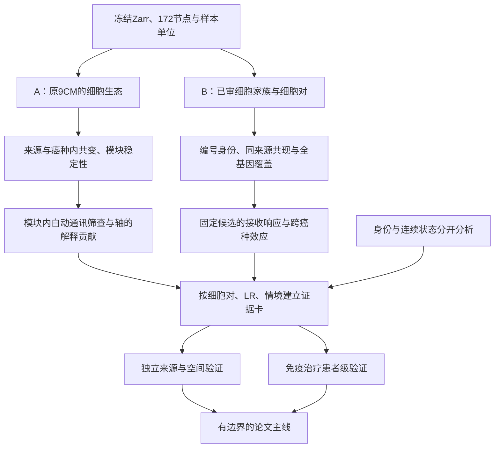

## 2026-10-16T20:48:53.925570+00:00 UTC /2026-10-17T04:48:53.925570+08:00 UTC+8 全来源主生产转入独立结果接受

完整共同变化生产已结束，功能语义测量/描述及全图已接受；下一等待完整独立主审计与既定全范围解释，然后依证据规划分子接口或队列意义，原CM和身份不改。 [run](runs/20261016_NSCLC_external_programme_coordination_v1.md)。

## 2026-10-16T20:45:36.521753+00:00 UTC /2026-10-17T04:45:36.521753+08:00 UTC+8 共同变化同步进入未入模RNA语义解释

全来源固定程序测量与未入模功能已分别接受，功能全图审阅完成；下一以完整主关联和来源背景合并评估，再推进生物学接口或队列意义，原2026年10月CM（v20261010）与身份冻结。 [run](runs/20261016_NSCLC_external_disjoint_functional_RNA_v1.md)。

## 2026-10-16T20:25:33.774331+00:00 UTC /2026-10-17T04:25:33.774331+08:00 UTC+8 来源内程序共同变化已进入实际检验

完整输入接受后，全部10程序/六细胞对进入预定条件置换及bootstrap，结果独立接受后再做跨来源一致性和生物学背景解释；临床、分子接口、空间后续依证据立题。 [run](runs/20261016_NSCLC_external_programme_coordination_v1.md)。

## 2026-10-16T20:18:39.623019+00:00 UTC /2026-10-17T04:18:39.623019+08:00 UTC+8 从测量可行性转入队列内程序共同变化

原计数和固定外部程序测量已独立接受；下一完整来源内共同变化与跨来源一致性，随后依全部结果定义临床/分子接口/空间问题。原172身份和2026年10月CM（v20261010）不改，来源限定关系保留价值。 [run](runs/20261016_NSCLC_native_MFA_external_qualification_v1.md)。

## 2026-10-16 19:48 UTC /2026-10-17 03:48 UTC+8 来源资格转入原始表达输入

捕获、标记和RNA宇宙数值审计已分别完成；下一计数输入验收、质量口径/评分合同，再做来源内程序共同变化及跨来源一致性。相容细胞池的固定基因程序扩展与原肺癌完整作者视图/精确潜因子复现分开，临床/分子接口/空间证据依结果立题。原2026年10月CM（v20261010）保持。[run](runs/20261016_NSCLC_native_MFA_external_qualification_v1.md)。

## 2026-10-16 19:42 UTC /2026-10-17 03:42 UTC+8 归一化修剪数值差异已定位、全范围复算进行中

官方R对照定位到近似并列值的log2舍入/修剪成员差异；标量数学在完整诊断病例中吻合，保持原容差/生产/科学门槛，v2重算全部范围尚待终态。完整原生计数v2在RAM无损压缩预算下读取既有core；96事前固定池的独立审核已绑定该真实生产句柄等待终态。没有新外部效应、临床确认或注释/CM变更。[run](runs/20261016_NSCLC_native_MFA_external_qualification_v1.md)。

## 2026-10-16 19:37 UTC /2026-10-17 03:37 UTC+8 原生计数输入与归一化数值诊断

全RNA宇宙校准producer19:28:26 UTC完成，原完整宇宙TMM重放一致；独立Python审计在Treg的一个mask发现数值差异，原失败保留，最终接受尚未通过。数值诊断已派发，不降容差或改科学门槛。全来源原始计数v1因保守磁盘预算在写入/新RNA前停止，v2采用RAM无损压缩后核准确字节，原256MiB上限及500GB余量保持，已实查读取原core计数。没有外部分数/P、标签改写或临床晋级。[run](runs/20261016_NSCLC_native_MFA_external_qualification_v1.md)。

## 2026-10-16 19:25 UTC /2026-10-17 03:25 UTC+8 全来源标记数值验收与完整图审阅

全部61来源/6760冻结池/固定44标记的计数、数值和缺失性19:20:50 UTC独立通过b4068820；原52来源为已接受native缓存重新聚合，免疫图谱为全部选中角色细胞counts重读，范围不混称。完整来源标记图19:24:33实际审阅b4d5a961，身份描述及下一步依据ec654d47保留server。RNA宇宙/TMM校准仍运行，尚无新外部因子或临床/通讯推断。原身份和2026年10月CM（v20261010）保持。[run](runs/20261016_NSCLC_native_MFA_external_qualification_v1.md)。

## 2026-10-16 19:20 UTC /2026-10-17 03:20 UTC+8 全来源标记已测量、独立复算与RNA校准运行中

全部61来源/6760冻结池标记测量19:16:33 UTC完成（beb9f859），独立缓存重聚合/图谱counts审计19:18:01开始。全RNA宇宙/TMM原数据校准19:17:19开始，19:20原审计进程与校准进程启动时刻均匹配，CD8原R日志已推进；两项最终验收待。保留全部10因子/四视图及作者标签冲突，不改原CM，不称新外部或临床发现。[run](runs/20261016_NSCLC_native_MFA_external_qualification_v1.md)。

## 2026-10-16 19:14 UTC /2026-10-17 03:14 UTC+8 全来源谱系与测量资格

原生多细胞程序转移进入完整身份/测量资格阶段，原10因子和旧9CM范围保持。两幅完整覆盖图已实际审阅，作者标签交叉已完成；身份未知/冲突保留，原注释不改。固定公开标记组合的全部来源RNA描述测量已派发，v1计数存储类型失败保留、v2限定转换修复待真实终态。下一仍需全RNA计数宇宙/TMM、平台和技术协变量可比性，尚无外部因子/临床效果或独立验证。[run](runs/20261016_NSCLC_native_MFA_external_qualification_v1.md)。

## 2026-10-16T18:45:21.764555+00:00 UTC / 2026-10-17T02:45:21.764555+08:00 UTC+8 原生临床阶段收束及来源资格

原生肺癌表达协调、完整功能/组成及固定内部临床家族分别已验收，保持各层证据边界。下一复用既有整合资源，完成全部来源/全因子的谱系、分析单位、重叠及测量可比性，再在效果前固定外部复现或空间/分子接口问题，不改变原CM或学习权重。 [临床](runs/20261016_NSCLC_native_MFA_clinical_v1.md)、[资格](runs/20261016_NSCLC_native_MFA_external_qualification_v1.md)。

## 2026-10-16T18:37:13.626246+00:00 UTC / 2026-10-17T02:37:13.626246+08:00 UTC+8 原生因子完整临床家族

原生肺癌表达程序从完整功能/组成解释进入固定内部留出临床双端关联；保留全部原控制信息的等价参数化已独立通过。先完整数值验收再审临床效果，关联、内部留出、独立来源及直接分子机制分开登记。 [执行](runs/20261016_NSCLC_native_MFA_clinical_v1.md)。

## 2026-10-16T18:17:56.945469+00:00 UTC / 2026-10-17T02:17:56.945469+08:00 UTC+8 原生因子解释与临床输入

肺癌原生多细胞程序完成全功能、未入模RNA及组成/背景解释，推进原作者结局/时点的队列价值问题。全10因子与旧9CM保持区分，旧已收束临床/LR不重开；新临床控制共线及contrast识别性已定位，下一冻结等价参数化推断合同并校准，再依结果规划分子接口、可比空间或外部来源。 [执行](runs/20261016_NSCLC_native_MFA_interpretation_v1.md)。

## 2026-10-16T16:27:22.061948+00:00 UTC / 2026-10-17T00:27:22.061948+08:00 UTC+8 下一功能变化的临床异质性

单池普遍变化、多池共同变化、共享临床关联与直接LR分别立题；先按全部50函数/全部池对核连续病理关系，双方各自完整QC和同患者集合，保留自由度不足。正式推断/校准未运行，不追加旧阴性家族，不把相关掩码当独立重复，其余来源/原9CM范围保留。全部原生功能、3200配对家族及200汇总/4800同患者变化相关已独立验收，两图实际查看；性能缓存修复和JSON证明失败/重放保留。完整科学结果仅server/授权对话，未晋级通讯或临床预测。下一完整功能变化—连续病理退缩问题已固定，metadata/模型资格与正式推断合同待；旧家族/身份/2026年10月CM（v20261010）保持、goal active。[run](runs/20261016_HNSCC_native_multicell_longitudinal_functions_v1.md)。

## 2026-10-16T16:15:54.793750+00:00 UTC / 2026-10-17T00:15:54.793750+08:00 UTC+8 从完整来源资格进入可解释纵向功能

头颈癌按已审配对与完整覆盖优先，测量训练基因外的全部既定功能；完整原程序/61来源—臂就绪表保留，不以此替代其他CM范围。原生测量已验收，新完整配对家族审计继续。先区分单池纵向变化、多池平行变化与同患者变化相关，后者仍需完整质量/来源条件，不能直接命名通讯或耐药。完整原生头颈癌功能测量16:11:32 UTC独立全量验收；全部3200患者配对功能槽已效果前冻结，16:13:59 UTC主精确符号/配套Wilcoxon家族真实开始，16:14:54 UTC独立完整患者/概率/区间/校正复算启动，最终验收待。没有重开旧临床/LR家族，原身份/2026年10月CM（v20261010）保持。[run](runs/20261016_HNSCC_native_multicell_longitudinal_functions_v1.md)。

## 2026-10-16T16:03:21.532615+00:00 UTC / 2026-10-17T00:03:21.532615+08:00 UTC+8 外部来源资格及后续研究问题

先按全部原生大类及固定多基因候选的捕获、已审患者/材料/时点和完整基因覆盖确定可比较范围。来源—臂不等于独立队列，旧29节点为全部T/髓系但旧候选更窄，宽谱系与精确身份分别登记。通过后在新效果前冻结外部功能/程序或临床问题，不追加已关闭阴性家族。完整谱系/患者捕获检查已真实完成并独立通过；旧TNBC sidecar引用错误保留为v1失败，v2使用已验收官方取样表。全61来源—臂的基因可测性检查已启动，最终覆盖及独立审计待。尚无新效果、临床模型或独立验证声明，原CM/身份保持、goal active。 [run](runs/20261016_complete_external_lineage_gene_qualification_v1.md)。

## 2026-10-16 15:37 UTC /墨尔本10月17日02:37 /UTC+8 23:37 功能背景诊断收束及外部资格

[完整第三谱系诊断](runs/20261016_NSCLC_third_lineage_functional_background_v1.md)：训练基因外全功能、作者RNA组成、同病例双端及第三谱系背景已依次完成独立数值核对。保留来源内共同生态与剩余端点协调两种问题，未确认直接通讯；不在同来源逐项追加背景控制/分数或重开已结束临床/LR家族求阳性。

下一先审现有外部来源的患者、材料/时点/治疗、谱系和完整测量覆盖，再在查看新效应前固定可比较功能/程序和临床问题。既有来源曾经参与哪些发现/筛选须记录，不能将反复使用的队列当全新独立确认。细身份、宽谱系扩展、同癌种和跨癌种分别说明；有合格机会才做正式外部模型。来源限定价值可以成立，直接LR机制、临床预测和正式状态仍需各自证据。

旧45来源/外部细对机会表只覆盖当时选定的细节点，不是完整大类捕获图。后续同时核全原生大类和多基因相容端点，再核精确细群；不能把旧选定节点缺失直接当整类未捕获，也不能无证据合并编号来凑样本。真实临床/患者sidecar以较晚审阅为准，未知保留。

## 2026-10-16 12:40 UTC /墨尔本23:40 /UTC+8 20:40 项目进展审阅

[10月14日后路线更新](methods/project-progress-and-next-phase-20261016.md)：从全谱系程序测量和2026年10月CM（v20261010）全探索链，收敛到来源限定候选的功能及外部可比样本。CRC与肺癌分别建立证据，不预设同一泛癌机制；先患者/端点/程序/同癌种复现，再完整空间或蛋白/功能。旧状态/空间阶段已完成的计算与尚未成立的生物结论分开，保留所有失败和弱结果。

## 2026-10-14 15:41 UTC+8 上次整理后的方向与下一阶段

[本轮路线与责任方向](methods/project-progress-and-next-phase-20261014.md)：图谱作为资源，原CM作结构参照，身份内程序作功能层，患者级独立来源与空间作验证层。优先程序与来源特定结局，再检验两端及分子接口；来源限定结果可以独立收束。完整原9CM/状态DIALOGUE/空间目标保持，技术制图不提升机制证据等级。

## 2026-10-13T13:29:24.230755+00:00 /UTC+8 2026-10-13T21:29:24.230755+08:00 有限两轮完成及主线转向

有限轮次1/2触发转向：不追加同数据阈值/检验，不强制空间第三轮。队列捕获意义→审baseline患者/组织/治疗/结局→DIALOGUE身份内协调程序；原9CM冻结。 [结果](inventories/analysis/2026-10-13/CM_fine_IFNG_finite_round_v1/RESULTS.md)。

## 2026-10-13T13:20:26.393419+00:00 /UTC+8 2026-10-13T21:20:26.393419+08:00 有限通讯轮次与CM转向

本阶段最多三轮：原CM细分身份内、固定评分稳健性、有候选才空间。无稳健候选或覆盖不足转向CM队列/临床和DIALOGUE表达MCP。 [合同](methods/finite-communication-rounds-and-CM-pivot-v1.md)。

# 项目路线图

## 2026-10-16 17:55 UTC /2026-10-17 01:55 UTC+8 队列原生多细胞程序及下一解释层

肺癌四视图官方MOFA已完成训练专属输入、固定主/稳定性模型及全部内部留出检验，完整数值复算与全图审阅通过。作为另一发现入口继续全因子功能、未参与模型基因RNA、作者亚型和技术/人口学解释；然后基于真实结果规划临床和分子/空间验证。原9CM仍作冻结结构参照；未完成精确端点/状态桥接前，不将新MFA因子直接归入旧CM或宣称主导原模块。初始化一致性、病例内部一致、外部患者验证及直接LR证据分别登记。[run](runs/20261016_NSCLC_native_MFA_discovery_v1.md)。

## 2026-10-16 17:25 UTC /2026-10-17 01:25 UTC+8 小样本临床支线收束与队列原生发现资格

头颈癌完整功能变化临床及另立作者状态计数临床阶段已验收，保留校准失败和效果前的唯一数值修正，不继续改变同家族问题求阳性。既有CRC/MMR结果已回查，覆盖不足与无支持分开。下一从肺癌现有全基因缓存核查队列内程序发现资格，区别于把旧来源程序投影过去；内部留出和已审患者/来源独立性分别说明。方法、真实发现和后续机制/临床验收仍是不同节点，原全9CM目标保持。[状态run](runs/20261016_HNSCC_author_state_count_clinical_v1.md)。

## 2026-10-12T10:11:30.425815+08:00 恢复条件已开始核验

用户确认配额扩充并明确继续，昨日临时暂停撤销；实际2048G硬限/约1495G已用，按下方既定主支线从READY/B1推进。先复用本机完整先验并校验，不重启旧失败v3；原范围/检验合同不变。[离线恢复合同](inventories/analysis/2026-10-12/fullgene_offline_resource_recovery_v4_spec.json)。当前只冻结新资源/执行入口，实际生产和统计结论须另取证。

## 后续研究主线与支线：2026-10-11，今日仅规划

用户已删除项目根目录GPU传输目录，并要求暂不下载，拟于2026-10-12向管理员申请配额。本节是后续任务计划，优先于下方历史“继续下载/恢复资源”指令；今天只读取必要证据、整理计划和同步日志，没有恢复资源、传输科学输入或启动分析。未来运行以用户恢复指令、实际配额和输入验收为前提，申请配额不等于自动启动。

### 1. 论文主问题与研究结构

**主问题：不同癌种中有哪些可复现的细胞协同生态，其中哪些细胞对具有可测的分子接口和接收响应，是否与组织结构及免疫治疗结局相关？**

研究按“生态 → 通讯候选 → 接收响应 → 空间/临床验证”组织。两个发现入口汇入同一证据链：A从原9CM出发；B从细胞对出发。支线可以独立交付限定情境的结论，再按明确映射与证据汇入主线。完成计算、输入验收、科学发现和机制验证分别登记。

**必须保留的版本关系**：原9CM/172节点/v20261010不重编号、不因新支线改写。原9CM的名称沿用已冻结组分名称；名称不加“耐药”“抑制”等功能结论。当前四家族扩展与原CM边的直接匹配为0，所以不能把其15条记录称为CM主导轴。未来只有匹配到原节点/边/成员并实际检验解释贡献，才建立CM关联；另建模块须新版本映射，不沿用旧CM编号含义。

### 2. 今天的真实起点

| 已有证据 | 当前进度 | 对后续计划的含义 |
|---|---|---|
| 权威整合对象及冻结下游 | canonical 4,676,787细胞；CoVarNet 1,290样本、172节点、9CM；121文库具已审身份，其余1,169按样本替代单位 | 重用底座；样本不能全部称独立患者；样本类别与分选审阅仍重要 |
| 原CM来源内组成与首轮通讯 | 60唯一细胞对映射120CM边；357可估计组成分层；13推断候选及2争议描述记录；6主通讯可估计分层、0主BH显著 | CM仍是生态发现；通讯不足分为缺覆盖、调整后不保留及未验证，不能概括为CM不存在 |
| 细胞对扩展 | 四家族/13原节点；336参考支持记录涉及209LR；112原重采样稳定、28新增条件关联保留；自动15后续记录涉及11LR | 28和15不是逐级漏斗；同轴的不同来源/程序记录不算多个独立机制；全候选与阴性继续保留 |
| 原生表达及身份审阅 | 当前3源/164文库/285,360选定细胞，原panel约296基因；实际9/13节点；全45已审来源有原生文件 | 文件存在不等于可比样本充足；完整基因准备和45源覆盖审计尚未执行 |
| 既有空间邻近 | 固定45接口，29可估计、16不可测，0完整主BH显著 | 当前空间数据未提供主检验支持；不更换半径、身份或端点追求显著 |
| 既有接收通用程序 | 固定70模型，22可估计、48不可估计，0名义p<0.05/0主BH显著 | 不能把共表达或R+内差异当配体诱导；后续全基因问题须另预声明 |
| 完整基因准备 | 336/15/1008范围及代码冻结，真实生产/审计未开始；服务器target部分文件此前因组配额失败 | 下一步先验收输入，不把合成检查或先验覆盖当新发现 |
| 免疫治疗新数据 | 已有11来源库存；4分片993,312细胞技术QC通过；正式新增来源验收0 | 临床支线先审患者、结局、时点、研究别名与基线重复，暂不扩大全局整合 |

来源依赖可接受，但问题分开报告：①癌种/来源间生态均值差异；②同来源、同癌种内部关联；③多个癌种中方向一致的效应；④同癌种多来源复现。多个癌种的效应有价值，不强制全癌种一致；不同癌种各仅一个GSE时，不能声称技术与癌种效应已分离。现有336记录中34跨癌种同向、17同癌种多来源同向均为描述性一致性，不等于各来源都显著或已经独立验证。

### 3. 主线A：解释9个CM的细胞生态与通讯贡献

| 支线 | 科学问题与操作 | 交付和推进条件 |
|---|---|---|
| A1 模块生态地图 | 覆盖全部9CM及60唯一边；复用来源内组成结果，将癌种、材料、同名编号、分母及缺捕获范围画成地图；报告全细胞分母敏感性 | 9张模块卡、120记录到唯一对的映射、癌种/来源效应和可检验分母；共享边不重复计证据 |
| A2 原身份与可比性 | 原编号保留；同名不同数字逐来源审阅major、作者谱系与marker兼容性，区分真正稀有、缺捕获、标注碎片化和身份差异；有证据才用分析家族并并列原编号结果 | 节点/家族映射、覆盖增益及身份混合风险；不得为凑样本把全部同名节点合并 |
| A3 自动LR筛查 | 在原CM明确发送/接收节点范围内，用完整每样本LIANA和固定数据库枚举所有可测LR；预先规定覆盖、模型、检验家族；历史COL1A1–DDR1、CCL5–CCR1单独追踪 | 不手选显著端点；表达缺失不填阴性；共识rank不当通讯强度/FDR；争议结合接口独列 |
| A4 轴对CM的解释贡献 | 用原W及去除当前发送/接收者后的CM活动作解释对象，比较细胞组成基线与加入单轴/轴组后的留出来源预测；多轴共享配体/程序时评估冗余 | 预先冻结留出单位、基线、误差指标及多重比较，报告加入轴后的额外解释与稳定性；不能识别去端点模块时标不可估计，不用原H代替主结果 |

A4是未来检验“哪些通讯特征对模块活动有额外解释”的方案，尚未执行。CM本来从组成产生，含端点H与其LR同时相关可能自关联，因此需去端点、基线对照和来源留出。“主要解释轴”只能指上述观测解释贡献；“驱动模块形成”仍需功能/干预证据。如果去端点后模块无法识别或无额外解释，交付细胞生态图与候选接口，不强命名驱动机制。

### 4. 主线B：从细胞对发现跨癌种或癌种限定的响应关系

| 支线 | 科学问题与操作 | 交付和推进条件 |
|---|---|---|
| B1 完整基因与覆盖 | 完成已冻结3来源全部336记录/15回映/1008候选×来源的全基因聚合及独立审计；另运行已声明45源header/既有覆盖审计 | 原编号×文库counts/检测/完整RNA分母，缺基因/空单位/患者块表；45源结果决定后续可比范围，不改原3源执行范围 |
| B2 响应假设 | 全336均检查先验覆盖；按固定独立先验选靶而非按本数据表达挑靶。另审受体功能、完整复合物、真实TF regulon及适用细胞情境 | 配体靶先验是无符号潜力，不是受体特异通路；普通ligand-TF文件的非零基因行不当TF目录；未测/无先验/零表达分开 |
| B3 固定细胞身份内部响应 | 在合格来源与原编号内分析发送端表达与接收靶/程序的样本级关系；并列家族汇总、身份比例、RNA深度、丰度及发送端共同程序敏感性 | 冻结背景、检验对象、协变量、最小单位、整体BH及重采样规则后再运行；来源不足及共线保留失败；不得把细胞当独立患者 |
| B4 多癌种效应与外部来源 | 给同一细胞对/LR/响应汇总各癌种效应，报告异质性、反向及留一来源；区分发现中已用与真正留出来源 | 跨癌种一致、癌种/来源限定、条件后减弱、证据不足四级；来源限定但可靠者进入相应队列研究 |

优先顺序是B1→B2范围冻结→B3/B4。当前3源用于发现/探索，重复使用只算内部检查；45源中也必须按此前使用历史逐源核定独立性。15记录维持追踪，覆盖充足的新检验不能仅对最显著15条做不声明的重复发现。原top200先验靶合同用于输入覆盖检查，不自动成为200个独立机制结局。

### 5. 主线内的三条验证支线

**S：身份与状态。** 现有标注主要是type/subtype/描述性marker，未正式加入状态。以固定、外部定义的IFN、细胞毒、增殖等连续程序作为状态层，保留原身份；去掉当前LR及命名marker，检查深度、谱系、恶性和解离/应激影响。正式状态标签须另审，不从CCL5/IL7R或单基因自动推出CD8、CD4、耗竭。状态可为混杂、共同刺激、作用中介或结果；总体生态效应和条件效应分别回答问题，不以调整后下降判定关系为假。

**V：空间与独立来源。** 先做已有数据的端点/基因、作者身份、坐标、材料及患者可比性验收，再设计验证。当前45/70阴性/不可测结果保留；现有CosMx不能测完整端点的候选不硬上该panel。发现中用过的空间来源不称独立验证；FOV/core/TMA不当患者。有合格独立来源时预声明空间界面、邻近零模型和接收响应；若只有邻近支持，结论止于组织结构，不推出方向/结合。没有合格现有数据时登记证据缺口，下载另按用户恢复指令规划。

**C：免疫治疗临床。** 先用已到库Project_v5及历史免疫治疗队列做原研究/患者/时点/疗法/组织/端点/基线排重审阅，冻结与发现无重叠的验证来源。主要临床问题优先治疗前的细胞生态/通讯响应与疗效的关系；配对前后变化是另一问题，不混为疗效预测。患者为单位，治疗类型与癌种分层；CAR-T产品和富集snRNA单列，不作为完整TME组成验证。发现/候选排序不能使用留出结局。满足覆盖后验证少数预声明轴/生态分数，效应和不确定性优先，不先训练高维临床模型。只有真实临床端点和足够可比患者的来源才能称临床验证。

支线可以支持不同层次结论：空间支持邻近而响应不足，可发表生态结构结果；响应在单癌种稳定但跨癌种不一致，可形成癌种限定研究；临床相关但无机制，止于结局关联。都不强行拼接“耐药机制”。后续湿实验/蛋白/扰动是功能因果支线，需候选、资源和实验条件确认后另设计。

### 6. 下一轮的实际任务顺序与停止条件

以下均为计划，今天未执行；2026-10-12是用户拟申请配额的日期，不是已预约运行时间。

| ID / 优先级 | 任务 | 前置条件 | 完成标准 / 转向规则 |
|---|---|---|---|
| PLAN-01 / P0 | 今日证据与主支线计划 | 用户当前指令 | 保存本计划、只读删除范围核查、任务板和日志；普通push独立验SHA |
| READY-01 / P0 | 配额与删除后输入路径验收 | 用户恢复运行指令、管理员配额结果 | 复测组quota及阶段峰值/日志输出余量，核源文件/校验；canonical和登记证据存在已观察，但全历史引用/完整SHA尚未审计 |
| READY-02 / P0 | 全基因先验就绪 | READY-01 | 恢复时用新阶段及真实成功终态/官方校验；优先考虑已完整本机文件的受控传输，不重复盲重试网络；今天禁止传输；旧v3失败不能作为生产通过入口 |
| B1-01 / P1 | 当前3源全基因生产及独立审计 | READY-01/02、冻结代码/父SHA | 全336/15/1008及原单位轴严格对齐，全值独立复算；仅输入readiness交接，不晋升机制 |
| B1-02 / P1 | 45源实际可比范围 | READY-01、现有原生文件 | header与既有单位覆盖审计，患者/材料/端点/基线重叠矩阵；不得把45有文件写45均可验证 |
| A1-01 / P1 | 9CM证据地图及原节点/家族对照 | READY-01、复用既有结果 | 每CM覆盖/效应/分母/同名身份风险/来源限制；先排可解释性再排通讯 |
| B2-01 / P1 | 响应合同与独立来源冻结 | B1输入和范围验收 | 机制先验、靶/TF、所有检验家族、单位/设计、阴性/缺失、验证留出完整预声明；不适用接口转描述性支线 |
| B3-01 / P1 | 样本级接收响应及跨癌种效应 | B2-01 | 主/敏感性/全部BH/留一来源；原编号内检查和家族结果并列；若主要身份/深度解释，转状态/生态问题 |
| A3-01 / P2 | 原9CM全量自动通讯与解释贡献 | A1-01、充分同来源覆盖、另冻合同 | 全范围LR及主模型有可追溯分母，去端点模块可识别；无增益保留生态结论 |
| C1-01 / P1 | 既有免疫治疗验证清单 | 只读既有元数据；未来执行再启动 | 真实患者/时点/疗效、排重、材料与独立性验收；无需先整合全部新细胞 |
| V1/C2 / P2 | 独立空间/临床验证 | 对应数据验收、预声明候选与留出 | 不据验证结局重选候选；不足则登记缺口/限定来源，不以更多细胞替代更多患者 |
| DATA-NEW / deferred | 新公共下载及全量重新整合 | 用户以后明确恢复、quota和正式来源验收 | 当前暂停；不是解决现有模型问题的默认步骤；另版本变更及用户整合决定 |

近期第一包交付应为“输入就绪 + 45源可比范围 + 9CM生态图 + 临床验证清单”；第二包是“固定响应检验和跨癌种效应”；第三包才是空间/临床验证与论文候选收束。先完成一轮固定问答并审计，再按新问题建立新版本，避免多个未完成探索互相覆盖。

### 7. 项目管理与论文收束

- 每条问题建立一张证据卡：原CM/节点/家族、细胞方向、LR及复合物、癌种/材料/来源、真实分析单位、发现使用历史、表达/响应/空间/临床各层证据、负向/缺失原因、下一动作。逐患者与细胞清单留服务器，公共日志只存汇总/SHA。
- 一个轴的跨来源重复、跨程序重复及CM共享边通过统一key关联，分别统计“轴数、情境记录数、检验数、患者数”，不互相替代。
- 运行按input → production → audit → scientific review → release分阶段，不用v17输入验收当“轴已验证”；旧错误/阴性/失败保留。各支线随关键节点更新同任务日志、daily、run和必要索引，普通push独立核验。
- 若最终仅支持细胞生态及来源限定响应，论文主线可止于“泛癌细胞生态图谱与情境相关接口”；若多癌种响应、独立空间及临床层形成一致链条，再聚焦少数接口。当前不提前把某轴写成共同耐药或免疫抑制机制。

[今天的暂停/路径证据](inventories/analysis/2026-10-11/planning_pause_checkpoint_v1.json)；[现有细胞对轨迹与方法](docs/2026-10-11_covarnet-leads-and-methods-explained.md)；[全基因冻结与失败历史](runs/20261011_fullgene_receiver_target_readiness_v1.md)。下面保留早期路线作为时间线，执行以本节当前条件为准。

## 2026-10-11T20:29:43.368494+08:00 接收程序验收

固定邻近和接收通用程序两问题已完成全量计算；下一阶段审查完整基因/患者与来源、受体特异靶和TF先验，预先固定新验证范围。保留来源/癌种限定生态，不反复改当前程序到显著。 [run](runs/20261011_spatial_receiver_programme_exposure_v1.md)。

## 2026-10-11T20:07:13 接收程序阶段

从固定细胞对的邻近进一步检验R+内程序与L+邻居暴露；身份和程序分别调整，来源/癌种限定关系保留。 [run](runs/20261011_spatial_receiver_programme_exposure_v1.md)。

## 2026-10-11 19:54 条件空间验收

条件空间45接口里程碑完成；下一项身份/连续程序分开建模的接收程序—发送者邻居暴露与独立来源验证，不能把SELL程序差异写成抑制机制。 [run](runs/20261011_spatial_conditional_neighborhood_v1.md)。

## 2026-10-11T19:43:34 条件空间阶段

下一有界任务已冻结：同FOV有限邻域+家族/深度/密度条件null，全部45接口保留；先空间组织再接收程序。 [run](runs/20261011_spatial_conditional_neighborhood_v1.md)。

## 2026-10-11 19:27 空间预检里程碑

[全65原生空间预检](runs/20261011_spatial_contact_native_preflight_v3.md)完成；输入修复、RNA/背景、作者身份对应与计算审计均有轨迹。v14接受计算及正确映射，未接受邻近/机制。下一有界任务固定9LR接口、去共享记录重复，核实结合/单位并预声明条件空间检验；保持来源/癌种限定关系价值和全部阴性/稀疏结果，状态轴待独立设计。

## 当前CM探索路线补充

本次[家族分析里程碑](runs/20261011_family_candidate_validation_v1.md)已完成覆盖、身份/RNA深度敏感性、全336候选排序和15记录身份内部程序检查；来源限定效应保留。下一步按自动13接触记录检查空间原生RNA、坐标、样本/患者及QC，再做样本级邻近验证。2条程序分支独立保留；原9CM驱动仍需另检验。历史首轮0BH结果不概括整个扩展分支。

18:36:08 UTC+8输入探索发现[CSV索引列转换故障](logs/incidents/2026-10-11_spatial-csv-index-column.md)。空间推断前先以新版本纠正输入并审计，再接续全部固定候选预检；不依照故障选择或替换候选。

18:52:17.951000 UTC+8：[修复里程碑](runs/20261011_spatial_native_input_repair_v1.md)接受新对象，原CSV全矩阵及X/counts独立核对通过，证据v12登记。下一项是全部13×5原生端点/背景/单位预检，不在本次输入修复上结束通讯验证目标。

## 当前路线：2026-10-11 Cloud代码开发与服务器执行

1. **已交付：控制仓库**。当前运行快照、可读报告、代码验收入口、云端任务提示、版本边界和外部证据索引。
2. **下一可执行云端任务**：补充来源与临床映射验证器，用合成fixtures定义缺失、冲突、纵向患者与多组织样本处理；产出可在服务器执行的脚本及运行合同。
3. **服务器数据验收**：继续公共下载；逐来源确认原始计数、文库、历史QC、技术类型和基线重叠；修复传输停滞后保存校验与失败记录。满足空间下一批峰值+500GB余量才启动新批。
4. **CM可信度复核**：针对现有候选来源补齐患者/组织/癌种/分选映射；再做可比较队列及K/分母敏感性。现有0 BH显著结果照实保留。
5. **版本门槛**：GSE299623最终身份审阅独立闭环；新来源新增验收达到450万—550万后，先决定整合，再冻结临床独立验证集；不能在验证集中选择marker或重新拟合发现模型。
6. **推进下游**：经过独立验证后，才规划路径/TF/空间机制与投稿版本晋升。

每个云端PR只解决一个有验收条件的任务。代码合入与服务器运行各自记录commit、合同、输出摘要；完成状态同步回仓库。以下早期路线保留为历史背景。

## 2026-09-22 Nature submission freeze

- P7 publication-preparation snapshot is created with V7 as the sole global identity/CNV authority.
- Preserve the 2026-09-16/17 V8 audit qualifications: T/NK held-out validation is compromised, Myeloid/DC held-out outputs were exposed before the split, and no lineage is `HELDOUT_VALIDATED`.
- The 2026-09-19 V9 candidate report and open review template are published as a lightweight candidate snapshot; this is evidence publication, not promotion.
- V9 is quarantined as `FROZEN_CANDIDATE`; do not promote it before 15 L3 reviews, the 632-sample CNV decision, stability review and an explicit promotion audit.
- Select one upgrade path: complete the V8 sealed benchmark or complete/promote V9. Do not merge their gates post hoc.
- After the identity decision, rebuild malignancy only if required, then rerun version-dependent CoVarNet/LIANA or retain the V5 branch as explicitly historical.
- Close panel-level provenance, source/licence, environment, ethics and repository/DOI requirements before creating a submission-candidate release.

## 2026-09-14 V8 B/Plasma full-cohort biological freeze

- Full execution completed 981/1,312 samples with 331 explicit `<50-cell` skips, 0 failures and 685,843 processed cells.
- Development-only evidence froze Bcell, Plasma and Bcell-naive; Plasma-IgA fell back to Plasma, and IFN/cycling remain overlays.
- P1-1 is DONE/FROZEN. The prospectively sealed 12-GSE held-out reference benchmark is now the only active scientific gate; no rule retuning is allowed.

## 2026-09-14 V8 Endothelial biological freeze

- `20260914_endothelial_3gse_v1` completed 6/6 samples, 8,951 cells and 35 clusters using preregistered rules.
- Freeze Endothelial parent, arterial and venous only; capillary, angiogenic-tip and lymphatic fall back.
- P1-1 subsequently completed with full-cohort B/Plasma validation; global V8 remains NOT_FROZEN and V7 remains default.

## 2026-09-13 V8 全量执行里程碑

- Myeloid/DC 全量 review 已从 4-sample pilot 晋升为可恢复的 54-GSE 执行任务；该“晋升”只指
  计算范围，不是 biological release 或标签写回。
- 当前只允许一个重任务直接运行；Slurm 唯一节点 drained，因此未新增 pending DAG。
- 下一重任务为 scATOMIC legacy 样本缺口，不重复已完成的 new-cohort 549/549 outputs；待
  Myeloid/DC 任务完成或资源审计允许后再启动。

## 2026-09-12 V8 实际执行里程碑

- 完成 V7-scoped Myeloid/DC pilot 的污染审计、fail-closed 修正与跨 GSE review-only
  复现；V1/V2 的否决理由和 V3 的接受边界均已保存。
- 下一方法门控是在不查看额外验证集结果的前提下预注册 cluster 接受/退回规则；随后选择第三个
  GSE 验证 cDC2、pDC、SPP1/TREM2 等尚未跨 GSE 复现的标签。
- Census/scANVI 不继续盲试版本；仅在获得可用的固定 client wheel/cache 或稳定官方连接后恢复。
- 任何 V8 标签写回、held-out benchmark 或 downstream 重跑均仍未授权为正式产物；V7 保持默认。

状态值：`completed`、`in_progress`、`blocked`、`planned`、`待确认`。完成状态必须有可检查证据。
## 2026-09-12 V8 开发候选索引

- V8 rerun2 已形成全量元数据软件候选及外部 hash/状态索引；其完整性、schema、round-trip 和
  128 个 V7 字段合同均为 `PASS`，但 release status 为 `NOT_FROZEN`。
- 最新 root audit 记录 `PASS_DEVELOPMENT_SOFTWARE_CANDIDATE_NOT_FROZEN`、V7 default
  与外部记录的 `pytest_passed: 167`；这些是软件候选门控证据，而非 biological freeze 或
  独立准确率结论。
- V7 继续是默认 identity/CNV 参考。该候选不代表独立准确率、classifier 执行、真值验证或
  生物学完成，且 policy 明确禁止自动参考晋升和正式 downstream mutation。
- 独立 scANVI reference 为
  `BLOCKED_NO_USABLE_PINNED_CLIENT_AFTER_BINARY_RETRY`。隔离安装及唯一官方 PyPI
  binary-only retry 已留存失败日志；获得固定 wheel/cache 或稳定官方连接前，不再盲试版本，
  也不得训练、mapping 或主张独立性能。
- 下一里程碑是在新的版本化验证 run 中完成独立生物学证据和下游影响审计；不能以本软件候选
  覆盖 V7 或已有 downstream 历史。

## 2026-09-06 路线更新

- P4/P5 身份与 CNV：V7 已冻结并成为当前默认参考，进入 append-only 维护。
- P7 发布治理：V7 与通讯证据链已形成轻量 Git releases。
- 下一里程碑：在 V7 身份/CNV 上版本化重跑依赖身份的 CoVarNet/LIANA 分支，并与
  当前 V5-derived downstream release 做差异审计。
- 下一里程碑：建立 Prism panel-to-source 索引、补齐软件/环境摘要和期刊要求的
  supplementary README。
- 数据发布继续采用 Git 元数据/小表/图 + 外部重型对象哈希的双层结构。

| 阶段 | 目标 | 输入 | 输出 | 依赖 | 完成标准 | 当前状态 |
| --- | --- | --- | --- | --- | --- | --- |
| P0 数据来源与库存 | 明确数据集、对象、矩阵语义和用途分支 | Project_v1/2/3 既有对象与官方元数据 | 数据集库存、对象库存、分支清单 | 可读取的对象元数据 | 数据集来源、物种、样本键和用途有可审计记录 | completed |
| P1 数据恢复与标准化 | 将可用来源转换为可追踪的 raw/counts 对象 | GEO/既有对象 | 每数据集 rawdata/checkpoint | 输入语义可确认 | 输入标识、矩阵语义和转换验证齐全 | in_progress |
| P2 逐数据集 QC | 对主发现队列进行一致且保留数据集差异的 QC | 冻结的 discovery manifest | QC 对象与验证表 | P0、P1 | 当前主线 33 个数据集全部通过验证 | completed |
| P3 统一整合 | 构建全量共同基因对象并完成多方法整合 | QC-pass human datasets | concat、Harmony、BBKNN、scVI、CellTypist、scIB | P2、基因空间审计 | 最终对象和三种整合均通过检查 | completed |
| P4 细胞注释 | 结合图聚类、marker、参考模型和污染审计生成主/亚型标签 | P3 BBKNN 对象 | 注释对象、证据表、复核清单 | P3 | 17 个 lineage 完整且交付审计通过 | completed |
| P5 肿瘤细胞与分支分析 | 进行恶性识别、CoVarNet 及必要敏感性分析 | P4 注释对象 | 恶性标签、CoVarNet 与分支结果 | P4 | active v2 的 721 样本、CoVarNet、LIANA、NicheNet 和最终审计完成 | in_progress |
| P6 跨队列验证 | 处理免疫治疗、snRNA、spatial、processed-only 分支 | 冻结的验证/敏感性清单 | 独立验证结果 | P0、P4/P5 | 分支边界明确，不与 discovery 泄漏，最终交付审计通过 | in_progress |
| P7 报告与发布 | 汇总方法、结果、局限和可复现证据 | 已验证结果 | 报告、图表、共享记录 | P4-P6 | 结论可追溯到 run、输入、参数和验证 | in_progress |

## 当前里程碑

- P1：24-GSE `Download_now` initial run 保留 4 verified/118 failed 的失败证据；141-task retry v3 已结束，127 verified、7 skipped_verified、6 unavailable_upstream、1 failed。GSE201347 partial 仍需独立 recovery attempt。
- P3：31 个 GSE、1,963,745 个细胞的全量对象完成 Harmony、BBKNN、scVI、CellTypist 和 scIB 评价。
- P4：17 major lineages、136 lineage clusters、106 final annotations，最终审计 `PASS`。
- P4/P7：V8 full-metadata rerun2/root audit 为
  `PASS_DEVELOPMENT_SOFTWARE_CANDIDATE_NOT_FROZEN`，外部记录 167 项 pytest 通过；它保留
  V7 作为默认参考，独立 reference 为 `BLOCKED_NO_USABLE_PINNED_CLIENT_AFTER_BINARY_RETRY`，不能计作
  P4 生物学标签升级或 P7 正式 release 完成。
- P5：主 CoVarNet 发现分支完成固定 `K=9`；恶性/通讯 v2 Stage 01 严格完成 580/721。recovery `20260812_124600_cm_stage01_from_0462` 在第 581 个样本因组配额耗尽终止；当前约 2.50 GiB 余量远低于剩余 Stage01 约 129–157 GiB 的估算，至少恢复 200 GiB 组配额余量后才从零基索引 580 新建 attempt；Stage 02–08 未开始。
- P6：旧三个固定模块免疫治疗投影完成；新的四队列整合已完成 19/19 cell2location 与 71,398-spot 严格 merge，但截至 2026-08-12 无新 Stage 13 attempt，最终验收仍因 11 个 reference-insufficient inferCNV skip 的状态策略冲突而阻断。
- P7：三个 extension 均已建立正式运行记录；下载 retry v3 已生成 final summary，免疫与 CM 的最终 audit 仍未齐全；GitHub SSH 普通 push 已恢复并核对远端 `main`。

## active extension 完成标准

### 四队列免疫治疗整合

1. 已完成：19/19 张 GSE273952 切片各自通过 cell2location attempt 验证。
2. 已完成：71,398 个 spots 精确合并，无 missing/extra、无非有限/负值/zero-sum abundance。
3. 待完成：统一 11 个 inferCNV reference-insufficient skip 的验收语义，`FINAL_DELIVERABLE_AUDIT.json` 通过，并保留 7 位 unresolved response 的不确定性。

### 恶性识别与 CM 通讯

1. 721 个 active samples 全部得到 non-failed terminal Stage 01 结果。
2. GSE 排除、GSE166555 重组、global positions 和恶性合并零冲突。
3. active v2 的 CoVarNet K9、sample × CM LIANA、NicheNet 非空验证和 `FINAL_AUDIT.json` 通过。
4. 发布前确认 CopyKAT 实际 `genome=hg20` 是否符合预期。

### 新数据下载

1. 已完成：141-task retry 终止并生成 machine-readable final summary；终态为 127 verified、7 skipped_verified、6 unavailable_upstream、1 failed。
2. 每个成功文件通过与类型相符的 gzip/tar/zip/size/MD5 检查。
3. `unavailable_upstream` 与网络失败不伪装为 verified。
4. core GEX、sidecar、human/xenograft、baseline/repeated-measure guardrail 经人工复核后才进入预处理。
5. GSE201347 的 14,413,317,040/19,071,156,087-byte partial 必须在新的版本化 recovery attempt 中恢复并重新验证；不得改写 retry v3 的失败历史。

## 关键依赖

- `/data4` 文件系统整体仍有约 771 GiB available，但 `USER002` 组受 1,572,864,000-block hard limit 约束；2026-08-16 仅余约 2.50 GiB。CM Stage01 新 recovery 至少需要 200 GiB 组配额余量，且下游 Stage 02–08 另需容量预算。
- `GSE278694` 的移除原因必须形成可审计决定，否则最终发现队列范围不能算完全冻结。
- `GSE162498` 的 extreme-scale 处理决定影响主队列是否扩展。
- low-confidence、unresolved 和 ambiguous annotations 需要人工复核后才能作为发布版标签。
- 外部验证必须继续使用冻结 mapper 和固定 CoVarNet 权重，避免在验证队列重新拟合造成信息泄漏。
- 每个阶段的权威证据通过 `inventories/runs.tsv` 和正式 run record 链接，不在路线图复制完整日志。

## 2026-08-16 07:00 依赖纠正快照

- 上述 03:37 记录的约 2.50 GiB 是历史快照；最新精确 `USER002` group-quota 余量为约 101.588 GiB。该值仍低于剩余 CM Stage01 的 129–157 GiB 外推和 200 GiB 安全门槛，因此 P5/CM 状态仍为 `blocked`，恢复入口仍为零基索引 580 的新 append-only attempt。
- P6/免疫治疗仍由 11 个 reference-insufficient inferCNV skip 的验收语义和缺失 final audit 阻断；P1/下载 retry v3 已终止，但 GSE201347 独立 recovery 与下载后 guardrail 复核仍待执行。

## 2026-10-12T18:16:10.399825+08:00 新数据技术合集里程碑

统一预处理Zarr已完成：[9源/792文库/3180973细胞/49985特征](inventories/runtime/2026-10-12/FINAL_ZARR_ACCEPTANCE_v1.md)全量验收与原卷证据持久化PASS。随后先走来源/别名/作者计数槽及临床用途门槛，再另版本生物学整合；正式新增计数仍0，450万—550万新增目标未完成，新下载保持暂停，旧发现/验证对象不由本技术合集替换。
