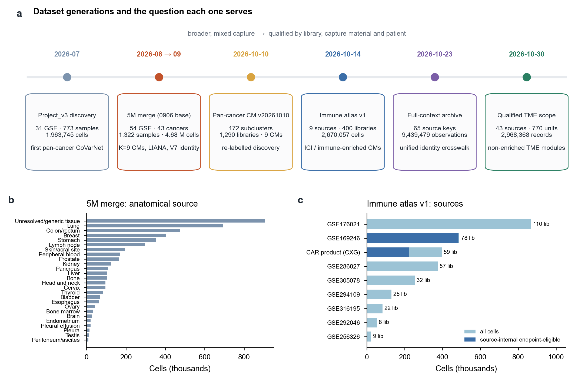
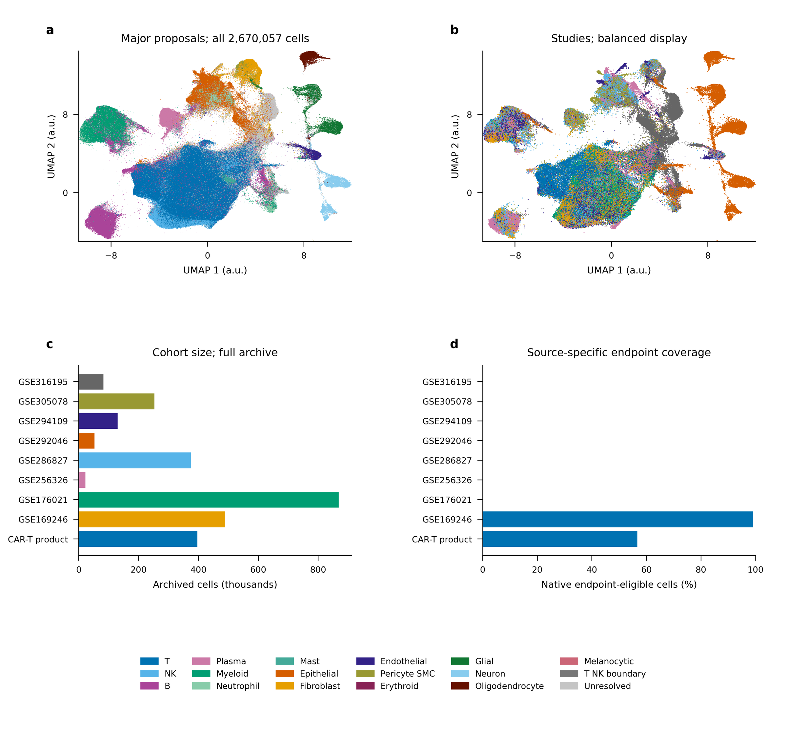

# Page 1 | Dataset selection and processing

[← Home](../../README.en.md#3-data-organization) · Pages: **1 Data** · [2 LIANA and CMs](02_liana_cm_communication.en.md) · [3 Annotation](03_annotation_logic.en.md) · [4 nsNMF](04_covarnet_nsnmf_limits.en.md) · [5 Spatial-first validation](05_spatial_first_validation.en.md) · [6 CM improvements](06_cm_discovery_improvements.en.md) · [中文](01_datasets.md)

This page describes the datasets assembled at different stages, the questions each collection was intended to address, and the shift from maximizing cell numbers to establishing eligibility by specimen and patient.

**Figure S1 | Dataset generations and their purposes.** **a**, Six data versions over time. The discovery collections on the left span many sources and mixed capture protocols; later collections progressively assess eligibility by library, captured material, and patient. **b**, Cell counts by anatomical source in the merged 5M dataset underlying the 0906 release. The “Unresolved/generic tissue” category contains 903,783 cells, illustrating gaps in source metadata. **c**, The nine sources in immune atlas v1 (2026-10-14); darker segments indicate cells eligible for endpoint analyses within their source (GSE169246 and CAR products only).

## 1 Dataset composition and purpose over time

| Date | Data version | Scale | Main purpose | Current status |
|---|---|---|---|---|
| 2026-07 | Project_v3 discovery collection | 31 GSEs · 773 samples · 1,963,745 cells · 11,063 genes | Initial unified integration and pan-cancer CoVarNet analysis | Historical version, reused read-only as the “existing 2M cohort” in the 5M collection |
| 2026-08→09 | Merged 5M collection (basis of 0906) | 54 GSEs · 43 cancer-type labels · 1,322 samples · 4,676,787 cells · 10,432 genes | K=9 CMs, per-sample LIANA, V5→V7 identity and CNV assessment | Main analysis presented on the homepage; V7 is the annotation reference |
| 2026-10-10 | Pan-cancer CMs v20261010 | 172 subpopulations · 1,290 libraries · 9 CMs | Rediscovery under new labels and an audit of CM edge coverage | Independent version; identifiers do not correspond to those in 0906 |
| 2026-10-14 | Immune atlas v1 | 9 sources · 400 physical libraries · 2,670,057 cells · 49,563 native features | Immunotherapy and immune-enriched material; continuous T-cell states; scope-specific CMs | Formally delivered; see the [previous homepage](../../README_20261026_CM02.en.md) for the CM02 analysis |
| 2026-10-23 | Full-context native archive | 65 source keys · 9,439,479 observations | Unified identities, within-source markers, and cross-version crosswalks | Hierarchical annotation in progress |
| 2026-10-30 | Eligible TME scope | 43 sources · 2,968,368 records · 770 eligibility units | Compositional CMs and within-identity state modules in non-enriched TME data | Fitting and review completed; clinical endpoints not yet incorporated |

Sources: [datasets.tsv](../../inventories/datasets.tsv), [immune atlas delivery](../../inventories/runtime/2026-10-14/immune_atlas_v1/RESULTS.md), and [eligible TME objectives](../../methods/TME-annotation-CM-state-goal-20261030.md).

## 2 Selection and processing for the 0906 release

**Sources.** The existing 2M cohort was the final output of the July integration. The new cohort comprised 24 GSEs downloaded externally on August 5, reusing converted `*_rawdata.h5ad` files. In 23 GSEs in the new cohort, `obs` lacked patient, tissue, or sample-type fields. Cancer type was therefore assigned at the GSE level from the download planning table, with provenance recorded in `cancer_type_source`.

**Per-sample quality control.** Adaptive thresholds were applied at two levels (strict for 476 sample units and floor for 73), filtering on mitochondrial fraction, total counts, and detected genes. Scrublet removed doublets (13,821 cells, approximately 0.6%; no sample reached the 8% cap). Of 3,282,991 cells in the new cohort, 2,713,042 were retained. Counts were originally stored in `.X` for all GSEs and were copied to `layers['counts']` after confirming nonnegative, near-integer values. GSE289314 contained log1p values in `.X`; it was excluded with the status `failed_no_counts_layer`.

**Merging.** The two cohorts shared 10,432 genes (94.3% of the 2M gene panel). Legacy clone-style names (RP11-, CTD-, etc.) accounted for approximately 22% of features in the new cohort; these were reported without renaming.

**Metadata audit (2026-08-29).** Sample material, immunotherapy, and metastasis information in Figure 2c–e comes from this audit: immunotherapy status could be determined for 127 samples and metastatic status for 80; material type was unknown for 284 samples.

## 3 Immune datasets and non-enriched TME datasets

The 0906 release combined all material types in one frequency matrix, although the meaning of a compositional proportion depends on the capture protocol:

- In **immune-enriched or sorted material** (CD45⁺ or CD3⁺ sorting, CAR products, or blood), cell proportions describe composition within the relevant parent lineage and cannot represent the entire TME.
- **Non-enriched tumor tissue** supports comparisons of relative composition across lineages.
- Adjacent/normal tissue, lymph nodes, and metastases provide different biological references and should not be treated as interchangeable replicates.

From October onward, data were therefore divided into four use categories: non-enriched tumor tissue for whole-TME composition and states; enriched/sorted material for states within the relevant lineage; spatial data for tissue validation of measurable identities and states; and clinical cohorts matched for cancer type, stage, and endpoint for independent clinical evaluation. Immune atlas v1 fits CMs separately by “scope,” such as `whole_TME_primary_tumor` and `immune_enriched_blood` (see [Page 6](06_cm_discovery_improvements.en.md)). The eligible TME scope additionally verifies capture protocols and patient mapping at the library level.

**Figure S1 supplement | Sources and cell composition of immune atlas v1 (publication figure dated 2026-10-26).** The atlas contains 2,670,057 cells from nine sources and 400 physical libraries, with 18 broad classes, 270 descriptive clusters, and five continuous T-cell state axes. The 708,954 cells eligible for endpoint analyses are used separately within each source.

## 4 Remaining data gaps

| Gap | Consequence | Proposed response |
|---|---|---|
| Public metadata lacks treatment, metastasis, or patient identifiers | Discovery data cannot directly address clinical questions; the number of independent patients is uncertain | Link author-provided supplementary tables; do not count material with unknown patient identity as independent patients |
| Most cancer types have only 1–2 GSEs | Cancer-type and study effects are confounded and cannot be separated statistically | Prioritize additional sources within the same cancer type |
| Enriched and non-enriched material is mixed | Compositional proportions have different meanings | Analyze separate branches; do not project enriched material as whole TME |
| Treatment phase remains unverified for 457 of the 770 eligible TME units | Material from different phases enters the same NMF | First freeze a subset with verifiable treatment phases |

[← Home](../../README.en.md#3-data-organization)
