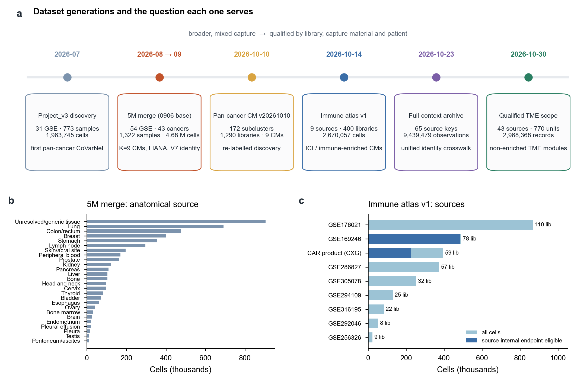
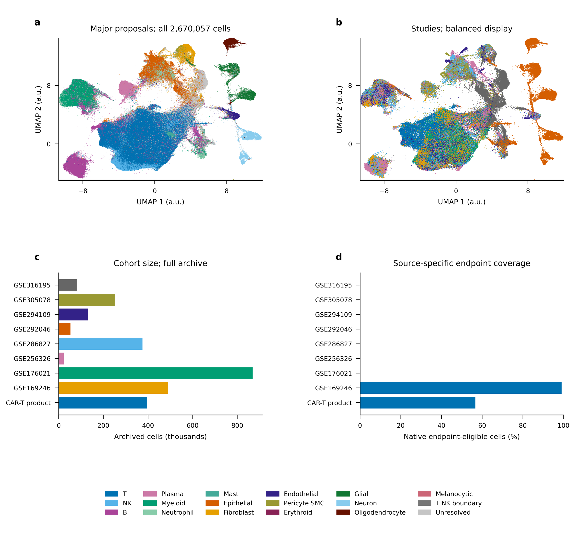

# 分页1｜数据集的选取和处理

[← 返回首页](../../README.md#3-数据的组织) · 分页：**1 数据** · [2 LIANA与CM](02_liana_cm_communication.md) · [3 注释](03_annotation_logic.md) · [4 nsNMF](04_covarnet_nsnmf_limits.md) · [5 空间优先](05_spatial_first_validation.md) · [6 CM改进](06_cm_discovery_improvements.md) · [English](01_datasets.en.md)

本页说明项目在不同时间段组织了哪些数据、每批数据用于回答什么问题，以及从“尽量多的细胞”转向“按材料和患者合格的数据”的过程。

**图S1｜数据集的世代与用途。** **a**，六个时间节点的数据版本。左侧为来源广、捕获方式混合的发现数据；右侧逐步按文库、捕获材料和患者进行资格审定。**b**，0906版本5M合并数据按解剖来源的细胞数；“Unresolved/generic tissue”为903,783个细胞，说明来源元数据的缺口。**c**，2026-10-14免疫图谱v1的9个来源，深色为来源内具备终点资格的细胞（仅GSE169246与CAR产品）。

## 1 各时间段数据集的构成与作用

| 时间 | 数据版本 | 规模 | 主要作用 | 当前状态 |
|---|---|---|---|---|
| 2026-07 | Project_v3发现集 | 31 GSE · 773样本 · 1,963,745细胞 · 11,063基因 | 首轮统一整合与泛癌CoVarNet | 历史版本，作为5M中的“已有2M队列”只读复用 |
| 2026-08→09 | 5M合并（0906基础） | 54 GSE · 43癌种标签 · 1,322样本 · 4,676,787细胞 · 10,432基因 | K=9 CM、逐样本LIANA、V5→V7身份与CNV | 本首页主线；V7为注释参考 |
| 2026-10-10 | 泛癌CM v20261010 | 172子群 · 1,290文库 · 9 CM | 新标签下的重新发现与CM边覆盖审计 | 独立版本，编号与0906不对应 |
| 2026-10-14 | 免疫图谱v1 | 9来源 · 400物理文库 · 2,670,057细胞 · 49,563原生特征 | 免疫治疗与免疫富集材料；T细胞连续状态；分范围CM | 正式交付；CM02主线见[上一版首页](../../README_20261026_CM02.md) |
| 2026-10-23 | 全背景原生档案 | 65来源键 · 9,439,479条观测 | 统一身份、来源内marker与跨版本crosswalk | 分层注释进行中 |
| 2026-10-30 | 合格TME范围 | 43来源 · 2,968,368条记录 · 770资格单位 | 非富集TME的组成CM与身份内状态模块 | 已完成拟合与审阅；临床终点未接入 |

数据来源：[datasets.tsv](../../inventories/datasets.tsv)、[免疫图谱交付](../../inventories/runtime/2026-10-14/immune_atlas_v1/RESULTS.md)、[合格TME目标](../../methods/TME-annotation-CM-state-goal-20261030.md)。

## 2 0906版本的选取与处理

**来源。** 已有2M队列来自7月统一整合的最终产物；新队列为8月5日外部下载的24个GSE，复用已转换的`*_rawdata.h5ad`。新队列中23个GSE在obs中没有患者、组织或样本类型字段，癌种按下载策划表以GSE为单位回填并标注`cancer_type_source`。

**逐样本质控。** 自适应阈值（476个样本单元用strict档，73个用floor档），按线粒体比例、总计数和检测基因数过滤，Scrublet去双细胞（13,821个，约0.6%，无样本触发8%上限）。新队列3,282,991个细胞保留2,713,042个。所有GSE的计数原写在`.X`中，在确认非负且近整数后复制为`layers['counts']`；GSE289314的`.X`为log1p值，被标记为`failed_no_counts_layer`排除。

**合并。** 两批取基因交集10,432个（占2M基因面板的94.3%）。旧式克隆命名（RP11-、CTD-等）在新队列中约占22%，只上报不改写。

**元数据审计（2026-08-29）。** 图2c–e的样本材料、免疫治疗和转移信息来自这轮审计：免疫治疗可判断者127个样本，转移可判断者80个；284个样本的材料类型未知。

## 3 免疫数据集与非富集TME数据集

0906版本把所有材料混在一个频率矩阵中，而“组成比例”的含义依赖于捕获方式：

- **免疫富集或分选材料**（CD45⁺、CD3⁺分选，CAR产品，血液）中的细胞比例反映的是父谱系内部的组成，不能代表整个TME；
- **非富集肿瘤组织**才可以讨论跨谱系的相对组成；
- 癌旁/正常组织、淋巴结和转移灶提供不同的生物学参照，不宜作为同一组样本的重复。

因此10月起数据按用途分为四类：未富集肿瘤组织用于全TME组成与状态；富集/分选材料只在相应谱系内研究状态；空间数据用于可测身份/状态的组织验证；同癌种、同阶段、同终点的临床队列用于独立临床评价。免疫图谱v1按“范围”（如`whole_TME_primary_tumor`、`immune_enriched_blood`）分别拟合CM（见[分页6](06_cm_discovery_improvements.md)），合格TME范围则在文库层面核定捕获方式和患者对应。

**图S1补｜免疫图谱v1的来源与细胞组成（2026-10-26正式图稿）。** 该图谱覆盖2,670,057个细胞、9个来源和400个物理文库，提供18个大类、270个描述分群及T细胞五条连续状态轴；终点资格细胞708,954个，按来源分别使用。

## 4 仍存在的数据缺口

| 缺口 | 影响 | 处理方向 |
|---|---|---|
| 公开元数据缺少治疗、转移、患者编号 | 发现数据无法直接做临床问题；独立患者数不确定 | 作者补充表桥接；患者未知的材料不计入独立患者 |
| 多数癌种只来自1–2个GSE | 癌种效应与研究效应混杂，统计校正无法分开 | 优先补“同癌种多来源” |
| 富集与非富集材料混合 | 组成比例语义不一 | 分支分析；富集材料不做全TME投影 |
| 合格TME的770单元中457个治疗阶段待核实 | 不同阶段材料混入同一NMF | 先冻结阶段可核的子范围 |

[← 返回首页](../../README.md#3-数据的组织)
