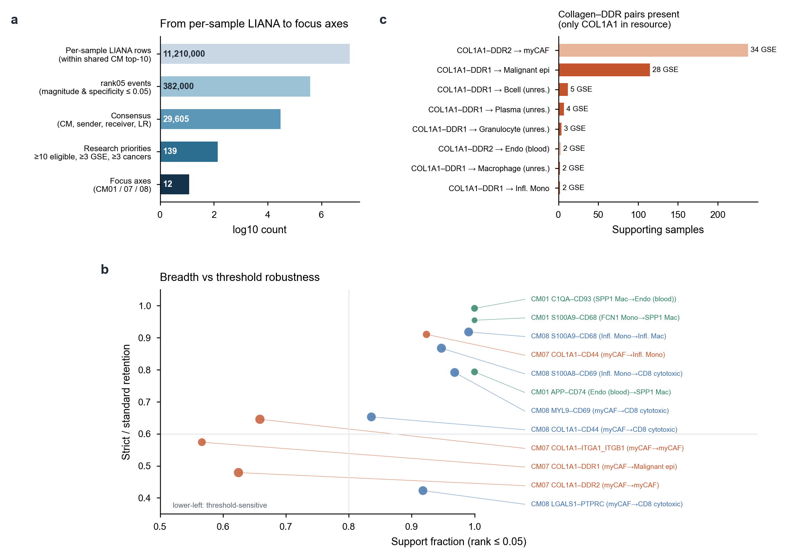

# Page 2 | Linking LIANA communication to cellular modules: interpretation and limitations

[← Home](../../README.en.md#6-cellcell-communication-axes-in-cm01-cm07-and-cm08) · Pages: [1 Data](01_datasets.en.md) · **2 LIANA and CMs** · [3 Annotation](03_annotation_logic.en.md) · [4 nsNMF](04_covarnet_nsnmf_limits.en.md) · [5 Spatial-first validation](05_spatial_first_validation.en.md) · [6 CM improvements](06_cm_discovery_improvements.en.md) · [中文](02_liana_cm_communication.md)

In the 0906 release, communication analysis connects compositional modules to mechanistic interpretation. This page explains how that connection was constructed and where the evidence remains insufficient.

**Figure S2 | From per-sample LIANA results to priority axes.** **a**, Counts at successive filtering stages (log scale): approximately 11.21 million within-CM per-sample rows → approximately 382,000 events with both magnitude and specificity ranks ≤0.05 → 29,605 consensus interactions aggregated by (CM, sender, receiver, ligand, receptor) → 139 research-priority candidates after requiring ≥10 testable samples, ≥3 GSEs, and ≥3 cancer types and excluding self-communication and background axes → 12 focal axes in CM01/07/08. **c**, Collagen–DDR pairs represented in the LIANA consensus resource: DDR1 is paired only with COL1A1; COL1A2–DDR1 and COL3A1–DDR1 are absent. **b**, Standard-threshold support fractions and strict/standard retention fractions for the 12 axes. Axes in the upper right (such as C1QA→CD93 and S100A9→CD68) are widely supported among testable samples and robust to the threshold. COL1A1→DDR1, COL1A1→DDR2, and COL1A1→ITGA1_ITGB1 are weaker on both measures. LGALS1→PTPRC has a high support fraction (0.92), but only 42% is retained at the strict threshold.

## 1 How CMs and LIANA are connected

1. Run `liana.mt.rank_aggregate` independently for each original sample, grouping cells by the fine states in `final_annotation_with_malignancy_v6`, with ≥20 cells per group, `expr_prop=0.10`, and `seed=1337`. Runs succeeded for 1,301/1,322 samples.
2. Apply **within-CM filtering**: retain only interactions whose sender and receiver both belong to a CM's top 10 members, and assign a `shared_cm` label.
3. Retain per-sample ligand–receptor (LR) events with ranks ≤0.05. Aggregate by (CM, sender, receiver, ligand complex, receptor complex), recording supporting samples, GSEs, cancer types, and mean ranks, and calculate `replicate_rank_score = log1p(n_samples) × −log10(√(mag×spec))`.
4. Add the testable denominator (samples with ≥20 cells in both groups), support fraction, and Wilson interval to the research-priority table.

## 2 Potential limitations

**(1) Circularity in member selection.** Step 2 uses CM membership to restrict eligible communicating cell pairs, while CM membership itself is derived from covarying cell proportions. Two populations that consistently increase together are also more likely to both reach ≥20 cells and be evaluated by LIANA. Within-CM communication is therefore not evidence independent of the CM; it is better interpreted as identifying specific LR pairs among populations already known to covary.

**(2) Abundance and specificity.** LIANA's magnitude depends on expression level, whereas specificity depends on comparisons across groups. S100A8/A9→CD68 and S100A8→CD69 occur in almost all samples containing inflammatory myeloid cells (support fractions 0.95–0.99), and their bulk proxies provide no information beyond the parent signature. They more closely reflect the compositional fact that myeloid cells are abundant. MYL9→CD69 and COL1A1→CD44 (myCAF→monocytes/CD8 T cells) behave similarly.

**(3) Threshold sensitivity.** Retention between rank thresholds ≤0.01 and ≤0.05 ranges from 0.42 to 0.99 across axes (Figure 5b). The median magnitude rank for COL1A1→DDR1 is approximately 0.01, near the threshold: collagen expression is high, whereas tumor DDR1 expression is relatively low. Reporting support at all three thresholds helps prevent borderline axes from being interpreted as robust findings.

**(4) Resource coverage.** DDR1 has only one ligand, COL1A1, in the consensus resource (Figure S2c). Thus, the single-cell “collagen–DDR1” analysis actually evaluates only COL1A1–DDR1. Frequent axes such as B2M–KLRD1/KLRC occupy many high-ranking positions and must be explicitly excluded as background.

**(5) Identity resolution.** Senders and receivers in 0906 include unresolved nodes such as `Granulocyte_unresolved` and `Plasma_unresolved` (Figure 4a). LR results for these nodes cannot be assigned to a specific cell state.

**(6) From single-cell data to bulk.** A bulk proxy uses the smaller of the ligand and receptor z-scores to represent “both ends high.” It is affected by the abundance of both sender and receiver cells and cannot recover directionality. Model C tests only whether a proxy adds information beyond its parent signature. The SPP1 macrophage and LGALS1 proxies passed this test; the collagen–DDR1 proxy was collinear with the desmoplasia signature and reversed direction after conditioning on it.

**(7) Statistical unit.** Support fractions use samples as the unit, but multiple samples from one patient or GSE are not independent. The largest single-GSE contribution (12% for COL1A1→DDR1) can flag study dominance, but cannot replace patient-level or source-held-out analysis.

## 3 Possible improvements

| Direction | Approach |
|---|---|
| Reduce circularity | Run LIANA on all cell pairs, then test whether CM-member pairs are more enriched for particular LR classes than abundance-matched non-member pairs; permute membership while preserving the abundance distribution |
| Separate abundance from communication | Adjust for within-sample cell counts and detected genes, or compare LR changes for the same cell pair between samples with high and low CM activity |
| Receiver-side evidence | Add pathway/TF responses in receiving cells, using approaches such as NicheNet or downstream scoring in LIANA+; require both LR and receiver-response support |
| Resource coverage | Use multiple resources in parallel and report resource-specific axes separately |
| Spatial constraints | Evaluate LR only in spatially adjacent cell pairs (see [Page 5](05_spatial_first_validation.en.md)) |

For the full audit, see the [communication evidence-chain report (Chinese)](../../releases/communication_evidence_chain_20260906/reports/COMMUNICATION_EVIDENCE_CHAIN_CN.md) and [evidence matrix](../../releases/communication_evidence_chain_20260906/tables/EVIDENCE_MATRIX.tsv).

[← Home](../../README.en.md#6-cellcell-communication-axes-in-cm01-cm07-and-cm08)
