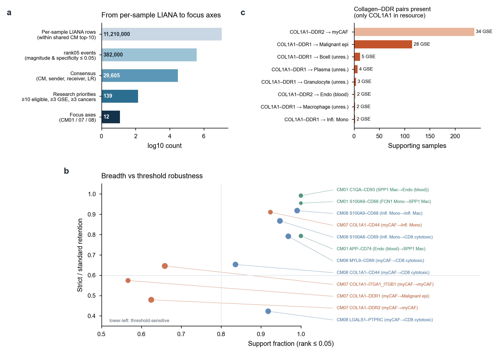

# 分页2｜LIANA通讯与CM模块的联系及潜藏的问题

[← 返回首页](../../README.md#6-cm01cm07cm08的细胞通讯轴) · 分页：[1 数据](01_datasets.md) · **2 LIANA与CM** · [3 注释](03_annotation_logic.md) · [4 nsNMF](04_covarnet_nsnmf_limits.md) · [5 空间优先](05_spatial_first_validation.md) · [6 CM改进](06_cm_discovery_improvements.md) · [English](02_liana_cm_communication.en.md)

0906版本中，通讯分析是连接“组成模块”和“机制解释”的桥。本页说明这座桥如何搭建，以及它在哪些地方承重不足。

**图S2｜从逐样本LIANA到重点轴。** **a**，逐级筛选的数量（对数坐标）：within-CM逐样本行约1,121万 → magnitude与specificity rank均≤0.05的事件约38.2万 → 按（CM、发送者、接收者、配体、受体）汇总的共识29,605条 → 要求≥10个可检验样本、≥3个GSE、≥3个癌种并去除自通讯和背景轴后的研究优先候选139条 → CM01/07/08的12条重点轴。**c**，LIANA consensus资源中出现的胶原—DDR配对：DDR1只与COL1A1配对，COL1A2、COL3A1与DDR1不在资源中。**b**，12条轴的标准阈值支持比例与“严格/标准保留比例”。右上（如C1QA→CD93、S100A9→CD68）在可检验样本中广泛且对阈值稳健；COL1A1→DDR1、COL1A1→DDR2、COL1A1→ITGA1_ITGB1在两方面都较弱；LGALS1→PTPRC支持比例高（0.92），但严格阈值下仅保留42%。

## 1 CM与LIANA是如何连接的

1. 每个原始样本独立运行`liana.mt.rank_aggregate`，分组为`final_annotation_with_malignancy_v6`细分状态，每组≥20个细胞，`expr_prop=0.10`，`seed=1337`；1,301/1,322个样本成功。
2. **within-CM过滤**：只保留发送者和接收者同属某个CM前10成员的互作，并打上`shared_cm`标签。
3. 逐样本、逐LR保留rank≤0.05的事件；按（CM、发送者、接收者、配体复合物、受体复合物）汇总支持样本数、GSE数、癌种数及平均rank，并计算`replicate_rank_score = log1p(n_samples) × −log10(√(mag×spec))`。
4. 研究优先表加入可检验分母（两组均≥20细胞的样本数）、支持比例及Wilson区间。

## 2 潜藏的问题

**(1) 成员定义的循环。** 第2步用CM成员来限定哪些细胞对可以通讯，而CM成员本身来自共变的细胞比例。两个总是一起增多的细胞群，自然也更常同时达到≥20个细胞、同时被LIANA评估。within-CM通讯因此不是独立于CM的证据，更适合理解为“在已知共变的细胞对中，哪些LR具有特异性”。

**(2) 丰度与特异性。** LIANA的magnitude依赖表达量，specificity依赖组间比较。S100A8/A9→CD68、S100A8→CD69几乎在所有含炎性髓系的样本中出现（支持比例0.95–0.99），bulk中也不提供超出父签名的信息，更接近“髓系多”这一组成事实。MYL9→CD69、COL1A1→CD44（myCAF→单核/CD8）的情况类似。

**(3) 阈值敏感性。** 同一条轴在rank≤0.01与≤0.05之间的保留比例从0.42到0.99不等（图5b）。COL1A1→DDR1的magnitude rank中位数约0.01，处于阈值边缘——胶原表达高而肿瘤DDR1表达偏低。报告支持比例时同时给出三档阈值，可以避免把阈值附近的轴读成稳健结果。

**(4) 资源覆盖。** consensus资源中DDR1只有COL1A1一个配体（图S2c），因此单细胞层面的“collagen–DDR1”实际只评估了COL1A1–DDR1。B2M–KLRD1/KLRC等高频轴在汇总中占据大量排名，需显式作为背景剔除。

**(5) 身份粒度。** 0906的发送者/接收者包含`Granulocyte_unresolved`、`Plasma_unresolved`等未细分节点（图4a）。未细分节点上的LR结果无法落到具体细胞状态。

**(6) 从单细胞到bulk。** bulk代理以配体和受体z分的较小值表示“两端都高”，它同时受发送和接收细胞丰度影响，无法恢复方向。模型C的意义仅在于检验“代理是否在父签名之外提供额外信息”：SPP1巨噬代理和LGALS1代理通过了这一检验，collagen–DDR1代理与desmoplasia签名共线、条件后方向翻转。

**(7) 统计单位。** 支持比例以样本为单位；同一患者的多个样本、同一GSE的多个样本并不独立。最大单一GSE占比（COL1A1→DDR1为12%）可以提示是否被单个研究驱动，但不能代替患者级或来源留出分析。

## 3 可以如何改

| 方向 | 做法 |
|---|---|
| 解除循环 | 在全部细胞对上运行LIANA，再检验CM成员对是否比匹配丰度的非成员对更富集某类LR（置换成员标签，保持丰度分布） |
| 区分丰度与通讯 | 以样本内细胞数、检测基因数为协变量，或比较同一细胞对在CM活动高/低样本中的LR变化 |
| 受体端证据 | 加入接收细胞的通路/TF响应（如NicheNet、LIANA+的下游打分），要求LR与受体端响应同时成立 |
| 资源 | 并行使用多套资源，单列只在某一资源中出现的轴 |
| 空间约束 | 只在空间上相邻的细胞对中评估LR（见[分页5](05_spatial_first_validation.md)） |

完整审计见[通讯证据链报告](../../releases/communication_evidence_chain_20260906/reports/COMMUNICATION_EVIDENCE_CHAIN_CN.md)与[证据矩阵](../../releases/communication_evidence_chain_20260906/tables/EVIDENCE_MATRIX.tsv)。

[← 返回首页](../../README.md#6-cm01cm07cm08的细胞通讯轴)
