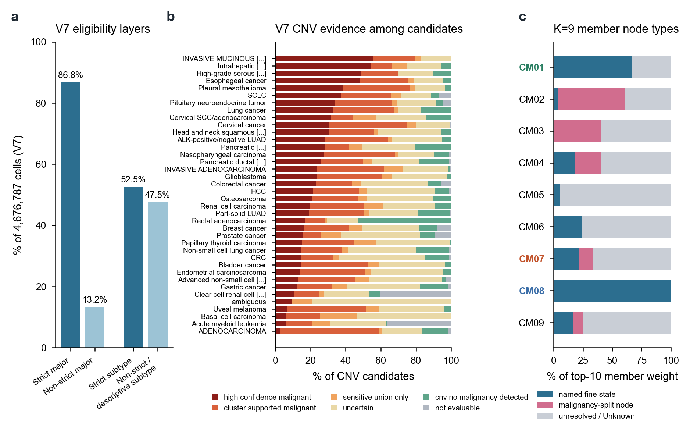

# Page 3 | Annotation logic in the 0906 release and subsequent revisions

[← Home](../../README.en.md#4-integration-and-annotation-in-the-0906-release) · Pages: [1 Data](01_datasets.en.md) · [2 LIANA and CMs](02_liana_cm_communication.en.md) · **3 Annotation** · [4 nsNMF](04_covarnet_nsnmf_limits.en.md) · [5 Spatial-first validation](05_spatial_first_validation.en.md) · [6 CM improvements](06_cm_discovery_improvements.en.md) · [中文](03_annotation_logic.md)

CM nodes are annotated cell subpopulations, so annotation determines what a module contains. This page describes the annotations used in the 0906 release (V5 identities and the V7 reference), the subsequent V8/V9 attempts, and the cluster-first, hierarchical strategy adopted in October.

**Figure S3 | Annotation layers and their effects on CMs.** **a**, Two levels of eligibility in V7: 86.76% qualify for strict broad-class analysis and 52.50% for strict subtype analysis; the remainder are boundary, pending, or descriptively unresolved labels. **b**, Malignancy evidence among V7 CNV candidate cells by cancer type (types with >2,000 candidates), sorted by the high-confidence fraction. **c**, Fractions of the top-10 member loadings in each K=9 CM assigned to named fine states, malignancy-evidence categories (such as `Malignancy_uncertain::Ambiguous`), and unresolved/Unknown nodes. CM08 consists entirely of named states; CM05, CM03, and CM02 are dominated by the latter two categories.

## 1 The 0906 release: V5 identities

**Broad-class arbitration.** Three evidence streams were used: author-provided per-cell labels (“literature”), marker scores calculated using true whole-transcriptome library sizes, and CellTypist (`Immune_All_Low`, which is approximately noise for non-immune cells and is therefore used only as supporting evidence within its applicable scope). Overall broad-class agreement between literature labels and CellTypist was 68.1% (71.7% in the existing cohort and 42.1% in the new cohort). The v1→v2 revision introduced negative exclusion markers for 17 lineages (for example, LST1/TYROBP/MS4A1/COL1A1/PECAM1 for T cells), changing the broad-class assignments of 514,215 cells. Unknown and Ambiguous labels were allowed.

**Fine annotation.** Lineages were reclustered with Leiden on the BBKNN graph and annotated using expanded marker panels. Revisions from v1 to v5 produced 41 identity labels. Malignancy was assessed through a tiered consensus of per-sample inferCNVpy, CopyKAT, and scATOMIC results. In the CoVarNet input, epithelial `subCluster` labels were replaced by malignancy categories, such as `Malignant::Epithelial` and `Malignancy_uncertain::Unknown`.

**Known instability.** Within-lineage BBKNN+Leiden reclustering was sensitive to input perturbation: removing 0.046% of cells reduced the adjusted Rand index (ARI) of T-cell reclustering to 0.61. Erythroid, HSPC, and ILC populations more closely resemble continuous differentiation trajectories, for which discrete clustering is unsuitable.

## 2 V7: frozen on 2026-09-05 and used as the reference from 0906 onward

V7 made two changes on the same index of 4,676,787 cells ([full logic, Chinese](../../releases/annotation_v7_20260905/methods/V7_REFERENCE_AND_ANNOTATION_LOGIC_CN.md)):

1. **Repairing uncertainty handling.** Under the old rules, a single negative marker could veto a candidate. V7 records a single negative marker as `provisional_negative_review`; at least two concordant negative markers are required to establish a competing program. Consistent conflicts across compartments remain Ambiguous. If such cells also fall in the high tail of the sample's doublet-score distribution, they are excluded from the main analysis without being deleted. Low-margin assignments between neighboring lineages are represented by boundary classes such as `T_NK_ILC_boundary` and `Myeloid_boundary`. Among 1,073,743 subtype-unresolved cells, 91,805 were rescued under strict criteria, 609,412 received descriptive `_unresolved_GENE` suffixes, and 372,526 still lacked markers robust across samples.
2. **Rerunning CNV per sample.** Using the revised broad classes, candidate/reference sets were rebuilt from raw counts for each original sample (1,156,120 candidates and 2,465,967 references). inferCNVpy and a fixed CopyKAT version were run separately, and results were classified as high-confidence, cluster-supported, sensitivity-union-only, uncertain, not detected, or not evaluable. Skipped samples were not interpreted as negative.

V7 also corrected gene aliases (such as KIM1→HAVCR1 and SEPP1/SELENOP) and GSE-specific structural-missingness masks, preventing “not measured” from being treated as “zero expression.”

**What V5→V7 means for CMs.** Homepage Figure 3e shows that 69% of the 393k V5 Ambiguous cells and 41% of the 454k V5 Unknown cells acquired definite lineage assignments in V7. However, the K=9 CMs were fitted on V5, and most member loading in CM02, CM03, and CM05 falls on these uncertain nodes (Figure S3c). Rerunning CoVarNet/LIANA on V7 could change module membership; this was not done for the 0906 communication evidence chain.

## 3 V8 and V9: attempts at lineage taxonomies in September 2026

| Version | Content | Status |
|---|---|---|
| V8 (from September 12) | Separate rule and taxonomy freezes for Myeloid/DC, T/NK, Fibroblast, Endothelial, and B/Plasma; held-out evaluation planned across 12 GSEs | Globally `NOT_FROZEN`; the T/NK holdout was contaminated, and 45.4% of cells in the B/Plasma development set fell back to competing lineages |
| V9 (September 19) | Frozen candidate report and L3 manual-review template | `FROZEN_CANDIDATE_NOT_PROMOTED`; 15 L3 clusters awaiting sign-off and 632 samples recommended for CNV reruns |

Neither replaced V7. The main lessons are that holdout sets must be defined before any outputs are generated, and freezing a lineage taxonomy is distinct from writing labels back to all cells. See the [V8 audit](../../releases/annotation_v8_lineage_audit_20260917/README.md) and [V9 candidate](../../releases/annotation_v9_candidate_20260919/README.md).

## 4 Revisions from October onward

| Change | 0906 approach | October approach | Basis |
|---|---|---|---|
| Naming order | Apply reference/marker panels first, then subdivide | **Cluster first**: name groups as `Celltype_MARKER_number` using their own native expression (positive enrichment and detection rates), then cross-check against CellTypist/SingleR references; retain broad classes when finer identity is unclear | [Cluster-first method](../../methods/TME_CLUSTER_FIRST_AUTOMATIC_CROSSCHECK.md) |
| Evidence provenance | Parent-group markers could be borrowed | Record own-group and borrowed parent-group markers in separate fields; do not propagate group labels as per-cell ground truth | [Full-context hierarchical annotation](../../methods/full-context-atlas-hierarchical-annotation-plan-20261023.md) |
| Identity and state | Proliferation, cytotoxicity, or IFN could become subpopulation names | Separate identity (L1 parent lineage→L2 subidentity→L3 local group) from continuous states; multiple states may be active simultaneously | [Next-stage plan](../../methods/CM-project-next-stage-20261030.md) |
| Integration foundation | BBKNN, with a small scIB advantage | Use an scVI working atlas for the original nine immune sources: 36 Leiden clusters map to 27 display names, with mixed clusters explicitly documented | [Parallel scVI integration](../../methods/TME-scVI-GPU-comparison-20261029.md) |
| Cross-version mapping | Versions remained separate | Build crosswalks between old and new identities, fully preserving the original 270 descriptive groups and author identities | [Annotation release index](../../releases/README.md) |

These revisions share one goal: every CM node should have its own native-expression evidence and consistency across sources, while unresolved identity remains visible rather than being absorbed into a named member.

[← Home](../../README.en.md#4-integration-and-annotation-in-the-0906-release)
