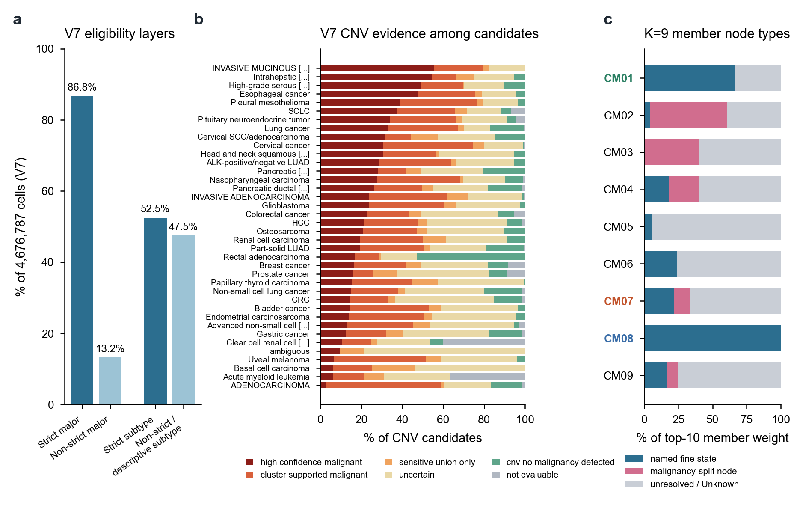

# 分页3｜0906的注释逻辑与后续调整

[← 返回首页](../../README.md#4-整合处理与0906注释) · 分页：[1 数据](01_datasets.md) · [2 LIANA与CM](02_liana_cm_communication.md) · **3 注释** · [4 nsNMF](04_covarnet_nsnmf_limits.md) · [5 空间优先](05_spatial_first_validation.md) · [6 CM改进](06_cm_discovery_improvements.md)

CM的节点就是注释得到的细胞亚群，因此注释决定了模块里“有什么”。本页依次说明0906版本使用的注释（V5身份与V7参考）、其后V8/V9的尝试，以及10月改用的cluster优先与分层策略。

**图S3｜注释层次与它对CM的影响。** **a**，V7的两层资格：严格大类86.76%、严格亚型52.50%；其余为边界、待定或描述性unresolved。**b**，V7中各癌种CNV候选细胞的恶性证据构成（候选细胞>2,000的癌种），按高置信比例排序。**c**，K=9各CM前10成员载荷中，已命名细分状态、恶性证据分层节点（如`Malignancy_uncertain::Ambiguous`）和unresolved/Unknown节点的比例。CM08全部为命名状态；CM05、CM03、CM02主要由后两类构成。

## 1 0906版本：V5身份

**大类仲裁。** 三路证据：数据集作者逐细胞标签（literature）、按真实全转录组文库大小计算的marker分数、CellTypist（`Immune_All_Low`，对非免疫细胞近似噪声，因此只在适用范围内作为支持）。literature与CellTypist的大类整体一致率68.1%（已有队列71.7%，新队列42.1%）。v1→v2引入17个谱系的负向排除marker（如T细胞配LST1/TYROBP/MS4A1/COL1A1/PECAM1），514,215个细胞的大类因此改变；允许Unknown与Ambiguous。

**细分。** 在BBKNN图上按谱系做Leiden重聚类，结合扩展marker面板，v1→v5多轮修订后得到41个身份标签。恶性维度来自逐样本inferCNVpy、CopyKAT及scATOMIC的分层共识；在CoVarNet输入中，上皮细胞的subCluster被替换为恶性判定类别（如`Malignant::Epithelial`、`Malignancy_uncertain::Unknown`）。

**已知的不稳定性。** BBKNN+Leiden谱系内重聚类对输入扰动敏感：移除0.046%的细胞，T细胞重聚类的ARI降至0.61。Erythroid、HSPC、ILC更像连续分化轨迹，离散聚类不适用。

## 2 V7（2026-09-05冻结，0906起为参考）

V7在同一4,676,787细胞索引上做了两件事（[完整逻辑](../../releases/annotation_v7_20260905/methods/V7_REFERENCE_AND_ANNOTATION_LOGIC_CN.md)）：

1. **不确定性修复。** 旧规则中单个负marker即可否决候选；V7改为单个负marker记为`provisional_negative_review`，至少两个方向一致的负marker才视为竞争程序；跨区室一致冲突保留为Ambiguous，同时处于样本双细胞分位数高位时设为不进入主分析（不删除）。相邻谱系间的低margin以`T_NK_ILC_boundary`、`Myeloid_boundary`等边界类表示。对1,073,743个亚型unresolved细胞：91,805个严格救援，609,412个获得描述性`_unresolved_GENE`后缀，372,526个仍无跨样本稳健marker。
2. **逐样本CNV重跑。** 依据新的大类，按原始样本由raw counts重建candidate/reference（共1,156,120个candidate、2,465,967个reference），分别运行inferCNVpy与固定版本CopyKAT，再分层为高置信、cluster支持、仅敏感并集、不确定、未检出与不可评估。跳过的样本不解释为阴性。

V7还修正了基因别名（如KIM1→HAVCR1、SEPP1/SELENOP）和按GSE的结构性缺测掩码，避免把“未测到”当成“零表达”。

**V5到V7对CM的含义。** 首页图3e显示，V5中393k个Ambiguous细胞有69%在V7获得确定谱系，454k个Unknown细胞有41%获得确定谱系。而K=9 CM是在V5上拟合的——CM02、CM03、CM05的大部分成员载荷落在这些不确定节点上（图S3c）。在V7上重跑CoVarNet/LIANA可能改变这些模块的成员；0906的通讯证据链没有做这一步。

## 3 V8与V9：谱系分类学的尝试（2026-09）

| 版本 | 内容 | 状态 |
|---|---|---|
| V8（09-12起） | Myeloid/DC、T/NK、Fibroblast、Endothelial、B/Plasma五个谱系分别冻结规则与分类学，计划用12个GSE做留出评估 | 全局`NOT_FROZEN`；T/NK留出被污染，B/Plasma开发集中45.4%细胞回落到竞争谱系 |
| V9（09-19） | 冻结候选报告与L3人工复核模板 | `FROZEN_CANDIDATE_NOT_PROMOTED`；15个L3 cluster待签、632个样本建议重跑CNV |

两者都没有替代V7。主要教训是：留出集必须在任何输出产生之前划定；谱系分类学冻结和全局细胞级写回是两件事。见[V8审计](../../releases/annotation_v8_lineage_audit_20260917/README.md)、[V9候选](../../releases/annotation_v9_candidate_20260919/README.md)。

## 4 10月后的调整逻辑

| 调整 | 0906的做法 | 10月的做法 | 依据 |
|---|---|---|---|
| 命名顺序 | 先套参考/marker面板，再细分 | **cluster优先**：先用本群原生表达（正向富集+检出率）命名`Celltype_MARKER_编号`，再与CellTypist/SingleR自动参考交叉核对；细分不清时保留大类 | [cluster优先方法](../../methods/TME_CLUSTER_FIRST_AUTOMATIC_CROSSCHECK.md) |
| 证据来源 | 允许借用父群marker | 本群marker与借用父群marker分字段记录；群级标签不广播为逐细胞真值 | [全背景分层注释](../../methods/full-context-atlas-hierarchical-annotation-plan-20261023.md) |
| 身份与状态 | 增殖、细胞毒、IFN等可能成为亚群名 | 身份（L1父谱系→L2子身份→L3局部群）与连续状态分开；状态可以同时活跃 | [下一阶段方案](../../methods/CM-project-next-stage-20261030.md) |
| 整合基座 | BBKNN（scIB微弱领先） | 免疫原九来源改用scVI工作图谱：36个Leiden群映射为27个展示名称，混合群在文档中注明 | [scVI平行整合](../../methods/TME-scVI-GPU-comparison-20261029.md) |
| 跨版本 | 版本之间各自独立 | 新旧身份建立crosswalk，旧270描述群、作者身份完整保留 | [注释发布索引](../../releases/README.md) |

这些调整服务于同一个目标：让CM的每个节点都有自己的原生表达证据和跨来源一致性，让“未定”成为可见的状态，而不是被并入某个成员。

[← 返回首页](../../README.md#4-整合处理与0906注释)
