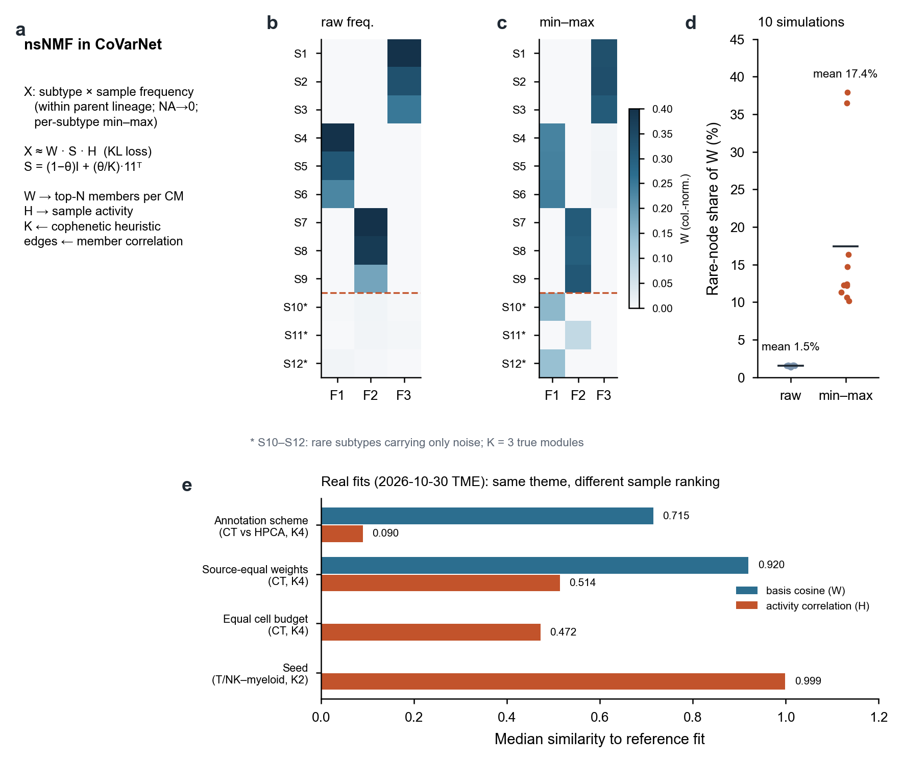

# Page 4 | Limitations of nsNMF in CoVarNet and possible improvements

[← Home](../../README.en.md#5-the-k9-cellular-module-landscape) · Pages: [1 Data](01_datasets.en.md) · [2 LIANA and CMs](02_liana_cm_communication.en.md) · [3 Annotation](03_annotation_logic.en.md) · **4 nsNMF** · [5 Spatial-first validation](05_spatial_first_validation.en.md) · [6 CM improvements](06_cm_discovery_improvements.en.md) · [中文](04_covarnet_nsnmf_limits.md)

CoVarNet formulates the question “which cell populations increase and decrease together?” as a nonnegative matrix factorization problem. This formulation is simple and interpretable, but input construction and optimization details can substantially affect the modules obtained. This page illustrates these effects using a reproducible simulation and diagnostics from actual project fits.

**Figure S4 | Behavior of nsNMF on compositional matrices.** **a**, CoVarNet input and factorization. **b–c**, Simulation with 12 subpopulations × 200 samples: S1–S9 are generated from three true modules; S10–S12 are rare subpopulations containing only sparse noise. K=3, θ=0.5, and KL loss are used. With raw frequencies (b), rare populations contribute almost no loading to any factor. After per-subpopulation min–max scaling (c), they span the same numerical range as common populations and acquire visible factor loadings. **d**, Rare-population share of W across 10 independent simulations: a mean of 1.5% with raw input versus 17.4% after min–max scaling. **e**, Recorded diagnostics from the eligible TME fits dated 2026-10-30: with the same cells and K=4, two annotation schemes yield a basis cosine similarity of 0.715 but a sample-activity correlation of only 0.090. Equal source weighting gives a basis cosine of 0.920 and activity correlation of 0.514; an equal cell budget gives an activity correlation of 0.472. Different seeds on the same panel yield an activity correlation of 0.999. Simulation code is in `simulate_rare` and `nmf_kl` in the [figure-rendering script](../../scripts/render_homepage_v2_figures.py).

## 1 Where nsNMF enters CoVarNet

The authors' CoVarNet code calculates subpopulation frequencies within broad classes, fills missing values with zero, and applies row-wise (per-subpopulation) min–max scaling. The z-score branch truncates negative values. It then runs nsNMF:

X ≈ W·S·H, S = (1−θ)I + (θ/K)·11ᵀ

S smooths H toward the mean across factors, encouraging a sparser W and making member selection easier. Rank is selected heuristically from the cophenetic correlation curve across repeated initializations. Each CM takes the top N members by loading, and a network is then constructed from correlations among those members across samples.

## 2 Limitations

**(1) Per-subpopulation min–max scaling amplifies rare and noisy nodes.** Min–max scaling gives every subpopulation the same range regardless of abundance or measurement precision. Proportional noise from a population with only a few dozen cells in a handful of samples is stretched to the same scale as major T-cell populations (Figure S4b–d). In the 0906 K=9 model, `Granulocyte_unresolved` is CM07's highest-loading member (19.4%), while `HSPC_unresolved` and `Platelet_coarse` are CM06's top two members. These nodes are sparse and have unresolved identities.

**(2) Compositional closure.** Proportions within a parent lineage sum to one, so an increase in one subpopulation necessarily accompanies decreases in others. This can create reciprocal structures in W that reflect either genuine replacement or a denominator effect. Filling missing values with zero also conflates “no opportunity to observe” with “observed zero.”

**(3) Rank selection.** Choosing the rank immediately before the first drop in cophenetic correlation can select K=2 in different panels, as happened in all four main panels of the new October TME analysis. When K=2 and H₁+H₂=1, the two “modules” are effectively a single contrast axis. Raising the maximum candidate K does not change where the first drop occurs.

**(4) Membership and networks.** Top-N selection determines both membership and the specificity threshold; changing top 10 to top 15 does more than add five members. Network edges are calculated from member correlations separately from the NMF objective. Empty networks and duplicate edges require explicit handling and interpretation.

**(5) Two levels of stability.** High agreement across seeds (activity correlation 0.999) indicates optimization stability only. Changing annotation or source weights can leave the basis—the module themes—largely intact while substantially changing the ranking of sample activities (Figure S4e). Downstream clinical associations depend on sample rankings, making this more consequential than thematic stability alone.

**(6) Composition alone.** Compositional CMs identify populations that become more abundant together; they do not represent functional states within cell types. Two tumors with the same T-cell proportion may have very different IFN, cytotoxicity, or exhaustion programs.

## 3 Possible improvements

| Direction | Approach | Question addressed |
|---|---|---|
| Measurement-aware input | Model counts and parent denominators using multinomial/logistic-normal models, or replace min–max scaling with centered log ratios; mask missing values instead of filling zeros; quantify proportional uncertainty from cell counts | Is noise in rare nodes appropriately downweighted? |
| Consensus and transparent baselines | Compare single-run scikit-learn NMF, repeated-initialization consensus (cNMF-style), and nsNMF on the same input; evaluate KL and Frobenius losses separately | Do gains come from consensus, the loss, or smoothing? |
| **cNMF for states** | Apply cNMF to cell × gene matrices within trusted parent lineages to obtain identity and activity programs; freeze the dictionary before projecting all cells | Which functional states exist within a cell type? |
| **Add state modules** | Model patient × identity × program distribution summaries (means, upper quantiles, and active fractions at fixed thresholds) alongside composition; compare compositional CMs, state CMs, and joint models | Do states still covary among tumors with similar composition? |
| Source structure | Use LIGER-style shared/source-specific decomposition, or estimate within sources and then aggregate | Are modules shared across sources or driven by a few studies? |
| Rank and stability | Evaluate reconstruction with patient/source holdouts; report splits, merges, and unmatched factors; report both basis and activity stability | Does the selected K transfer to new patients? |

A basic identity for within-cell-type states is m = Σₖ π_k·μ_k, the mean of program g in parent lineage c for patient p, where π is the subtype proportion and μ the within-subtype mean. Standardizing to fixed reference proportions π_ref separates changes in subtype composition from changes in within-subtype state. The tool review dated 2026-10-28 assigns six NMF implementations to different roles: cNMF for consensus across repeated fits; RcppML for fast sensitivity fits; CoGAPS for posterior parameter uncertainty; log1pNMF for changing the link between count means and programs; LIGER for separating shared and source-specific structure; and scikit-learn as a transparent baseline. They address different problems and should not be placed in a single ranking. See the [next-stage plan](../../methods/CM-project-next-stage-20261030.md) and [CoVarNet comparison report dated 2026-10-31](../reports/20261031_TME_CM_review/CoVarNet_comparison.md).

[← Home](../../README.en.md#5-the-k9-cellular-module-landscape)
