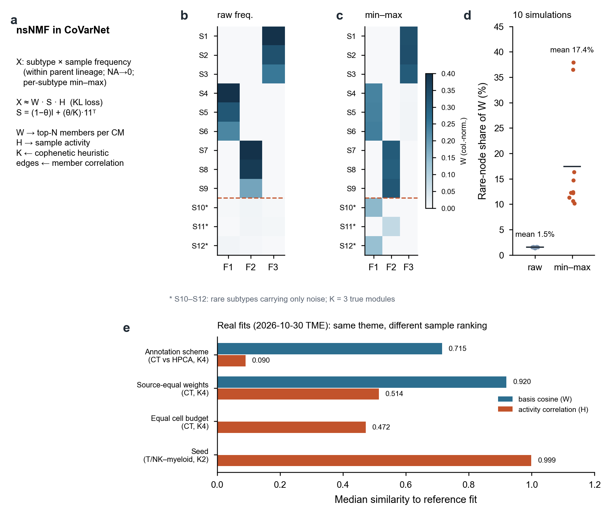

# 分页4｜CoVarNet所用nsNMF的局限与改进方向

[← 返回首页](../../README.md#5-k9细胞模块图谱) · 分页：[1 数据](01_datasets.md) · [2 LIANA与CM](02_liana_cm_communication.md) · [3 注释](03_annotation_logic.md) · **4 nsNMF** · [5 空间优先](05_spatial_first_validation.md) · [6 CM改进](06_cm_discovery_improvements.md)

CoVarNet把“哪些细胞群一起增减”写成一个非负矩阵分解问题。这个设定简洁、可解释，但输入构造和求解细节会显著影响得到的模块。本页结合一个可复现的模拟和项目内真实拟合的诊断说明这些影响。

**图S4｜nsNMF在组成矩阵上的行为。** **a**，CoVarNet中的输入与分解。**b–c**，模拟：12个亚群×200个样本，S1–S9由3个真实模块生成，S10–S12是只含稀疏噪声的稀有亚群；K=3、θ=0.5、KL损失。原始频率输入（b）中，稀有亚群几乎不进入任何因子；逐亚群min–max缩放后（c），稀有亚群被拉到与常见亚群相同的数值范围，并在因子中获得可见载荷。**d**，10次独立模拟中稀有亚群在W中所占比例：原始输入平均1.5%，min–max后平均17.4%。**e**，2026-10-30合格TME真实拟合的已记录诊断：同细胞、同K=4下两套注释方案的基底余弦为0.715而样本活动相关仅0.090；来源等权时基底余弦0.920、活动相关0.514；等细胞预算时活动相关0.472；同一面板不同种子活动相关0.999。模拟代码见[成图脚本](../../scripts/render_homepage_v2_figures.py)中`simulate_rare`与`nmf_kl`。

## 1 nsNMF在CoVarNet中的位置

CoVarNet的作者代码按大类计算亚群频率，将缺失填0，再逐行（逐亚群）做min–max缩放（z-score分支会截断负值），随后运行nsNMF：

X ≈ W·S·H，S = (1−θ)I + (θ/K)·11ᵀ

S把H向各因子的均值方向平滑，从而让W更稀疏、更易于选出成员。rank由多次初始化的共表型相关曲线启发式选择；每个CM取载荷前N的成员，再以成员间跨样本相关构建网络。

## 2 局限

**(1) 逐亚群min–max放大稀有和噪声节点。** min–max使每个亚群的取值范围相同，与它的丰度和测量精度无关。一个只在少数样本中出现几十个细胞的亚群，其比例噪声会被拉伸到与T细胞主群同等的尺度（图S4b–d）。在0906的K=9中，`Granulocyte_unresolved`是CM07载荷最高的成员（19.4%），`HSPC_unresolved`、`Platelet_coarse`是CM06的前两位成员——这些节点细胞少、身份未定。

**(2) 组成闭合。** 同一父谱系内的比例之和为1，一个亚群上升必然伴随其他亚群下降，这会在W中产生“此消彼长”的结构，它可能来自真实替代，也可能只是分母效应。缺失填0又把“没有观察机会”与“观察到零”混在一起。

**(3) rank选择。** 共表型相关的“首次下降前一阶”在不同面板中可能落到K=2（10月新TME的四个主面板均如此）；K=2时H₁+H₂=1，两个“模块”实际是一条对比轴。提高K的上限并不能改变首次下降的位置。

**(4) 成员与网络。** top-N同时决定成员和特异性阈值，从top10改为top15并不只是多看5个成员。网络边由成员间相关计算，与NMF目标无关，空网络和重复边需要去重解释。

**(5) 稳定性的两个层次。** 种子之间高度一致（活动相关0.999）只说明优化稳定。换一套注释或改变来源权重时，基底（模块主题）大体保留，而样本活动排序变化很大（图S4e）。下游的临床关联依赖样本排序，这一点比主题是否稳定更关键。

**(6) 只看数量。** 组成CM回答“哪些细胞一起变多”，不包含细胞类型内部的功能状态。两个肿瘤的T细胞比例相同，其IFN、细胞毒或耗竭程序可能完全不同。

## 3 改进方向

| 方向 | 做法 | 回答的问题 |
|---|---|---|
| 测量感知的输入 | 用计数+父分母建模（多项/logistic-normal），或以中心对数比替代min–max；缺测用mask而非补0；按细胞数给出比例的不确定性 | 稀有节点的噪声是否被正确降权 |
| 共识与透明基线 | 在同一输入上比较单次sklearn NMF、多次初始化共识（cNMF式）与nsNMF；KL与Frobenius分开 | 收益来自共识、损失还是平滑 |
| **cNMF用于状态** | 在可信父谱系内对细胞×基因做cNMF，得到身份程序与活动程序；冻结字典后投影所有细胞 | 一个细胞类型内部有哪些功能状态 |
| **加入状态模块** | 患者×身份×程序的分布摘要（均值、高分位数、固定阈值活跃比例），与组成矩阵并列建模；比较“组成CM”“状态CM”和二者联合 | 组成相近的肿瘤中，状态是否仍然协同变化 |
| 来源结构 | LIGER式共享/来源特异分解，或来源内估计后汇总 | 模块是跨来源共享还是被某几个研究驱动 |
| rank与稳定性 | 按患者/来源留出评价重构；报告拆分、合并、未匹配因子；同时报告基底与活动两个层次 | K的选择是否能迁移到新患者 |

细胞类型内状态的一个基本恒等式是：父谱系c、程序g在患者p中的均值 m = Σₖ π_k·μ_k（π为亚型比例、μ为亚型内均值）。固定参考比例π_ref得到的标准化均值，可以把“亚型构成变化”和“亚型内状态变化”分开。2026-10-28的工具梳理把六种NMF实现分别对应到不同环节：cNMF负责重复拟合的共识，RcppML负责快速的敏感性拟合，CoGAPS给出参数后验不确定性，log1pNMF改变计数均值与程序的链接方式，LIGER分开共享与来源特异结构，scikit-learn作为透明基线；它们改进的是不同问题，不宜作单一排名。相关设计见[下一阶段方案](../../methods/CM-project-next-stage-20261030.md)与[2026-10-31 CoVarNet对照报告](../reports/20261031_TME_CM_review/CoVarNet_comparison.md)。

[← 返回首页](../../README.md#5-k9细胞模块图谱)
