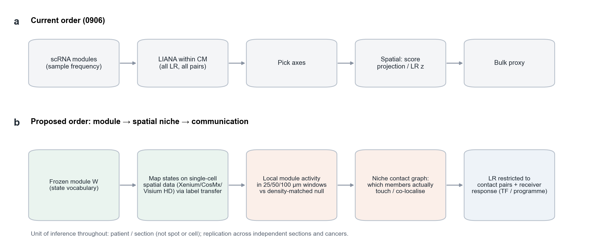

# Page 5 | Validating modules and discovering communication directly in spatial data

[← Home](../../README.en.md#7-readouts-in-spatial-data) · Pages: [1 Data](01_datasets.en.md) · [2 LIANA and CMs](02_liana_cm_communication.en.md) · [3 Annotation](03_annotation_logic.en.md) · [4 nsNMF](04_covarnet_nsnmf_limits.en.md) · **5 Spatial-first validation** · [6 CM improvements](06_cm_discovery_improvements.en.md) · [中文](05_spatial_first_validation.md)

The 0906 release followed the sequence “single-cell CMs → single-cell LIANA → axis selection → spatial readouts → bulk proxies.” Spatial data entered late in the chain, testing axes that had already been selected. This page considers moving spatial validation earlier: once modules have been identified, first test whether their members meet in tissue, then investigate communication only among those cell pairs.

**Figure S5 | Current and proposed analysis sequences.** **a**, The 0906 sequence: communication is evaluated across all member pairs, with spatial data used only as a post hoc readout. **b**, The proposed sequence: freeze the module specification (member-state vocabulary) → map states in spatial data at single-cell resolution → calculate local module activity within fixed physical windows and compare it with a density-matched null model → construct contact/colocalization graphs among members → evaluate LR only on contacting pairs, requiring a corresponding pathway or TF response in receiving cells. The inferential unit remains the patient or tissue section throughout.

## 1 What the 0906 spatial readouts can and cannot establish

| Readout | Observation | Limitation |
|---|---|---|
| Moran's I for projected Visium CM scores (61 sections) | CM01/07/08 show spatial autocorrelation in every section (medians approximately 0.63–0.67, p≤0.001) | Each 55 μm spot contains multiple cells; smooth scores do not establish member colocalization |
| Visium neighborhood LR co-enrichment | VCAN→ITGB1 (CM07) is positive in 5/5 datasets; LGALS1→PTPRC (CM08) has mixed directions; APP→CD74 is strongly negative in three datasets | Senders and receivers are defined by gene expression rather than cell identity; DDR1 was not evaluated |
| ccRCC CosMx | CD8 cells are farther from collagen×DDR1-high tumor regions (RCC3: 319 vs 77 μm; RCC5: 556 vs 100 μm); T3/T4 coefficients have concordant directions in 3/3 tissues | Only ccRCC is represented, and its proximal-tubule lineage is intrinsically DDR1⁺; T1 adjacency runs counter to the hypothesis |

## 2 Proposed analytical framework

**(1) State mapping.** Transfer labels from a frozen state vocabulary to single-cell-resolution spatial data, such as Xenium, CosMx, MERFISH, or Visium HD, using only genes measurable in both datasets. Markers absent from a panel are unmeasurable, not negative. If key members of a CM cannot be identified, mark that CM as not evaluable in the dataset.

**(2) Local module activity.** Aggregate state composition within fixed physical windows, such as 25/50/100 μm, and project it using frozen W. Null models preserve marginal state abundances and cell density—for example, by permuting labels within tissue compartments—so that high module activity means more than an abundance of one cell type.

**(3) Member contact graphs.** For each pair of CM members, calculate co-occurrence ratios within k-nearest-neighbor or fixed-radius neighborhoods and compare them with the null model to determine which members are actually adjacent. In October, the project used this type of design in NSCLC lymph nodes—patient-level aggregation, MKI67 stratification, and local conditional null models—to test T-cell state pairs; see the [spatial methods](../../methods/CM02-LN-regulatory-specificity-20261022.md).

**(4) Communication among contacting pairs.** Evaluate LR only between adjacent senders and receivers. In spatial RNA data, additionally compare receptor-downstream programs between receiver cells adjacent to senders and non-adjacent cells of the same receiver type. This narrows the interpretation from “possible communication” to “spatially plausible communication with a receiver-side response.”

**(5) Inferential units and holdouts.** Overlapping windows share cells, so training/evaluation splits require a buffer at least as wide as the neighborhood radius. Independence is defined at the patient or whole-section level. Neighborhood aggregation and graph smoothing should be ablated as separate factors.

## 3 Specific spatial questions for the three 0906 CMs

| CM | First spatial question to test | Suitable data |
|---|---|---|
| CM01 | Do FCN1 monocytes, SPP1 macrophages, and vascular endothelial cells form a perivascular niche, and what T/NK states occur nearby? | Single-cell spatial panels with vascular and myeloid markers, across multiple cancer types |
| CM07 | Are CD8 cells excluded at the myCAF–malignant epithelial interface, and what are the DDR1 and EMT/MMP programs of interface tumor cells? | Strongly desmoplastic tumors such as lung, esophageal, and pancreatic cancers, avoiding ccRCC |
| CM08 | How are inflammatory monocytes/macrophages, myCAFs, and CD8 T cells positioned relative to each other, and what states do CD8 cells near LGALS1-high CAFs occupy? | Panels containing CAF and T-cell state markers |

The project also has a SpaCoVarNet prototype (design dated 2026-10-28) in which sample and spatial views share W but have separate H matrices, with graph regularization. Using 106 historical states, 755 samples, and one field of 6,090 cells, the real spatial graph produced lower roughness than two null models. This shows only that graph regularization behaves as designed; whether it yields more biologically valid modules still requires the independent spatial readouts above. For completed eligibility assessment of MERFISH spatial molecular measurements, see the [CM02 spatial measurement extension](../../methods/CM02-spatial-communication-extension-20261018.md).

[← Home](../../README.en.md#7-readouts-in-spatial-data)
