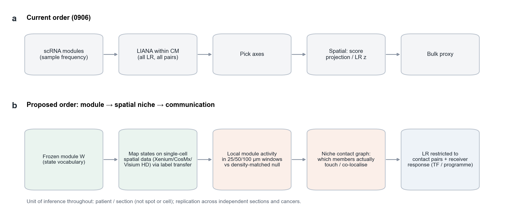

# 分页5｜模块识别之后直接在空间数据上验证并发掘通讯

[← 返回首页](../../README.md#7-空间数据中的读出) · 分页：[1 数据](01_datasets.md) · [2 LIANA与CM](02_liana_cm_communication.md) · [3 注释](03_annotation_logic.md) · [4 nsNMF](04_covarnet_nsnmf_limits.md) · **5 空间优先** · [6 CM改进](06_cm_discovery_improvements.md)

0906版本按“单细胞CM → 单细胞LIANA → 挑选轴 → 空间读出 → bulk代理”的顺序推进。空间数据出现在链条后段，只用来检验已经挑好的轴。本页讨论把空间验证提前：模块一旦识别，就先在空间数据中检验其成员是否真的在组织里相遇，再只在相遇的细胞对上发掘通讯。

**图S5｜现行顺序与提议顺序。** **a**，0906的顺序：通讯在所有成员对上评估，空间只作为后验读出。**b**，提议的顺序：冻结模块配方（成员状态词表）→ 在单细胞分辨率空间数据中映射状态 → 计算固定物理窗口中的局部模块活动并与密度匹配的零模型比较 → 构建成员之间的接触/共定位图 → 只在接触对上评估LR，并要求接收细胞出现相应的通路或TF响应。推断单位始终是患者或切片。

## 1 0906空间读出能说明什么、不能说明什么

| 读出 | 观察 | 局限 |
|---|---|---|
| Visium CM投影Moran's I（61张切片） | CM01/07/08在所有切片中均有空间自相关（中位约0.63–0.67，p≤0.001） | 55 μm spot内混有多个细胞；打分平滑不等于成员共定位 |
| Visium LR邻域共富集 | VCAN→ITGB1（CM07）5/5数据集为正；LGALS1→PTPRC（CM08）方向不一；APP→CD74在3个数据集中强负 | 由基因表达而非细胞身份定义发送与接收；未测DDR1 |
| ccRCC CosMx | 胶原×DDR1高的肿瘤区域CD8更远（RCC3：319 vs 77 μm；RCC5：556 vs 100 μm）；T3/T4系数3/3同向 | 只有ccRCC，而ccRCC近端小管本身DDR1⁺；T1邻接方向与假设相反 |

## 2 提议的分析框架

**(1) 状态映射。** 在Xenium、CosMx、MERFISH或Visium HD等单细胞分辨率数据上，以冻结的状态词表做标签迁移（只用两侧共同可测的基因）；面板缺少的marker记为不可测，而不是阴性。若某个CM的关键成员在面板中无法识别，该CM在此数据上标为不可评估。

**(2) 局部模块活动。** 以25/50/100 μm等固定物理窗口聚合状态组成，用冻结的W投影得到局部活动。零模型保持各状态的边际丰度和细胞密度（例如在组织区室内置换标签），使“模块活动高”超出“某类细胞多”。

**(3) 成员接触图。** 对每个CM的成员对，计算k近邻或固定半径内的共现比值，与零模型比较，得到“哪些成员真的相邻”。项目10月在NSCLC淋巴结中已用这一类设计（患者单位汇总、MKI67分层与局部条件零模型）检验T细胞状态配对，见[空间方法](../../methods/CM02-LN-regulatory-specificity-20261022.md)。

**(4) 接触对上的通讯。** 只在相邻的发送/接收对上评估LR；在RNA空间数据中进一步比较“与发送者相邻的接收细胞”和“不相邻的同类接收细胞”在受体下游程序上的差异。这一步把通讯从“可能”收紧到“空间上可能且接收端有响应”。

**(5) 推断单位与留出。** 重叠窗口共享细胞，划分训练与评估时需加入至少等于邻域半径的缓冲区；独立性以患者或整张切片计。邻域聚合与图平滑作为两个因素分别消融。

## 3 0906三组CM在此框架下的具体问题

| CM | 首先要检验的空间问题 | 适合的数据 |
|---|---|---|
| CM01 | FCN1单核、SPP1巨噬与血管内皮是否构成血管周生态位；该生态位旁的T/NK状态 | 含血管与髓系标志的单细胞空间面板，多癌种 |
| CM07 | myCAF与恶性上皮的界面上，CD8是否被隔离；界面肿瘤细胞的DDR1及EMT/MMP程序 | 肺癌、食管癌、胰腺癌等强促纤维化肿瘤（避开ccRCC） |
| CM08 | 炎性单核/巨噬、myCAF与CD8 T的相对位置；LGALS1高CAF旁的CD8状态 | 含CAF与T细胞状态标志的面板 |

项目还有一个SpaCoVarNet方向的原型（2026-10-28方案：样本视图与空间视图共享W、各自H，并加图正则）。在历史106状态、755个样本和一个6,090细胞视野上，真实空间图相对两类零模型给出更低的粗糙度；这只说明图正则按设计起作用，模块是否更真实仍需由上面的独立空间读出评价。已完成的MERFISH空间分子测量资格审定见[CM02空间测量扩展](../../methods/CM02-spatial-communication-extension-20261018.md)。

[← 返回首页](../../README.md#7-空间数据中的读出)
