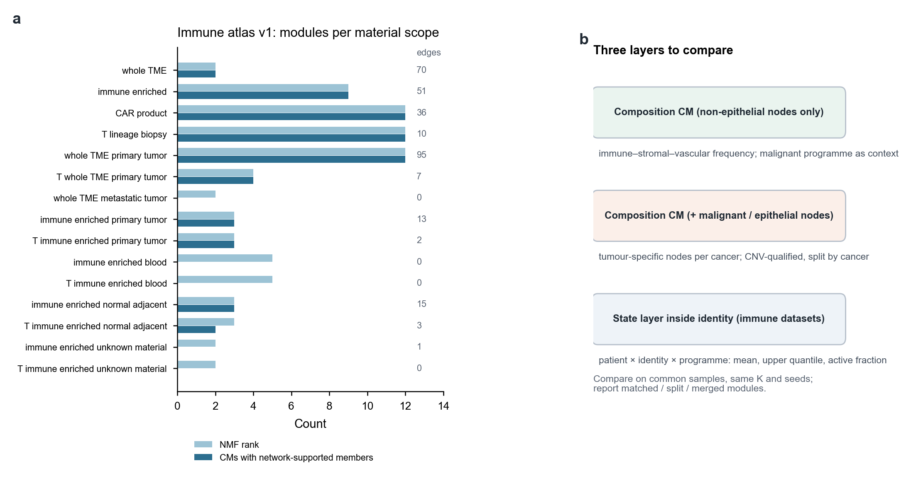
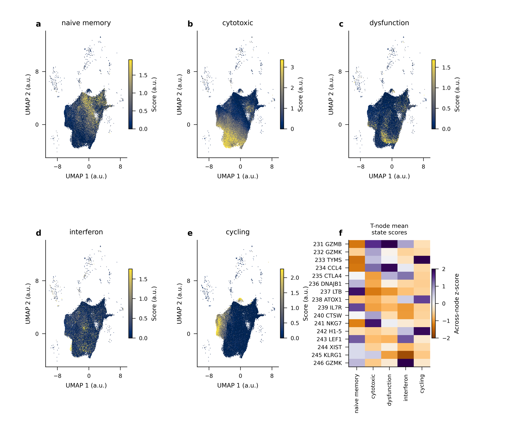

# Page 6 | Improving cellular module discovery

[← Home](../../README.en.md#9-open-questions-and-six-companion-pages) · Pages: [1 Data](01_datasets.en.md) · [2 LIANA and CMs](02_liana_cm_communication.en.md) · [3 Annotation](03_annotation_logic.en.md) · [4 nsNMF](04_covarnet_nsnmf_limits.en.md) · [5 Spatial-first validation](05_spatial_first_validation.en.md) · **6 CM improvements** · [中文](06_cm_discovery_improvements.md)

The 0906 K=9 model placed all lineages—including epithelial malignancy-evidence categories and unresolved nodes—into one frequency matrix. This page discusses two improvements: changing which cells enter module discovery by excluding or including tumor/epithelial cells, and adding a cell-state layer to immune datasets. Some designs have already been implemented in the new October data scope, and their results are also presented here.

**Figure S6 | CMs discovered within specimen scopes and a three-layer comparison framework.** **a**, NMF rank (light), number of CMs with network-supported members (dark), and network edge counts (right column) for 15 separately fitted specimen scopes in immune atlas v1 (2026-10-14). Blood and unknown-material scopes yielded no network-supported modules; `whole_TME_primary_tumor` had 95 edges at rank 12. Material overlaps across scopes, so ranks cannot be added. **b**, Three layers proposed for parallel comparison: compositional CMs using only non-epithelial nodes, compositional CMs including malignant/epithelial nodes, and states within identities.

## 1 Excluding and including tumor/epithelial cells

**Why examine these separately?** The original CoVarNet study excluded epithelial cells from pan-cancer modules because of their tissue specificity, while retaining stromal and vascular cells. The 0906 K=9 model retained epithelial cells and represented them by malignancy categories. As a result, most loading in CM02, CM03, and CM05 fell on nodes such as `Malignancy_uncertain` and `Malignant::Unknown` ([Page 3](03_annotation_logic.en.md), Figure S3c). These modules correlate strongly with the strictly malignant fraction or the malignancy-uncertain fraction (CM03 ρ=0.70; CM02 ρ=0.74), largely reflecting tumor purity and CNV classification status.

**The tradeoffs of each approach.**

| Approach | What it can address | Risk |
|---|---|---|
| Exclude epithelial/tumor cells and use only immune–stromal–vascular nodes | Microenvironmental composition themes comparable across cancer types | Loses the tumor–immune interface; excluded parent lineages must be removed before fitting, rather than deleting members from a whole-TME module afterward |
| Include tumor nodes | Covariation between tumor states and the microenvironment | Malignant cells are strongly cancer-type-specific, limiting the meaning of a shared pan-cancer “malignant node”; modules may be driven by purity |
| Compromise: use tumor programs as contextual variables | Extract reproducible malignant programs within cancer types, such as IFN/antigen presentation or hypoxia/stress, and test whether they modify established immune–stromal relationships | Requires sufficient sources and patients within each cancer type |

**Comparisons in the October eligible TME scope.** On 2026-10-30, four panels were fitted across 43 eligible sources: T/NK–myeloid, addition of epithelial cells, addition of stromal cells, and a six-lineage panel (25 identity fits and 240 factor records in total). In the epithelial-added panel, the CM01 network still contained only Treg-related and monocyte-related nodes, with no epithelial nodes. This panel had an activity correlation of approximately 0.743 and a network weighted Jaccard index of approximately 0.467 across seeds, making it less stable than the T/NK–myeloid panel (activity correlation approximately 0.999). The six-lineage panel retained only 241 working units with complete coverage; its CM01 contained two disconnected components, one within Tregs and one stromal–endothelial. See the [new TME CM review](../reports/20261031_TME_CM_review/TME_CM_review.md) and [catalogue of all 240 factors](../reports/20261031_TME_CM_review/all_CM_catalogue.md).

**Immune-compartment-only CMs (2026-11-01).** A further analysis excluded epithelial, stromal, endothelial, neural, erythroid, and platelet populations before constructing the NMF input, seeking covariation only among T/NK, B/plasma, and myeloid cells. The primary proportion remained “subpopulation/full parent type,” with unresolved identities retained in the parent denominator. Fourteen prespecified fits and comparisons have been completed. The current 75 nodes are exploratory intersections of frozen Harmony clusters and reference identities, rather than individually validated cell types. See the [immune-compartment CM scope](../../methods/TME-immune-only-CM-scope-20261101.md) and the public [CT75 review](https://pancancer-ct75-review.pages.dev/).

## 2 Adding cell-state analysis to immune datasets

Compositional CMs record abundance alone. Immune datasets also allow functional states to be measured within trusted identities.

**Figure S6 supplement | Five continuous RNA state axes in T cells from immune atlas v1 (publication figure dated 2026-10-26).** Naive/memory, cytotoxic, dysfunction-associated, interferon, and cycling expression vary continuously across T-cell clusters; a single cluster may exhibit several state features simultaneously.

**Proposed state layer.**

1. Derive programs within trusted parent lineages using cNMF or an externally fixed dictionary, freeze them, and project all eligible cells. Do not use the scVI latent space as gene programs.
2. For each patient × identity × program, record the mean, one prespecified upper quantile requiring n(1−q)≥5, and the active fraction at a fixed threshold. Each summary addresses a different question.
3. Use standardized means at fixed reference subtype proportions to distinguish changes in subtype composition from changes in within-subtype state.
4. Compare composition, state, and joint representations alongside compositional CMs for prediction on **held-out sources** and incremental value for the same clinical endpoint.

**One completed step.** On 2026-10-30, the project designed and executed an incremental validation of state modules in the eligible TME scope. Using a leave-one-parent-lineage-out design, composition or state representations from the remaining lineages predicted programs in the receiving lineage. The analysis compared a composition/depth baseline with the added value of state-CoVarNet activities and continuous state coordinates; parameters were frozen before viewing held-out effects ([methods](../../methods/TME-state-module-increment-validation-20261030.md)). This evaluates coordinated prediction at the representation level, not communication mechanisms or clinical performance.

**Specific questions in immunotherapy data.** In ICI sources such as GSE169246 and GSE176021, one can test whether T-cell state distributions change together with myeloid/stromal states before and after treatment in the same patient, and whether differences between responders and nonresponders appear in compositional CMs or the state layer. This requires paired time points from the same patients; ordering cross-sectional stages cannot substitute for dynamics.

## 3 Designing controlled comparisons

Annotation effects and input effects need to be estimated separately. Where data can be aligned, construct four cells of a comparison: old eligibility/old labels, old eligibility/new labels, new eligibility/old labels, and new eligibility/new labels. Use common cells and the same K and seeds within each comparison; report one-to-one module matching, splits/merges, within-source edges, and source-held-out projection. If a comparison cell is unavailable, explicitly mark it as not comparable. Success criteria include interpretable node expression, recovery in held-out sources, and stability under cell-budget perturbation. More edges, a larger K, or a more attractive UMAP are not success criteria. See the [next-stage plan](../../methods/CM-project-next-stage-20261030.md) and [CoVarNet comparison report](../reports/20261031_TME_CM_review/CoVarNet_comparison.md).

[← Home](../../README.en.md#9-open-questions-and-six-companion-pages)
