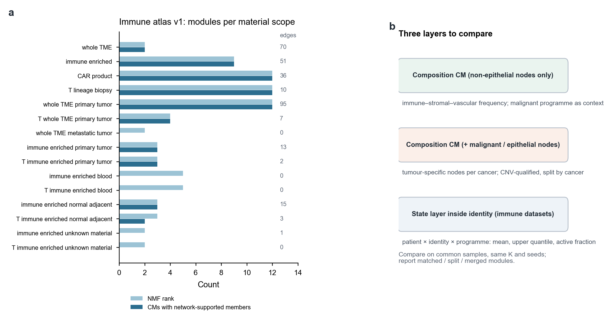
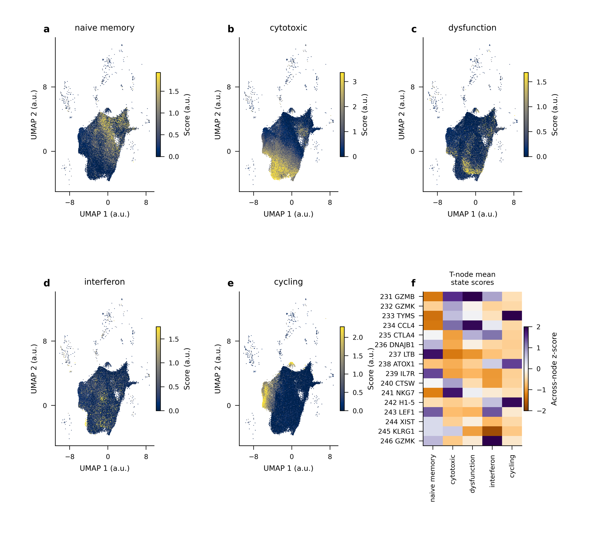

# 分页6｜CM模块发掘的改进

[← 返回首页](../../README.md#9-开放问题与六个延伸分页) · 分页：[1 数据](01_datasets.md) · [2 LIANA与CM](02_liana_cm_communication.md) · [3 注释](03_annotation_logic.md) · [4 nsNMF](04_covarnet_nsnmf_limits.md) · [5 空间优先](05_spatial_first_validation.md) · **6 CM改进**

0906的K=9把所有谱系（包括恶性上皮分层节点和未定节点）放进同一个频率矩阵。本页讨论两类改进：调整“哪些细胞进入模块发现”（移除或加入肿瘤/上皮），以及在免疫数据集中加入细胞状态层。部分设计已在10月的新数据范围上执行，相应结果在此一并展示。

**图S6｜按材料范围发现的CM与三层比较框架。** **a**，2026-10-14免疫图谱v1在15个材料范围中分别拟合的NMF rank（浅色）、具有网络支持成员的CM数（深色）及网络边数（右列）。血液和未知材料范围没有得到网络支持的模块；`whole_TME_primary_tumor`在rank 12时有95条边。不同范围的材料相互重叠，rank不能相加。**b**，建议并行比较的三层：只用非上皮节点的组成CM、加入恶性/上皮节点的组成CM，以及身份内部的状态层。

## 1 移除与加入肿瘤/上皮细胞

**为什么要分开看。** CoVarNet原文因上皮的组织特异性而把上皮排除在泛癌模块之外，但保留了基质和血管细胞。0906的K=9保留了上皮，并以恶性判定类别作为节点，结果是CM02、CM03、CM05的大部分载荷落在`Malignancy_uncertain`、`Malignant::Unknown`等节点上（[分页3](03_annotation_logic.md)图S3c）。这类模块与“严格恶性比例”或“恶性不确定比例”高度相关（CM03 ρ=0.70，CM02 ρ=0.74），主要反映肿瘤纯度和CNV判定状态。

**两种做法各自的问题。**

| 做法 | 能回答 | 风险 |
|---|---|---|
| 移除上皮/肿瘤，只用免疫—基质—血管节点 | 跨癌种可比的微环境组成主题 | 丢失肿瘤—免疫界面；去掉的父谱系不能事后从全TME模块中删除，必须在输入前排除 |
| 加入肿瘤节点 | 肿瘤状态与微环境的共变 | 恶性细胞癌种特异性强，跨癌种共享的“恶性节点”意义有限；纯度驱动模块 |
| 折中：肿瘤程序作为情境变量 | 在癌种内提取可重复的恶性程序（IFN/抗原呈递、缺氧/应激等），检验它是否改变既定免疫—基质关系 | 需要癌种内足够的来源和患者 |

**10月合格TME中的对照。** 2026-10-30在43个合格来源上，分别拟合了T/NK—髓系、加上皮、加基质和六谱系四个面板（共25项身份拟合、240条因子记录）。几点观察：加上皮面板的CM01网络中仍只有Treg相关与单核相关节点，没有上皮节点；该面板种子间活动相关约0.743、网络加权Jaccard约0.467，比T/NK—髓系面板（约0.999）更不稳定；六谱系面板只剩241个完整覆盖的工作单位，CM01由Treg内部和基质—内皮两个不连通部分组成。详见[新TME CM审查](../reports/20261031_TME_CM_review/TME_CM_review.md)与[全部240项目录](../reports/20261031_TME_CM_review/all_CM_catalogue.md)。

**免疫区室专用CM（2026-11-01）。** 进一步在NMF输入前排除上皮、基质、内皮、神经、红系和血小板，只在T/NK、B/浆细胞和髓系之间寻找共变；主比例仍为“亚群/完整父类型”，未定身份留在父分母中。14项预设拟合与比较已完成；当前75个节点是冻结Harmony分群与参考身份的探索性交集，尚非逐一验证的细胞类型。范围定义见[免疫区室CM方案](../../methods/TME-immune-only-CM-scope-20261101.md)，公开审阅页见[CT75 review](https://pancancer-ct75-review.pages.dev/)。

## 2 在免疫数据集中加入细胞状态分析

组成CM只记录数量。免疫数据集的价值在于可以在可信身份内部测量功能状态。

**图S6补｜免疫图谱v1中T细胞的五条连续RNA状态轴（2026-10-26正式图稿）。** naive/memory、cytotoxic、dysfunction-associated、interferon与cycling相关表达在T细胞分群之上连续变化；同一分群可以同时具有多种状态特征。

**建议的状态层。**

1. 在可信父谱系内用cNMF或外部固定字典得到程序，冻结后投影到所有合格细胞（不使用scVI潜空间作为基因程序）。
2. 在患者×身份×程序上记录均值、一个预选的高分位数（要求n(1−q)≥5）和固定阈值活跃比例，三者分别回答不同问题。
3. 用标准化均值（固定参考亚型比例）区分“亚型构成改变”与“亚型内状态改变”。
4. 与组成CM并列：比较组成、状态和联合表示在**留出来源**上的预测能力，以及对同一临床终点的增量。

**已完成的一步。** 2026-10-30在合格TME中进行了状态模块增量验证的设计与执行：以留一父谱系的方式，用其余谱系的组成或状态表示预测接收谱系的程序，比较组成/深度基线、状态CoVarNet活动和连续状态坐标的增量，参数在查看留出效应前冻结（[方法](../../methods/TME-state-module-increment-validation-20261030.md)）。这是表示层面的协同预测，不是通讯机制或临床检验。

**免疫治疗数据中的具体问题。** 在GSE169246、GSE176021等ICI来源中，可以检验：治疗前后同一患者的T细胞状态分布是否与髓系/基质状态共同改变；应答与非应答患者之间，差异出现在组成CM还是状态层。这需要同患者配对时间点，横断面阶段顺序不能替代动态。

## 3 受控比较的设计

注释和输入的影响需要分开估计。在可对齐的数据上构建四格：旧资格/旧标签、旧资格/新标签、新资格/旧标签、新资格/新标签；每格内使用共同细胞、同一K和种子，报告模块的一一匹配、拆分/合并、来源内边和来源留出投影。缺少某一格时如实记为不可比较。成功标准包括节点表达可解释性、来源留出恢复和细胞预算扰动下的稳定性；网络更多、K更大或UMAP更好看都不作为标准。设计细节见[下一阶段方案](../../methods/CM-project-next-stage-20261030.md)与[CoVarNet对照报告](../reports/20261031_TME_CM_review/CoVarNet_comparison.md)。

[← 返回首页](../../README.md#9-开放问题与六个延伸分页)
