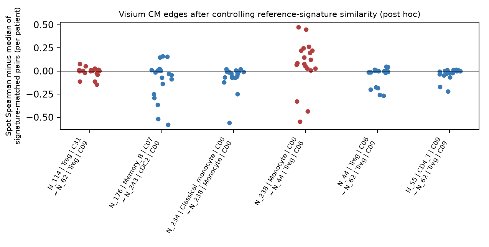

# PanCancer｜当前研究进展、正在推进的分析与下一阶段任务

[← 历史0906首页](../../README.md) · [数据](01_datasets.md) · [通讯](02_liana_cm_communication.md) · [注释](03_annotation_logic.md) · [CoVarNet](04_covarnet_nsnmf_limits.md) · [空间](05_spatial_first_validation.md) · [CM改进](06_cm_discovery_improvements.md) · [服务器系统审计](../reports/20261105_server_analysis_audit/README.md)

> **Living Research Overview｜更新于2026-11-05（Australia/Melbourne）。** 本页连接历史研究问题与下一阶段执行。先读快照与看板了解全局，再沿各工作线追踪方法、结果和验收。已补入11月5日01:50—01:52 UTC的WEHI现场证据；状态仅在取证时刻成立，**不是自动刷新面板**；检查范围、Git基线与时间口径见[版本与证据](#versions)。

[当前快照](#snapshot) · [研究逻辑的变化](#questions) · [七条工作线](#workstreams) · [近期研究变化](#updates) · [未解决问题](#uncertainties) · [下一阶段路线](#roadmap) · [版本与导航](#versions)

## 1 Current Research Snapshot

PanCancer已从0906版本“建立CM并依次读取通讯、空间和临床关联”，进入**重建可信输入、检验模块可识别性与独立验证资格**的阶段。最近完成了72来源、4,720,931细胞的统一decontX整合数据层，补充来源登记与恶性判定，开展新TME去批次比较；同时在历史细胞宇宙上完成V7受控CM重算和9种NMF方法×5种子的比较。新的证据也收紧了原来的解释：CT75两个主CM尚未通过独立空间验证；V7的CAF相关空间弱信号依赖成员定义，关键myCAF身份未通过面板识别资格；NMF原匹配指标受等价因子尺度影响。当前最重要的产出是**更清楚的版本、测量与验证边界**，尚不是一个已经完成细分注释、空间验证和临床推广的新泛癌CM图谱。[最新审计](../reports/20261105_server_analysis_audit/README.md) · [状态纠正表](../../inventories/server_analysis/2026-11-05/state_corrections.tsv)

**状态读法。** 「已验证」仅指明确写出的技术或统计验收范围；「待验收」指已有产出/提交但缺终验；「运行中」必须有带时间的活跃进程或调度证据；「待依赖」表示尚未启动或不具备准入条件；「受阻/未通过」保留失败、阴性及不可测。01:50—01:52 UTC现场确认TME run_v2、V7来源等权及逐来源留出任务运行中；K4已有计算完成收据，仍待科学审阅。活跃状态不等于成功退出，部分完成也不等于整批稳定性通过。[WEHI实时补核](../../runs/20261105_current_overview_wehi_readonly.md)

| 工作线 | 研究目标 | 当前进度 | 最新变化 | 核心问题 | 下一步 |
|---|---|---|---|---|---|
| [A 数据与扩展TME](#line-a) | 在可比肿瘤材料中测量跨谱系组成 | 数据层技术已验证；TME run_v2运行中，后处理待依赖 | 当前范围3,347,659细胞；Leiden已记录78簇 | 来源/患者与材料资格；新图尚缺最终读回 | 核终态、范围、mask、同图UMAP与marker |
| [B 身份与注释](#line-b) | 让每个CM节点有可信细胞身份 | 单来源候选试点已执行；全量完成待核实，身份未冻结 | 参考按marker父类分流；8项研究的作者标签/代码已整理 | 非免疫参考适用域、细分冲突与父群借名 | 刷新预检，建立本节点证据和来源留出 |
| [C 组成CM与NMF](#line-c) | 区分跨来源生态关系与分解/输入效应 | V7 K4/K9及45次基准有计算收据；来源敏感性运行中 | K4新增两种子收据；53来源LOSO部分完成；尺度问题保留 | K9被固定；成员相似不等于活动或生物学一致 | 接收现有留出产出；规范尺度后审rank/活动/覆盖 |
| [D 身份内功能状态](#line-d) | 区分细胞数量变化与功能程序变化 | 评分和技术比较已完成；字典/模块准入待依赖 | 预定义读出、数据驱动T/NK试点与TME状态分支分别交付 | 适用身份、深度、应激与来源混杂 | 固定父身份及测量准入，再冻结状态字典 |
| [E 空间独立验证](#line-e) | 检验模块成员是否在组织中相遇 | CT75主验证未通过；V7探索结果已归档、待资格审阅 | 参考谱控制削弱CT75信号；V7换成员定义后弱信号消失 | 身份不可分、panel缺测、重复单位与零模型 | 冻结可测边/成员及患者单位，设计独立检验 |
| [F 通讯与临床](#line-f) | 检验空间关系的功能解释与患者价值 | 历史读出可追溯；新V7/扩展TME验证待依赖 | 新TME临床接口审查发现结局未精确接入 | within-CM筛选循环、bulk代理与CM不等价 | 先锁版本、患者桥与终点，再比较增量 |
| [G 环境、迁移与复现](#line-g) | 使发现可保存、可复核、可交接 | 多路径重放已验证；持久存储/环境全验收未闭合 | 两个数据层已有labshare/rechunk记录 | 跨GPU/CPU差异、遗漏脚本、历史日志失鲜 | 核具体持久对象和环境，不按目录存在判完成 |

**当前最值得先做的三件事：**（1）关闭TME run_v2的最终验收缺口；（2）刷新72来源注释预检并制定节点身份验收；（3）对已有NMF小型结果固定尺度后重核匹配。三者分别决定后续分析的细胞集合、节点语义和模块对应，具体产出与门槛见[下一阶段路线](#roadmap)。

## 2 从原始研究问题到当前新方向

README的两个科学问题仍然成立：**哪些多细胞组合与肿瘤及治疗结局相关？这些组合内的通讯是否与免疫浸润有关？** 0906版本把这条链完整走了一遍，但“共同增减”“表达上具备通讯可能”“组织邻近”和“患者结局关联”各自测量不同对象。V5 CM01/07/08的LIANA、Visium/CosMx和bulk读出提供了候选线索，并没有自动把它们连成因果链。[历史首页](../../README.md) · [LIANA与CM的关系](02_liana_cm_communication.md)

后续工作首先改变了**什么可以进入比例分母**。免疫富集、作者只发布T细胞子集、血液、肿瘤组织以及不同治疗阶段不能无差别混入全TME组成。10月按材料范围形成免疫图谱和合格TME工作线，11月进一步补同癌种来源、统一decontX和恶性判定。这一扩展的意义是提高可比性和可追溯性，而非用更大细胞数替代独立患者或研究数；来源内患者键也不能自动认证跨研究独立性。[数据演变](01_datasets.md) · [扩展数据说明](../INTEGRATION_V2.md)

第二个变化是**把身份、状态和模块拆开审阅**。同一父身份内可以同时存在细胞毒、IFN和增殖程序；数字cluster或参考预测不能直接变成真实亚型。身份调整会改变CM频率输入，来源平衡会改变患者活动排序，NMF参数又会改变因子拆分。因此需要在共同细胞、相同分母和受控K下分别比较注释、输入与算法，不能把新旧CM同号理解成同一发现。[注释调整](03_annotation_logic.md) · [受控比较设计](../reports/20261031_TME_CM_review/CoVarNet_comparison.md)

第三个变化是**把空间测量资格提前**。CT75表明，参考谱很相似的节点可以被反卷积“共同抬高”，而靶向面板又未必能把它们区分。先确认成员可测、独立单位及零模型，再检验共处，最后连接LR和接收端响应，才有机会形成独立证据。它与临床线的共同依赖是一个冻结、可迁移且不依赖结局选择的测量定义。[空间优先框架](05_spatial_first_validation.md) · [CT75结果](../reports/20261102_CT75_spatial_validation/README.md)

## 3 各工作线的最新进展

### A｜来源审核、统一处理与扩展TME图谱

**科学问题与输入。** 当前需要的是“捕获条件可比较、同癌种有外部来源、恶性身份有证据”的TME，而不是所有可获取细胞的简单合并。11月1日analysis-ready v1为53来源、3,818,042细胞、94,200基因的原始计数层；随后integration_v2扩展为72来源、4,720,931细胞、1,258单位、1,014个来源内患者键和28个癌种分层。它与0906的54 GSE、43个癌种标签并非相同分类口径；不能把43→28解释成癌种覆盖下降，也不能将两批细胞数相加。[analysis-ready v1](../ANALYSIS_READY_ZARR_V1.md) · [integration_v2](../INTEGRATION_V2.md)

**已执行的方法与新结果。** 现有来源沿用既有QC；新来源执行基因/UMI门槛、按样本线粒体过滤和Scrublet。全部72来源再统一按单位运行decontX，排除污染率≥0.5的细胞。整合以共同测到的12,563基因为基础，在raw counts上选择4,000 HVG，以校正计数CP10K+log1p进行50维PCA、Harmony及15近邻UMAP。最终对象有99,071个并集基因，读回确认ID唯一、抽查counts为整数、嵌入形状/有限值；全计数指纹未检出跨来源完全相同的细胞，但这不排除同患者跨研究复用。[读回](../../inventories/integration_v2/readback_v2.json) · [指纹检查](../../inventories/integration_v2/fingerprint_summary.json) · [运行记录](../../runs/20261102_integration_v2.md)

恶性判定采用单位内scATOMIC与inferCNV，先避免把scATOMIC支持的肿瘤群当作CNV参考，参考不足时从同来源借用；CNV score或corr超过对照99分位作为阳性依据。后续对DLBCL、骨肉瘤、软组织肉瘤和间皮瘤补充CNV主导逻辑；冲突或不可评估保留uncertain。72个最终侧表已存在，最新审计没有重新逐行认证其正确性。旧TME run_v1有3,383,398细胞、101簇，其中367,692为uncertain；不能把这些细胞全称为确定非恶性。[方法初版](../MALIGNANCY_TME_V1.md) · [后续代码变化：`b0ac58d`、`0429295`](../../scripts/malignancy_v1/malignancy_source_v1.py) · [run_v1汇总](../../inventories/server_analysis/2026-11-05/tables/tme_v1/tme_summary.json)

来源审核又改变了当前范围：GSE179994实际为作者发布的T细胞子集，不能据免疫比例判断完整TME；GSE182434为B/non-B分选；GSE189357的3个AIS单位属于癌前病变。按统一排除表计算，当前TME为**3,347,659细胞**，其中**2,980,723**可进入当前CoVarNet v1主范围；uncertain仍可在探索图中保留。旧对象以标记保留历史行，新run_v2按范围重建，因此对象行数与合格细胞数不同是有记录的版本差别。[排除规则](../../inventories/tme_v1/scope_exclusions_v1.tsv) · [版本对照](../../inventories/server_analysis/2026-11-05/version_crosswalk.tsv)

**为什么重新整合。** TME初版的来源＋单位Harmony仍有明显来源残留。固定30万细胞的比较使用原表达marker标签评价生物结构；scIB部分再使用至多10万个可信粗标签细胞。已报告嵌入总分中，来源θ2 Harmony为0.6614，单位scVI为0.6212、来源scVI为0.5920，来源＋单位Harmony为0.5456。BBKNN来源iLISI达到7.557，但细标签纯度降至0.633，说明混合强不能单独作为成功标准。Scanorama重试已有图指标，尚缺scIB总分；这些标签也不是独立真值，不能宣布所有算法的普适排名。[图指标](../../inventories/server_analysis/2026-11-05/tables/batch_benchmark/graph_metrics.tsv) · [scIB表](../../inventories/server_analysis/2026-11-05/tables/batch_benchmark/scib_metrics.tsv) · [评价代码](../../scripts/batch_benchmark_v1/evaluate.py)

**现状、依赖与完成标准。** 新run_v2实际日志在11月5日00:31:34 UTC（墨尔本11:31:34）记录来源θ2 Harmony完成，矩阵为3,347,659×4,000；原归档时没有最终summary。后续现场确认作业仍RUNNING，日志在01:27:57 UTC新增Leiden完成、78簇；01:52:12 UTC最终zarr/summary仍未出现，后处理等待上游成功。这是阶段进度，尚非新版图验收。[WEHI实时补核](../../runs/20261105_current_overview_wehi_readonly.md)。下一步先取结束/失败收据，再核ID和排除表、counts/decontX/X语义、测量mask、同图聚类/UMAP及来源分层marker；全部通过才可称新版TME基座完成。1,103/1,258单位能唯一桥接GSM、155单位仍仅来源级描述，患者与材料资格继续限制下游独立性。[进度](../../inventories/server_analysis/2026-11-05/tme_run_v2_progress.json) · [最新来源与范围审计](../reports/20261105_server_analysis_audit/README.md)

### B｜泛癌注释：先建立父身份，再审定细节点

**科学问题与版本。** CM节点是否对应可复现的亚群，取决于本群表达、参考适用域与跨来源一致性。历史V5/V7共用4,676,787细胞宇宙；V7严格大类为86.76%，严格亚型仅52.50%。Unknown+Ambiguous从846,526降到129,843，部分转为边界或provisional，不能全算作成功细分。大类同名标签改变16.4821%，恶性主标签改变22.5277%，后者包含语义改名和候选池变化；这不是“纠错率”。目前缺每个细分标签逐细胞流向，尤其不能从两版标签计数推造重点CM成员的迁移。[V5/V7聚合证据](../../inventories/server_analysis/2026-11-05/tables/v5_v7/) · [历史注释逻辑](03_annotation_logic.md)

**最近实际推进。** 扩展TME的新流程在原表达上先作marker父类路由，再送入适用参考：免疫用CellTypist Immune_All High/Low，血管/壁细胞用Adult_Human_Vascular，成纤维、上皮、肝和胶质候选用SingleR HPCA；恶性排除，uncertain单列，无适配参考则未解决。路由门槛为父类分数≥1、领先竞争父类≥0.25、至少2个marker均值≥0.5；它是候选筛查规则，不是经外部标定的准确率阈值。GSE138709全来源11,381细胞试点中，7,175恶性排除，剩余2,421免疫、299血管、1,139 HPCA和347无兼容参考，共4,206 TME候选；收据明确`accepted_fine_identity=false`。[路由代码](../../scripts/server_analysis/marker_routed_annotation/scripts/marker_policy.py) · [试点收据](../../inventories/server_analysis/2026-11-05/annotation_pilots.json)

作者证据整理为这一工作提供词表和方法参照：8项研究抽取680条分层标签，又核查marker/panel及作者代码。这里包括父子层级、功能状态和重复视图，不是680种互斥细胞类型；原DEG摘录、绘图panel与正式分类规则也分开保存。作者代码支持“先大类、谱系内重聚类、清理后重算、再结合marker和参考审阅”的思路，但存在占位、参考缺类和版本差异，不能把资料整理写成本项目重新注释已经完成。[标签提取日志](../../logs/codex/2026/2026-11-05_pan-cancer-full-annotation-catalogue.md) · [marker与代码审查](../../logs/codex/2026/2026-11-05_pan-cancer-marker-panels-code-review.md)

**瓶颈与下一步。** High/Low来自相关模型，不构成两份独立证据；HPCA参考713列的标签依赖配对缓存顺序，尚缺独立sample-ID对齐，而且组织成纤维标签不能直接解释为CAF亚型。历史preflight的“67待提交、1可复用、4待恶性”已因72侧表存在而失鲜，但全量候选完成收据仍未建立。下一阶段先刷新sidecar/试点hash和重复任务预检，再逐来源验收ID、路由、缺测和冲突；最终细节点须有**本节点**正/竞争marker、足够来源支持、保留未知的规则和样本/来源留出评价。原九来源scVI展示身份与扩展72来源候选注释必须分别维护。[当前侧表状态](../../inventories/server_analysis/2026-11-05/annotation_current_presence.json) · [HPCA实现](../../scripts/server_analysis/marker_routed_annotation/scripts/singler_hpca.R) · [cluster优先合同](../../methods/TME_CLUSTER_FIRST_AUTOMATIC_CROSSCHECK.md)

### C｜CoVarNet与NMF：从可重复拟合到可信组成关系

**科学问题与三条不同输入线。** 历史0906 CM使用0825 V5身份、87节点、1,303样本、K9；11月V7 strict重算使用2,449,945合格细胞、47节点、1,207样本、53来源，另有181节点/1,303样本的legacy展示分支。10月合格TME/CT75来自另一套来源资格和cluster×参考身份。扩展72来源数据层尚无验收通过的新CM，不能把V7重算称为“在472万新TME上发现”。[版本表](../../inventories/server_analysis/2026-11-05/version_crosswalk.tsv)

**V7已完成什么。** strict和legacy均有rank 2–20 survey及nsNMF/作者网络完成报告，最终nrun30、seed20261103/04，K9为历史受控比较而显式override。strict cophenetic在K4约0.8957，K5降至0.8581，按当前首次下降0.02规则会关注K4；这不能证明K4最优。后续现场已读到K4两种子NMF/作者网络完成报告（47节点、1,207观察、53来源），纠正原审计“缺收据”；K4/K9成员、活动与网络比较仍待审阅。[WEHI实时补核](../../runs/20261105_current_overview_wehi_readonly.md)。V5 CM07匹配V7 strict两个seed的CM04/CM01，活动相关约0.41/0.39；V5 CM08匹配CM02/CM08，约0.63/0.60。它们保留部分主题，不能视为原模块原样复制。[完成报告](../../inventories/server_analysis/2026-11-05/tables/v7_cm/primary_strict/CoVarNet_execution_report_v1.json) · [rank survey](../../inventories/server_analysis/2026-11-05/tables/v7_cm/primary_strict/rank_survey_v1.tsv) · [seed1对应](../../inventories/server_analysis/2026-11-05/tables/v7_cm/v7_v5_cm_alignment_seed_20261103.tsv) · [seed2对应](../../inventories/server_analysis/2026-11-05/tables/v7_cm/v7_v5_cm_alignment_seed_20261104.tsv)

**算法比较带来的新认识。** 围绕同一V7节点/样本范围的频率输入及另设计数组，已有9方法×5seed、全部K9的45份任务记录，覆盖nsNMF、RcppML、CoGAPS、sklearn两种损失、LIGER、cNMF_X及两个计数组分支。原跨seed成员余弦约为nsNMF 0.723、RcppML/CoGAPS接近1；这只是给定输入和匹配定义下的重复性。cNMF还改变方差预处理，LIGER按来源拆成14组，计数组改变了输入语义，线程/重启预算也不同，不能作纯优化器、准确率或速度排名。[任务清单](../../inventories/server_analysis/2026-11-05/nmf_tasks.tsv) · [原始比较汇总](../../inventories/server_analysis/2026-11-05/tables/nmf/method_summary.tsv) · [方法代码与边界](../../scripts/nmf_benchmark/README.md)

11月5日新增审计指出，原比较先按W的节点行归一、再做列余弦匹配，不能消除等价变换`W×D, D⁻¹×H`的因子尺度。已有W列乘10⁻²～10²后，同一拟合的相似度可降到约0.65–0.89；先固定W列和再执行原匹配，等价缩放相似度恢复为1。sklearn Fro的5个seed均改变因子配对，LIGER和log1pNMF各1个改变。主要跨seed趋势仍在，但具体模块归属和对应H相关需要复核；这项审计**没有重拟合**，也未替代原结果。[原比较实现](../../scripts/nmf_benchmark/cm/compare_methods.py) · [尺度敏感性](../../inventories/server_analysis/2026-11-05/nmf_scale_sensitivity.tsv) · [审计实现](../../scripts/server_audit/check_nmf_scaling.py)

**10月结果仍有独立价值。** 20261030合格TME的25项身份拟合产生240条因子记录，其中199条有作者规则支持的网络，不能称240个独立CM。T/NK—髓系主轴包含调节T相关—单核候选关系；六谱系CM01由Treg内部和基质—内皮两个不连通部分组成。共同K4下不同注释方案基底余弦约0.715，而活动相关仅0.090；来源等权时分别约0.920和0.514。主题较稳不代表病例排序稳，加入上皮的面板也不代表网络真的含上皮成员。[CM结构与来源审查](../reports/20261031_TME_CM_review/TME_CM_review.md) · [配置与输入诊断](../reports/20261031_TME_CM_review/CoVarNet_comparison.md)

**正在推进的来源敏感性。** 现场确认V7 strict K9的来源等权（seed20261103/04）及53来源逐一留出数组正在运行。01:51:41 UTC有25份留出完成报告，01:52:12 UTC增至26份；后一次26份中25份为47节点、1份为43节点，全部保留52来源。来源等权尚无最终报告。它们检验来源主导性，但未形成全53来源稳定性结论；节点减少要求比较共同节点、覆盖损失和活动，不能把不同形状W直接当同域结果。[WEHI实时补核](../../runs/20261105_current_overview_wehi_readonly.md)

**下一步与验收。** 接收现有作业产出，先修正比较口径，保留原W/H及K9分支，报告规范后的成员、活动、拆分/合并和未匹配项；再按预设rank/初始化、共同细胞预算、来源权重及患者/来源留出检验稳定性。节点本群marker与面板测量资格来自B/E线，不能仅凭高余弦给因子命名。评价应允许无网络或无法迁移，不用更多边、更小临床p值决定参数。[后续设计](../../methods/CM-project-next-stage-20261030.md)

### D｜身份内部的状态程序：组成之外是否还有协同信息

**科学问题与不同资源。** 组成CM只描述数量，无法区分“某亚型增多”和“同一身份功能增强”。现有资源包括20261014免疫图谱的5条T细胞连续轴、旧全谱系cNMF/Spectra的814个候选程序、预定义T/NK评分线，以及20261030 TME的181个预定义程序和150个状态模式；这些数字来自不同范围，不能相加为正式状态总数。旧五轴采用可测marker表达均值，TME UCell采用秩评分，名称相似也不保证等价。[资源桥接审查](../reports/20261031_TME_CM_review/TME_CM_review.md)

**已完成的工作。** 预定义T/NK线已对37来源、776,270细胞、126程序评分，完成拆半、稀释、rank与排序背景敏感性，WEHI UCell重放逐字节一致。数据驱动T/NK试点完成基线与五轮敏感性，7个保留元程序的跨设置审阅材料已生成，仍待命名和冻结，尚未进入该分支CM。另一条TME组成/状态计算已交付530个fit目录、1,060个seed-model输出及26个预测分支的数值审核；这些是计算量，绝不是530个生物学发现或独立样本。[10月31日工作线记录](../../methods/workstream-board-20261031.md) · [完整计算收据](../../logs/codex/2026/2026-10-30_TME-CM-complete-computation-public-receipt.md)

**现存问题与下一步。** 均值、尾部分位和高活跃比例回答不同问题；细胞拆半稳定不等于患者外泛化。热休克/解离应激、检测深度、身份混合和材料捕获可以产生稳定但不适合模块解释的程序。正式准入仍需父身份词表、来源/材料适用性、原生可测基因、缺失原因及患者桥。下一步先冻结该协议，审阅字典后才比较“组成”“状态”“联合”在来源留出上的增量；现有RNA程序预测属于表示层协同，不能写成受体响应机制或临床疗效验证。[读出验证协议](../../methods/predefined-state-readout-validation-20261030.md) · [TME状态增量设计](../../methods/TME-state-module-increment-validation-20261030.md)

### E｜空间数据与CM独立验证：保留阴性与不可测

**数据与测量前提。** 已有31个Xenium入库单元的统计、背景和测量mask；V7分析使用29张肿瘤切片、7种panel、18个分析单位，后者不是18个已认证独立患者。S18贡献10名HNSCC患者，S07重复合并，部分TMA core→患者尚未明确。31个入库单元、早期32个处理对象和29张入选切片属于不同范围。CosMx、MERFISH、Stereo等下载完成也不等于细胞身份和效应验收。[空间入库](../../runs/20261030_WEHI_spatial_ingest_and_download_v1.md) · [Xenium测量mask](../../runs/20261030_WEHI_xenium_section_stats_v1.md) · [V7审计](../reports/20261105_server_analysis_audit/README.md)

**CT75：主模块未通过，候选边保留。** 2026-11-01 CT75 K2、seed20261030的两CM，以区室×cluster×CellTypist为节点。19名ccRCC患者的Visium按cell2location及CoVarNet式共定位分析，初看CM01很强；但调节T相关参考谱高度相似，事后校正参考谱相似度后，两CM均未高于零分布。Xenium按事先F1≥0.5规则，可测成员不足，主要分析不可计分；不筛F1的探索阳性不能补作正式验证。N_238单核～N_44调节T相关边在Visium 16/19患者、Xenium 8/8可评单位方向为正，值得作为下一轮预设候选，尚不是通讯或机制证据。[空间完整报告](../reports/20261102_CT75_spatial_validation/README.md) · [事前方案及事后补充](../../methods/TME-CT75-spatial-CM-validation-20261102.md)

**图1｜参考谱相似度控制改变了CT75的空间解释。** 每点是患者层面spot相关相对相似参考谱对的残差，来自已归档图件。六条边中单核N_238～调节T相关N_44保留较一致的正方向；该控制是事后诊断，不是预注册确证，也不意味着整CM通过。[图表来源](../../inventories/analysis/2026-11-02/CT75_spatial_validation_v1/visium_signature_adjusted_edge_summary.tsv)

**V7：完成摘要与弱信号的边界。** blisa 1.0.3/fastLISA 1.0.1采用999次置换，25/50/100 µm各已有29份摘要，早期“25 µm C05未完成”应更新；但25 µm缺相同跨CM汇总，不能补造结果。主50 µm下，V7 strict K9 seed20261103 CM04（与历史V5 CM07部分对应）在W top10定义中15/18单位z>0，单侧符号p≈0.00377；seed20261104对应CM01为16/18。改用作者网络成员后分别为9/18与11/18，弱信号不再成立。关键myCAF_ACTA2和非恶性上皮身份在所有panel均未通过识别阈值；atlas留出F1也不是Xenium准确率。[完成摘要计数](../../inventories/server_analysis/2026-11-05/spatial_completion.tsv) · [seed1 W top10](../../inventories/server_analysis/2026-11-05/tables/v7_spatial/cm_blisa_primary_strict_K9only_seed20261103_wtop10_bin50.tsv) · [seed1网络成员](../../inventories/server_analysis/2026-11-05/tables/v7_spatial/cm_blisa_primary_strict_K9only_seed20261103_network_bin50.tsv) · [panel资格与seed2汇总](../../inventories/server_analysis/2026-11-05/tables/v7_spatial/)

**现存问题与下一步。** 通用PTPRC/PECAM1相关信号不能替代CAF—肿瘤机制；谱系匹配零模型在同类不足时允许回退其他类，实际回退率和来源平衡需审计。9模块内校正不覆盖所有bin、seed、成员定义的探索家族。下一阶段先锁定可识别成员、测量mask、患者/切片独立单位及完整检验家族，再做参考谱控制、来源留出和目标邻近/接收响应。保留“未检出”与“不可测”的区别；面板不含目标、身份分不开时，应换合格数据或缩小问题，不降低门槛制造通过。[汇总代码](../../scripts/server_analysis/v7_cm_blisa/scripts/aggregate_cm_blisa.py) · [空间资格与多重比较审计](../reports/20261105_server_analysis_audit/README.md)

### F｜细胞通讯与临床：把候选关系连接到独立终点

**问题、已完成结果及历史边界。** 0906 LIANA在1,301/1,322样本成功，先按CM top10限定发送/接收对，再筛magnitude/specificity rank。V5 CM07 COL1A1–DDR1标准支持115/203、严格66/203；V5 CM08 LGALS1–PTPRC为291/317、严格123/317。rank是排序而非校正p值；预先限定成员又统计within-CM通讯，不能作为独立CM验证。已处理32空间对象均未同时覆盖这两条轴的两端，指的是处理后词表资格，不等于原始panel必缺，更不是通讯阴性。[历史轴表](../../inventories/server_analysis/2026-11-05/tables/historical_0906/focus_axes_replication_summary.tsv) · [panel轴覆盖](../../inventories/server_analysis/2026-11-05/tables/historical_0906/panel_axis_coverage.tsv) · [LIANA局限](02_liana_cm_communication.md)

历史TCGA对9,034例原发肿瘤、27癌种的CM表达代理已有关联读出，但癌种间方向相反，ICI队列的结果也不一致。另一个值得保留的正向研究线是**2026-10-14免疫图谱CM02 v1、T原发肿瘤范围**：来源等权下七个核心成员保留；固定调节相关—细胞毒RNA代理在IMvigor210关联应答（OR 3.57，95%CI 1.80–7.06），在SU2C_MARK关联OS（HR 0.51，0.32–0.82）。这是两个不同终点的代理关联，不能当作同终点独立复制，更不能移植成V5、V7、CT75或扩展TME“CM02”的临床结果。NSCLC淋巴结中已有相对蛋白状态组织证据，同样保持癌种、组织、测量与患者单位边界。[0906临床读出](../../README.md#8-bulk队列与免疫治疗队列中的读出) · [免疫CM02历史首页](../../README_20261026_CM02.md) · [完整比较口径](../PROJECT_PUBLICATION_EVIDENCE_20261026.md)

**最近完成的是接口审查，而非新临床验证。** 20261030合格TME的770工作单位设计表未直接接入response/OS/PFS；已有210行ICI旁表来自不在该43来源范围内的三个研究，也不是210个已认证独立患者。GSE305078已查GEO接口有32材料行及阶段信息，尚缺病例—材料—治疗—结局精确桥；阶段不能代替pCR。原五轴与新TME程序也尚未完成同口径新评分。最新V7逐样本LIANA和接收端响应没有完成证据，保留待启动/待依赖。[临床与状态接口报告](../reports/20261031_TME_CM_review/TME_CM_review.md) · [后续方案](../../methods/TME-CM-clinical-and-immune-state-plan-20261031.md) · [V7当前边界](../reports/20261105_server_analysis_audit/README.md)

**下一步与验收。** 先由B/C线冻结身份和成员、由E线确定可测空间关系；通讯应在完整合格细胞对或匹配非成员对背景下检验，控制丰度/深度并另报接收端程序。临床先验收患者、材料、时间点、治疗、终点及事件语义，固定新CM测量或单独命名的bulk代理，再比较临床背景、组成、CM、状态及组合的患者/来源外增量。无法连接或样本/事件不足时明确不可估计，避免把技术完成、相关性和预测价值写成同一结论。

### G｜计算环境、持久存储与可复现交接

**已完成与实际限制。** 10月30–31日旧服务器到WEHI的M0–M4迁移在新位置复核318,117文件一致，重放发现的M5原生h5ad缺口另补齐。pyUCell、CellTypist、共同K4 CoVarNet及SingleR/MOFA等有数值重放记录；HVG/PCA依赖AVX-512节点，scVI同GPU型号可复现、跨V100与其他架构近邻约两成不同，Leiden/UMAP也存在记录中的跨环境差异。冻结旧结果仍是对应版本的权威对象，新环境重算应另设版本。[迁移记录](../../runs/20261030_WEHI_old_server_migration_v1.md) · [计算切换与重放](../../runs/20261031_WEHI_compute_switch_P0_v1.md)

11月4日文档已记录analysis-ready v1和integration_v2迁到labshare并按值核对rechunk：文件数分别66,518→4,320、319,665→16,164。因此早期“这两个对象仍只在scratch、持久空间待申请”已不能直接沿用。但这不证明所有运行、环境和资源都完成持久化；完整R环境有版本偏差记录，环境prefix重定位后的实际执行仍需对应验收。CT75可重放阶段数值差约1e-14，另3个子审查缺生成脚本，不能称整条流水线重放完成。[持久对象更新](../ANALYSIS_READY_ZARR_V1.md) · [迁移收据摘要](../../inventories/server_analysis/2026-11-05/migration_receipt_summary.tsv) · [CT75重放](../../runs/20261102_WEHI_CT75_replay_v1.md)

**本次现场核实与下一步。** 11月5日01:21:37 UTC（墨尔本12:21:37）通过既有跳板读到旧服务器9个Slurm作业，均为依赖失败/等待或人工挂起；不能将它们列为正在计算。随后已通过Open OnDemand只读核实WEHI：主代码副本有未跟踪内容，独立发布副本干净；各自缓存origin/main的0/0不能代表与最新GitHub同步。配置PC_ROOT已指持久区，当前作业仍显式指向scratch，不能因此宣布运行和环境全部迁移。[WEHI实时补核](../../runs/20261105_current_overview_wehi_readonly.md)。下一步分别关闭持久对象、环境加载/重放、缺失脚本和最终运行收据的缺口；不执行未经授权的清理或用重跑覆盖旧输出。公开仓库保存聚合证据、代码、hash和逻辑路径，大对象及个体数据仍留研究环境。[本次检查日志](../../logs/codex/2026/2026-11-05_current-research-overview.md) · [同步规则](../RUNTIME_SYNC.md)

## 4 Recent Research Updates｜最近提交与重要研究变化

下表按科研事件合并提交。日期采用墨尔本日期的提交/记录窗口；**提交时间不等于计算完成时间**。近7天为10月30日—11月5日，向前回溯至10月6日；基线历史窗口内共有771条提交（含合并），重点检查最近50条的变更文件，并追读重要方法实现和产物。表内SHA为可核验提交依据，链接指向对应研究证据。

| 日期与代表commit | 为什么做、实际变化与结果 | 对科学判断的影响与后续 |
|---|---|---|
| 11-05 01:50—01:52 UTC现场补核；阅读基线`b268012` | [WEHI实时补核](../../runs/20261105_current_overview_wehi_readonly.md)确认TME运行至78簇、K4两种子计算有收据，来源等权/53来源LOSO正在运行 | 改变执行状态，不升级科学判断；先接收现有产出、处理留出节点缺失，再作尺度规范与稳定性验收 |
| 11-05 `fc13620`、`7617443` | [系统审计](../reports/20261105_server_analysis_audit/README.md)归档206项原证据与43脚本，纠正V7 rank/blisa早期pending；发现NMF尺度问题；后一提交记录当时推送受阻 | 代码/计算与科学验收拆开；本次已从远端读到两提交，旧“待同步”只描述当时传输，不是当前缺失。优先TME终验、身份和尺度复核 |
| 11-04—05 `db939f7`、`e978e41`、`c6bbacc` | 来源登记识别分选和AIS，统一[排除表](../../inventories/tme_v1/scope_exclusions_v1.tsv)供整合/报告读取；TME范围收紧为3,347,659 | 更新比例分母与CoVarNet资格，旧对象历史行保留；需要按新范围验收，不能沿用旧总数 |
| 11-04—05 `3b5d997`、`0138a29`、`4b8088f` | 固定子样本比较批次方法；改为可配置Harmony批次变量；CSR连续块读取替代backed随机行索引。[指标](../../inventories/server_analysis/2026-11-05/tables/batch_benchmark/) | 当前支持来源θ2作为重整合候选。I/O改进及代码提交不证明新版图已完成；Scanorama排名仍不完整 |
| 11-05 `7bf9309`、`3a6b7d6`、`e6cf388` | [8项研究标签](../../logs/codex/2026/2026-11-05_pan-cancer-full-annotation-catalogue.md)、[marker/代码与QC说明](../../logs/codex/2026/2026-11-05_pan-cancer-marker-panels-code-review.md)完成整理 | 增加可追溯参考，明确DEG/panel/身份区别；未执行本项目全量重新注释 |
| 11-03—04 `0429295`、`b0ac58d`、`b4e2473`、`f8ed82f` | 恶性worker加入超时/重试及特定癌种CNV主导逻辑；区分uncertain与CM资格；TME初图检查发现批次残留。[审计汇总](../reports/20261105_server_analysis_audit/README.md) | 恶性参考与来源范围影响后续图谱；不能把全部完成侧表当最终正确身份 |
| 11-02—03 `b3820a9`、`8049d39`、`d22c8c0` | CT75空间流程、逐切片cell2location及[结果报告](../reports/20261102_CT75_spatial_validation/README.md)；谱系零模型和参考谱控制明确为事后补充 | 由初步强共定位收紧为整CM未验证，仅保留候选单核—调节T边；下一轮先确定身份可识别性 |
| 11-01—02 `6bdba11`、`f675d1f`、`bee3325` | 53来源raw-count层发展为72来源统一decontX [integration_v2](../INTEGRATION_V2.md)，读回与指纹检查通过 | 扩大同癌种来源，尚非正式细身份/新CM发布；来源内患者键不能当跨来源独立患者 |
| 10-31—11-04 `7b8bd6b`、`9680d5f`、`ed6a789`、`929d633` | WEHI计算切换重放、环境差异登记、两数据层labshare/rechunk记录 | 部分“迁移/环境仍未开始”历史状态过时，整体持久化和所有路径重放尚不能一概通过。[重放边界](../../runs/20261031_WEHI_compute_switch_P0_v1.md) |
| 10-30—11-02 `d590d0c`、`91289b2`、`c8093a4`、`d983d86` | TME多注释/状态计算交付；[结构审查](../reports/20261031_TME_CM_review/TME_CM_review.md)揭示不连通与重复边；CT75免疫范围与WEHI重放推进 | 高重复性主轴不等于跨来源生态机制；旧免疫CM02结局不能归给新TME |
| 10-30—11-03 `e1900f8`、`78b2711` | 历史0906论文式首页、六分页及英文版发布 | 是历史研究叙事整理，不是0906结果获得新验证；本页补充动态工作入口 |

**近30天仍决定当前设计的变化。** 10月11日固定空间家族45项检验主BH无显著，70项接收程序模型仅22可估计、无名义/主BH显著（`1319ad6`、`00c9e1d`）；这些阴性结果要求后续把可测性、分母和受体响应分开，而不是不断扩展LR清单。[条件空间](../../runs/20261011_spatial_conditional_neighborhood_v1.md) · [接收程序](../../runs/20261011_spatial_receiver_programme_exposure_v1.md)

10月12–14日新增预处理档案与免疫专用图谱，随后按材料范围发现CM并将T细胞状态独立描述；10月18–26日免疫CM02推进固定RNA代理、来源平衡和特定淋巴结状态组织证据。它们构成当前功能/临床线的历史锚点，不能移植编号。10月23–30日来源资格、全背景本群marker、cluster优先和受控注释/输入比较进一步说明“节点身份与实验设计”是CM的上游条件（代表`2efa2b9`、`748bfb2`、`62f995d`、`5f416eb`、`6061ea6`）。[免疫交付](../../inventories/runtime/2026-10-14/immune_atlas_v1/RESULTS.md) · [CM02证据](../PROJECT_PUBLICATION_EVIDENCE_20261026.md) · [来源资格方法](../../methods/library-level-source-qualification-20261026.md)

## 5 主要未解决的科学问题

**来源与患者独立性决定“泛癌”能否成立。** 同癌种只有一个研究时，癌种、来源、捕获和治疗背景不可分；更多细胞不会增加独立研究数。来源内患者键、工作单位与空间core必须分别认证。当前的来源η²和来源内正向点估计是诊断，不能解释成技术批次的因果贡献，也不是显著外部复制。[数据边界](../INTEGRATION_V2.md) · [来源结构审查](../reports/20261031_TME_CM_review/TME_CM_review.md)

**身份与恶性的不确定性会传播到模块。** 未定节点、父群借来的marker、参考缺类以及uncertain恶性细胞都能改变分子/分母。图上标签更少、Unknown减少或参考预测完成，不等于亚型更准确。需保留细胞身份、功能状态与恶性证据三个维度，给重点成员提供逐细胞跨版本桥和本群marker。[注释审计](../reports/20261105_server_analysis_audit/README.md) · [注释背景](03_annotation_logic.md)

**NMF可识别性与CM可解释性尚未闭合。** 等价尺度、排列、rank与初始化会改变匹配；输入min–max放大稀有节点，K2活动闭合又使两列反向相关并非两项独立发现。基底、H活动、作者网络、连通分量与来源外迁移需要分别评估。已有结果不足以量化注释、输入和优化器各贡献多少差异。[NMF审计](../../inventories/server_analysis/2026-11-05/nmf_scale_sensitivity.tsv) · [CoVarNet诊断](../reports/20261031_TME_CM_review/CoVarNet_comparison.md)

**空间独立性首先是测量与设计问题。** 参考谱相似可以制造共同丰度，panel缺测会使关键成员不可识别；重复切片、TMA单位和来源不平衡会影响推断。旧Visium Moran自相关、CT75探索性共定位和V7 CCI符号检验各不相同，均不能替代完整CM的独立验证。没有可测myCAF/恶性身份，就不能据通用LR信号解释CAF—肿瘤机制。[CT75报告](../reports/20261102_CT75_spatial_validation/README.md) · [V7空间资格](../reports/20261105_server_analysis_audit/README.md)

**临床可推广性不能由关联效应或RNA预测代替。** 旧CM表达代理、免疫CM02功能代理、新TME比例活动和状态程序是不同测量；不同癌种/终点方向也不能任意合并。新工作线需要冻结代理、同癌种独立患者及合格事件数，预先规定完整模型比较；没有接口时保持不可估计，不能借用旧HR/OR宣布新CM价值。[临床接口](../reports/20261031_TME_CM_review/TME_CM_review.md) · [历史临床证据口径](../PROJECT_PUBLICATION_EVIDENCE_20261026.md)

## 6 下一阶段研究路线

以下为**建议执行顺序，均不代表本次已启动新计算**。主依赖为：范围/数据终验 → 父身份与节点资格 → 冻结CM及其稳健性 → 可测空间关系 → 通讯/接收端与患者终点。旧V7尺度审计、空间患者桥和临床元数据审查可并行，不必等待新TME全量完成。[当前TODO](../../TODO.md) · [ROADMAP](../../ROADMAP.md)

| 优先级与任务 | 前置依赖 | 预期产出 | 验收标准 |
|---|---|---|---|
| **P0-1 TME run_v2终验** | 真实调度/退出记录与最终对象可读 | 版本化完成或失败报告；ID/范围/mask/图与marker摘要 | 排除表与3,347,659当前范围逐项对齐；层语义、ID与嵌入有效；同图结果及来源分层诊断可复核。失败如实登记 |
| **P0-2 注释预检和身份准入** | 当前72来源恶性侧表、参考hash及路由试点 | 更新的复用/待跑/受阻清单；本节点证据模板 | 不再沿用旧4来源等待状态；来源ID/路由守恒，缺测与冲突显式；候选与最终身份分开。大规模执行另按运行合同 |
| **P1-1 NMF尺度、rank与匹配复核** | 已有W/H、节点/样本轴和rank survey | 规范尺度的配对/活动相关表、拆分/合并与未匹配报告 | 等价缩放不改变指标；保持重构等价；K9受控分支保留；K4已有计算收据，比较结果仍需审阅；现有留出分支按已执行配置审计，新增设计另行冻结 |
| **P1-2 来源/患者稳定性与可解释节点** | 扩展TME依赖P0-2；既有V7可接收当前留出产出，科学比较依赖P1-1及患者/材料资格 | 同域同K注释×输入对照、全53来源留出及细胞预算敏感性 | 同分母、同细胞桥明确；报告活动与网络两层、覆盖损失及全部负结果，不按效果挑来源 |
| **P1-3 空间测量与独立检验合同** | 冻结候选成员/边、panel与患者映射 | 可测/不可测表、来源平衡汇总、完整零模型及多重比较家族 | 关键成员过身份资格；重复单位不当患者；记录谱系零模型回退；区分事后诊断与新预设检验 |
| **P1-4 状态程序准入与字典审阅** | 可信父身份、原生测量mask、开发/留出划分 | 适用域和深度审查、冻结或拒收的程序字典 | 应激/身份混合标记、缺失不补0；拆半稳定与外部泛化分开；不以高分跨身份命名 |
| **P1-5 通讯和临床接口冻结** | 目标版本确定、患者/时间点/终点桥；通讯另依赖空间资格 | V5/V7成员流向、合格细胞对/患者清单与固定比较方案 | 先核接口再估计；来源留出和完整检验家族；LR、响应、关联及预测增量分别验收 |
| **P2 补齐复现与比较缺口** | 对应对象/环境可访问 | Scanorama scIB或不纳入理由、CT75缺失生成脚本、持久对象/环境清单 | 按值/按hash及真实执行验收；明确硬件与版本差异。持久性缺口若威胁P0输入则立即前移 |

**最先推进的三个具体行动。**

1. **读取一次TME run_v2终态并交付验收页。** 先判断完成、失败还是仍活跃，再决定继续观察或修复；不因为旧日志没有结束而重复提交。这一步确定后续所有注释使用的真实细胞与图版本。
2. **更新72来源路由预检，先形成“可进入审阅的候选”。** 核sidecar和试点hash、参考适用域与ID覆盖，为每节点明确本群marker和冲突字段；“候选全量完成”与“身份冻结”设两个出口。这一步避免把错误父身份传播进CM。
3. **复用已有NMF结果做尺度不变的对应复核。** 从小W/H结果和rank表开始，先产出修正后的跨seed/跨方法匹配及活动相关，不重拟合；同时接收已在运行的V7来源等权/留出产出，明确节点损失；据此决定下一轮设计，不重复提交。这一步先厘清跨方法模块对应，为后续跨版本与空间解释提供稳定性依据，成本也低于扩大模型搜索。

## 7 版本、证据与导航

### 7.1 使用结果前先选对版本

| 版本/范围 | 核心口径 | 本页的使用边界 |
|---|---|---|
| 0906历史发布，0825 V5身份CM | 54 GSE、4,676,787细胞；CM为87节点×1,303样本、K9 | README的CM01/07/08及旧LIANA/bulk链；不自动成为V7结果 |
| 0905冻结V7身份，11月受控重算 | 同一历史细胞宇宙；strict 47节点×1,207样本，legacy 181×1,303；K9 override | 必须带分支、K、seed；rank survey完成不等于K9最优 |
| 2026年10月泛癌CM（v20261010） | 172节点、1,290文库、9模块 | 与V5/V7编号无直接对应 |
| 20261014免疫图谱v1 | 9来源、400物理文库、2,670,057细胞；按材料范围拟合 | CM02须附`T_whole_TME_primary_tumor`；RNA/蛋白代理独立命名 |
| 20261030合格TME | 43来源、2,968,368范围记录、770资格单位；共同分析域2,758,214细胞 | 多身份/面板比较；并非11月扩展72来源 |
| 20261101 CT75免疫CM | 75个探索性交集节点，own-K2及common-K4等分支 | 空间报告主线为K2、seed20261030；不对应其他CM02 |
| analysis-ready v1 → integration_v2 | 53来源3,818,042 → 72来源4,720,931；raw counts → 另加统一decontX分析层 | 不是历史467万对象的同义改名；未测基因须用mask |
| TME run_v1 → 当前范围/run_v2 | 旧对象3,383,398；当前合格TME3,347,659、CoVarNet主范围2,980,723 | 保留旧行与物理重建有区别；run_v2最终对象/UMAP尚待验收 |

版本依据：[系统crosswalk](../../inventories/server_analysis/2026-11-05/version_crosswalk.tsv)、[历代数据](01_datasets.md)、[10月TME对照](../reports/20261031_TME_CM_review/CoVarNet_comparison.md)、[免疫图谱交付](../../inventories/runtime/2026-10-14/immune_atlas_v1/RESULTS.md)。

### 7.2 本次检查范围与证据新鲜度

本页阅读基线为远端`main` **`7617443f90cb42bf4e772d21774731cc9fc020c6`**；本页自身提交晚于该基线；WEHI补核时本机fetch的远端HEAD为`b268012ef7c4678d49ce1117867a4e00a29a2aba`。检查日期为2026-11-05 Australia/Melbourne；Git窗口覆盖2026-10-06至检查时刻，深入最近50条提交及近7天研究事件，并追读近30天仍影响当前设计的报告、方法、运行、daily/Codex日志和inventories。未启动大规模计算、未重拟合CM、未修改分析脚本或已有结果。

WEHI最新系统快照起点为**2026-11-05 00:49:42 UTC / 08:49:42 UTC+8 / 11:49:42 Melbourne**，原运行事件各自保留时间；初稿读取已发布收据与聚合表。后续WEHI现场取证为**01:50:36—01:52:26 UTC / 09:50:36—09:52:26 UTC+8 / 12:50:36—12:52:26 Melbourne**，只核指定小文件、调度与Git，未重新hash服务器大对象。旧服务器队列另有01:21:37 UTC观察，三个窗口不能合并成同一时刻的全平台状态。[WEHI实时补核](../../runs/20261105_current_overview_wehi_readonly.md)。[快照](../../inventories/server_analysis/2026-11-05/snapshot.json) · [206项源证据hash](../../inventories/server_analysis/2026-11-05/source_evidence.tsv) · [本次取证与检查](../../logs/codex/2026/2026-11-05_current-research-overview.md)

本机主checkout起点为`63f78a2`，有大量未提交修改，与本次远端基线存在41个本地独有/191个远端独有提交（其中部分内容有其他提交/公开记录对应）。本次使用隔离副本编写，未合并或覆盖原工作区。原九来源scVI工作图谱等本地交付已经检查，但不把本地提交、私有图件或旧`completed`字样自动升级为最新公共科学证据；可公开概述以已发布的[工作线记录](../../methods/workstream-board-20261031.md)为边界。

### 7.3 权威入口与后续维护

- **研究叙事：** [历史0906首页](../../README.md)、[免疫CM02历史首页](../../README_20261026_CM02.md)、本页及前六分页。
- **最新事实与执行：** [11月5日系统审计](../reports/20261105_server_analysis_audit/README.md)、[STATUS](../../STATUS.md)、[TODO](../../TODO.md)、[ROADMAP](../../ROADMAP.md)、[CHANGELOG](../../CHANGELOG.md)。旧节点的“当前”应按版本和取证时间解读。
- **研究证据：** [分析线索引](../../inventories/server_analysis/2026-11-05/analysis_lines.tsv)、[运行索引](../../runs/README.md)、[方法](../../methods/README.md)、[决策](../../decisions/README.md)、[数据与公开政策](../DATA_POLICY.md)。

后续更新应以新的终态收据或科学审阅为触发，修改快照、相关工作线及下一步，并注明事件时间、取证时间、数据/代码版本和证据链接。保留失败、阴性、不可测与被替代的历史解释；没有新证据时保持「待核实」，不将本页当作自动刷新或自动授权运行的任务队列。
