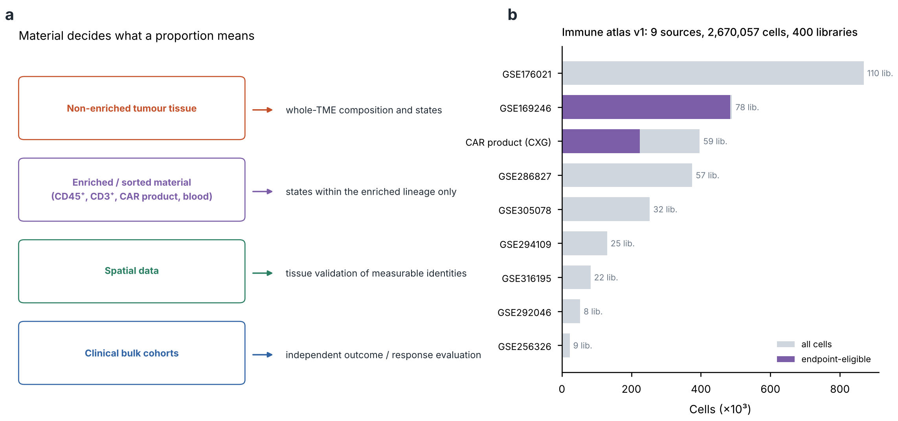
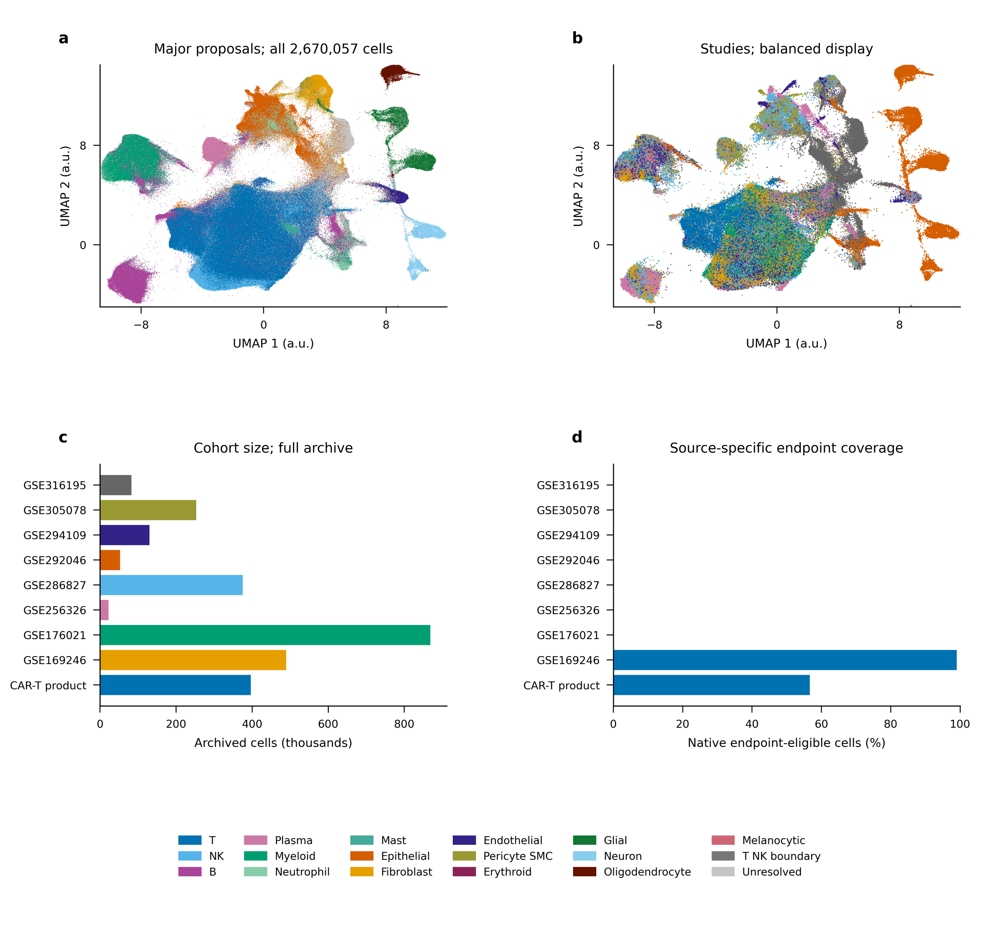

# 分页1｜数据集的选取和处理

[← 返回首页](../../../README.md#3-数据的组织) · 分页：**1 数据** · [2 LIANA与CM](02_liana_cm_communication.md) · [3 注释](03_annotation_logic.md) · [4 nsNMF](04_covarnet_nsnmf_limits.md) · [5 空间优先](05_spatial_first_validation.md) · [6 CM改进](06_cm_discovery_improvements.md) · [上一版分页1（2026-11-02）](../01_datasets.md)

本页说明项目在不同时间段组织了哪些数据、每批数据回答什么问题，以及项目如何从“尽量多的细胞”转向“按材料、患者和终点合格的数据”。

**图S1｜数据的四种用途与免疫图谱的来源构成。** **a**，10月以后数据按用途分为四类：非富集肿瘤组织用于讨论全TME组成与状态；免疫富集或分选材料（CD45⁺、CD3⁺分选，CAR产品，血液）只在被富集的谱系内部研究状态；空间数据用于在组织中验证可测的身份/状态；临床bulk队列用于独立的结局与应答评价。同一个“比例”在不同材料中含义不同——分选材料中的T细胞比例反映的是分选门内部的组成，不能代表整个TME。**b**，2026-10-14免疫图谱v1的9个来源：灰色为全部细胞，紫色为具备终点资格的细胞（只有GSE169246和CAR产品两个来源有终点资格细胞，共708,954个）；右侧为物理文库数。主文图2f给出了全部七个数据代际。

## 1 各时间段数据集的构成与作用

| 时间 | 数据版本 | 规模 | 主要作用 | 当前状态 |
|---|---|---|---|---|
| 2026-07 | Project_v3发现集 | 31 GSE · 773样本 · 1,963,745细胞 · 11,063基因 | 首轮统一整合与泛癌CoVarNet | 历史版本；作为0906中的“已有2M队列”只读复用 |
| 2026-08→09 | **5M合并（0906基础）** | 54 GSE · 43癌种标签 · 1,322样本 · 4,676,787细胞 · 10,432基因 | K=9 CM、逐样本LIANA、V5→V7身份与CNV | **首页主线**；V7为注释参考 |
| 2026-10-10 | 泛癌CM v20261010 | 172子群 · 1,290文库 · 9 CM | 新标签下的重新发现与CM边覆盖审计 | 独立版本，编号与0906不对应 |
| 2026-10-14 | 免疫图谱v1 | 9来源 · 400物理文库 · 2,670,057细胞 · 49,563原生特征 | 免疫治疗与免疫富集材料；T细胞连续状态；按材料范围拟合CM | 正式交付；CM02主线见[2026-10-26首页](../../../README_20261026_CM02.md) |
| 2026-10-23 | 全背景原生档案 | 65来源键 · 9,439,479条观测 | 统一身份、来源内marker、跨版本crosswalk | 分层注释参考 |
| 2026-10-30 | 合格TME范围 | 43来源 · 2,968,368条记录 · 770资格单位 | 非富集TME的组成CM与身份内状态模块 | 拟合与审阅完成；临床终点未接入 |
| 2026-11-06 | **V4非上皮K14** | 13来源 · 164样本 · 560,871非上皮细胞 · 45节点 | 按CoVarNet原文配置复现CM；种子与来源稳定性 | 见首页第9节；来源范围敏感性另列 |
| 2026-11-15 | **WEHI R4 K15** | 1,196单元（1,194进入分析）· 44身份 · 1,974,301细胞 | 血管模块CM12的通讯、空间、免疫浸润与预后验证 | 见首页第9节；单元不等同于患者 |

数据来源：[datasets.tsv](../../../inventories/datasets.tsv)、[免疫图谱交付](../../../inventories/runtime/2026-10-14/immune_atlas_v1/RESULTS.md)、[合格TME目标](../../../methods/TME-annotation-CM-state-goal-20261030.md)、[V4 CoVarNet](../../../inventories/analysis/2026-11-06/v7_selective_CoVarNet_author_v1/README.md)、[WEHI R4归档](../../../inventories/analysis/2026-11-19/WEHI_R4_CM_validation/README.md)。

## 2 0906版本的选取与处理

**来源。** 已有2M队列来自7月统一整合的最终产物；新队列为8月外部下载的24个GSE，复用已转换的`*_rawdata.h5ad`。新队列中23个GSE在obs中没有患者、组织或样本类型字段，癌种按下载策划表以GSE为单位回填，并标注`cancer_type_source`。

**逐样本质控。** 自适应阈值（476个样本单元用strict档，73个用floor档），按线粒体比例、总计数和检测基因数过滤，Scrublet去除13,821个双细胞（约0.6%，没有样本触发8%上限）。新队列3,282,991个细胞保留2,713,042个。计数在确认非负且接近整数后复制为`layers['counts']`；GSE289314的`.X`为log1p值，标记为`failed_no_counts_layer`并排除。

**合并。** 两批取基因交集10,432个（占2M基因面板的94.3%）。旧式克隆命名（RP11-、CTD-等）在新队列中约占22%，只上报不改写。

**元数据审计（2026-08-29）。** 首页图2d–e的样本材料、免疫治疗和转移信息来自这轮审计：能判断是否接受免疫治疗的样本127个，能判断是否为转移灶的354个，材料类型未知的284个。

## 3 免疫数据集与非富集TME数据集

0906把所有材料放进同一个频率矩阵，而“组成比例”的含义依赖于捕获方式。10月起的处理原则（图S1a）：

- **免疫富集或分选材料**中的细胞比例只反映父谱系内部的组成，不做全TME投影；
- **非富集肿瘤组织**才讨论跨谱系的相对组成；
- 癌旁/正常组织、淋巴结和转移灶提供不同的生物学参照，不作为同一组样本的重复。

免疫图谱v1按材料“范围”（如`whole_TME_primary_tumor`、`immune_enriched_blood`）分别拟合CM（[分页6](06_cm_discovery_improvements.md)图S6a）；合格TME范围在文库层面核定捕获方式和患者对应；V4 K14只用非上皮节点，并把GSE179994因“TME矩阵范围未确认”在看到CM效应之前暂存——保留它的v1运行（210样本、14来源、690,421细胞）选出K19，去掉后（v2）选出K14，说明**发现结果对来源范围敏感**。

**图S1补｜免疫图谱v1的来源与细胞组成（2026-10-26正式图稿）。** 覆盖2,670,057个细胞、9个来源和400个物理文库，提供18个大类、270个描述分群及T细胞五条连续状态轴。

## 4 空间与临床数据的来源

| 用途 | 数据 | 使用版本 | 说明 |
|---|---|---|---|
| 空间（spot） | Visium：GSE175540（ccRCC，24片）、GSE203612（多癌种，本项目用乳腺10片）、GSE238264（HCC，7）、GSE273952（ccRCC，12–19）、GSE301720（HNSCC，8） | 0906（61片）；V4（3来源53片）；R4（4片） | spot约55 μm，含多个细胞；切片数不等于患者数 |
| 空间（单细胞） | CosMx ccRCC 3例；Xenium/CosMx 13个成像单元；新乳腺Xenium 6例 | 0906；V4 | 面板缺少IGHD、XCL1等关键marker时，相应身份标为不可评估 |
| 空间（legacy ST） | Thrane黑色素瘤8张切片 | R4 | 逐片患者桥接未核实 |
| bulk临床 | TCGA（toil RSEM TPM，Liu 2018生存数据） | 全部版本 | 0906用9,034例；R4用9,120例非Redacted患者 |
| ICI | Riaz2017、Hugo2016、IMvigor210、Rose2021、Jung2019；V4另用六ICI家族与I-SPY2（248例） | 全部版本 | 队列小、终点和取材时序不一（Rose取材时序未知） |
| 外部肝癌 | GSE14520（GPL3921，225肿瘤/220非肿瘤） | R4 CM13 | 患者/OS桥接与时间起点尚未合格，未做外部生存拟合 |

## 5 仍存在的数据缺口

| 缺口 | 影响 | 处理方向 |
|---|---|---|
| 公开元数据缺少治疗、转移、患者编号 | 发现数据无法直接回答临床问题；独立患者数不确定 | 作者补充表桥接；患者未知的材料不计入独立患者 |
| 多数癌种只来自1–2个GSE | 癌种效应与研究效应混杂，统计校正无法分开 | 优先补“同癌种多来源” |
| 富集与非富集材料混合 | 组成比例语义不一 | 分支分析；富集材料不做全TME投影 |
| 合格TME的770单元中457个治疗阶段待核实 | 不同阶段材料混入同一NMF | 先冻结阶段可核的子范围 |
| 发现结果对来源范围敏感（V4：K19 vs K14） | 模块编号与成员随来源集合变化 | 来源留出、来源权重敏感性作为默认报告项 |

[← 返回首页](../../../README.md#3-数据的组织)
