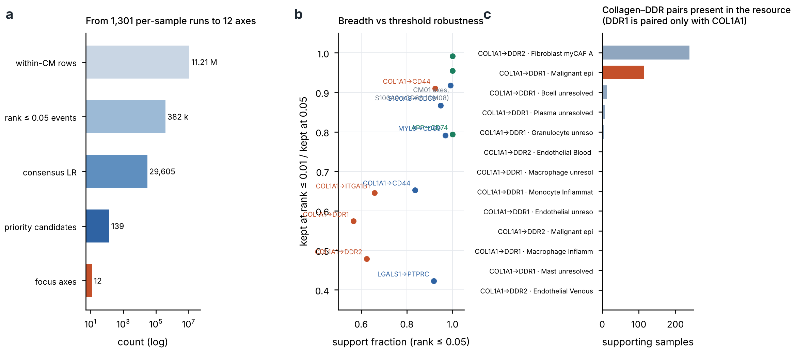

# 分页2｜LIANA通讯与CM模块的联系及潜藏的问题

[← 返回首页](../../../README.md#6-cm内部的细胞通讯) · 分页：[1 数据](01_datasets.md) · **2 LIANA与CM** · [3 注释](03_annotation_logic.md) · [4 nsNMF](04_covarnet_nsnmf_limits.md) · [5 空间优先](05_spatial_first_validation.md) · [6 CM改进](06_cm_discovery_improvements.md) · [上一版分页2（2026-11-02）](../02_liana_cm_communication.md)

0906版本中，通讯分析是连接“组成模块”和“机制解释”的桥。本页说明这座桥如何搭建、它在哪些地方承重不足，以及后续版本用置换检验和跨模块比较重新检查这座桥时看到了什么。

**图S2｜从逐样本LIANA到重点轴。** **a**，逐级筛选的数量（对数坐标）：within-CM逐样本行约1,121万 → magnitude与specificity rank均≤0.05的事件约38.2万 → 按（CM、发送者、接收者、配体、受体）汇总的共识互作29,605条 → 要求≥10个可检验样本、≥3个GSE、≥3个癌种并去除自通讯和背景轴后的研究优先候选139条 → CM01/07/08的12条重点轴。**b**，12条轴的“广度”（标准阈值下的支持比例，横轴）与“阈值稳健性”（严格阈值下仍保留的支持样本占标准阈值下的比例，纵轴）。右上角（CM01三条轴、CM08的S100A9→CD68）支持广且对阈值不敏感，但这正是丰度驱动轴的特征；LGALS1→PTPRC支持比例0.92，严格阈值下只保留42%；COL1A1→DDR1、COL1A1→DDR2、COL1A1→ITGA1:ITGB1在两个维度上都较弱。**c**，LIANA consensus资源中出现的胶原—DDR配对及其支持样本数：DDR1只与COL1A1配对（COL1A2、COL3A1与DDR1不在资源中），COL1A1→DDR1的支持集中在恶性上皮接收端（橙）。数据：`fig5_focus_axes_replication.tsv`与[collagen_ddr_sweep_summary.tsv](../../../releases/communication_evidence_chain_20260906/tables/collagen_ddr_sweep_summary.tsv)。

## 1 CM与LIANA是如何连接的

1. 每个原始样本独立运行`liana.mt.rank_aggregate`，分组为`final_annotation_with_malignancy_v6`细分状态，每组≥20个细胞，`expr_prop=0.10`，`seed=1337`；1,301/1,322个样本成功。
2. **within-CM过滤**：只保留发送者和接收者同属某个CM前10成员的互作，打上`shared_cm`标签。
3. 逐样本、逐LR保留rank≤0.05的事件；按（CM、发送者、接收者、配体复合物、受体复合物）汇总支持样本数、GSE数、癌种数及平均rank，并计算`replicate_rank_score = log1p(n_samples) × −log10(√(mag×spec))`。
4. 研究优先表加入可检验分母（两组均≥20个细胞的样本数）、支持比例及Wilson区间。

## 2 潜藏的问题

**(1) 成员定义的循环。** 第2步用CM成员来限定哪些细胞对可以通讯，而CM成员本身来自共变的细胞比例。两个总是一起增多的细胞群，自然也更常同时达到≥20个细胞、同时被LIANA评估。within-CM通讯因此不是独立于CM的证据，更合适的理解是“在已知共变的细胞对中，哪些LR具有特异性”。

**(2) 丰度与特异性。** LIANA的magnitude依赖表达量，specificity依赖组间比较。S100A8/A9→CD68、S100A8→CD69几乎在所有含炎性髓系的样本中出现（支持比例0.95–0.99），在bulk中也不提供超出父签名的信息，更接近“髓系多”这一组成事实。MYL9→CD69、COL1A1→CD44（myCAF→单核/CD8）情况类似。

**(3) 阈值敏感性。** 同一条轴在rank≤0.01与≤0.05之间的保留比例从0.42到0.99不等（图S2b）。COL1A1→DDR1的magnitude rank中位数约0.01，处于阈值边缘——胶原表达高而肿瘤DDR1表达偏低。报告支持比例时同时给出三档阈值，可以避免把阈值附近的轴读成稳健结果。

**(4) 资源覆盖。** consensus资源中DDR1只有COL1A1一个配体（图S2c），单细胞层面的“collagen–DDR1”实际只评估了COL1A1–DDR1。B2M–KLRD1/KLRC等高频轴在汇总中占据大量排名，需要显式作为背景剔除。

**(5) 身份粒度。** 0906的发送者/接收者包含`Granulocyte_unresolved`、`Plasma_unresolved`等未细分节点（首页图4a）。未细分节点上的LR结果无法落到具体细胞状态。

**(6) 从单细胞到bulk。** bulk代理以配体和受体z分的较小值表示“两端都高”，同时受发送和接收细胞丰度影响，无法恢复方向。模型C的意义只在于检验“代理是否在父签名之外提供额外信息”：SPP1巨噬代理和LGALS1代理通过了这一检验，collagen–DDR1代理与desmoplasia签名共线，条件后方向翻转。2026-11-06的复核进一步显示TCGA中DDR1的“免疫冷”信号大部分可由肿瘤纯度解释（[运行记录](../../../runs/20261106_CM07_DDR1_exploration_v1.md)）。

**(7) 统计单位。** 支持比例以样本为单位；同一患者的多个样本、同一GSE的多个样本并不独立。最大单一GSE占比（COL1A1→DDR1为12%）可以提示是否被单个研究驱动，但不能代替患者级或来源留出分析。

## 3 后续版本中，这些问题如何显现

0906之后的两个发现版本换用了带置换检验的CellPhoneDB，并且**在所有CM之间比较**，而不只在一个CM内部看。结果直接对应上面的问题(1)和(2)：

| 版本 | 做法 | 关键数值 | 对应问题 |
|---|---|---|---|
| V4 K14（11-07～11-09） | 全局CPDB（38,711个平衡抽样细胞、45标签、1,000次置换）；14个High + 11个Low共25组CM-high/low比较；CellChat 2.2.0作替代算法；21个“CM—免疫身份”的细胞因子响应 | 57,450个“有序身份对×LR”候选事件；数据库2,923条互作中1,356条组分完整可测；CM03在两种Low定义下都没有稳健的High>Low增强；作者式响应分支无成员q<0.05 | (1) 循环、(2) 丰度 |
| WEHI R4 K15（11-15～11-19） | 全部15个CM的CPDB，1,000次置换，无下采样；跨15个CM联合BH；三来源患者级high/low差异LR | 25,912,935个检验中798,786个联合q<0.05，但它们都处在P=0的置换分辨率档；CM12 ESM1→RGS5的78项检出中77项也在其他CM中检出，反向108项全部共享；患者级45,821个非恒定假设联合BH后无q<0.05 | (1)、(2)、(7) |

也就是说，“这条LR在这个CM里被检出”和“这条LR是这个CM特有的”是两个问题。后者需要跨CM比较、匹配丰度的对照，以及患者级的统计单位；在R4中，核心血管对（ESM1内皮/RGS5周细胞）只有肾癌一个来源（GSE207493，9 high/10 low）满足患者数资格，肝癌资格不足不能当阴性。详见[V4通讯](../../../inventories/analysis/2026-11-07/v4_communication_author_v1/README.md)、[V4验证审阅](../../../inventories/analysis/2026-11-09/v4_CM_validation_review_v1/README.md)、[R4归档](../../../inventories/analysis/2026-11-19/WEHI_R4_CM_validation/README.md)。

## 4 可以如何改

| 方向 | 做法 |
|---|---|
| 解除循环 | 在全部细胞对上运行通讯推断，再检验CM成员对是否比匹配丰度的非成员对更富集某类LR（置换成员标签，保持丰度分布） |
| 区分丰度与通讯 | 以样本内细胞数、检测基因数为协变量；或比较同一细胞对在CM活动高/低样本中的LR变化（作者Figure 3h式high/low，以患者为单位） |
| 模块特异性 | 跨全部CM联合校正；报告每条检出在其他CM中是否也检出，“仅在一个CM达阈值”不等于差异通讯 |
| 受体端证据 | 加入接收细胞的通路/TF响应（如NicheNet、LIANA+的下游打分），要求LR与受体端响应同时成立 |
| 资源 | 并行使用多套资源，单列只在某一资源中出现的轴；不可测组分记为不可测而非阴性 |
| 空间约束 | 只在空间上相邻的细胞对中评估LR（见[分页5](05_spatial_first_validation.md)） |

完整审计见[0906通讯证据链报告](../../../releases/communication_evidence_chain_20260906/reports/COMMUNICATION_EVIDENCE_CHAIN_CN.md)与[证据矩阵](../../../releases/communication_evidence_chain_20260906/tables/EVIDENCE_MATRIX.tsv)。

[← 返回首页](../../../README.md#6-cm内部的细胞通讯)
