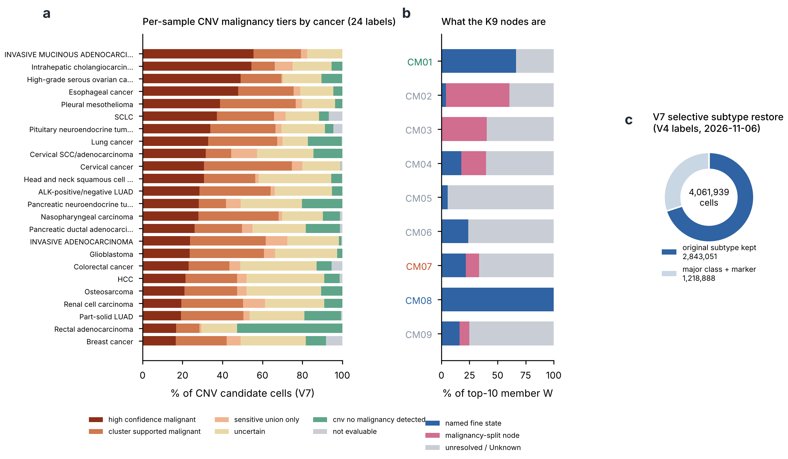

# 分页3｜0906的注释逻辑与后续调整

[← 返回首页](../../../README.md#4-整合处理与0906注释) · 分页：[1 数据](01_datasets.md) · [2 LIANA与CM](02_liana_cm_communication.md) · **3 注释** · [4 nsNMF](04_covarnet_nsnmf_limits.md) · [5 空间优先](05_spatial_first_validation.md) · [6 CM改进](06_cm_discovery_improvements.md) · [上一版分页3（2026-11-02）](../03_annotation_logic.md)

CM的节点就是注释得到的细胞亚群，所以注释决定了模块里“有什么”。本页依次说明0906使用的注释（V5身份与V7参考）、其后V8/V9的尝试、10月的cluster优先与分层策略，以及11月为后续CM版本做的标签整理。

**图S3｜恶性证据分层、K9节点的性质与V4标签的来源。** **a**，V7中各癌种CNV候选细胞的恶性证据构成（按高置信恶性比例排序的24个癌种标签）：深红为高置信，橙为cluster支持，浅橙为仅敏感并集，米色为不确定，绿色为CNV未检出，灰色为不可评估。在图中这24个癌种标签内，高置信比例从乳腺癌的约17%到浸润性黏液腺癌的约55%不等，“恶性”节点在不同癌种中的含义并不相同。**b**，K=9各CM前10成员载荷中，已命名细分状态（蓝）、恶性证据分层节点（粉，如`Malignancy_uncertain::Ambiguous`）和unresolved/Unknown节点（灰）的比例。CM08全部为命名状态；CM05、CM03、CM02主要由后两类构成。**c**，2026-11-06的V7选择性保留亚型（即V4 K14使用的标签）：4,061,939个细胞中2,843,051个沿用原亚型/分类名，1,218,888个未完成细分或有父类纠错记录的细胞只给“大类＋marker”。

## 1 0906版本：V5身份

**大类仲裁。** 三路证据：数据集作者逐细胞标签（literature）、按真实全转录组文库大小计算的marker分数、CellTypist（`Immune_All_Low`，对非免疫细胞近似噪声，因此只在适用范围内作支持）。literature与CellTypist的大类整体一致率68.1%（已有队列71.7%，新队列42.1%）。v1→v2引入17个谱系的负向排除marker（如T细胞配LST1/TYROBP/MS4A1/COL1A1/PECAM1），514,215个细胞的大类因此改变；允许Unknown与Ambiguous。

**细分。** 在BBKNN图上按谱系做Leiden重聚类，结合扩展marker面板，v1→v5多轮修订后得到41个身份标签。恶性维度来自逐样本inferCNVpy、CopyKAT及scATOMIC的分层共识；在CoVarNet输入中，上皮细胞的subCluster被替换为恶性判定类别（如`Malignant::Epithelial`、`Malignancy_uncertain::Unknown`）。

**已知的不稳定性。** BBKNN+Leiden谱系内重聚类对输入扰动敏感：移除0.046%的细胞，T细胞重聚类的ARI降到0.61。Erythroid、HSPC、ILC更像连续分化轨迹，离散聚类并不适用。

## 2 V7（2026-09-05冻结，0906起为参考）

V7在同一4,676,787细胞索引上做了两件事（[完整逻辑](../../../releases/annotation_v7_20260905/methods/V7_REFERENCE_AND_ANNOTATION_LOGIC_CN.md)）：

1. **不确定性修复。** 旧规则中单个负marker即可否决候选；V7改为单个负marker记为`provisional_negative_review`，至少两个方向一致的负marker才视为竞争程序；跨区室一致冲突保留为Ambiguous，同时处于样本双细胞分位数高位时设为不进入主分析（不删除）。相邻谱系间的低margin以`T_NK_ILC_boundary`、`Myeloid_boundary`等边界类表示。1,073,743个亚型unresolved细胞中，91,805个严格救援，609,412个获得描述性`_unresolved_GENE`后缀，372,526个仍无跨样本稳健marker。
2. **逐样本CNV重跑。** 依据新的大类，按原始样本由raw counts重建candidate/reference（共1,156,120个candidate、2,465,967个reference），分别运行inferCNVpy与固定版本CopyKAT，再分为高置信、cluster支持、仅敏感并集、不确定、未检出与不可评估（图S3a）。跳过的样本不解释为阴性。

V7还修正了基因别名（如KIM1→HAVCR1、SEPP1/SELENOP），并按GSE建立结构性缺测掩码，避免把“未测到”当成“零表达”。

**V5到V7对CM的含义。** 首页图3g显示，V5中Ambiguous细胞有69%在V7获得确定谱系，Unknown细胞有41%获得确定谱系。而K=9 CM是在V5上拟合的——CM02、CM03、CM05的大部分成员载荷落在这些不确定节点上（图S3b）。0906的CoVarNet/LIANA分支没有在V7上重跑。

## 3 V8与V9：谱系分类学的尝试（2026-09）

| 版本 | 内容 | 状态 |
|---|---|---|
| V8（09-12起） | Myeloid/DC、T/NK、Fibroblast、Endothelial、B/Plasma五个谱系分别冻结规则与分类学，计划用12个GSE做留出评估 | 全局`NOT_FROZEN`；T/NK留出被污染，B/Plasma开发集中45.4%细胞回落到竞争谱系 |
| V9（09-19） | 冻结候选报告与L3人工复核模板 | `FROZEN_CANDIDATE_NOT_PROMOTED`；15个L3 cluster待签、632个样本建议重跑CNV |

两者都没有替代V7。主要教训：留出集必须在任何输出产生之前划定；谱系分类学冻结和全局细胞级写回是两件事。见[V8审计](../../../releases/annotation_v8_lineage_audit_20260917/README.md)、[V9候选](../../../releases/annotation_v9_candidate_20260919/README.md)。

## 4 10月的调整逻辑

| 调整 | 0906的做法 | 10月的做法 | 依据 |
|---|---|---|---|
| 命名顺序 | 先套参考/marker面板，再细分 | **cluster优先**：先用本群原生表达（正向富集+检出率）命名`Celltype_MARKER_编号`，再与CellTypist/SingleR交叉核对；细分不清时停在大类 | [cluster优先方法](../../../methods/TME_CLUSTER_FIRST_AUTOMATIC_CROSSCHECK.md) |
| 证据来源 | 允许借用父群marker | 本群marker与借用父群marker分字段记录；群级标签不广播为逐细胞真值 | [全背景分层注释](../../../methods/full-context-atlas-hierarchical-annotation-plan-20261023.md) |
| 身份与状态 | 增殖、细胞毒、IFN等可能成为亚群名 | 身份（L1父谱系→L2子身份→L3局部群）与连续状态分开；状态可以同时活跃 | [下一阶段方案](../../../methods/CM-project-next-stage-20261030.md) |
| 整合基座 | BBKNN（scIB微弱领先） | 免疫图谱九来源改用scVI工作图谱：36个Leiden群映射为27个展示名称，混合群在文档中注明 | [scVI平行整合](../../../methods/TME-scVI-GPU-comparison-20261029.md) |
| 跨版本 | 版本之间各自独立 | 新旧身份建立crosswalk，旧270描述群、作者身份完整保留 | [注释发布索引](../../../releases/README.md) |

## 5 11月：为后续CM版本整理标签

| 工作 | 内容与数值 | 对CM的意义 | 记录 |
|---|---|---|---|
| V7 panel修复（11-05） | 旧162项规则逐条迁移为112个证据模块、409个基因；634条模块—基因依据中266条在作者材料中有出现证据，其余明确标注待核 | marker命名需要该marker本身可测且相对富集，不能用同panel其他基因替代；未测不当阴性 | [panel修复](../../../resources/annotation/v7_panel_repair_v1/README.md) |
| 上皮面板扩展（11-05） | 原文件26组拆分后新增25、复用7组织上皮面板；V7扩展对照版137模块 | 为“加入上皮节点”的模块识别准备组织特异身份 | [上皮扩展](../../../resources/annotation/v7_epithelial_extension_v1/ALL_PANELS.md) |
| unresolved复查（11-06） | B谱系157,888个目标细胞：101,299个大类工作、56,589个身份待复查；红系/血小板/HSPC/ILC共59群、70,778细胞重建 | 未定节点不再以“unresolved”身份进入模块 | [B复查](../../../inventories/analysis/2026-11-06/v7_B_unresolved_review_v1/README.md)、[其他复查](../../../inventories/analysis/2026-11-06/v7_other_unresolved_review_v1/README.md) |
| 选择性保留亚型（11-06，V4标签） | 图S3c：2,843,051个沿用原亚型，1,218,888个用大类＋marker | V4 K14的45个非上皮节点来自这套标签；继承亚型不等于本轮重新验证了亚型 | [V4标签](../../../inventories/analysis/2026-11-06/v7_selective_subtype_restore_v4/README.md) |
| 新TME注释v2（11-07～11-09） | 3,347,659个细胞；三轮谱系分析、组织特异池（Kupffer、LSEC、肺泡巨噬、小胶质）、低深度标签转移（留出准确率上限0.89–0.92） | 分辨率1的Leiden**只换随机种子就有约30%细胞的亚型标签改变**，因此亚型改由十种子共识定稿；31,002个组织池细胞符合主分析条件 | [方法](../../../methods/tme-annotation-v2-lineage-rounds-20261107.md) |
| WEHI R4身份（11-15） | 44个细胞身份、2,779,785条唯一R4标签重建1,196×44计数并逐项核对 | R4 K15的节点 | [R4归档](../../../inventories/analysis/2026-11-19/WEHI_R4_CM_validation/README.md) |

“只换种子就有约30%的亚型标签变化”这一观察尤其值得注意：CM的输入是亚型比例，亚型边界的随机性会直接传递到频率矩阵，再传递到模块成员。这也是[分页4](04_covarnet_nsnmf_limits.md)把“种子稳定”和“生物学稳定”分开讨论的原因之一。

这些调整服务于同一个目标：让CM的每个节点都有自己的原生表达证据和跨来源一致性，让“未定”成为可见的状态，而不是被并入某个成员。

[← 返回首页](../../../README.md#4-整合处理与0906注释)
