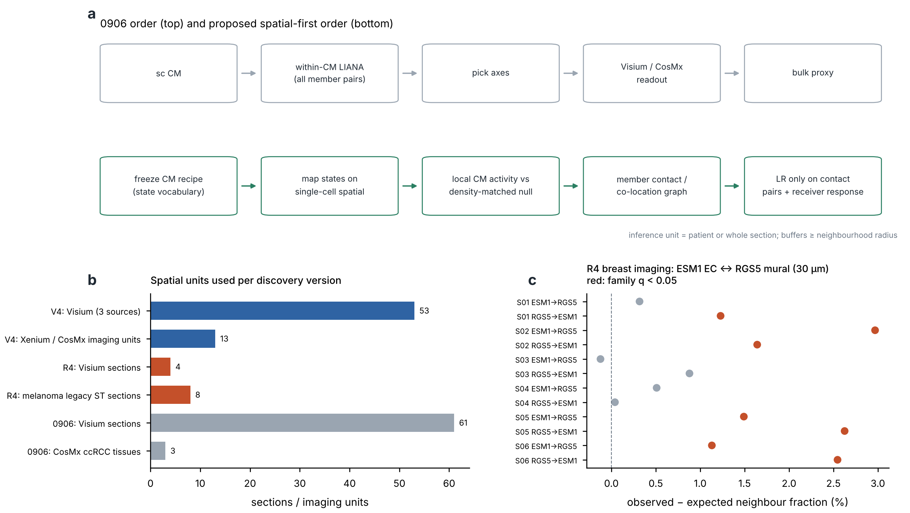

# 分页5｜模块识别之后直接在空间数据上验证并发掘通讯

[← 返回首页](../../../README.md#7-空间数据中的读出) · 分页：[1 数据](01_datasets.md) · [2 LIANA与CM](02_liana_cm_communication.md) · [3 注释](03_annotation_logic.md) · [4 nsNMF](04_covarnet_nsnmf_limits.md) · **5 空间优先** · [6 CM改进](06_cm_discovery_improvements.md) · [上一版分页5（2026-11-02）](../05_spatial_first_validation.md)

0906按“单细胞CM → 单细胞LIANA → 挑选轴 → 空间读出 → bulk代理”的顺序推进，空间数据出现在链条后段，只用来检验已经挑好的轴。本页讨论把空间验证提前：模块一旦识别，先在空间数据中检验成员是否真的在组织里相遇，再只在相遇的细胞对上发掘通讯。V4和R4两个后续版本已经部分按这个思路做过，本页一并展示它们的结果与遇到的问题。

**图S5｜空间优先的顺序、各版本使用的空间单元与一个单细胞分辨率的示例。** **a**，上排为0906的顺序：通讯在所有成员对上评估，空间只作为后验读出；下排为提议的顺序：冻结模块配方（成员状态词表）→ 在单细胞分辨率空间数据中映射状态 → 计算固定物理窗口中的局部模块活动，并与保持密度的零模型比较 → 构建成员之间的接触/共定位图 → 只在接触对上评估LR，并要求接收细胞出现相应的通路或TF响应。推断单位始终是患者或整张切片。**b**，三个发现版本实际使用的空间单元数（切片或成像单元，不等于患者数）。**c**，R4乳腺成像（6张切片，S01–S06）中ESM1内皮与RGS5周细胞在30 μm内的邻近：横轴为观测减期望的邻居比例，红色为该检验家族中q<0.05。6张切片中有4张在至少一个方向上富集，S03、S04两个方向都不显著；效应大小在0–3个百分点之间。

## 1 0906空间读出能说明什么、不能说明什么

| 读出 | 观察 | 局限 |
|---|---|---|
| Visium CM投影Moran's I（61张切片） | CM01/07/08在所有切片中均有空间自相关（p≤0.001） | 55 μm spot内混有多个细胞；打分平滑不等于成员共定位 |
| Visium LR邻域共富集 | VCAN→ITGB1（CM07）5/5数据集为正；LGALS1→PTPRC（CM08）方向不一；APP→CD74在3个数据集中强负 | 由基因表达而不是细胞身份定义发送与接收；未测DDR1 |
| ccRCC CosMx | 胶原×DDR1高的肿瘤细胞离CD8更远；但复核显示观测比值与保持密度的零模型期望接近（RCC5：5.54对5.13） | 只有ccRCC，而ccRCC近端小管本身DDR1⁺；坐标单位为像素；“肿瘤”集合约36%为成纤维样/巨噬样簇 |

## 2 提议的分析框架

**(1) 状态映射。** 在Xenium、CosMx、MERFISH或Visium HD等单细胞分辨率数据上，以冻结的状态词表做标签迁移（只用两侧共同可测的基因）；面板缺少的marker记为不可测，而不是阴性。若某个CM的关键成员在面板中无法识别，该CM在此数据上标为不可评估。

**(2) 局部模块活动。** 以25/50/100 μm等固定物理窗口聚合状态组成，用冻结的W投影得到局部活动。零模型保持各状态的边际丰度和细胞密度（例如在组织区室内置换标签），使“模块活动高”超出“某类细胞多”。

**(3) 成员接触图。** 对每个CM的成员对，计算k近邻或固定半径内的共现比值，与零模型比较，得到“哪些成员真的相邻”。

**(4) 接触对上的通讯。** 只在相邻的发送/接收对上评估LR；在RNA空间数据中再比较“与发送者相邻的接收细胞”和“不相邻的同类接收细胞”在受体下游程序上的差异。

**(5) 推断单位与留出。** 重叠窗口共享细胞，划分训练与评估时加入至少等于邻域半径的缓冲区；独立性以患者或整张切片计。

## 3 后续版本中已做的空间优先尝试

| 版本与对象 | 做了什么 | 读出 | 遇到的问题 |
|---|---|---|---|
| **V4 CM03**（IGHD B—PECAM1内皮—XCL1 NK），Visium 3来源53张 | 同标签cell2location，固定原成员/W投射；原文共定位分数、60近邻有向Moran；独立的CellCharter区域 | 两条原边来源中位Spearman 0.27–0.44（大类合并后0.37–0.58）；但53张切片中没有一张在两个主指标上超过“相同父类组成”对照的95百分位；三成员同一最高均值区域只有16/53 | 与相似参考谱的细胞对相比，B—内皮超额相关为负（−0.05至−0.16），原始正相关可能部分来自细胞混合与参考可分辨性 |
| **V4 CM03大类扩展**，新乳腺Xenium 6例 | ACKR1≥1 UMI血内皮为目标、ACKR1未检出血内皮为对照，50 μm内免疫身份比例，患者级log-OR | B 6/6供者正向（log-OR中位0.717，BH 0.016）、NK 6/6（0.626）、T 6/6（0.434，作背景）；66个假设数值独立重放通过 | 面板缺IGHD和XCL1，因此**不是精确CM03亚型验证**；作者`um`字段实为像素（×0.2125修正后326万坐标通过） |
| **V4 ccRCC**（单例，358,841个QC细胞） | 现有身份下的12组成/108 LR，CellChat四参数，固定500 μm分区删单块 | EC—NK超额+0.197个百分点，删除任一区域后仍为正，但只有39.8%的区域正向；Mural→B/T的CXCL12–CXCR4区域贡献较一致；B—EC与三方结构缺少支持 | 有限MC联合BH/BY无q<0.05；单例 |
| **R4 CM12**（ESM1内皮—RGS5周细胞—FOLR2巨噬），Visium 4片 + 黑色素瘤legacy ST 8片 + 乳腺/肺成像 | 预先固定N=30主分析、N=5/60敏感性（24个模型）；466个成像条件检验 | ESM1–RGS5偏相关在4张Visium中0.44–0.57、8张ST中全部为正；加入FOLR2的边不一致；乳腺部分设置支持邻近富集（图S5c），肺癌未通过联合校正 | 参考不含ESM1、PECAM1；ST切片患者桥接未核实；有效条码/H&E配准尚未建立 |

这些尝试的共同经验是：**(a)** 面板是否覆盖成员的身份marker，在开始之前就决定了能检验什么；**(b)** 坐标单位、图像几何和参考可分辨性都需要单独核验；**(c)** 大类层面的空间关系（如血管周淋巴细胞组成）比精确亚型组合更容易得到一致读出，二者不能互相替代；**(d)** 空间共现、差异通讯和临床预测是三个不同的问题，一个层面的支持不自动外推到另一个层面。详见[V4验证审阅](../../../inventories/analysis/2026-11-09/v4_CM_validation_review_v1/README.md)、[ccRCC定位](../../../inventories/analysis/2026-11-10/ccrcc_localization_v1/README.md)、[Xenium坐标修正](../../../inventories/analysis/2026-11-08/v4_coordinate_fix_v1/README.md)、[R4归档](../../../inventories/analysis/2026-11-19/WEHI_R4_CM_validation/README.md)与[R4全24组敏感性](../../../inventories/analysis/2026-11-20/WEHI_R4_melanoma_all24/README.md)。

## 4 0906三组CM在此框架下的具体问题

| CM | 首先要检验的空间问题 | 适合的数据 |
|---|---|---|
| CM01 | FCN1单核、SPP1巨噬与血管内皮是否构成血管周生态位；该生态位旁的T/NK状态 | 含血管与髓系标志的单细胞空间面板，多癌种 |
| CM07 | myCAF与恶性上皮的界面上，CD8是否被隔离（需保持密度的零模型）；界面肿瘤细胞的DDR1及EMT/MMP程序 | 肺癌、食管癌、胰腺癌等强促纤维化肿瘤（避开ccRCC）；需要恶性细胞身份可靠 |
| CM08 | 炎性单核/巨噬、myCAF与CD8 T的相对位置；LGALS1高CAF旁的CD8状态 | 含CAF与T细胞状态标志的面板 |

项目还有一个SpaCoVarNet方向的原型（2026-10-28方案：样本视图与空间视图共享W、各自H，并加图正则）。在历史106状态、755个样本和一个6,090细胞视野上，真实空间图相对两类零模型给出更低的粗糙度；这只说明图正则按设计起作用，模块是否更真实仍需由上面的独立空间读出评价。已完成的MERFISH空间分子测量资格审定见[CM02空间测量扩展](../../../methods/CM02-spatial-communication-extension-20261018.md)，NSCLC淋巴结中以患者为单位、MKI67分层与局部条件零模型检验T细胞状态配对的设计见[空间方法](../../../methods/CM02-LN-regulatory-specificity-20261022.md)。

[← 返回首页](../../../README.md#7-空间数据中的读出)
