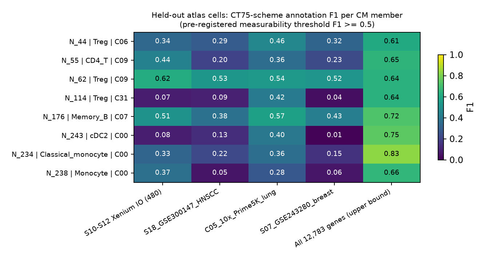
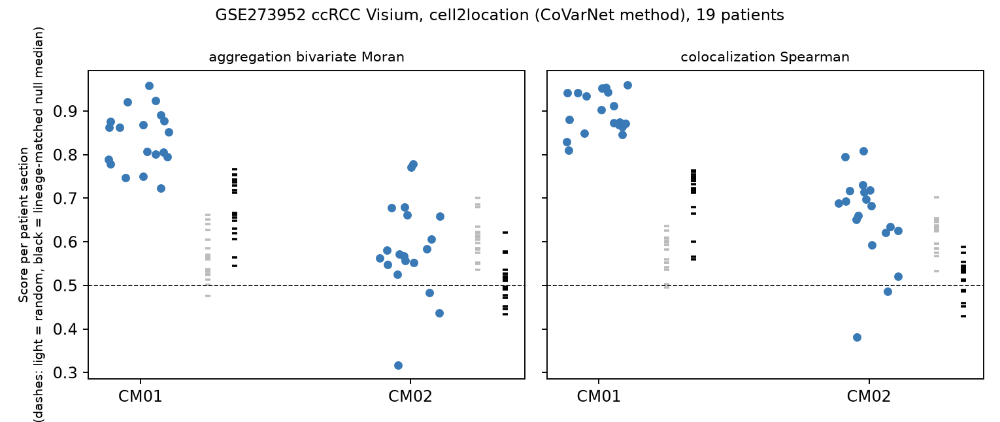
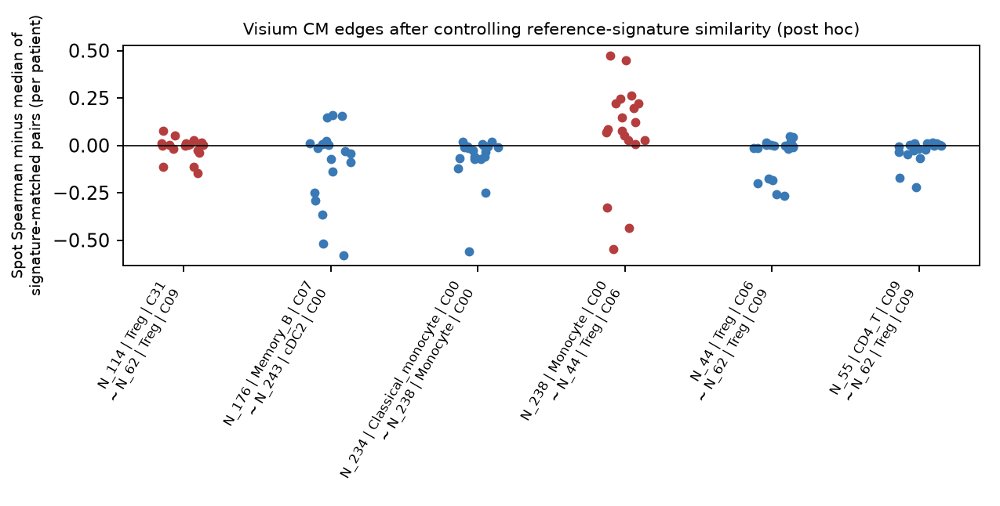
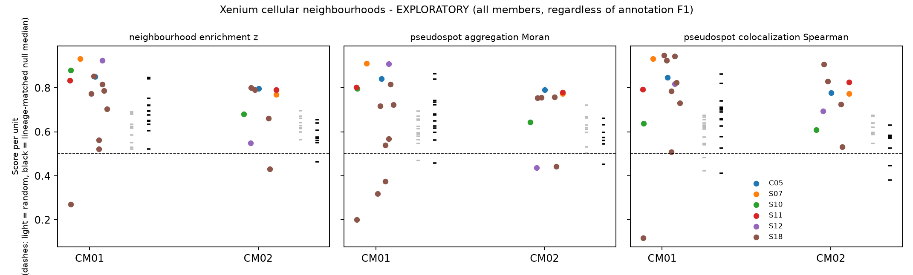

# CT75免疫CM：独立空间转录组验证

2026-11-02 / 11-03（UTC），WEHI。对象为CT75主方案（K=2，种子20261030）的两个CM：2026-11-01 CT75 CM01和CM02。方法事先写在[方法文件](../../../methods/TME-CT75-spatial-CM-validation-20261102.md)，运行记录见[runs](../../../runs/20261102_TME_CT75_spatial_validation_v1.md)，全部汇总表和图在[inventories](../../../inventories/analysis/2026-11-02/CT75_spatial_validation_v1/)。

## 结论

**两个CM作为整体，在独立空间数据上都没有得到验证。** 唯一稳定的信号是CM02中的一条跨谱系边：单核细胞（N_238，C00）与调节T相关节点（N_44，C06）在Visium和Xenium上都比对照更常共处。

| 层次 | CM01（4个T/NK节点） | CM02（B、髓系、T共5个节点） |
|---|---|---|
| Visium，按原文方法 | 19/19名患者分数>0.5（中位0.88） | 17/19>0.5（中位0.68） |
| Visium，控制参考谱相似度后（事后） | 0/19>0.5（中位0.39），低于零分布 | 5/19>0.5（中位0.48），与零分布无差别 |
| Xenium，事先规则（成员F1≥0.5） | 不可计分 | 不可计分 |
| Xenium，探索性（全部成员） | 共定位高于谱系匹配零分布的趋势（p=0.067），聚集分数无差别 | 伪spot共定位高于谱系匹配零分布（8/9单位，p=0.008） |
| N_238~N_44这条边 | — | Visium：16/19名患者高于谱相似对照（符号检验p=0.004）；Xenium：8/8单位邻域z>0 |

## 1. 注释沿用同一套方案

CT75节点=父区室×Leiden数值cluster×CellTypist `Immune_All_Low`身份。参考从CT75的439个单位抽取，每个节点≤1,000个细胞（186个节点，含非免疫区室），另取不重叠的留出细胞。Xenium细胞先用在参考上训练的CellTypist模型迁移区室×cluster，再用与图谱同版本、同SHA的官方模型给身份，最后按图谱同一兼容规则合成节点。

留出验证（图1，[表](../../../inventories/analysis/2026-11-02/CT75_spatial_validation_v1/annotation_transfer_validation.tsv)）：

| 基因集 | 基因数 | 区室准确率 | 区室×cluster | 75个节点中F1≥0.5 |
|---|---:|---:|---:|---:|
| Xenium Prime 5K（C05） | 3,786 | 0.97 | 0.86 | 16 |
| Xenium IO（S10–S12） | 396 | 0.96 | 0.84 | 10 |
| Xenium HNSCC（S18） | 279 | 0.94 | 0.80 | 6 |
| Xenium乳腺（S07） | 256 | 0.95 | 0.80 | 6 |
| 全部12,783个基因（上限） | 12,783 | 0.97 | 0.89 | 33 |

8个CM成员在全基因下F1为0.61–0.83，但在任何Xenium面板上最多只有N_62和N_176达到0.5。CM01的几个调节T相关节点只靠所属cluster区分，靶向面板分不开。

## 2. Visium（GSE273952 ccRCC，19名患者）

方法按CoVarNet原文：cell2location（N=5，α=20，30,000 epochs，全批量；全部切片合并超出40 GB显存，改为每张切片单独拟合）；CM活动为成员丰度按W加权；共定位分数和双变量Moran聚集分数的定义与原文相同。另加两种零分布：随机成员，以及保持父区室组成的谱系匹配随机成员。

按原文分数，CM01很强（图2）。但成员两两的spot相关高得不合理：三个调节T相关节点之间的Spearman为0.94–0.96。检查发现，在全部186个细胞群之间，spot相关与参考谱相似度的秩相关为0.52；CM01成员的参考谱相关为0.97–0.98，而参考谱同样相似的任意一对节点，spot相关中位数也有0.95–0.96。也就是说，cell2location把同一种信号分给了几个几乎相同的谱，产生了相关。

事后控制：每对的spot相关减去参考谱相似度相近（±0.01）的所有对的中位数，再计算原文分数（[汇总](../../../inventories/analysis/2026-11-02/CT75_spatial_validation_v1/visium_signature_adjusted_summary.tsv)）。CM01降到0.39，CM02降到0.48；六条网络边中只有N_238~N_44仍为正（中位残差+0.087，16/19，图5）。

## 3. Xenium细胞邻域

数据：C05肺（Prime 5K）、S07乳腺（两张技术重复合并为一个单位）、S10–S12卵巢/结直肠/肺、S18 HNSCC（17张切片、10名患者，按患者合并）。方法：50 µm半径邻域富集（标签置换200次）；50 µm伪spot上计算与Visium相同的共定位和聚集分数。

按事先规则，两个CM在所有面板上可测成员都不足2个，**主要分析不可计分**。探索性分析不按F1筛成员（图3）：随机零分布本身已经在0.6左右，因为免疫细胞彼此聚集；改用谱系匹配零分布后，CM01共定位p=0.067、聚集p=0.95，CM02伪spot共定位p=0.008。成员注释在这些面板上的F1多在0.4以下，这一部分不能算验证。

## 4. 解读边界

- CM01由4个同谱系节点组成，差别只在cluster。它们在单细胞上的共变很可能来自同一群细胞被拆成几个cluster；空间上既分不开，也没有超出同谱系共处的证据。
- CM02作为五节点模块没有得到支持；N_238~N_44在两类平台上方向一致，是值得单独追踪的候选关系。共处不等于通讯或因果，Visium spot也不是细胞接触。
- 空间来源癌种为ccRCC、肺、卵巢、结直肠、乳腺和HNSCC，与CT75的混合癌种训练集不同，不能算同癌种复制。
- Visium的参考谱控制、Xenium的探索性分析和谱系匹配零分布都是看到初步结果之后加的，已在方法文件中注明。
- cell2location估计的每spot细胞数中位约40（先验为5），绝对丰度没有经过校准，只使用相对关系。

## 5. 下一步建议

1. 在全转录组的单细胞空间数据上（S23 Stereo-seq，11名LUAD患者，需先确认是原始计数）重做细胞邻域分析，直接检验N_238~N_44，并检查CM01成员能否分开。
2. CosMx（S20/S21）与MERFISH（S22）入库后，按同一流程验证。
3. 把N_238~N_44作为预设边，在其他Visium队列中做同样的参考谱控制。
4. 回到单细胞：评估CM01是否只是同一群调节T细胞被拆成几个cluster（合并后重拟合作为敏感性分析）。
