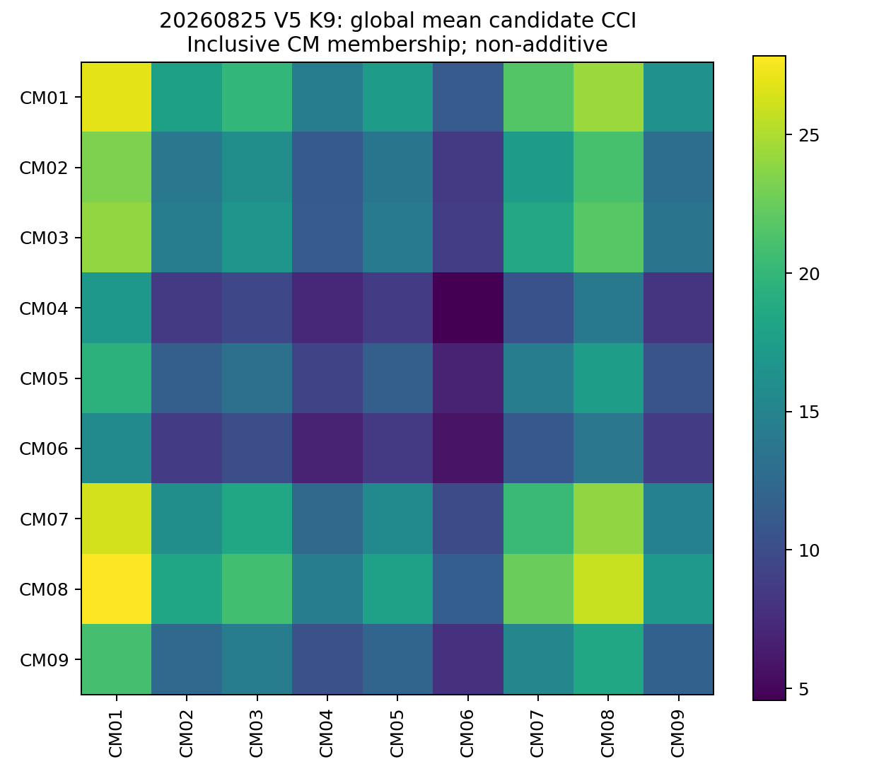
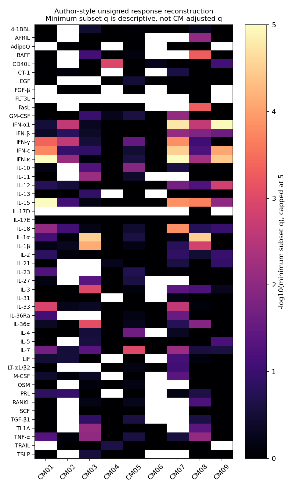
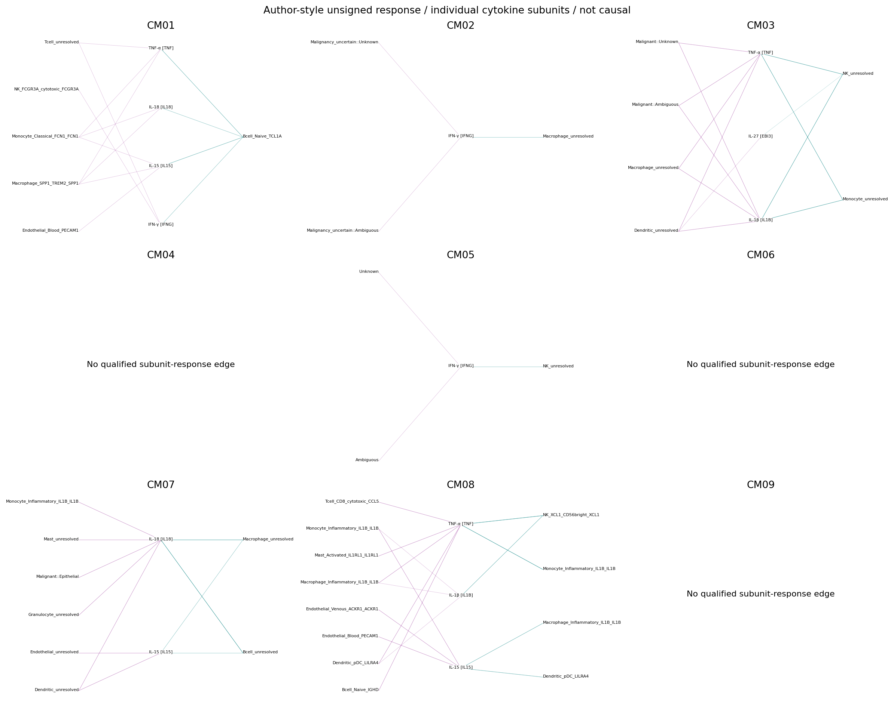
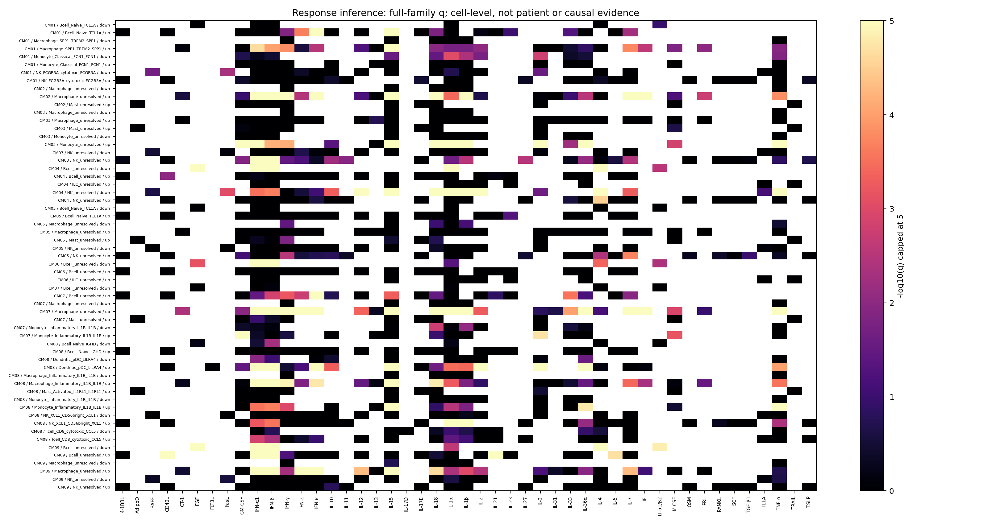
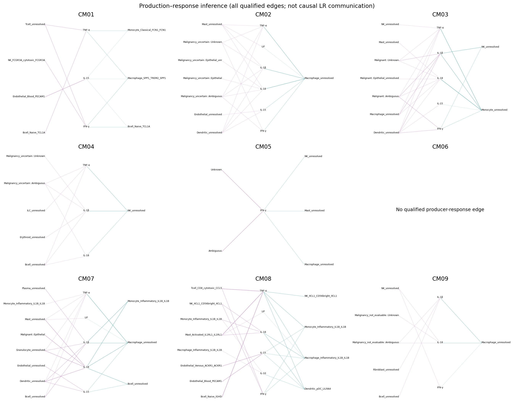

# 2026-08-25 V5/K9：CoVarNet原文式通讯补分析

2026-11-06执行检查点。**全局1,000置换CPDB与细胞级响应已完成并独立读回；核心High/Low正在全量运行，尚不是完整科学交付。** 全部九CM均纳入，不因既往CM01/07/08较好看而缩小家族。V5是历史补分析，未升级为当前权威注释。

## 输入与版本

| 分支/对象 | 核实内容 | 本次用途 |
|---|---|---|
| 20260825 V5身份/K9 | `final_annotation_v6_identity_v5_malignancy_v3`；4,676,787细胞、1,322原始样本、87身份；与原生zarr逐行索引一致 | 主历史分支 |
| W/H/S | W 87×9；H 9×1,303；冻结nsNMF theta=0.5，S 9×9，行和1 | 不重新拟合，不改模块编号 |
| H资格 | 全部有限非负，原H列和4–19.243455；无最大值并列 | 按列归一后argmax不变；不做跨CM单独缩放 |
| 表达 | 原始合并zarr.X由计数构建；10,432交集基因；读取块非负/整数/有限已核 | 按当前基因集总量1e4+log1p；没有使用整合嵌入或插补 |
| 全局CPDB输入 | 固定seed=1337，每身份≤1000，合计71,329细胞 | 1322原始样本；B仅用1303有H样本 |
| V7/K9和肿瘤限定CM | 较新报告有计算、LOSO与blisa；肿瘤限定仍缺本任务可核验完整冻结终验；CAF身份亦未稳妥 | 本次不建立扩展分析，不混用同号CM |

逐文件逻辑路径、大小及完整SHA见[输入清单](tables/input_manifest_public.tsv)。原始患者和细胞行只保存在`${RUN_ROOT}/private/`。原生Zarr全对象另已只读核验13,696个文件、14,206,760,484字节；[排序逐文件SHA清单摘要](tables/native_expression_tree_SHA.json)的SHA为`deeec0d3e43138a41fa3d67a8a9edfdda751bd1035a545481ec88312718824d5`。清单及原数据留服务器，派生全细胞LR输入和全局输出SHA见[全量输入收据](tables/full_input_complete.json)与[全局完成收据](tables/global_producer_complete.json)。输入及输出校验对应独立run `20261106_V5_K9_CoVarNet_communication_v1`。

原始1,322个样本键均只对应一个来源、一个癌种标签，未发现跨来源样本键合并。原NMF模型、边文件SHA与两套实际Python/NumPy/SciPy/Scanpy等版本见[运行来源补充](tables/runtime_provenance_final.json)。S由原nsNMF模型的theta确定，没有重新拟合。

## 成员与High/Low

[完整成员差异](tables/member_comparison.tsv)、[作者网络节点](tables/network_members.tsv)、[High/Low资格](tables/HighLow_eligibility.tsv)、[患者可比层](tables/patient_strata_eligibility.tsv)。原文式用冻结网络节点；旧LIANA对照保留W top10，不静默替换。网络节点共79个CM–成员归属，允许重叠，不能把归属数当不同身份数。CM03/05/07/08两套成员完全一致；CM01/02/04/06/09不同，见[集合核验](tables/member_set_equality.tsv)。

| 历史CM | 网络成员数 | 旧LIANA top10 | High样本 | Low样本 | A/B/D状态 | C状态 |
|---|---:|---:|---:|---:|---|---|
| CM01 | 6 | 10 | 81 | 1222 | A/D已读回；B运行中 | 患者层不可估计 |
| CM02 | 9 | 10 | 223 | 1080 | A/D已读回；B排队 | 患者层不可估计 |
| CM03 | 10 | 10 | 185 | 1118 | A/D已读回；B排队 | 患者层不可估计 |
| CM04 | 7 | 10 | 112 | 1191 | A/D已读回；B排队 | 患者层不可估计 |
| CM05 | 10 | 10 | 201 | 1102 | A/D已读回；B排队 | 患者层不可估计 |
| CM06 | 8 | 10 | 171 | 1132 | A/D已读回；B排队 | 患者层不可估计 |
| CM07 | 10 | 10 | 110 | 1193 | A/D已读回；B排队 | 患者层不可估计 |
| CM08 | 10 | 10 | 152 | 1151 | A/D已读回；B排队 | 患者层不可估计 |
| CM09 | 9 | 10 | 68 | 1235 | A/D已读回；B排队 | 患者层不可估计 |

High是该CM在样本全部CM中活动最高（CMT=m），Low是其他CMT；不是中位数/四分位数。缺失、非有限、负值、总活动零及近似并列（rtol=1e-10、atol=1e-12）在效应前规定排除。19个原始样本没有H，不进入B/D比较，不能塞入Low。

## 原文与代码的核实差异

已实际阅读[原文Methods与Fig.3图注](https://pmc.ncbi.nlm.nih.gov/articles/PMC12240829/)及[作者Zenodo v2代码](https://zenodo.org/records/15569445)。冻结参数见[原文/项目配置](method_freeze.json)、[实际软件配置](runtime_freeze.json)和[冻结SHA](freeze_receipt.json)。

[方法解释补充](method_interpretation_addendum.json)记录作者zip无法验证同一性、分亚基规则与完整亚基审计的区别；冻结配置及实际计算参数保持原样，不把解释修正包装成预先报告的作者设置。

| 项目 | 可核实原文/代码 | 本次处理与偏差 |
|---|---|---|
| 全球抽样 | 每细亚群最多1000 | 固定1337；原文未报告种子 |
| 数据库 | 作者代码路径含`v4.1.0/cellphonedb.zip`，未提供该文件SHA | 本次选官方数据库v4.1.0标签快照，是路径推断下的重建，不能证明与作者zip同一；软件现有5.0.1，作者软件版本未明 |
| CPDB参数 | pvalue .05，subsampling False，hgnc_symbol；代码12线程 | 4线程；1000置换、表达比例.1是本次显式钉住的实现默认，不能称正文报告值 |
| Fig3g Low | 正文“其余样本”；代码逐CMT计算后取其他CMT计数中位数 | pooled-Low正文分支与median-CMT-Low代码分支分别输出 |
| Fig3g统计 | 双侧配对Wilcoxon；点为有序非自细胞亚群对 | 不是患者；共享节点导致细胞对相依，P值仅原图式描述；另列全九CM BH |
| 代码缺陷 | 读入sig_means_file但随后用sig_means；12个CMT硬编码；缺失对补0 | 修复变量/动态K；主要输出缺失为NA，不当0；均列为实现偏差 |
| DE | 正文称Student t-test，Scanpy默认t-test实际用Welch | 精确均值/平方和实现Welch并与原始数值t检验核验；非直接Scanpy调用，明确实现偏差 |
| 签名 | Immune Dictionary原始S3，作者仅取Cytokine/Gene；去重式MGI映射 | 取得原XLSX，保留上/下调方向；当前MGI严格互为一对一，非作者历史映射快照 |
| 富集 | 超几何/clusterProfiler，DE log2FC>log2(1.2)、FDR<.05；作者未指定universe | 原代码式注释背景与项目方向/实测背景分表；Python超几何等价实现，需独立审阅 |
| CM响应图 | 取同CM各细胞子集q最小值 | 仅描述，不称CM层正确校正q；另报完整家族q |

签名原表含51,804上调、20,183下调记录。严格同源映射后60,095条，详见[签名审计](signature_audit.json)。不把一般通路库当Immune Dictionary。生产端转录本均值>0.1不证明蛋白分泌或受体结合；其与接收端签名仅构成响应推断，不能称本项目进行了细胞因子干预。

## A：全局候选图谱

正式1,000次置换已经完成（约619秒），输出SHA及按LR ID对齐的p/显著均值通过独立读回。7,569个有序细胞对共108,417个候选事件，7,403对至少有一个候选；不是108,417条不同LR。CellPhoneDB库2,923个互作中，当前交集基因背景仅271个满足完整映射覆盖；其余不属于“通讯阴性”。完整候选/亚基缺失见[资源背景](tables/LR_database_background.tsv)。完整背景与汇总已保留；见[全局验收](tables/global_acceptance.json)和[内外背景表](tables/global_inside_vs_outside.tsv)。

全局每个有序细胞对/LR计一次；CM内与CM间按对应成员对平均CCI报告。重叠成员允许在多个CM格子中出现，各格子不具有可加性；总量取唯一细胞对/LR并集。自身互作保留在全局表，Fig3g比较排除自身互作。

图中行为发送CM、列为接收CM，格子为对应有序成员对的平均候选CCI（含自身对）；重叠成员使各格子不可相加。下表另排除自身对，模块外背景为两端均非该CM成员，未匹配谱系或细胞数，不是环境效应检验。

| CM | 内部非自身细胞对 | 内部平均CCI | 双端模块外平均CCI |
|---|---:|---:|---:|
| CM01 | 30 | 25.67 | 13.43 |
| CM02 | 72 | 13.49 | 14.30 |
| CM03 | 90 | 16.39 | 13.97 |
| CM04 | 42 | 7.14 | 15.02 |
| CM05 | 90 | 11.26 | 14.73 |
| CM06 | 56 | 5.43 | 15.24 |
| CM07 | 90 | 19.60 | 13.57 |
| CM08 | 90 | 25.38 | 12.92 |
| CM09 | 72 | 11.57 | 14.53 |

4个CM（01/03/07/08）内部描述均值较高，5个较低；这主要比较不同身份组合，不能替代B固定身份的High/Low问题。

下表列各CM全局内部覆盖细胞对最多的三个数据库候选，括号是候选检出的非自身有序对数。它们是描述性排序，完整检验背景未据此裁剪；所有候选及零检出项见[带组分与资源注释的完整表](tables/global_CM_LR_candidates_annotated.tsv)。

| CM | 三个覆盖较广的候选 |
|---|---|
| CM01 | ICAM2–ITGAL/ITGB2（20/30）；PPIA–BSG（20/30）；SEMA4D–PTPRC（20/30） |
| CM02 | PPIA–BSG（38/72）；APP–CD74（35/72）；LGALS9–P4HB（34/72） |
| CM03 | TYROBP–CD44（49/90）；PPIA–BSG（49/90）；APP–CD74（40/90） |
| CM04 | SEMA4D–PTPRC（25/42）；KLRB1–CLEC2D（20/42）；ICAM3–ITGAL/ITGB2（17/42） |
| CM05 | TYROBP–CD44（41/90）；LGALS9–HAVCR2（36/90）；ICAM3–ITGAL/ITGB2（35/90） |
| CM06 | APP–CD74（21/56）；JAG1–CD46（20/56）；APP–SORL1（14/56） |
| CM07 | APP–CD74（52/90）；LGALS9–P4HB（49/90）；PPIA–BSG（49/90） |
| CM08 | PGE2生成代理PTGES3–PTGER4（56/90）；PPIA–BSG（51/90）；TGFB1–TGFBR1/TGFBR2（49/90） |
| CM09 | APP–CD74（33/72）；PPIA–BSG（28/72）；IGFBP3–TMEM219（22/72） |

CellPhoneDB资源也包含非蛋白互作：CM08第一项的原始名称是`ProstaglandinE2_byPTGES3`，`is_ppi=False`，不能说PTGES3蛋白就是PTGER4的直接配体。上述任何候选也都未证明在样本中实际发生结合。

[集中度分解](tables/global_concentration.tsv)显示，前三个细胞对占各CM全局内部事件的6.4%–19.5%，前十个LR占20.2%–53.0%。26个LR在全部九CM均有检出，贡献各CM内部事件的32.9%–72.7%；CM04最高。全局计数明显含通用候选关系，不能把模块总量直接解释为模块特有通讯。完整[细胞对计数](tables/global_cellpair_CCI.tsv)、[LR跨CM检出表](tables/global_LR_CM_prevalence.tsv)包含零检出项；完整LR原始均值、P和显著均值文件留在`${RUN_ROOT}/results/global/`。B的“变化由谁驱动”须等真实High/Low终态后另算，不能用本全局分解代替。

## B：全部CM固定身份的环境比较

已准备全部18组（九CM×High/Low）的正式分析，使用完整合格样本细胞，不用旧LIANA rank筛选。每一细胞对同时输出High与Low CCI、共同/仅High/仅Low检出及表达均值。median-CMT分支复用各CMT High结果，且严格保留缺失，不能混称pooled-Low。

**一组显著、另一组不显著不是差异显著；CPDB标签置换P不是环境差异P。** 正式配对图及少数细胞对/通用LR驱动分解仍待终态。CM01 High的297,271细胞/499个可匹配LR基因、1,000次置换已完成，耗时约38.7分钟；当前进入CM01 Low的4,378,190细胞计算。完成1/18组仍不能得出任何完整High/Low结论；最新取证见[执行快照](tables/execution_status.json)。实测速度表明完整家族需跨日运行；已移除旧监督器对整家族的24小时计时中断，只替换监督进程，保留原CPDB生产进程、四个worker及科学参数。新guardian等待现有进程结束，核验已完成组SHA后补齐缺组，并自动执行18组独立读回、汇总、驱动分解和图件；终态收据为`logs/guardian_terminal.json`。当前不能称全部已完成。不把目前“待计算/待验收”写成阴性。

## C：患者/样本级扩展

1,303个H样本中642缺患者来源字段，1,178治疗时点未知，280材料未知。按已冻结同来源×癌种×材料×已知时点、两组各≥10有记录患者规则，候选可比层为0。首版误把占位字符串当患者已知，已修正为v2并保留失败历史；本报告只采用v2。表中患者键数仍是有来源记录的候选键，GEO_GSM字段不自动证明真实患者去重已经验收；后续还需患者桥验证，本次没有用它们拟合患者模型。

[两组构成分布](tables/HighLow_composition_distribution.tsv)、[细胞数与检测能力分布](tables/HighLow_detection_background.tsv)、[每个成员的样本细胞资格](tables/HighLow_member_cell_eligibility.tsv)已实际计算。后者明确分开身份缺失、1–19细胞和≥20细胞；缺失不能作为零通讯。检测能力表用每样本源QC字段的中位数再汇总四分位数；源QC可能来自不同原始基因面板，不能当本10,432交集基因检测数。

因此患者级连续LR效应、95%区间、q、来源留出以及患者pseudobulk响应**当前不可估计**。无资格不能以大量细胞补足，不能把未知时点当治疗前，也不能把样本键冒充患者。这里没有虚构森林图；资格表是本阶段真实结果。来源/癌种/材料/时点分布仍完整提供，后续补桥后另按冻结家族执行，不反向选轴。缺患者映射、未知治疗时点和仅单侧出现分别保留资格原因；“不可估计”特指本冻结设计，不代表任何未来研究都无法估计。

已生成2,078,253个CM×有序成员对（含自身）×全数据库LR资格槽，分类CMT效应、连续H效应、区间、p和q全部为NA，明确没有拟合模型。九CM[家族资格摘要](tables/patient_family_status.tsv)与[完整服务器台账SHA](tables/patient_family_receipt.json)保留所有不可估计项，不将其改成零效应或阴性。

## D：同身份细胞因子响应

全体CMT×身份的原生表达充分统计已完成；全部4,675,461个H合格细胞读回，另以真实B细胞和SPP1巨噬群的499个LR基因均值核对，最大误差2.73×10⁻⁵。冻结签名按细胞类型映射：B、NK、单核、巨噬、肥大、ILC及明确pDC/CD8等；未分清CD4/CD8的T、未分清DC亚类、浆细胞等不硬套不适用签名。原文式细胞级响应与患者级稳健性分开：前者已完成计算与数值读回，后者当前无合格比较层。

4,776个预设响应槽中1,612个符合签名大小/背景资格，3,164个不可检验；完整家族BH后，代码式无方向背景有56个、项目方向/实测背景有209个响应关联，两者不可合并计数。项目方向响应配合原文分亚基生产规则得到137条候选连接；后验完整亚基资格审计保留136条，另1条CM03的IL-27候选缺IL27、仅有EBI3。原文允许分别展示亚基，因此137条原始表仍保留；136条是项目额外资格审计，不能称作者要求或新的预设主终点。全部九CM摘要见[响应汇总](tables/response_CM_summary.tsv)，数值核验见[响应验收](tables/response_acceptance.json)。CM06在代码式完整家族校正分支为0个q<0.05关联，项目分支为6个；它体现方法差异，不应只挑更显著的分支。IFN共同程序不证明某个特定LR已经发生。

[完整响应家族](tables/response_full_family_reviewed.tsv)包括全部阳性、阴性和不可检验项，原代码式无方向/注释背景与项目有方向/实测背景通过`branch`分开；未检验q为NA，BH的预设家族保留这些槽位（以p=1参与，较实际enricher返回项校正更保守，也是实现偏差）。[身份签名资格](tables/identity_eligibility.tsv)列出未能匹配签名的成员，不把未匹配当阴性。作者式DE仍是细胞级，未控制患者重复、癌种、来源和材料，不能由小q宣称环境效应已被生物学重复验证。

原代码式无方向分支按CM×身份内部q<0.05得到69个响应关联，改用完整家族校正后为上述56个；按原文分别表示生产亚基的规则构建64条亚基—响应连接。其[网络表](tables/author_unsigned_subunit_network.tsv)和[收据](tables/author_response_network_receipt.json)独立保留，不与项目方向分支混计。

此图复现作者取CM内子集q最小值的展示方式，覆盖全部九CM；最小值仅作描述，不是有效CM层校正q。未测/未检验为白色，未因只展示显著项而裁剪完整结果表。

中间标签明确列出细胞因子及实际表达亚基。一个亚基的表达不能证明完整细胞因子产生；本图也不是患者稳健性或因果证据。

图为项目方向/实测背景分支的完整家族−log10(q)，上限5。每行为CM×相同身份×签名方向，白色为未检验，黑色附近为未显著；整行不可检验的身份列在资格表而不强行画成零。原代码式全部结果与q同时保留在完整表，不选择更显著分支作为唯一结论。

此图为项目方向响应分支的后验完整亚基资格审计。左侧生产身份，中间细胞因子，右侧响应身份；完整亚基表达均值均须>0.1。图合并相同生产者/细胞因子/接收者的重复方向，完整方向和q见[网络亚基审计](tables/production_response_network_subunit_review.tsv)。原文分亚基规则的137行表仍保留。CM06没有通过两端条件的生产—响应边，不等于没有细胞因子作用。历史unresolved/Unknown身份按冻结名称保留，因此其细胞归属解释仍有原身份不确定性。

## 已有结果复用和旧LIANA对照

| 旧产物 | 本次复用 | 不能替代 |
|---|---|---|
| 冻结W/H/S、原网络与表达/身份索引 | 直接作为历史输入，不重发现 | V7权威注释、独立外部验证 |
| 0906 release的12重点轴、29,605共识及样本支持汇总 | 预先标记旧LIANA子集、跨样本复现 | CMT环境变化、接收端响应、因果 |
| 原逐样本LIANA完整within-CM文件 | 可作为旧top10口径的连续/支持辅助；原return_all_lrs=False限制保留 | 全数据库候选及新增/消失LR全集 |
| Visium/CosMx/bulk旧结果 | 仅原边界背景 | 本次High/Low或患者差异 |
| V7 CM/blisa | 版本与扩展资格参考 | V5同号成员、表达或效果 |

[逐轴旧LIANA对照](tables/old_LIANA_axis_comparison.tsv)保留12条预先指定轴与[旧跨样本复现数据](tables/old_LIANA_replication.tsv)。其中只有COL1A1–ITGA1/ITGB1和APP–CD74两条与本次选用CPDB数据库完整可测匹配；其余10条不在该数据库的同一对手定义中，不能作为新CPDB阴性。数据库不含DDR1和LGALS1基因记录；SPP1虽在库中，却不在历史10,432基因交集，相关三个CPDB轴皆不可完整测量。标记名含SPP1的巨噬群仍是冻结身份名称，不代表此表达对象确实测到了SPP1。

旧12轴没有匹配的Immune Dictionary同一LR扰动签名；接收细胞的IFN等响应不能升级成这些特定轴的响应证据。DDR1、SPP1、LGALS1没有预设为阳性。任何“仅广泛存在”“环境相关”“有接收响应”“不支持”都要依据相应完成证据填写；当前跨样本复现只沿用旧报告，新增环境结论尚未产生；D只提供细胞级响应推断，患者稳健性未建立，因果通讯均未建立。

## 全部CM当前结论

以下响应数是细胞级CM×身份×细胞因子×方向关联（两分支定义不同），不是患者数或独立LR数。

| 历史CM | 无方向完整家族q<.05 | 项目方向完整家族q<.05 | 项目完整亚基审计边 | 固定身份环境变化 | 患者稳健性 / 因果 |
|---|---:|---:|---:|---|---|
| CM01 | 6 | 31 | 11 | B待终态，不下结论 | 不可估计 / 未建立 |
| CM02 | 3 | 14 | 18 | B待终态，不下结论 | 不可估计 / 未建立 |
| CM03 | 10 | 25 | 24 | B待终态，不下结论 | 不可估计 / 未建立 |
| CM04 | 1 | 22 | 9 | B待终态，不下结论 | 不可估计 / 未建立 |
| CM05 | 3 | 6 | 6 | B待终态，不下结论 | 不可估计 / 未建立 |
| CM06 | 0 | 6 | 0 | B待终态，不下结论 | 不可估计 / 未建立 |
| CM07 | 14 | 33 | 30 | B待终态，不下结论 | 不可估计 / 未建立 |
| CM08 | 13 | 48 | 31 | B待终态，不下结论 | 不可估计 / 未建立 |
| CM09 | 6 | 24 | 7 | B待终态，不下结论 | 不可估计 / 未建立 |

## 执行与交付状态

代码位于[`scripts/cm_covarnet_communication_v1`](../../../scripts/cm_covarnet_communication_v1/)，实际命令、进程句柄及完整日志留`${RUN_ROOT}`；正式阶段有互斥锁、输入/输出SHA与终态收据，可从已完成组恢复。资源预检约3.9TB余量、约840GiB可用内存；本任务4线程CPDB并保留其他任务。原生数据全扫描提取不会重跑注释或CM。

已完成：输入、成员、H/CMT、原文与代码、资源覆盖、样本资格、真实小试与数值审计。仅技术通过：小试不是科学结论。已完成并数值读回：正式A与细胞级D。正在执行：核心B，全部18组尚未完成。科学上不可估计：当前预设患者层C与pseudobulk。仍需验证：B全部正式终态及其LR层/变化驱动分解与配对图、患者资料桥，以及任何因果通讯。A与D图件已独立查看；未输出空白High/Low占位图冒充结果。
