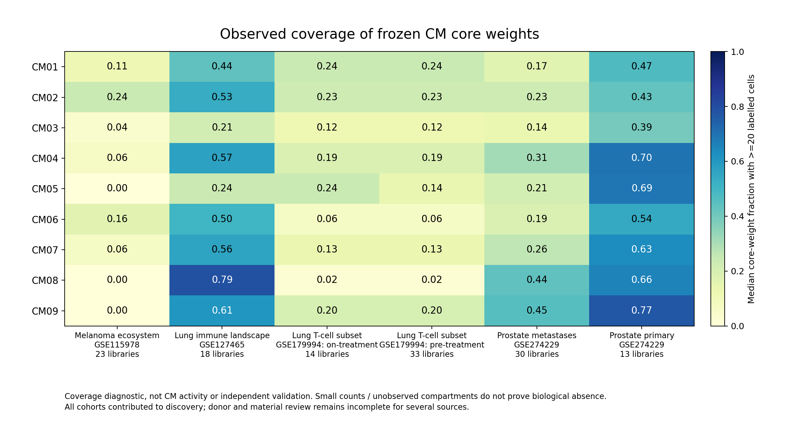

# 原CM定义审阅与免疫相关来源复现尝试

取证：2026-10-12 23:15 UTC+8 /15:15 UTC。真实计算已完成，不是仅提出方案。固定原9CM，使用4个已有来源131文库、6个来源/材料/治疗分层；全部参与过原1290发现，**只有内部迁移/复现尝试，不是独立验证**。

## 直接回答

当前可以观察部分CM成员的来源内共变，尤其前列腺原发背景CM09的可测骨架；不能确认完整原9CM在免疫数据中普遍或独立复现。CM由组成/程序结构定义，显著LR不是其成立前提。某些模块H能计算，不能证明其核心被联合捕获；LR阴性也不能直接否定全部生态关系。

CoVarNet原文强调可比混合样本、非上皮子群、组成因子和特异相关网络，后续再检验空间/通讯及外部细胞因子签名支持。原文并未对每个CM的一条人肿瘤驱动轴进行直接干预。其编号不能与本项目9CM直接对应。原文已读完整PDF和方法，定义细节见[方法合同](../../../../methods/CM-definition-and-recovery-v1.md)。

## 输入和复现对象

| 来源 | 本次文库/分层 | 采样及单位限制 |
|---|---|---|
|GSE115978 黑色素瘤生态|23|免疫治疗相关生态，混合FACS背景；当前患者块仍为样本替代|
|GSE127465 肺免疫景观|18|官方研究含7人类患者、肿瘤及血液；当前材料和真实患者映射待核，18不能当18患者|
|GSE179994 肺T细胞子集|治疗前33、治疗中14|47库/36已审来源内患者；仅T子集，不能验证多谱系完整TME|
|GSE274229 前列腺|原发13、转移30|当前43人类范围，患者/人类治疗信息尚未完成审阅；鼠治疗字段不能套人类|

使用全部冻结172计数、9列W、原H、原归一化频率、120图边与已审患者覆盖层；不重学W、不改身份、模块编号或权威Zarr。完整频率重建最大差5.55e-16；本地独立CSV重建复核输入SHA及全部设计。

本次[图核心字典](fixed_CM_graph_core.tsv)依据实际图成员，而不是简单取top10含孤立节点。9模块实际核心数为9/8/10/10/10/9/9/8/9。CM01/02核心权重100%在旧免疫类，CM03约51.3%、CM04 70.2%、CM05 76.7%、CM06 71.0%、CM07 64.0%、CM08 50.4%、CM09 71.9%；名称中的免疫组分不能代替完整成员定义。

## 首轮：覆盖与固定W投影

预先冻结[合同](plan.json)，14:49:44—14:49:52 UTC真实执行exit0。以≥20标签细胞为成员支持，结合至少半数核心/≥60%权重、多个major与可靠大谱系、≥50%文库和≥10继承块。

- 54个CM×情境中52未过捕获门槛。
- 只有GSE127465/CM08与GSE274229原发/CM05过覆盖，原图中达到本轮数目/变异门槛的跨major边均0，未产生可估计共变p。这是不可检验，不是阴性证明。
- 51/54组合在捕获未通过时仍能得到至少一个非零投影活动。所有masked W的数学秩为9；T子集仅12—13个变异行也能算出活动，但其最高核心捕获中位权重仅约24.2%。
- 原发前列腺CM09核心捕获中位权重约76.9%，属于较好覆盖入口，却未满足全部操作性门槛；不能将10块等人为阈值当存在性的自然开关。

这是≥20标签细胞的观察权重，不是H或整体细胞比例，数值接近0也不证明生物缺失。旧[图v1](CM_core_capture.png)标签拥挤，保留；v2改标签/版式但数值不变。

固定W使用KL恢复，原尺度保留；并列冻结全局与cohort minmax。初次10/12投影数值fixture通过，2个SLSQP目标偏高，失败保留。随后另算法有界KL-deviance least_squares从独立初值检查全部12×3=36固定文库fixture，36通过，原生产H未改变。[数值审计](projection_deviance_audit_v2.json)不能代替生物复现或完整每文库数值重演。

## 第二轮：允许边重塑、明确分母和免疫骨架

v1之后预声明[完整敏感性](rewiring_plan_v2.json)，而非事后只追某个CM。保持成员，重新估所有可变跨分母成员对，并列：

1. 原major分母与parent分析分母。
2. 全核心的可测部分与免疫骨架。
3. 1/20个平均细胞门槛，要求至少50%且至少10继承块。

parent只是分析分母：myeloid相关类归同分母，T/TNK/未决lymphoid归同分母，B及其他类保留；不重新命名细胞。每问题用2万整分母向量置换保留组内闭合/共变、2000块bootstrap，跨全部432配置作诊断BH/BY。该分析发生在v1后，是方法敏感性，不替换原结论或独立验证。

真实15:03:12—15:04:05 UTC（23:03—23:04 UTC+8）exit0：

- 432配置，120可估计，94不重复统计问题。
- 267缺至少两个可靠大谱系，45缺可变成员；不记阴性。
- 14记录通过BH及正向bootstrap区间，涉及11不重复统计问题、7个来源×CM组合。
- BY通过3记录，全部是同一前列腺原发背景CM09的重叠成员读出，不是3个独立模块。

| 来源/CM | 示例模式 | 可变成员/块/对 | 平均Spearman rho | bootstrap区间 | 诊断BH/BY |
|---|---|---|---:|---|---|
|黑色素瘤CM02|原分母、1细胞|3/20/3|0.479|[0.213,0.675]|0.0137/0.0914|
|肺景观CM01|parent分母、1细胞|9/18/24|0.187|[0.069,0.298]|0.0108/0.0718|
|肺景观CM04免疫骨架|parent分母、1细胞|6/18/9|0.074|[0.017,0.120]|0.0108/0.0718|
|肺景观CM05免疫骨架|parent分母、1细胞|6/18/9|0.199|[0.008,0.372]|0.0463/0.3076|
|前列腺原发CM02|原分母、1细胞|4/11/6|0.573|[0.192,0.815]|0.0108/0.0718|
|前列腺原发CM05|原分母、1细胞|5/10/10|0.405|[0.066,0.661]|0.0382/0.2540|
|前列腺原发CM09|原分母、1细胞|5/12/10|0.682|[0.387,0.806]|0.0072/0.0479|
|前列腺原发CM09|原分母、20细胞|3/12/3|0.739|[0.399,0.898]|0.0072/0.0479|
|前列腺原发CM09免疫骨架|原分母、1细胞|4/12/6|0.690|[0.384,0.826]|0.0072/0.0479|

表是完整配置中的示例，不是新选择发现家族，所有432及阴性/不可测保留在[全表](rewiring_v2/all432_rewiring_sensitivities_annotated_v3.tsv)。其他通过记录与同一成员/上下文高度重叠，不相加为独立生物支持。

### CM09当前可观察骨架

1细胞口径：B_HLA-DRA_24、ACKR1内皮_50、CD74巨噬_39、TPSAB1肥大_25、IL7R-T_28；20细胞口径剩ACKR1内皮、CD74巨噬和IL7R-T。免疫骨架去除内皮只在1细胞口径通过，20细胞口径未通过。故较严格支持指向“血管—髓系—T”的可测小骨架，不能直接命名完整B/T/Mast/TLS生态位，尚无空间或患者级独立验证。

parent分母下，同一CM09全核心可测部分仍正向（rho0.222、BH0.0252），但效应大小、参与节点及BY支持改变。这支持继续检查而非已证明分母无关。

### CM02跨来源同向的边界

黑色素瘤可变成员是B_HLA-DRA、CCL5未决lymphoid、IL7R-T；前列腺是CCL5未决lymphoid、CD74巨噬、TPSAB1肥大、IL7R-T。两者不是同一完整成员组。

合并parent分母后，黑色素瘤CM02 rho变为−0.040/q1；前列腺rho0.168/q0.0864。不能把原分母两来源通过概括成稳健跨癌种CM02复现。此变化提示需要审阅原major层级和身份碎片化，但不同分母也改变问题，尚不能判断哪种“正确”。

## 验证范围与未解决问题

服务器v2直接scipy Spearman复算每个唯一问题的观测及首4null，最大差2.22e-16；BH/BY核对通过。本机从另一份原CSV和clinical表独立解析，重建全部54捕获、432设计及120观测统计，2670项检查最大差4.44e-16；所有统计键逐字节一致。[独立设计复算](independent_design_recount_v3.json)。没有重演全部2万null或全部原始细胞矩阵，也没有独立生物验证。

最大限制是三个来源仍用文库替代患者；尤其GSE127465官方7人类患者，18文库不能视作18独立人。分选、材料、身份置信度、共同状态及发现/验证重叠继续限制解释。所有p/q只用于诊断；不发布正式CM、通讯驱动、免疫治疗预测或状态标签。

本轮重连统计是所有合格跨分母对的平均Spearman相关，用单侧正向尾概率；它检验整体正共变，不复刻原文的特异边/网络拓扑判定，也不证明全部原W或E。正负边抵消、局部强边或其他组织模式可能被平均值遗漏。BH/BY覆盖432个敏感性配置，不能纠正发现样本复用、文库替代患者或材料混杂；包括BY通过项也只能作为内部诊断线索。

## 为什么目前难以找到“关键互作模块”

1. 模块定义与通讯驱动混淆：生态共变不要求每条LR条件显著；一个共同刺激也可能组织多细胞程序。
2. 采样不匹配：T子集缺多谱系观察机会，低细胞量生态无法稳定捕获稀有核心。数学投影不补足观察证据。
3. major层级/分母：某些大类单子群导致频率接近1/0；同类身份拆分可把原父类内关系误当跨类型关系。
4. 参考身份与来源限制：172中多数为marker/宽谱系，来源限定较多，且包含上皮/肿瘤组织成分；现有跨癌种关系常不能分开研究和癌种。
5. 统计问题比描述生态更窄：几万LR×TF、较少患者、多项强控制使功效下降；共同状态既是潜在混杂，也可能是实际生物路径。
6. 分子与空间证据不足：数据库角色不保证胞外结合，RNA不保证复合物、分泌或因果方向。

## 下一步

优先补齐GSE274229原发与GSE127465的真实患者/材料映射，固定CM09的小骨架及CM01的完整可测成员作患者级核查。旧9CM保留，另用可靠父类、非上皮与可比混合采样发现新版本免疫生态；rank和成员稳定性单独审阅。没有可靠原172映射的新ICI数据先做身份桥接，而非硬套旧编号。模块生态与细胞对分子响应作为并行证据层，待生态成立后选择可信完整受体、空间及功能问题。

完整过程、代码与执行时间见[正式run](../../../../runs/20261012_CM_immune_recovery_v1.md)。
