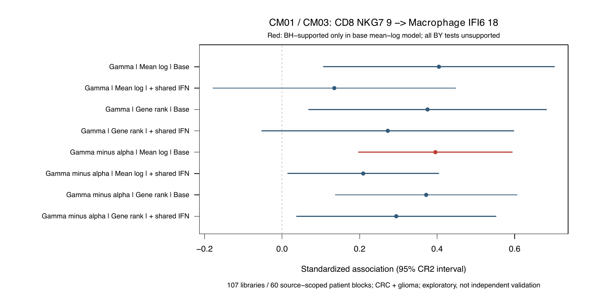

# 两轮追加结果：保留CM生态线索，转向队列意义和表达MCP

## 执行与复核

UTC2026-10-13 13:21:21—13:21:39生产，审计到13:21:47；UTC+8为21:21。两阶段exit0，13:21:50核实全部进程退出。[336完整模型](all336_fine_IFNG_models.tsv)、[18覆盖](all18_fine_context_coverage.tsv)、[审计](independent_audit.json)、[终态](terminal_execution_observed_v1.json)。全部96个有数值的模型（92可推断、4有效df不足）独立full-X CR2复算572值，最大差3.38e-14；5来源20代表程序例、60均值/秩/检测值回原缓存scalar检查通过。不是第二遍全程序评分，也不是独立生物学验证。

## 两轮实测

同一预声明覆盖：原全部3条T—Mac CM边、IFNG→IFNGR1/2、5来源6原发上下文、4固定Hallmark/集合差读出，每评分/控制变体84检验，缺失不算阴性。秩评分是**文库内细分群平均表达的全基因并列秩**，不是单细胞UCell。状态尚未正式赋值。

|评分／控制|84中可推断|BH<.05|BY<.05|
|---|---:|---:|---:|
|本群mean-log；身份比例、细胞数、复杂度、受体|24|1|0|
|mean-log；再加发送gamma及接收自身IFNG|20|0|0|
|本群gene-rank；基础控制|24|0|0|
|gene-rank；共同程序控制|24|0|0|

**唯一BH记录**：PAIR015／CM01和CM03，`CD8_T_cell_NKG7_9 → Macrophage_IFI6_18`，IFNG与gamma-minus-alpha集合读出：β.395，CI[.197,.594]，BH.0301，BY.151。107文库／60来源内已审患者块，来自CRC和当前Glioblastoma标签来源；CRCβ.380、胶质瘤β.478同向，但CRC估计信息份额**84.6%**。这些不是两个独立同癌种验证队列。集合差不是IFNG刺激特异性程序。

同一读出gene-rank基础β.372／BH.221，共同程序mean-logβ.209／BH.612，rank共同程序β.294／BH.559。效应方向保留，统计支持与估计大小依赖读出和控制。不能把它宣布为稳健通讯，也不能据BH未通过认定没有关系。

完整gamma读出基础β.405／BH.204，加入共同程序后β.135／BH1；rank基础β.375／BH.221，共同程序β.273／BH.983。控制变量可能包含中介，下降本身不证明伪影；目前支持先研究身份内炎症协调及组成生态。

[森林图PDF](PAIR015_program_robustness.pdf)、[来源](pooled_source_effects.tsv)、[留一来源](pooled_LOSO_effects.tsv)。

## 样本不足具体在哪里

- PAIR015在CRC分选/未分选36、42文库，胶质瘤29；肺4、乳腺14、胃13。CRC两处理分层共享患者，已按共同来源患者块计算，不把107文库称107独立患者。
- PAIR034（CM02/09，IL7R T—CD74巨噬）各上下文只有6—19库，全部未到20；没有降低门槛制造结果。
- PAIR038（CM01，Treg—IFI6巨噬）CRC44/44库，其他来源6—18；可做来源限定探索，缺乏第二来源池化条件。
- 全336里208细分覆盖不足、32池化来源不足、4有效df不足、92可推断。没有给缺失p填0；只在BH内部按预声明分母填1。

## 现在如何转向

已触发[有限合同](../../../../methods/finite-communication-rounds-and-CM-pivot-v1.md)的**模型敏感＋来源集中／覆盖不足**条件。前两轮完成；第三轮空间仅对稳健候选执行，现在没有达到该要求的候选，因此不重跑旧阴性空间检验以寻找显著。

PAIR015保留为两癌种同向、CRC主导的CM生态/共同炎症线索。原全部9CM继续做队列捕获/关系恢复；优先审既有CM09前列腺血管—髓系—IL7R接口，材料/患者修订在推断前完成。临床及DIALOGUE新入口如下，不以当前结果命名耐药模块。

### 真实临床盘点与DIALOGUE条件

[只读聚合取证](../CM_pivot_readiness_aggregate_v1.json)UTC13:25:07：既有临床表GSE16924678库／22来源患者tokens，77库显式evaluable、78有文献响应和TTP字段；GSE31619522库／11tokens、22显式evaluable；GSE176021110库／16tokens但时点/治疗字段未填、evaluable为0。**文库数不是独立患者数，字段存在不是终点已验收；当前全部clinical_validation_eligible=false。**

下一临床优先审核GSE169246的**治疗前肿瘤、治疗臂和响应定义**；分开血液/重复文库/治疗后。原研究同时有化疗及化疗＋atezolizumab，不能把所有样本作为同一种免疫治疗。[原始论文](https://doi.org/10.1016/j.ccell.2021.09.010)。TTP须核时间起点/删失再考虑生存；22tokens不足支持高维预测器或随意切多个小验证集。GSE316195先作为小样本队列支持，必须另审终点/材料和配对，不承诺独立机制验证。

服务器系统R3.6.0，DIALOGUE未安装；官方依赖lmerTest、PMA、psych、unikn、beanplot缺失。新训练未运行。下一在隔离可复现R环境完成依赖及官方示例，再冻结真实T/髓系单细胞、类型内PC、质量/患者/材料、来源内发现和患者块留出；先去掉细胞类型均值/混合造成的协调，再映射原CM。DIALOGUE发现的是协调表达MCP，不等于直接LR因果。已有状态准备与新免疫专用对象支线持续保留，不重复其诊断。

## 边界及数据保护

本次无新表达下载、无删除、无原注释／CM／权威库变更，原证据登记v17未改。私有fixtures、样本与表达均留server；这里只发布模型统计、来源覆盖、SHA和审计。保持此前来源限定阳性、阴性和失败历史；新临床和空间模型仍未运行。
