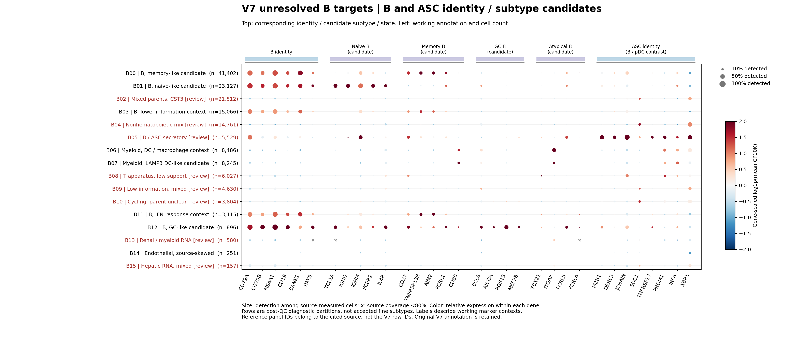
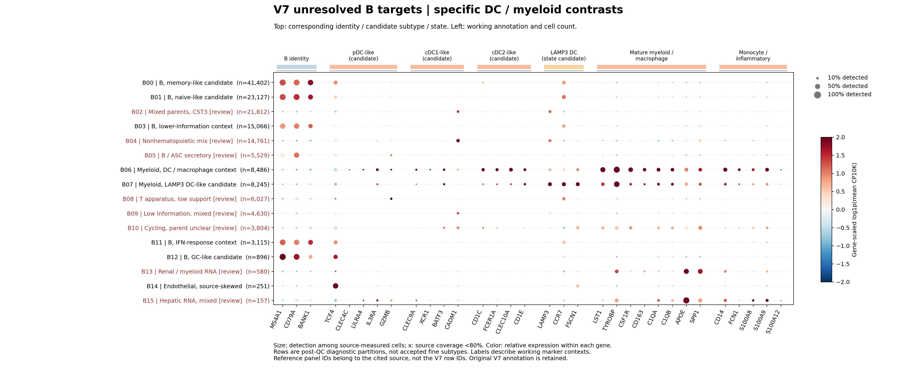

# V7 B-unresolved逐群复核与当前完整注释

本轮已实际清理、从counts重建16个诊断群、审阅327个marker，并写出/读回B工作旁表。**B-unresolved既包含真正B细胞的细分不足，也包含旧父类误标、共享分化程序及混合/低信息背景。** 16个计算分区不是16种B细胞亚型。

[16群完整判读表](ALL_B_CLUSTER_REVIEW.md) · [工作身份汇总](global/stage_f_B_working_annotations/B_working_identity_counts.tsv) · [旧B标签→当前工作身份](global/stage_f_B_working_annotations/B_old_to_working_annotation_counts.tsv) · [方法与文献代码边界](../../../../methods/V7-B-unresolved-current-annotation-20261106.md) · [正式运行](../../../../runs/20261106_v7_B_unresolved_review_v1.md)

## 本轮范围及实际清理

| 注释目标 | 起始QC-v3保留 | 本轮排除 | 实际重建目标 |
|---|---:|---:|---:|
| Bcell_unresolved | 42,344 | 25 | 42,319 |
| Bcell_unresolved_CST3 | 55,407 | 266 | 55,141 |
| Bcell_unresolved_DNAJB1 | 55,667 | 52 | 55,615 |
| B_Plasma_boundary | 4,839 | 26 | 4,813 |
| 合计 | **158,257** | **369** | **157,888** |

模型另含来源分层的正向B-naive/ASC表达对照8,565，共166,453行、54来源；它们不是身份真值、不覆盖原注释，主marker图仅统计157,888目标。整个B/Plasma/边界693,254行做marker/QC扫描，其余B/coarse未完整重聚类。实际QC作用旧B/边界509,367行，共新增5,321操作性混合RNA排除，包含上述369目标及4,952其他B。外部Plasma的3,038联合候选仅记录，未自动剔除。

全V7 QC-v4当前为**8,237排除、238暂存、4,668,312保留**。经验95百分位加互斥RNA组件是本轮操作性复查规则，不是doublet概率或真值；B–ASC、T–NK共享轴不作自动排除对。完整原对象、矩阵及所有历史记录保留。

## B群的主要发现

| 分区 | 目标数 | 工作解释 | 仍需解决 |
|---|---:|---|---|
| B00 | 41,402 | B身份明确；CD27/TNFRSF13B/AIM2支持memory-like候选 | 不是全群逐细胞memory终验；应激背景分列 |
| B01 | 23,127 | TCL1A/IGHD/IGHM/FCER2支持naive-like候选 | B内部及来源敏感性 |
| B03 | 15,066 | MS4A1/CD79A/BANK1支持B大类；检测基因中位703 | 当前无正向DE过阈值，不强分亚型 |
| B11 | 3,115 | B大类＋IFIT1/IFIT3/MX1/ISG15背景 | IFN是群级状态，不是新功能亚型 |
| B12 | 896 | RGS13、BCL6/AICDA/MEF2B支持GC-like候选 | naive/memory背景并存，细分待验 |
| B05 | 5,529 | 有ASC分泌成分，同时有B程序 | 保留B–ASC边界，不强给成熟度/过渡/doublet |
| B06/B07 | 8,486/8,245 | 髓系大类，分别有DC/巨噬及LAMP3–FSCN1–CCR7背景 | 不把混合群全定cDC2或LAMP3 DC |
| B08 | 6,027 | T装置方向富集，仅393满足保守T组件规则 | 仅正向个体可路由；其余继续身份复查 |
| B14 | 251 | CLDN5/PECAM1与TIE1/PROCR/MMRN1支持内皮大类 | 92.8%来自单来源，血管细分未验收 |

B02/B04/B09/B10/B13/B15保留父身份复查：有上皮、内皮、血管壁、黑色素或组织/髓系混合RNA。B04的UMI中位4,971，不能全归因低深度；B10的MKI67/TOP2A/UBE2C虽显著，也不能据“cycling”判B。B15的ALB/APOA1/ASGR1与污染估计及其他成分需分开核对，未称全部肝细胞或恶性。

本轮实际侧表为**101,299个大类工作记录、56,589个身份待复查记录**，两者合计157,888。工作数含纠正到其他父类者，不是101,299个新确认B细胞。开放父类分区中有1,278个正向B和575个正向T逐细胞路由；这575来自全部开放分区，不只B08。654个B+ASC相关程序记录不会自动成为doublet或“过渡细胞”。最终细分接受标志仍FALSE，冻结V7标签未改。

按旧标签回看，DNAJB1组主要是B身份与状态/细分混在一起，CST3组则主要需要先重核父身份，不能把所有未定都归因于“缺少B亚型marker”。下表的B与其他大类只计无本轮竞争复查的工作记录；未定记录不预先推断为非B。

| 旧标签（QC-v4目标） | 保留B大类工作 | 其他大类工作 | 身份仍待复查 |
|---|---:|---:|---:|
| Bcell_unresolved（42,319） | 27,943 | 2,098 | 12,278 |
| Bcell_unresolved_CST3（55,141） | 2,298 | 14,375 | 38,468 |
| Bcell_unresolved_DNAJB1（55,615） | 53,713 | 241 | 1,661 |
| B_Plasma_boundary（4,813） | 493 | 138 | 4,182 |

## marker图：对应身份/亚型/状态已标出

上方标注marker对应的大类、候选亚型或状态；左侧为群号、工作说明及目标数。颜色是同一基因在各群的相对表达，点大小是来源可测细胞中的检出比例；灰叉表示来源覆盖不足80%。不可比较不同基因颜色来推断绝对表达。所有图均排除8,565个参考细胞的统计。

[淋巴竞争谱系](plots/B_lymphoid_competitors_v7.png) · [非造血对照](plots/B_nonhematopoietic_context_v7.png) · [状态程序](plots/B_state_programs_v7.png) · [同种型与前体背景](plots/B_isotype_precursor_context_v7.png)。每张另有可编辑SVG；完整目标marker数表见`B_target_all_review_markers.tsv`。

## 验证与解释边界

干净counts精确子集、所有分辨率/来源计数、304＋23个marker来源分母与CP10K、B旁表索引/旧标签/路由与聚合均独立通过。全RNA DE计算不使用整合表达：只用10,569个全部模型来源共同可测基因。IgV/globin仅排除HVG，完整RNA和Ig常数区保留。B03/B09无正向DE过当前阈值。原与来源校正图ARI目标为0.1914，只是敏感性提示，不证明新图最优或细分稳定。

现有CellTypist/scATOMIC已按目标分群列出旁证，本轮没有重跑或训练分类器。TCF4或HLA单独不证明pDC/DC，CST3不证明B，DNAJB1不定义B类型。未取得相同Technology/状态合同，未声称精确复现Lodi的Technology-CCA；没有接受Breg、年龄相关功能、成熟/未成熟浆细胞或新恶性判断。

当前完整注释视图正在按冻结轴合并此前Mast/T6/四稀有谱系与本轮B工作旁表；以其独立合并审计和最终交付为准。未重建的标签会保留“沿用旧V7”，旧strict资格不代表本轮发表终验。新TME数据和CoVarNet输入未因本次变化。
