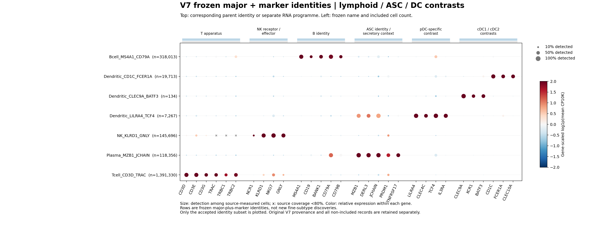

# V7大类marker身份视图 历史版本

> **2026-11-06用户纠正：本版本将已有亚型一并合并为20个大类marker名称，超出了要求。它仅保留为大类身份证据视图，不能作为完整注释的默认标签。正在恢复原有已命名亚型；只有缺少可靠细分的占位标签使用大类＋marker。**

**已完成 `V7_marker_identity_20261106_v3`：3,918,715个细胞，18个大类、20个正式名称。** 正式身份字段为 `final_annotation`，不含unresolved、coarse、provisional、pending等进度词。未获得可靠细分的细胞按大类＋身份marker命名；状态、CNV与审计原因独立。

[全部20个正式名称、细胞数和marker支持](FROZEN_LABELS.md) · [原B coarse入口的去向](B_COARSE_REPAIR.md) · [749,597个QC保留但未纳入细胞及各来源保留率](NOT_INCLUDED.md) · [正式验收与文件SHA](stage_f5_formal_annotation_release/FORMAL_FREEZE_ACCEPTANCE.json)

## 冻结范围与证据

原V7全部4,676,787行完整保留；QC-v4仍为8,237排除／238暂存／4,668,312保留。83.94%的QC保留细胞进入这个正式身份层，其他记录留在全轴审计对象中继续排查。这里没有通过换名把混合父类强行冻结，也没有把“去掉占位词”当作全图谱达到发表标准的证明。**20个名称是身份层的命名值，不是20个新亚型。全V7的完整注释与论文发表验收仍开放。**

全部4,676,787行原始RNA、54来源、490基因、完整库UMI和来源可测分母经独立复算；22项正向组件结合既有重建群、多marker和人工审阅。保留此前Mast/T6/稀有群/B的重新建模证据，其余原全局群×旧标签只作诊断分区。223个分区不是本轮新拟合的223个亚群。CellTypist/scATOMIC为旁证，不是身份真值。

352项审阅决策的全轴纳入名单、父类、规则、CNV/QC和原字段逐值独立核验；后续合并仅统一同一身份路线的marker命名，不改变任何细胞纳入或父类决定。最终20×490项表达统计、40条命名marker支持、来源集中度再次独立核验。正式私有pkl与全部TSV行读回一致；旧标签列不混入正式对象。

## 发现与修正

- 原B coarse有显著T/髓系/DC方向，不能整群称B；DNAJB1与CST3不能单独承担B身份。
- pDC常共享MZB1/JCHAIN分泌程序，需LILRA4/CLEC4C/TCF4/IL3RA特异装置对照；不能按共享分泌直接判doublet。
- 真粒细胞要求FCGR3B/CEACAM8、CSF3R及效应语境；CSF3R/S100单独不能与单核区分。Glial保守入口增加OLIG1/2，不能由共享SOX10/MBP误叫胶质；未过此入口也不证明非胶质。
- 旧Macrophage_SERPINE2的PMEL/MLANA/MITF支持先纠正黑色素父身份。旧差异基因方法即使跨样本重复，也不替代父身份验证。良恶性另审。
- 筛选前名称不自动适用于筛选后细胞：早期68名称中一个2细胞血小板名称的GP1BB零检出，终检明确失败，未正式接受。保留失败证据后统一为20个身份名称；最终命名marker在实际纳入集合上重新验证。

## Marker图

五张图分别展示淋巴/ASC/DC、髓系/颗粒谱系、基质/上皮/神经、稀有造血和独立状态程序。**上方标对应身份或程序，下方标基因，左侧标正式标签和细胞数。** 圆点大小为来源可测细胞中的检出率；颜色是同一基因在当前图各行间的相对表达，不能比较不同基因的绝对量。灰叉表示覆盖不足80%。

[髓系/颗粒谱系图](figures/frozen_myeloid_granulocyte_Mast.png) · [组织及基质图](figures/frozen_stromal_epithelial_neural.png) · [稀有造血图](figures/frozen_hematopoietic_rare.png) · [状态程序图](figures/frozen_state_programmes_separate.png) · [可编辑SVG及图件SHA](figures/plot_manifest.json)

## 证据、复现与私有导出

[全量原始审计](full_axis_diagnostic/independent_profile_audit.json) · [v2共享组件独立审计](stage_b2_refined_components/independent_refinement_audit.json) · [完整纳入名单的逐值审计](stage_c2_exact_audit_resume/independent_serialized_axis_audit.json) · [合并命名独立审计](stage_c4_harmonized_identity_freeze/independent_freeze_audit.json) · [最终marker独立审计](stage_d4_harmonized_marker_evidence/independent_naming_marker_audit.json) · [保留率核算](stage_e4_release_retention/complete.json)。早期建议和68名称写出是历史中间版本，当前正式入口只以上述v3验收和20名称表为准。

服务器正式文件位于 `${PROJECT_ROOT}/runs/20261106_v7_publication_marker_annotation_v1/stage_f5_formal_annotation_release/annotation_frozen_V7_marker_20261106_v3_PRIVATE.pkl.gz` 及同名`.tsv.gz`。全轴历史/未纳入审计在`stage_c4_harmonized_identity_freeze/annotation_all_cells_with_release_status_PRIVATE.pkl.gz`。逐细胞文件和矩阵留私有，Git仅提供聚合证据、方法和通用脚本。

[方法](../../../../methods/V7-major-marker-freeze-20261106.md) · [真实运行、失败及恢复](../../../../runs/20261106_v7_publication_marker_annotation_v1.md) · [持续任务日志](../../../../logs/codex/2026/2026-11-06_v7-publication-marker-freeze.md) · [执行代码SHA](code_SHA256.tsv)。新TME与CoVarNet输入仍使用各自版本；本轮不反向改写历史CM结果。
