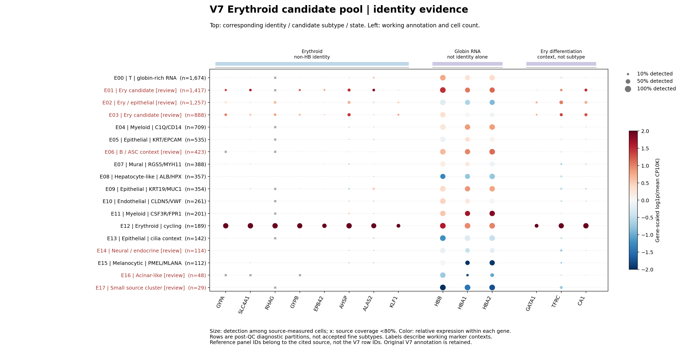
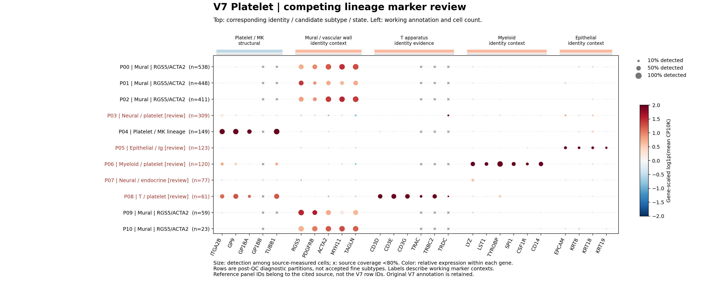
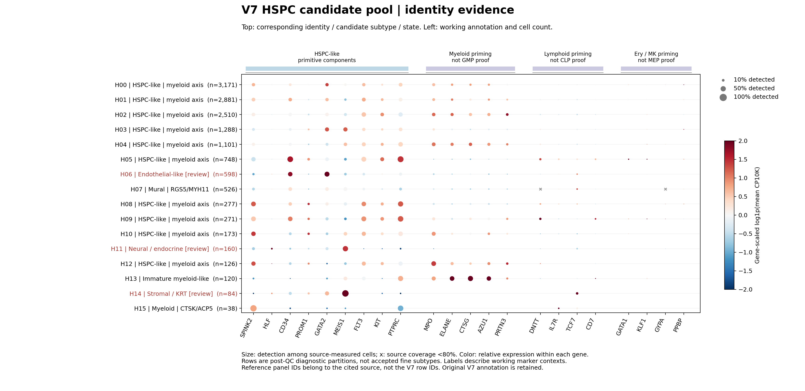
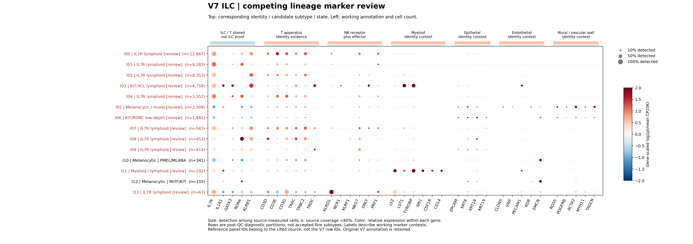

# V7其余unresolved逐类复查：红系、血小板、HSPC、ILC

本轮已经实际清理、从counts重新聚类、审阅RNA marker，并写出/读回新工作侧表。主要发现是：**一部分unresolved来自旧父类误标，并非这些细胞缺少可命名亚型。** 因此先纠正父身份，才讨论细分；保留旧V7和所有QC记录。

[59个诊断群的完整表](ALL_CLUSTER_REVIEW.md) · [逐细胞工作身份的聚合数](global/stage_f_working_annotations/working_identity_counts.tsv) · [旧标签→工作身份](global/stage_f_working_annotations/old_to_working_identity_crosswalk.tsv) · [方法与文献边界](../../../../methods/V7-other-unresolved-source-aware-review-20261106.md) · [正式运行](../../../../runs/20261106_v7_other_unresolved_review_v1.md)

## 实际完成与尚未完成

| 候选池（含边界召回） | 清理后建模细胞 | 诊断群数 | 大类工作记录，无本轮竞争复查 | 身份仍需复查 |
|---|---:|---:|---:|---:|
| Erythroid | 9,098 | 18 | 5,495 | 3,603 |
| Platelet | 2,318 | 11 | 1,625 | 693 |
| HSPC | 14,072 | 16 | 13,117 | 955 |
| ILC | 45,290 | 14 | 6,837 | 38,453 |
| 合计 | **70,778** | **59** | **27,074** | **43,704** |

“大类工作记录”包含改到其他父类的细胞，也包含HSPC_like；不等于仍属于原父类，更不是最终发表注释通过数。细胞数是清理后的候选池，不能当作泛癌全部该类型的丰度。所有最终细分接受标志仍为FALSE；本轮未替换CoVarNet输入、冻结V7或新TME线。

候选扫描包括8个旧父类/边界入口，共298,674细胞。实际追加913个操作性混合RNA排除、2个血液肿瘤语境暂存；全V7 QC-v3累计**2,916排除、238暂存、4,673,633保留**。这些是联合RNA与原工具评分的操作性决策，不是人工doublet真值。另226,981个背景候选未做本轮身份重建，仅保留后续路由。[QC来源汇总](global/stage_b_disjoint_QC_review/QC_actions_by_origin_and_model.tsv)与[独立输入审计](global/stage_c_QC_views/independent_input_audit.json)可核对。

## 红系：HB高表达不能代替红系身份

E12（189细胞）有一致的GYPA、SLC4A1、RHAG、AHSP、ALAS2等非HB结构/合成证据及MKI67/TOP2A增殖背景，适合先用**Erythroid＋cycling状态**，无需硬分成熟阶段。此外从待复核分区中，605个细胞以直接非HB结构＋合成证据进入红系工作路由；这不是说全数据只有189个红系。

其他分区可见T（E00）、髓系（E04/E11）、血管壁（E07）、内皮（E10）、上皮（E05/E09/E13）、肝样（E08）和黑色素谱系（E15）。HB同时在这些群表达，单凭globin把它们留在红系父类会制造“红系unresolved”。本轮不能仅由未校正counts区分环境RNA、吞噬/附着或残余混合，故记录为globin-rich RNA背景，不宣称污染机制已确证。

E01/E03的非HB证据集中于部分细胞，低深度及混合背景仍需复核；E02有红系/上皮混合，E06有B/ASC背景，E14神经/神经内分泌边界，E16腺泡RNA小群，E17单来源29细胞。未将这些群强行改成红系亚型。

## 血小板：旧父类中存在清晰的血管壁细胞

P00/P01/P02/P09/P10共**1,479细胞**表现RGS5、PDGFRB、ACTA2、MYH11/TAGLN的血管壁细胞程序，工作父类改为Mural。NRGN在这些群中也表达，不能以NRGN单独判血小板。此数是簇级工作归属；有逐细胞竞争证据者仍单列复查。

P04（149细胞）同时具备PF4/PPBP与ITGA2B、GP9、GP1BA、TUBB1结构组件，先保留**Platelet/Megakaryocytic谱系**。不凭该RNA面板区分成熟血小板与有核巨核细胞，更不把11个计算群叫11个亚型。P03神经/血小板、P06髓系/血小板、P08 T/血小板混合继续复查；它们没有达到联合排除门槛也不等于身份合格。

## HSPC：大类与正常性、分化方向分开

10个分区共12,546细胞保留**HSPC_like**的簇级工作描述，其中8,937来自血液疾病语境（主要AML）。SPINK2/CD34/FLT3/GATA2等与不同程度髓系程序支持“未成熟造血/HSPC样背景”，不能证明正常HSC、MPP、GMP或MEP，也不能证明细胞恶性。该问题需结合疾病来源、配套恶性/基因型证据及匹配参考。

H06（598）有CLDN5/FLT1/EMCN等内皮样程序且少量造血候选混在其中；H07（526）是血管壁程序；H11（160）为神经/神经内分泌背景；H14（84）为基质/KRT混合。H13是未成熟髓系样背景，H15有髓系及CTSK/ACP5程序，均不强定正常祖细胞亚型或功能性破骨细胞。

增殖和myeloid priming作独立RNA背景，不因其出现而删为doublet，也不把每个背景程序当亚型。H00/H01/H03没有满足本轮DE阈值的正向差异，不据此判断“没有身份”。

## ILC：先解决T与非造血父身份，暂不接受ILC1/2/3

ILC候选池实际有**6,363细胞**因正向CD3/TCR组件且无当前正向异源竞争组件转入T工作路由；这个数字包含边界召回，不是所有原ILC细胞的最终T数量。I10/I12共496细胞有明确黑色素谱系RNA，I05还有黑色素/血管壁混合背景，I11有髓系/淋巴混合。

I00/I01/I02/I04等不少细胞只有IL7R、KLRB1、RORA等T/ILC共享程序；I03为KIT/XCL背景，I06低深度KIT/RORC且混有黑色素候选。即使ILC2/3组件阳性，先满足造血父身份并排查其他程序也仍不能由“TCR没检出”证明Lin阴性。因此仅保留**166个ILC_like候选**供下一轮重点验证，未把它们确认为ILC2/3。IFN或cycling只作状态背景。

追加逐细胞组件诊断：166个候选来自32个来源，其中67为类型2程序候选、99为类型3程序候选，无两类同时满足者。这里是正向RNA条件分组，不是确证的ILC2/ILC3；候选的组件、分区与读回收据另见[跟进表](global/stage_g_ILC_candidate_followup/complete.json)。

## 为什么仍有coarse或review

下列原因是本轮RNA与来源证据的诊断解释；本轮没有逐步重放旧V7标签生成代码，不能将其当成旧代码每次决策的已证实历史原因。

本轮把原因拆成父类误标、成熟谱系混合、marker测量范围/低表达、T–ILC共享身份、连续分化/细胞周期及血液疾病语境。**coarse不一定是失败**：当大类充分、细分证据不足时，大类＋命名marker/状态是合理工作终点；但不能用coarse掩盖父类不对或混合群。

59群是相同分辨率的计算分区，不是由marker数或期望亚型数预先指定。聚类从清理后counts重算并公开res0.2/0.4/0.6/0.8计数；尚未完成跨来源/参数的身份稳定性终验，不宣称新发现59个亚型。原CellTypist/scATOMIC结果已经纳入逐群辅助表，本轮未新跑分类器，也没有用预测标签取代marker。

## 全部表与16张图

| 候选池 | 260基因完整统计 | 组件统计 | 原分类器辅助结果 | top15 RNA DEG | 全部图 |
|---|---|---|---|---|---|
| Erythroid | [marker](Erythroid/markers/measured_marker_expression.tsv) | [组件](Erythroid/markers/module_component_evidence.tsv) | [CellTypist/scATOMIC](Erythroid/markers/cluster_reference_top5.tsv) | [DEG](Erythroid/markers/top15_RNA_DEG.tsv) | [图目录](Erythroid/plots/) |
| Platelet | [marker](Platelet/markers/measured_marker_expression.tsv) | [组件](Platelet/markers/module_component_evidence.tsv) | [CellTypist/scATOMIC](Platelet/markers/cluster_reference_top5.tsv) | [DEG](Platelet/markers/top15_RNA_DEG.tsv) | [图目录](Platelet/plots/) |
| HSPC | [marker](HSPC/markers/measured_marker_expression.tsv) | [组件](HSPC/markers/module_component_evidence.tsv) | [CellTypist/scATOMIC](HSPC/markers/cluster_reference_top5.tsv) | [DEG](HSPC/markers/top15_RNA_DEG.tsv) | [图目录](HSPC/plots/) |
| ILC | [marker](ILC/markers/measured_marker_expression.tsv) | [组件](ILC/markers/module_component_evidence.tsv) | [CellTypist/scATOMIC](ILC/markers/cluster_reference_top5.tsv) | [DEG](ILC/markers/top15_RNA_DEG.tsv) | [图目录](ILC/plots/) |

每类4图：identity、竞争父类、扩展组织RNA背景、状态；均提供PNG/SVG。图顶给marker对应身份/状态，左侧给工作标签和n。灰×表示可测来源覆盖<80%，不是阴性；颜色按每个基因单独缩放，不能比较不同基因的绝对强度。图左是簇级工作描述，逐细胞竞争复核数见完整表，不能把整群所有细胞都视为最终接受。

输入、全部15,340条marker统计、来源和各分辨率计数、HVG/DE资格及侧表均独立复算通过。[最终侧表审计](global/stage_f_working_annotations/independent_sidecar_audit.json)确认冻结V7 SHA仍为`e4fda365…3981e`。该审计证明计算及记录一致，不证明最终生物学细分。当前优先处理ILC/T/NK边界与166个候选、红系弱非HB群、血小板混合群及HSPC疾病背景；其余背景入口和其他谱系继续另行复查。
