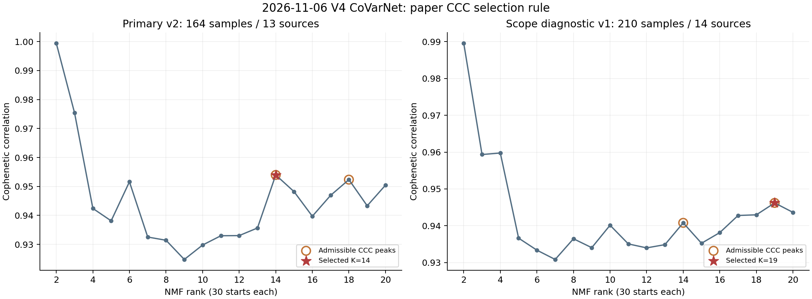

# 2026-11-06 V4 CoVarNet原文配置CM结果

**主分析已完成并独立核验：560,871个非上皮细胞、164样本、13来源、45节点；K2–20每K30次（570次），原文CCC规则选K14。** 14个因子中11个有网络，10个含跨父类边，1个仅髓系内部；CM01/02/05为空图。编号仅属于本次V4运行。

[rank选择](figures/rank_selection.png) · [全部top15候选](primary_v2/CM_results/factor_top15_candidates.tsv) · [最终成员与W](primary_v2/CM_results/CM_members_after_author_network_filter.tsv) · [全部网络边](primary_v2/CM_results/each_edge.tsv) · [输入45标签及覆盖](primary_v2/inputs/node_catalogue.tsv) · [完整拓扑与置换](primary_v2/CM_results/CM_network_topology_and_permutation.tsv) · [独立最终审计](primary_v2/CM_results/FINAL_INDEPENDENT_AUDIT.json)

网络只保留18条全局边。下表完整保留原文算法输出，不把空因子、单父类或近零载荷的边硬称生物学模块。**CM10、CM12、CM14存在近零W成员；CM06/12/14最终成员完全相同。** 特别是CM12两个成员W约7.9×10⁻⁹⁴及3.0×10⁻¹⁰³，虽然碰巧落入该因子top15并有全局相关边，也不足以支持该因子代表这一生物学模块。

| 因子/图 | 网络节点 | 边 | 父类 | 连通分量 | 置换P | 完整成员（沿用V4） | 诊断 |
|---|---:|---:|---:|---:|---:|---|---|
| [CM01](figures/CM01.png) | 0 | 0 | 0 | 0 | 1 | — | 空图 |
| [CM02](figures/CM02.png) | 0 | 0 | 0 | 0 | 1 | — | 空图 |
| [CM03](figures/CM03.png) | 3 | 2 | 3 | 1 | 0.0015 | Bcell_Naive_IGHD Endothelial_Blood_PECAM1 NK_XCL1_CD56bright_XCL1 | 待稳健性验证 |
| [CM04](figures/CM04.png) | 4 | 2 | 3 | 2 | 0.005599 | NK_XCL1_CD56bright_XCL1 Granulocyte_FCGR3B_CSF3R Granulocyte_Neutrophil_mature_FCGR3B Endothelial_Blood_PECAM1 | 非单一连通模块 |
| [CM05](figures/CM05.png) | 0 | 0 | 0 | 0 | 1 | — | 空图 |
| [CM06](figures/CM06.png) | 2 | 1 | 2 | 1 | 0.0207 | Bcell_MS4A1_CD79A Macrophage_Inflammatory_IL1B_IL1B | 成员同 CM12; CM14 |
| [CM07](figures/CM07.png) | 2 | 1 | 2 | 1 | 0.0169 | Macrophage_Cycling_Macrophage_MKI67 Fibroblast_Cycling_Fibroblast_TOP2A | 待稳健性验证 |
| [CM08](figures/CM08.png) | 3 | 2 | 1 | 1 | 0.0019 | Dendritic_CD1C_FCER1A Dendritic_LILRA4_TCF4 Dendritic_pDC_LILRA4 | 仅同一父类 |
| [CM09](figures/CM09.png) | 5 | 3 | 4 | 2 | 0.0026 | Macrophage_SPP1_TREM2_SPP1 Macrophage_Cycling_Macrophage_MKI67 Endothelial_Blood_PECAM1 Fibroblast_Cycling_Fibroblast_TOP2A NK_XCL1_CD56bright_XCL1 | 非单一连通模块 |
| [CM10](figures/CM10.png) | 2 | 1 | 2 | 1 | 0.014 | NK_XCL1_CD56bright_XCL1 Endothelial_Blood_PECAM1 | 成员含近零W |
| [CM11](figures/CM11.png) | 4 | 5 | 4 | 1 | 0.0002 | Glial_GFAP_OLIG1 Neural_Neural_progenitor_SOX2 Tcell_CD8_cytotoxic_CCL5 Macrophage_SPP1_TREM2_SPP1 | 父类出现/缺失信号 |
| [CM12](figures/CM12.png) | 2 | 1 | 2 | 1 | 0.0167 | Bcell_MS4A1_CD79A Macrophage_Inflammatory_IL1B_IL1B | 成员含近零W；成员同 CM06; CM14 |
| [CM13](figures/CM13.png) | 4 | 2 | 3 | 2 | 0.006599 | Mast_Activated_IL1RL1_LTC4S NK_XCL1_CD56bright_XCL1 Mast_Activated_IL1RL1_IL1RL1 Endothelial_Blood_PECAM1 | 非单一连通模块 |
| [CM14](figures/CM14.png) | 2 | 1 | 2 | 1 | 0.0206 | Macrophage_Inflammatory_IL1B_IL1B Bcell_MS4A1_CD79A | 成员含近零W；成员同 CM06; CM12 |

上述“近零”仅为透明诊断：网络成员W/本因子最大W<10⁻⁶；没有据此更改作者筛选或重新选择秩。[全部权重/重叠诊断](CM_weight_and_overlap_diagnostics.tsv)。不同因子网络可重叠，不应把10个跨父类网络当作10个独立生态系统。置换在固定全局图上抽取相同节点数，只评估此节点标签零分布的连接度；全部非空网络名义P及因子BH诊断虽<0.05，并未控制来源、癌种、稀有节点、参数或选择效应。

CM11包含Glial单节点父类，强连接可能携带组织/疾病和父类出现信号；HSPC、Melanocytic、Platelet同属单节点父类。输入仍含极少细胞的节点（如cycling Erythroid为2、Platelet为7），按作者算法本轮未另加最小节点计数门槛；覆盖表公开，不能以minmax后变异等价于可靠生物学证据。

## 来源范围敏感性

GSE179994在查看CM效应前因保留TME矩阵范围未确认暂存。旧v1不覆盖，单列[范围对照](source_scope_comparison.tsv)：v1含210样本、14来源、690,421细胞，选K19；v2为164样本、13来源、560,871细胞，选K14。两套网络编号不可直接一一对应。这说明发现对来源范围明显敏感；不是来源稳健性已通过。

## 输入和执行边界

[方法](../../../../methods/CoVarNet-V7-selective-author-CM-20261106.md) · [run](../../../../runs/20261106_v7_selective_CoVarNet_author_v1.md) · [执行代码与SHA](../../../../scripts/covarnet_v7_selective_20261106/) · [研究级平台补核](SOURCE_PLATFORM_EVIDENCE.md)。V4继承亚型不等于本轮新增亚型验证；12分母父类与作者91非上皮亚群体系不同，使用NMF0.28而非作者测试版本，复用既有QC。不能称原文数据/环境完全复现。

来源留出/种子与节点覆盖敏感性、疾病语境以及独立空间验证尚未执行。下一步应先核对近零载荷和重复成员、组织/来源依赖，避免直接给CM命名机制。正式作者输出保留；改进版阈值/分母若推进，必须另开版本作对照。样本/患者行、矩阵、完整RNA和作业日志保持私有。

生产2026-11-06 12:40:49 UTC/20:40:49 UTC+8结束，12:40:57 UTC/20:40:57 UTC+8全部独立核验通过。producer初始complete仍写pending；以较晚的独立R/FINAL审计为终验依据。

[交付验收](technical_acceptance.json)与[服务器实际执行代码/配置SHA读回](executed_server_code_binding.json)进一步核对全部38个秩作业退出0，公开代码与服务器执行字节一致。15张图包含14因子的完整top15及最终网络，图中文字按身份和marker分隔换行，不截断基因名。仓库检查0 errors/1项既有历史警告；科学稳健性未因此升级。
