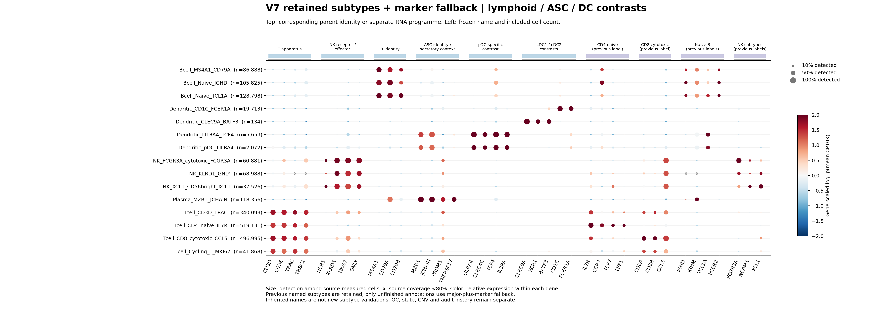

# V7保留原有亚型的选择性命名修正

**已修正上一轮的过度合并：原有已命名亚型/分类保留，只对缺少可靠细分的占位标签使用“大类＋marker”。** 当前版本`V7_selective_subtype_marker_20261106_v4`，共4,061,939细胞、50个标签。其中2,843,051个细胞沿用原名，1,218,888个使用大类marker回退；606,373个QC保留记录仍在全轴审计层。

[修正后的全部标签和细胞数](ALL_ANNOTATIONS.md) · [30个原已命名标签逐项保留审计与例外](PRESERVATION_AUDIT.md) · [独立逐细胞核验](stage_h_selective_subtype_restore_v4/independent_audit.json)

## 这次修正的规则

1. 以最后一次保留原有亚型的完整V7当前对象为基线。naive B、CD4 naive T、CD8 cytotoxic T、SPP1巨噬、单核、CAF、NK和内皮等已有标签保留原文，不统一收缩成Bcell/Tcell/Myeloid。
2. 只有unresolved/coarse/provisional/pending等未完成细分的记录，才在父身份支持范围内使用大类＋marker。候选细分仍按其证据粒度处理，不通过改名晋升。
3. 不以v3正向大类组件筛选作为原有亚型保留的前置条件，因此恢复了143,224个原被该粗粒度视图挡在外面的已有命名细胞。恢复原名只继承原证据，不是新的亚型验收。
4. 先前clean refit已经发现的父类误标不能恢复为错误原名；2,022条此类例外逐项列明。其他v3与原标签的父类差异仅作独立复核标识，不自动推翻原标签。

## 当前范围

原始4,676,787行和QC-v4（4,668,312保留／8,237排除／238暂存）完全不变；原严格资格、旧标签、CNV和全部审计历史保留。正式`final_annotation`混合原有已命名亚型/分类与有依据的大类marker回退，不含进度占位词；独立`annotation_application`、`annotation_resolution`和`evidence_basis`说明每条身份如何产生。

这是按照用户原意恢复注释层级，不宣称原有亚型在本轮重新完成发表级验证，也不宣称剩余606,373个QC保留记录已经解决。原v3的20名称保留作[历史大类诊断视图](../v7_marker_identity_freeze_v1/README.md)，不再作为完整注释的默认展示。新TME、CoVarNet和历史CM输入均未替换。

## Marker图

图中同时显示原亚型和大类marker回退。每组基因标出对应身份或状态程序；左侧显示实际完整标签与细胞数。图件用于审查表达，不能把保留的Activated/Cycling等原词误解为本轮新增功能验证。

[髓系/颗粒谱系](figures/selective_v4_myeloid_granulocyte_Mast.png) · [基质/上皮/神经](figures/selective_v4_stromal_epithelial_neural.png) · [稀有造血](figures/selective_v4_hematopoietic_rare.png) · [独立程序](figures/selective_v4_state_programmes_separate.png)

## 私有对象与复现

服务器正式文件为`${PROJECT_ROOT}/runs/20261106_v7_publication_marker_annotation_v1/stage_h_selective_subtype_restore_v4/annotation_frozen_V7_selective_subtype_20261106_v4_PRIVATE.pkl.gz`和同名`.tsv.gz`。完整轴历史/未纳入记录为同目录`all_axis_selective_annotation_with_history_PRIVATE.pkl.gz`；其中v3字段仅追溯此前大类诊断，新身份使用v4字段和独立应用说明。

[实际写出与文件SHA](stage_h_selective_subtype_restore_v4/complete.json) · [新fallback命名marker独立核验](stage_i_selective_annotation_marker_evidence_v4/independent_naming_marker_audit.json) · [方法](../../../../methods/V7-selective-subtype-preservation-20261106.md) · [运行](../../../../runs/20261106_v7_selective_subtype_restore_v4.md) · [任务日志](../../../../logs/codex/2026/2026-11-06_v7-selective-subtype-preservation.md)。逐细胞行、样本/患者行及矩阵不公开。
