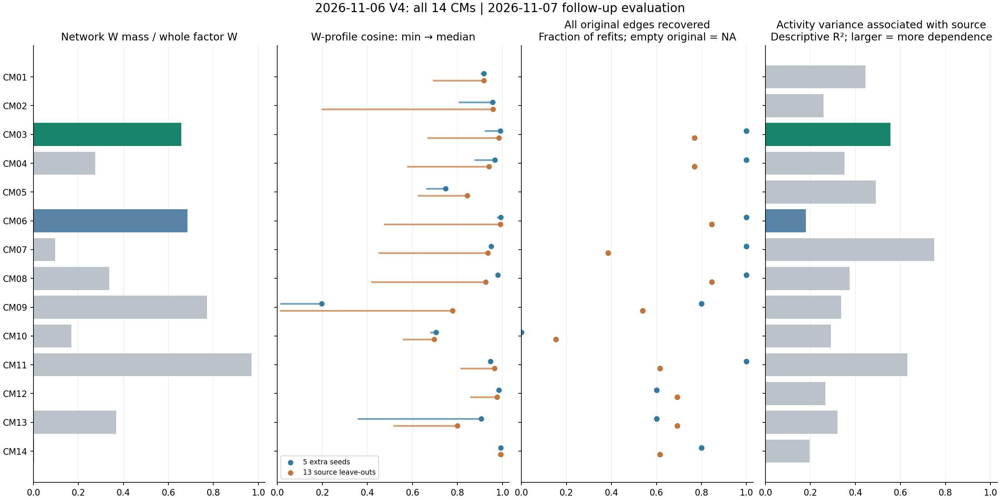
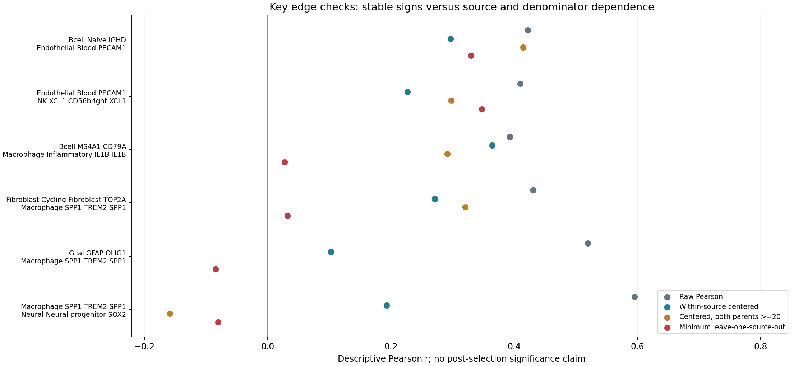
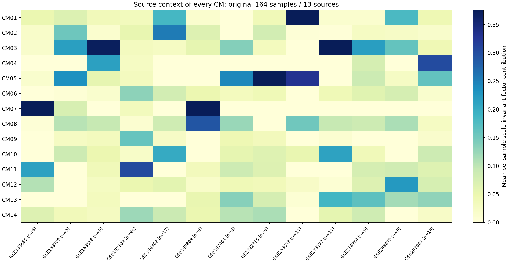

> **2026-11-09 后续验证更新**：本页保留事前候选选择；[完整验证结果](../../2026-11-09/v4_CM_validation_review_v1/README.md)已纳入53张空间、25组通讯及新六例，不以事前优先级代表生物学验证完成。

# 全部V4 CM分析：优先推进CM03，CM06备选

**结论：当前最适合投入下一步验证的是“2026-11-06 V4 CM03”：IGHD naive B—PECAM1 blood endothelial—XCL1 NK。CM06可作两细胞关系备选；CM09暂不作为主线，CM11用于组织/分母诊断。没有模块已完成独立空间、身份和机制验证，因此这里选择的是研究优先级。**

本次对全部14因子追加了5组额外seed和13组逐来源留出，每组固定K14、30次nsNMF，共540次；252个对应均报告，独立R/Python核验通过。原CM定义及筛选没有更改。

[完整指标表](ALL_CM_REVIEW.tsv) · [所有来源/分母边诊断](diagnostics/all_global_edge_source_diagnostics.tsv) · [18重拟合/252对应](diagnostics/all_CM_refit_matches.tsv) · [全部来源活动](diagnostics/all_CM_source_activity.tsv) · [最终独立审计](diagnostics/FINAL_INDEPENDENT_AUDIT.json) · [方法](../../../../methods/V4-CM-selection-source-stability-20261107.md) · [原始14CM、成员和图](../../2026-11-06/v7_selective_CoVarNet_author_v1/README.md)

## 全部14个模块的取舍

“网络W占比”衡量最终网络是否承载该因子的主要载荷；“余弦”是全部45原节点W谱的一对一匹配中位数，已排除列缩放影响；“全边恢复”允许增加其他节点/边，不能等同严格成员集合一致。这里只汇总描述值，没有任意综合分或选择性P值。

| 本次CM | 网络W占比 | 额外seed W余弦 | LOSO W余弦 | 全边恢复 seed／LOSO | 判断 | 原因 |
|---|---:|---:|---:|---|---|---|
| CM01 | 0.0% | 0.918 | 0.918 | NA／NA | 暂缓 | NK_KLRD1／髓系LST1／CD4 IL7R组成程序；作者网络为空，不能作为有边支持的CM主线。 |
| CM02 | 0.0% | 0.957 | 0.958 | NA／NA | 暂缓 | VWF内皮／COL1A1成纤维／RGS5壁细胞组成程序；网络为空，最差来源留出谱匹配很低。 |
| CM03 | 65.7% | 0.990 | 0.984 | 5/5／10/13 | 首选验证候选 | IGHD naive B—PECAM1 blood endothelial—XCL1 NK三节点连通，实质载荷、来源内边与重拟合整体最均衡；来源活动仍偏倚，严格成员集合未完全稳定。 |
| CM04 | 27.5% | 0.966 | 0.940 | 5/5／10/13 | 暂缓整体；边作对照 | 中性粒两个标签构成一对、内皮—NK另一对，二者不连接；后者已在CM03，网络仅占27.5% W，不能称一个整体生态位。 |
| CM05 | 0.0% | 0.747 | 0.844 | NA／NA | 暂缓 | Plasma MZB1／myCAF ACTA2等组成程序；作者网络为空，seed谱匹配较弱。 |
| CM06 | 68.5% | 0.992 | 0.990 | 5/5／11/13 | 备选；优先查来源 | MS4A1 CD79A B—IL1B炎性巨噬，两节点载荷充分、seed稳定；去GSE182109后边接近0，且B为大类回退，需先分清身份与来源。 |
| CM07 | 9.7% | 0.950 | 0.936 | 5/5／5/13 | 不以此因子追增殖轴 | 网络为cycling macrophage—cycling fibroblast，但仅占9.7% W；最高载荷Melanocytic PMEL，来源R²=0.749，LOSO边恢复差。增殖关系可另作CM09子问题。 |
| CM08 | 33.7% | 0.980 | 0.925 | 5/5／11/13 | 同谱系对照 | CD1C DC／LILRA4 TCF4 DC／LILRA4 pDC同一Myeloid父类；seed网络最稳定，可作谱系内部对照。两个pDC方向标签需排查继承/回退分割，不叫跨谱系CM。 |
| CM09 | 77.2% | 0.196 | 0.779 | 4/5／7/13 | 暂缓主线；子关系探索 | SPP1 macrophage／cycling macrophage／cycling fibroblast三节点子网，另有内皮—NK断开子网；seed谱非常不稳，活动质量约79%来自GSE182109，不能先讲泛癌机制。 |
| CM10 | 16.9% | 0.704 | 0.697 | 0/5／2/13 | 不采用原网络解释 | 内皮—NK网络的内皮W约3.4×10⁻⁴¹；不是该因子的有效成员，seed原边恢复0/5。 |
| CM11 | 96.9% | 0.947 | 0.964 | 5/5／8/13 | 组织/分母诊断 | Glial—Neural SOX2—CD8 CCL5—SPP1网络最密，但Glial仅一个分母节点；在Glial存在的样本内频率恒1，多条条件相关不可估计，不能因P最小选作泛癌TME主线。 |
| CM12 | 0.0% | 0.984 | 0.977 | 3/5／9/13 | 不采用原网络解释 | B—IL1B macrophage两成员W约10⁻⁹⁴与10⁻¹⁰³；因子实际高载荷是FCGR3A NK／VWF内皮／ECM CAF。组成谱稳定并不能挽救错误网络解释。 |
| CM13 | 36.8% | 0.906 | 0.800 | 3/5／9/13 | 暂缓整体；Mast对照 | 两个activated Mast标签为一对子网，内皮—NK为另一对，缺少Mast到它们的桥；Mast内部关系可保留，不称Mast–NK–血管生态位。 |
| CM14 | 0.4% | 0.992 | 0.993 | 4/5／8/13 | 不采用原网络解释 | HSPC SPINK2 CD34最高载荷、单节点父类；B—IL1B macrophage网络仅占0.45% W且B近零，不以稳定HSPC组成谱证明B–髓系模块。 |

## 为什么首选CM03

三个成员分别为`Bcell_Naive_IGHD`（W=0.272）、`Endothelial_Blood_PECAM1`（0.224）、`NK_XCL1_CD56bright_XCL1`（0.161）。它们恰为该因子前三载荷、占总W的65.7%；不是靠top15边缘的近零节点拼出网络。三者属于三个父类，形成B—内皮—NK的连通路径。**当前并没有B—NK直接边**，不能画成三角互作或称已证实三方协作。

| CM03边 | 原始r | 去来源均值r | 双父类≥20再去来源均值r | 留一来源r范围 | 来源内正向/可估计 |
|---|---:|---:|---:|---|---|
| Bcell_Naive_IGHD — Endothelial_Blood_PECAM1 | 0.422 | 0.297 | 0.414 | 0.330–0.504 | 12/13 |
| Endothelial_Blood_PECAM1 — NK_XCL1_CD56bright_XCL1 | 0.410 | 0.227 | 0.298 | 0.348–0.526 | 10/13 |

原三节点共同可见于72/164样本，三个父类均≥20细胞有47样本。五seed载荷余弦中位0.990、最低0.920，原两边5/5保留；13LOSO中位0.984、最低0.666（留出GSE273127），原两边10/13保留。严格原三节点集合仅5/13完全相同，有时新增节点；失去至少一条原边的留出为GSE163558, GSE253013, GSE273127。所以可称当前相对最均衡候选，不能称所有来源下完整成员已稳定。

CM03活动仍有来源依赖（来源R²≈0.555），最大来源活动质量份额约25.4%，活动有效来源数约6.8。跨来源差异可能包含真实组织生物学，也可能包含技术、注释、治疗和重复患者差异。本轮来源中心化和LOSO没有分离所有这些因素。

[全部26个原边机会的筛选追踪](diagnostics/CM03_LOSO_edge_filter_trace.tsv)已独立重建并核对网络：三个失败留出中，两个端点均仍在匹配因子top15，相关及特异性也通过，丢边原因均为**作者Holm后BH的FDR>0.05**。留出GSE163558的两边FDR约0.633/0.250；留出GSE253013的内皮–NK为0.057；留出GSE273127的B–内皮为0.613。全部留出相关仍为正不代表原网络统计阈值在全部来源下稳健；两项事实同时保留。

## 为什么不先追CM09或CM11

**CM09的SPP1故事可解释，但分解本身不稳。** 其来源活动质量78.99%来自GSE182109（该来源占44/164观察样本），网络又分为SPP1/增殖巨噬/增殖成纤维三节点与内皮–NK两节点。五seed的W谱匹配中位仅0.196（A谱0.443），不能因4/5次保留同一稀疏网络就忽视因子载荷改变；缺失的来源或新增节点会改变候选语义。SPP1–cycling fibroblast边原始r=0.431，去来源均值0.271；去掉GSE182109后约0.032。若继续，只先把三节点子关系作为限定来源/疾病及细胞周期控制的探索对象，原CM09不重命名、不宣称泛癌稳健。

**CM11最小连接度P主要不足以排除组织/父类出现信号。** Glial只有一个分母节点，因此一旦该父类存在，其频率恒1；在双方父类存在或≥20的视图中，多条Glial相关根本不可估计。SPP1–Neural的原始r=0.595在来源去均值后为0.193，双父类≥20并去来源均值后为−0.158；CD8–Neural也从0.377降为−0.124。谱稳定可以说明组织组成被稳定识别，并不自动证明泛癌TME互作。

**CM06是备选而非已确认模块。** B大类marker回退—IL1B炎性巨噬的载荷质量68.5%，seed谱中位0.992，来源中心化r=0.365、双父类≥20时0.292，覆盖120共同出现样本/86个充分分母样本；但去GSE182109后r≈0.027，LOSO最低W谱余弦0.473。先检查该来源与B细分、样本/治疗结构，再决定是否进入机制分析。

## CM03接下来研究什么

1. **先核三个身份及其近邻对照。** 对IGHD B与TCL1A B、blood PECAM1内皮与VWF/ACKR1内皮、XCL1 NK与FCGR3A NK在真实RNA、来源内比例和样本保留率中复核；不能仅用旧标签承诺三个亚型均终验。
2. **在独立测量中检验血管邻近的组织关系。** 使用可区分三类且覆盖所需marker的空间/蛋白数据，分别检验B–内皮、NK–内皮和三者邻域富集，匹配谱系密度、组织区域和血管距离作背景；不是看到三者多就称共定位。
3. **再检验状态和机制。** 先在三个身份内建立可测状态，问同一身份比例下是否仍存在协同状态，及其与血管区室的关系。通讯、接收端响应和临床结局放在身份/空间关系通过之后；不能直接把共变边当配体受体作用。

目前**不命名为TLS、HEV或抗肿瘤免疫生态位**：IGHD B和PECAM1内皮不足以证明这些组织结构，CM中也没有证明GC B/Tfh/DC组织者。文献中的[NK–XCL1/CCL5–cDC1轴](https://pmc.ncbi.nlm.nih.gov/articles/PMC5847168/)提供一个可检验机制背景，但当前CM03没有cDC1成员，不能直接套用。SPP1巨噬–成纤维关系也已有[原始研究](https://pubmed.ncbi.nlm.nih.gov/35365629/)，所以单纯重复共现不是创新；TOP2A cycling fibroblast亦不等同FAP CAF。

本次选择的价值是把后续验证预算集中到当前载荷和边最协调的候选；创新要来自独立空间、身份内状态、来源可迁移性或机制增量，而不能来自给CM重新取名。

## 验证范围

2026-11-06 22:18:43 UTC（客户端2026-11-07）全部18重拟合结束；22:20:01 UTC独立R/Python通过。18个模型每份30次、K14，共识CCC和WSH导出、活动缩放不变性、18全局边、全部252匹配已核；Hungarian对应由精确DP独立检查。固定K14未重新选各留出视图的最优秩。原始空图/NA/失败历史保留，统计为发现后诊断，不是独立确认性检验。

R首次核验因producer JSON默认4位小数CCC而失败；改为从保存模型全精度独立计算，仍以1e-10核对NMF原值，JSON只按明确舍入界检查，详见[完整精度读回](diagnostics/all_18_refit_CCC_precision_readback.tsv)。模型没有因此重跑。初次A因子名导出检查失败亦保留，A=W·S验证后才绑定固定因子轴。

服务器模型、W/H/频率矩阵及逐样本/患者行留私有；公开仅节点、边、来源/模块聚合、代码和脱敏收据。
