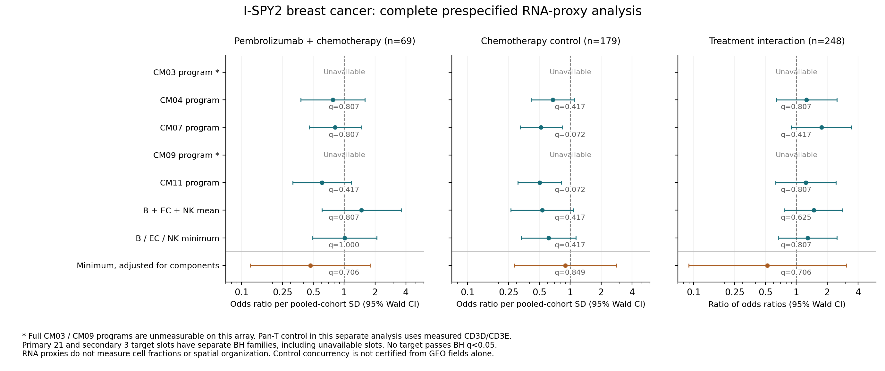

# 乳腺癌血管相关免疫组成：从V4 CM03到空间与治疗关联

**当前主线为组成—空间组织—募集通讯—治疗关联；状态分析不再是前置条件。** 2026-11-06 V4 CM03的定义、原注释与成员保持，新的乳腺癌测量版本另列。它提供B—内皮、内皮—NK两条发现边，原网络没有B—NK边；同一血管周三者聚集是需要新检验的扩展假设。

## 已完成及当前边界

- 新图谱的记录、ZIP成员、实际面板和13份作者代码已核对，并固定作者提交`177e35ffed015b5a6155319c830e03616efc8659`。[代码取证清单](author_code_manifest.json)。
- 新增空间输入已启动独立有限获取与资格分支，原队列不改。直连公共归档失败，保留失败并建立临时回环传输恢复；具体真实进度见追加检查点。**启动或字节传输不等于空间分析完成。**
- I-SPY2原生来源、248位合格患者、严格测量v1及单独测量v2已核查。v2的18个可估计模型通过原始键/秩分数/设计、独立NumPy似然和完整FDR审核；当前没有目标项通过BH。

## 新空间资源怎样用

[作者公开记录](https://zenodo.org/records/18917100)包含32位患者的40份Visium（33原发肿瘤切片，其中一位有重复；7匹配淋巴结）、4份Visium HD与6份Xenium。平台和切片重叠不能累加为独立患者；原发肿瘤与淋巴结分开。六份Xenium的压缩成员合计约3.21GB，先按平台和源成员字典序取全六份及18个层级映射，不下载整套约1TB输入。

[实际面板](https://github.com/swarbricklab/P08-breast-tme-spatial-atlas/blob/177e35ffed015b5a6155319c830e03616efc8659/resources/probe_set/xenium_panel.csv)为5101个唯一名称，包含ACKR1、CCL19/CCL21、CCR7、CXCL12/CXCR4及主要血管壁marker，**没有IGHD、XCL1**，也缺NKG7、CD3D、TRAC。见[逐marker测量审核](panel_qualification.json)。因此先检验可靠的大类血管免疫关系，不能以转移标签补成精确CM03。全转录组Visium/HD可另核IGHD/XCL1实测和分辨率，但目前尚未取回，不能预先保证可测。

AnnData只有细胞中心坐标；边界在另一SpatialData归档。作者图像对齐后的`obsm['spatial']`是图像像素，原生微米在`x_centroid/y_centroid`及`xenium_um_spatial`。后续距离只使用核对过的微米坐标；中心距离不是血管壁距离，也不是接触。原生X为计数log1p；名为filtered_counts的层已经CP10K，不能误当原始UMI。

## 作者代码提供的逻辑与已有工作边界

| 环节 | 实际代码逻辑 | 本项目借鉴及区别 |
|---|---|---|
| 原生QC/表达 | 计数过滤下限10、基因至少5细胞检出；X保留log1p计数，另一层CP10K | 保留作者QC，先查尺度、双细胞/分割污染和marker，不自动视为发表身份 |
| 三层映射 | Wu参考，Tangram clusters模式、1000轮、最大映射质量取标签 | 保存作者标签并核多marker；其最大值是映射质量，不能机械套0.7分类概率阈值 |
| HEV区域 | TSPAN7/MEOX2/RAMP3/SPNS2/IL33打分，核心阈值0.6、扩张0.2、30μm，扩张群至少5细胞 | ACKR1阳性血内皮与作者HEV定义分开；不以ACKR1单基因直接宣布HEV |
| 距离 | 对原生微米中心用cKDTree最近邻，区分邻近TLS的HEV | 全六个输入接续；血管类型、淋巴细胞量、TLS及组织区室作背景 |
| 趋化因子来源 | 作者已比较imPVL s1与iCAF s2，分别核CCL19/CCL21/CXCL13来源及梯度 | 不预设所有CCL19/21来自血管周细胞；区分PVL、成纤维和淋巴管 |

这些步骤的精确文件和SHA见代码清单，外部源代码只在私有取证区保存，不整段转载。**该新图谱本身就研究TLS/HEV微环境和趋化因子，因此重画同一关系不是新发现。** 我们优先检验B/NK联合组成与血管的关系是否超出总淋巴细胞量、血管量和TLS背景；没有增量就如实收窄主张，不强行造新状态。

作为研究尺度参照的[2025年静脉生态位研究](https://doi.org/10.1038/s41467-025-58511-0)已把ACKR1内皮、CCL19/21相关血管壁细胞、空间联系和功能实验连起来。这里的ACKR1/CCR7轴是已有机制背景，不作为本项目原创发现；ACKR1的趋化因子呈递不能简单等同一般受体的下游信号激活。

## I-SPY2：真实测量结果而非按病例总数猜测

[官方GEO](https://www.ncbi.nlm.nih.gov/geo/query/acc.cgi?acc=GSE194040)的处理表达19,134基因×988列，GEO有988条记录、987个唯一患者键。精确连接、排除重复键后，本轮HER2阴性且对应治疗臂共248人：pembrolizumab+paclitaxel 69（31 pCR，HR阳性40/TNBC29）；paclitaxel对照179（31 pCR，HR阳性94/TNBC85）。[来源和患者桥汇总](clinical_v2/input_measurement_receipt.json)不含个体行。治疗前取样及表达/mIF人群区别依据[I-SPY2原研究](https://pmc.ncbi.nlm.nih.gov/articles/PMC11604542/)；GEO字段本身不足以认证全部对照同期入组，因此交互仍为探索性。

严格v1要求原CM程序与原三基因pan-T完整实测：TRAC缺失令全部24槽不可估计。CM03还缺NCR3LG1，CM09缺C1QL4/DMRTA2；保留[原严格表](clinical/all24_prespecified_target_terms.tsv)和[原因/来源分母](clinical/reviewed_measurement_eligibility.tsv)，不能把0完整病例解释为无表达数据或阴性。

在尚无任何可估计效应时，另冻结[测量补充v2](measurement_addendum_before_estimable_effects_v2.json)：pan-T改为本芯片实测CD3D/CD3E，二者均须完整；原CM03和CM09仍不可估计，不用9基因碎片冒充原程序。B（IGHD/MS4A1/CD79A）、EC（PECAM1/VWF/CDH5）、NK（XCL1/NCR1/KLRD1）各基因先在合格全队列内取患者百分位，得到三个均值；再计算等权平均和最低组成，统一以全队列SD报告。**这只是RNA组成代理，不是细胞比例、精确NMF活动或真实空间生态位。** EC面板也不能单独保证血管相对淋巴管特异性。

保留原5个充分CM程序及两项新代理的全部21个目标槽（治疗臂内/对照内/交互），另3个最低组成增量槽单独成家族；未测槽P1入校正、展示NA。不二分、不优化marker或cutpoint。基础模型调pan-T和HR；增量模型再调EC、B/NK均值，交互模型保留相应组成、pan-T、HR与治疗的交互作为背景。

| 组成代理 | 联合治疗内OR/SD（95%CI） | 治疗交互OR比（95%CI） | 相应完整家族BH |
|---|---|---|---|
| 三组成均值 | 1.477（0.609–3.582） | 1.480（0.772–2.838） | 0.807／0.625 |
| 最低组成 | 1.013（0.492–2.085） | 1.293（0.670–2.495） | 1.000／0.807 |
| 最低组成，加入组成控制 | 0.467（0.122–1.794） | 0.522（0.089–3.053） | 0.706／0.706 |

[全部24槽](clinical_v2/all24_prespecified_target_terms.tsv) · [测量覆盖](clinical_v2/program_measurement_coverage.tsv) · [可评估性](clinical_v2/reviewed_measurement_eligibility.tsv) · [独立原始测量/设计/似然/FDR审核](clinical_v2/independent_audit.json)。18设计数值最大误差1.19e-10、原生秩分数误差2.23e-16。21主槽15可估计，3增量槽均可估计，两家族均0 BH。OR比检验不同治疗臂中代理系数是否不同，不能由单臂显著/另一臂不显著代替；小样本增量模型不作为预测器。

本轮为HER2阴性总体、调整HR的模型，不等于TNBC专项结论；pembro臂TNBC仅29位，低于当前n≥30门槛，不强行另拟合。这里检验的是B/泛EC/NK RNA代理，尚未检验空间确定的ACKR1血管或CCL19/CCL21血管周生态位；后者须先获得空间资格再另冻测量和独立验证，不能用本轮阴性替代。

**当前没有简单RNA代理的治疗关联支持；这既不能证明血管空间组织无意义，也不能证明它已有治疗价值。** 上一轮六ICI无乳腺癌且测的是另一CM程序代理，不能直接否定此路线；本轮也不会用换基因、换结局、换阈值挽救阳性。

## 下一步的完成标准

1. 接收六份原生输入完整CRC/SHA，核精确barcode、基因尺度、微米坐标、作者层级与多marker；保留已确定亚型，不把粗粒度结果伪装为精确CM03。
2. 从全部合格血内皮中心开展0–25–50–100–200–400μm距离与局部组成描述；ACKR1检出/未检出血内皮和淋巴管分开。完成几何/身份资格后另冻结患者级与区室限制的零模型，避免细胞伪重复。三者同血管周组织化作为扩展检验，原两条CM边各自也要验证。
3. 将CCL19/21–CCR7、CXCL12–CXCR4的真实来源、受体阳性接收者和邻近位置放在一起。先审核身份和实测表达，再做完整假设范围的空间通讯及足够重采样；不从旧100次置换的P0宣布机制，不以高CellChat分值替代邻近/响应证据。
4. 若空间指标在患者间可重复，再固定能跨平台测量的组成指标做外部治疗复现；对照单独EC、总B/NK及pan-T，并检验治疗交互。TCGA-BRCA预后背景为补充，不把其替代乳腺癌ICI队列。

[原冻结方案](frozen_breast_plan_v1.json) · [方法](../../../../methods/V4-breast-vascular-immune-20261107.md) · [正式run](../../../../runs/20261107_V4_breast_vascular_v1.md) · [通用代码](../../../../scripts/v4_breast_vascular_20261107/) · [此前空间/TCGA/ICI](../v4_spatialCellChat_bulk_v1/README.md)。

当前传输补充：首份对象的三层映射在本机已完整CRC/SHA通过；矩阵部分下载中，尚无新原生空间身份/距离结论。服务器大块正文超时，已改独立SSH、256KB块恢复；没有将BadZipFile网络异常解释为源包损坏。有限原生资格阶段等待完整CRC/SHA，不以部分文件读取或进程存在冒充科学完成。

[最后技术检查点](runtime_checkpoint_v1.json)分开记录服务器与本机：新增原生矩阵尚无完整验收，三层映射3/3已校验，部分矩阵不用于结果。

[较晚执行地点纠正](transport_compute_fallback_v2.json)：服务器大文件转发也实际超时，现以隔离本机有限分支接续全部6份/18映射；首份和已验收3映射复用，没有改变科学规则。新增矩阵/原生空间结论仍待完整校验，不将早期“进程活跃”快照当成当前健康运行证据。当前源码以[清单v4](public_code_manifest_v4.json)为准，旧版/失败保持。
