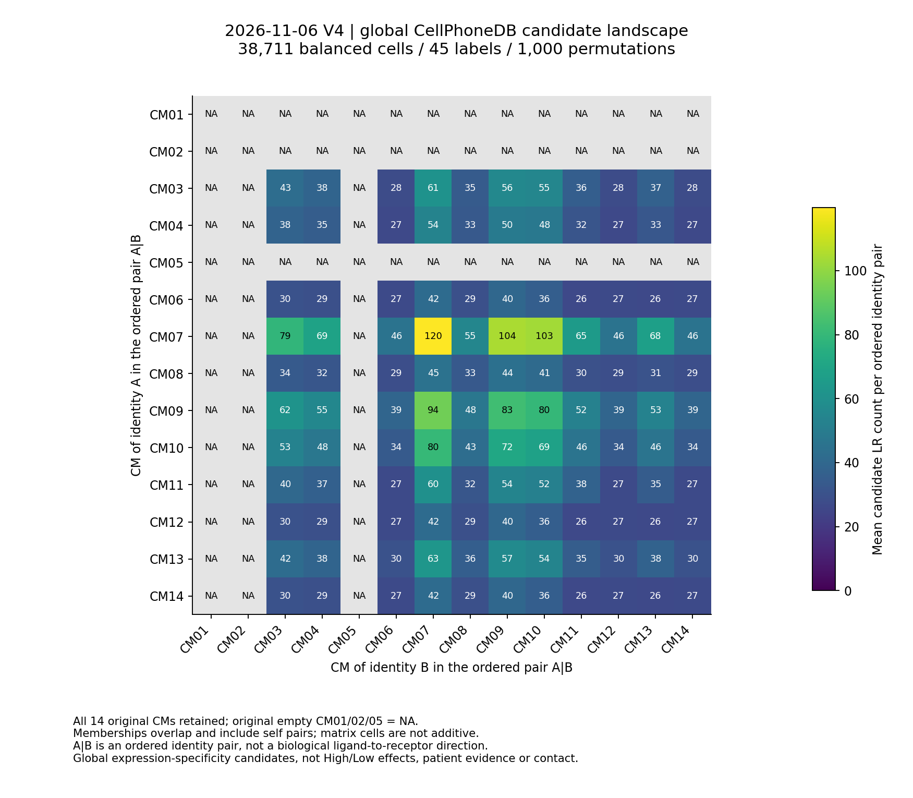
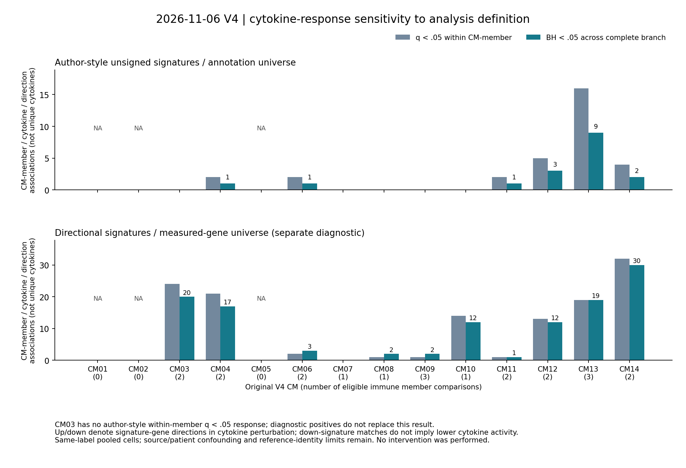

# 当前V4通讯分析与空间队列进度

本页为带时间检查点：**空间主模型6/53已完整拟合、原文评分及独立审核通过，另2张运行；CellCharter全部53张拟合及逐张审核通过。当前V4全局1,000次置换CPDB和细胞因子响应已完成并独立读回，完整25组High/Low仍在进行，尚无完整通讯或CM空间验证结论。**

06时前后继续后的较晚证据：[正式全局/响应独立审核](completed_global_response_v1/complete.json) · [全14CM候选均值](completed_global_response_v1/global_all14_CM_by_CM_candidate_CCI.tsv) · [所有2,923个数据库互作的组分覆盖](completed_global_response_v1/full_database_component_measurement.tsv) · [全部响应检验](completed_global_response_v1/response_full_family.tsv) · [各身份资格](completed_global_response_v1/CM_member_signature_eligibility.tsv) · [最新空间6/53](spatial_runtime_checkpoint_v2.json) · [通讯时间修正](communication_ETA_v2.json)。原先4–12小时为未标定暂估，现按全局/首个High正式耗时与25组细胞访问量修正为**剩余约18–30小时**，待首个大Low组实际完成再标定；没有为了赶时间截短正式置换或丢掉Low细胞。

## 已有真实结果与边界

全局38,711个平衡抽样细胞、45标签、1,000置换已独立通过，共57,450个“有序细胞身份对×LR”候选事件，不是57,450个不同分子或真实通讯。数据库2,923互作中1,356具备本轮完整组分测量覆盖，正式CPDB保留恰为这1,356，未发现保留互作存在组分缺测；其余不可测不能称阴性。全局任务约8分33秒，首个正式CMT High约11分18秒。完整CMT家族与CellChat仍以实际终态审阅，不从当前全局计数推环境效应。

行为原输出有序细胞对A|B中身份A所属CM、列为身份B所属CM，值为原成员有序对的平均候选LR数，含自身对；表中`source_CM/target_CM`是该技术次序字段，**不能直接当作分子层面的配体发送—受体接收方向**。CM01/02/05原空网络为NA；重叠成员使格子不可相加。不同身份本身表达/数据库候选数不同，CM07/CM09等全局计数高不等于更可靠生态位或更强环境依赖通讯，不能凭本图改选主模块。两图均从独立通过的聚合表生成，已检查轴/字样/图例遮挡，见[图件清单](figure_manifest_v1.json)。

21个“CM—免疫身份”比较的295,071个DE基因条目从实际表达独立复算通过，最大P误差5.64e-7、log2FC误差1.89e-6；超几何误差1.11e-16，BH与38条生产—响应亚基关联均读回。作者式分支1,065个请求／480可检验，成员内q<0.05为31项、完整分支BH<0.05为17项；方向/实测背景分支2,130请求／643可检验，分别128/118项。数量是身份—细胞因子—方向关联，非不同细胞因子数、非独立患者或不同机制数；两个分支同时改变方向处理与背景定义，不能将差异仅归因于保留方向。

### 预先优先候选CM03

| 原成员 | High细胞 | Low细胞 | Immune Dictionary适用性 |
|---|---:|---:|---|
| Bcell_Naive_IGHD | 6,466 | 5,014 | B_cell签名 |
| Endothelial_Blood_PECAM1 | 635 | 4,002 | 当前免疫字典无对应内皮签名，不能硬套 |
| NK_XCL1_CD56bright_XCL1 | 667 | 4,376 | NK_cell签名；近邻身份混淆限制仍保留 |

**CM03在作者式无方向签名/注释背景下没有成员内q<0.05的细胞因子响应。** 在预先登记的方向/实测背景分支中有IFN等关联，完整分支BH下保留20个身份—细胞因子—方向项，但这不能替换作者式未获支持的结果。当前该分支的生产—响应关联为内皮IL15→NK、B细胞TNF→NK，两者匹配的是刺激实验中的下调基因签名；`down`不等于细胞因子活性下降，也不是本项目做了干预。尚需25组LR环境比较、受体/来源/身份背景与全范围空间结果，不能据此写成IL15/TNF已确认机制。

完整[生产—响应网络](completed_global_response_v1/production_response_network.tsv)和[身份/DE统计](completed_global_response_v1/CM_member_DE_summary.tsv)均保留全部模块；最高信号的CM14仅2个High样本，不能用大量细胞扩充独立重复。另据[NCBI/HGNC](https://www.ncbi.nlm.nih.gov/gene/64806)复核IL17E应映射IL25，建立[别名审阅视图](producer_alias_review_v2/complete.json)：IL25不在本轮13来源共同实测基因中，未新增边，原38条和全部原始输出保持；无DE/富集重拟合。

最新[05:37:51 UTC](runtime_checkpoint_v3.json)：[原始输入独立核验](audit/input_independent_audit.json)覆盖全部560,871细胞/45标签/CMT及245个原始CSR计数行重算，最大表达误差2.99e-7；全局38,711细胞、共同实测14,051基因。[技术小试审核](results/pilot/independent_audit.json)已通过，20置换数值不是科学结果。首版审核假设输出同序而失败；核实三表1,329个互作ID集合完全相同后只补显式ID对齐，[恢复部署SHA](execution_code_recovery_v2.json)一致，原始失败/代码/输出保留，未重跑输入和小试。

较晚[05:34:44 UTC检查点](runtime_checkpoint_v2.json)确认有限控制器仍实际存活，原始目标560,871行已全部抽出，正在写出分析对象；[较晚输入进度](inputs/progress_v2.json)与早期记录分开保留。尚无输入独立审核/正式通讯收据。[公开同步核验](publication_checkpoint_v1.json)绑定本轮已推送内容提交，公开同步成功不等于科学推断完成。

[空间实际状态](spatial_runtime_checkpoint_v1.json) · [耗时与预计](spatial_runtime_ETA_v1.json) · [全部53张niche来源汇总](all53_niche_audit_by_source.tsv) · [通讯实际状态/代码SHA](runtime_checkpoint_v1.json) · [冻结配置](method_freeze.json) · [方法](../../../../methods/V4-CoVarNet-communication-plan-20261107.md) · [run](../../../../runs/20261107_V4_CoVarNet_communication_v1.md) · [代码](../../../../scripts/v4_communication_author_20261107/)。

05:19–05:20 UTC／墨尔本16:19–16:20取证，已完成4张均为GSE203612，每张完整30,000轮/1,000posterior，耗时80.39/82.54/84.68/86.79分钟。四张均通过作者共定位/60近邻有向Moran与独立核验。按两并行估算剩余49张名义约34小时；考虑后续来源/spot数差异，规划区间为**35–50小时，墨尔本11月9日凌晨至傍晚**。仅4张同来源时间标定，尚不能承诺精确完成时刻；故障、后续来源速度和资源变化会影响估计，不为压缩时间改变epoch或GPU并发。

CellCharter于03:10:48 UTC完成53张接受清单：GSE20361210、GSE17554024、GSE27395219，独立邻域特征误差≤2.38e-7。仅恢复视图的3个HVG零信息spot对niche不评估；主空间轴/模型不改。最终CM—niche联合解释仍依赖完整主去卷积分数，niche技术完成不自动等于CM生物学验证。

通讯输入严格复用当前V4主v2：13来源、164样本、560,871细胞、45非上皮标签和全部14因子。05:28 UTC实际输入准备已扫描原轴640,000行、抽取124,984个目标细胞，有限控制器真实存活；尚未完成输入审核或技术小试，不能称CellPhoneDB已跑完。[CM比较资格](audit/CM_comparison_eligibility.tsv)和[CMT来源样本数](audit/CMT_source_sample_counts.tsv)在通讯效应前固定。[来源实测范围](audit/native_measurement_scope.tsv)避免缺测当0。

执行顺序：原始输入及独立审核 → 明确非科学的20置换小试 → 每标签≤1,000的全局1,000置换CPDB → 14个CMT High＋11个非空CM pooled-Low共25组正式推断；并行CellChat替代算法及Immune Dictionary细胞因子响应 → 全家族比较/独立审核。High为CMT原H最高，不是中位数分组；正文pooled-Low与代码median-CMT-Low分别保留，缺失对NA。CM03 High19/Low145，部分CMT强来源依赖；细胞对P值不是患者环境效应证据。

通讯时间目前只能作**暂定4–12小时的CPU计算窗口**，从输入准备开始计，未用本轮正式任务实测标定；全量Low组和CellChat可能更慢。小试/全局正式结束后以实际耗时重估，出现软件/基因测量失败则保留真实阻断。空间最终对齐和图件审阅的完成时间另算，不承诺本窗口完成最终论文结果。
