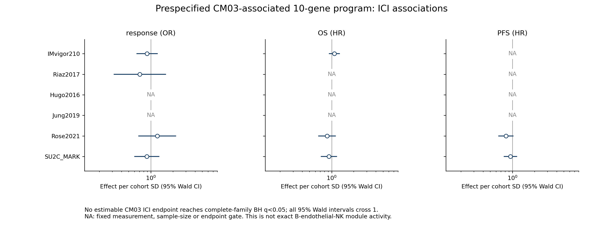
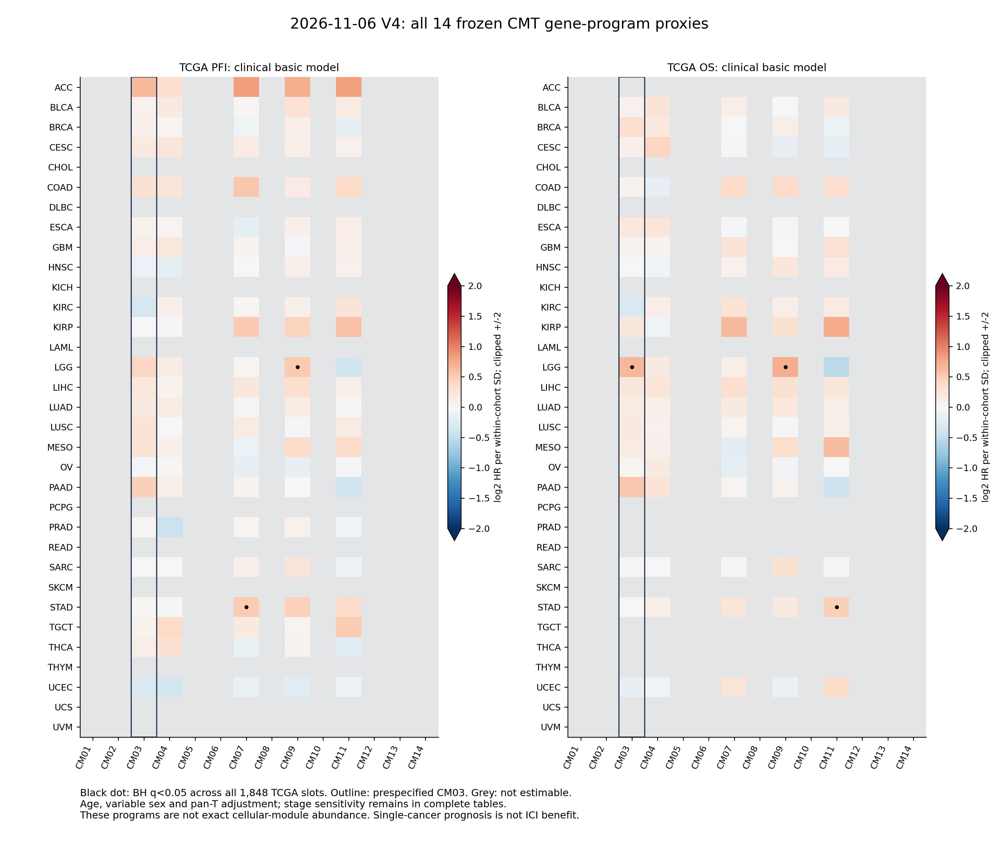
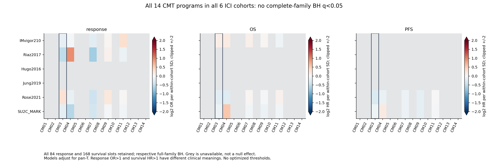

# 当前V4重点CM：成像空间通讯与TCGA/ICI

**本轮TCGA/六ICI及免疫计算和独立审核已完成；成像空间CellChat继续。当前冻结的CM03相关表达程序与多项免疫RNA读出相关，但ICI应答/生存未获完整家族BH支持。** 原53张Visium、25组CPDB和V4注释/CM继续，未将程序代理或部分空间结果升级为精确模块/机制验证。

## 已完成的TCGA和ICI结果

[全部2100临床槽](completed_bulk_v1/all2100_clinical_slots.tsv) · [当前全部4620免疫槽v2](completed_bulk_v2/all4620_immune_slots.tsv) · [当前完整家族汇总](completed_bulk_v2/complete_family_summary_current_v2.tsv) · [患者得分/设计/FC独立审核](completed_bulk_v1/independent_measurement_audit.json) · [395设计数值重拟](completed_bulk_v1/independent_numeric_audit.json) · [C1–C6来源映射及全家族独立审核](completed_bulk_v2/independent_audit.json)。

| 完整家族 | 预设槽 | 可估计 | BH q<0.05 | BY q<0.05 |
|---|---:|---:|---:|---:|
| TCGA癌种内PFI/OS、两模型 | 1,848 | 350 | 5 | 2 |
| 六ICI应答 | 84 | 20 | **0** | 0 |
| 六ICI OS/PFS | 168 | 25 | **0** | 0 |
| TCGA免疫RNA和C1–C6 | 4,620 | 1,325 | 814 | 688 |

这些是检验记录，非独立机制或独立验证队列数；所有不可评估槽保留在校正分母。23.6万患者得分条目与395个模型设计绑定通过，独立临床数值最大差2.81e-6；RNA统计误差≤3.33e-16，C1–C6独立H/P误差≤2.28e-13。矩阵、个体临床和设计未导出。

### 优先CM03的当前解释

1. **免疫相关背景成立于当前程序测量。** 在29个可检验癌种中，PTPRC相关28个、CD274 28个、CTLA4 27个、CYT 24个通过完整免疫家族BH，方向均为正；这仍可能反映总体浸润/细胞混合，不是状态特异、纯度独立或直接通讯。C1–C6只有BRCA/LUAD/PRAD/SARC满足所有原组别门槛；BRCA和PRAD差异经BY仍保留，LUAD仅BH边界q≈0.0498、BY≈0.449，SARC未获支持。其余癌种不删稀有亚型凑检验，见[全33来源计数](completed_bulk_v2/all33_source_C1_C6_counts.tsv)和[全14×33亚型描述](completed_bulk_v2/all14_by33_C1_C6_descriptive_programs.tsv)。
2. **ICI目前不支持该冻结程序。** CM03的全部可估计应答/OS/PFS均未通过完整家族BH，95% Wald CI均跨1。[完整CM03临床表](completed_bulk_v1/CM03_all_clinical_slots.tsv)保留所有来源/终点；Hugo/Jung的缺测/规模限制与真实源患者数见[逐队列程序资格](completed_bulk_v1/cohort_program_measurement_eligibility.tsv)，NA不等于无RNA或阴性。
3. **TCGA仅有单癌种探索线索。** LGG OS基础模型n=504，HR/SD=1.590（95%CI 1.284–1.967），完整1848槽BH q=0.00679、BY q=0.0550；未形成多癌种一致预后证据。基础模型只调整pan-T、年龄/可变性别，未控制LGG分级、IDH/1p19q等关键背景，不能称独立临床标志物；这些背景与结局的关系见[TCGA LGG原研究](https://www.nejm.org/doi/full/10.1056/NEJMoa1402121)。

全部图保留NA与原14因子，CM03边框仅表示事前优先级。图中为连续程序每队列/癌种SD的效应，不是CM真实丰度；红色正系数在应答OR和生存HR中含义不同。原CM09/07/11的组织/来源/分解限制仍成立，个别TCGA阳性不用于改选最优模块。

### 成像队列当前状态与技术恢复

08:29:38 UTC检查：5个Xenium已准备，大类细胞数/999次邻域背景完成；乳腺两单元大类分类器收敛，三IO单元的大类模型尚有迭代上限警告，fine50均未收敛，因此只作带限制的测量机会，不宣称精确亚型。5个面板均缺IGHD/XCL1，精确CM03不成立。原首张邻近int8错误已仅恢复失败阶段，成功准备不重跑。

前两张空间CellChat v1的“不可评估”已定位为**预检使用labels而安装版computeRegionDistance要求group字段**，不是组织缺少邻近细胞；原0×0矩阵/收据保持，v2只修字段、复用准备输入。08:29:38时首个乳腺和卵巢各已有2/4个真实距离变体完成，独立全变体审核仍待；两个R进程CPU时间持续增加，未重启。其余Xenium及8个CosMx归档由有限队列接续。tar流与pandas的seek接口问题已用合成输入证实，改为相同成员字节的内存缓冲，未改原基因/坐标/阈值。

原免疫v1未识别完整C1–C6描述字符串；v2按原表六个标签精确映射，独立正则核对，不改变患者连接、RNA统计P或临床模型。当前免疫结果以completed_bulk_v2为准，v1保留为纠正前历史；BH/BY按完整4620槽重算，没有删组或放宽门槛。

较晚[08:40:25 UTC检查点](runtime_checkpoint_v2.json)：首乳腺和卵巢各完整4/4距离变体、独立数组/候选计数/全模型BH审核通过，共2个原生单元算完；卵巢大类优化警告仍在，因此计算通过不等于身份或生物学通过。乳腺仅大类背景合格，不能替代原CM03精确亚型。[首个CosMx原生表头](first_CosMx_native_header_qualification.json)实际测得IGHD、XCL1、PECAM1、VWF，细胞键及全局像素字段相符，有进一步细分核对的机会，不把一个表头推断为全部归档已通过。

后续同一C1/L2分类目标将优化预算从1000增至5000，未收敛的同面板缓存只作warm-start，原分组/参考split/基因/阈值不改；已运行模型和预测不覆盖。当前代码及原版本见[源码清单v3](public_code_manifest_v3.json)，[优化预算读回](optimizer_precision_readback_v7.json)与原快照分开保存。待首个CosMx完整分视野任务完成后再据实标定耗时。

### 首个合格大类背景的通讯候选与重采样限制

08:53:57 UTC接收首乳腺单元的[四参数汇总](first_broad_spatial_context_v2/all_four_variants_summary.tsv)、[身份对×配体受体候选](first_broad_spatial_context_v2/all_four_variants_typepair_LR_candidates.tsv)和[独立数组审核](first_broad_spatial_context_v2/independent_audit.json)：模型133,517细胞、11大类、15个完整实测蛋白互作。主参数250μm/10μm下有273个软件名义候选，原软件BH为265；这些是身份对×互作记录，不是273个不同分子。内皮→B/NK的CXCL12–CXCR4及PECAM1–PECAM1列为探索性候选，缺IGHD/XCL1仍禁止称精确CM03通讯。10→20μm接触范围使名义候选增至314，范围敏感性完整展示。

**100次重采样的P=0表示未出现超越值，不表示真实概率为零。** 08:57:18 UTC／16:57:18 UTC+8另以`(100×P+1)/101`诊断有限重采样的非零下限，对每个变体全部1,815个假设重新BH并独立核对：四变体均为**0个BH候选**，最小q约0.0593–0.0678，见[完整敏感性表](first_broad_spatial_context_v2/MC_floor_sensitivity_v1/all_four_variants_MC_floor_sensitivity.tsv)和[收据](first_broad_spatial_context_v2/MC_floor_sensitivity_v1/complete.json)。这只是非零下限敏感性，不是完整并列值校准或新的空间零模型；原CellChat数组/P和身份均保留，没有重拟合或更换细胞。当前不能把原软件q=0当成稳健FDR或机制证据；后续按预设完整范围增加重采样并结合独立空间背景/患者复现，而不只加跑阳性边。

## 已核实的测量条件

| 分支 | 实际已核实 | 当前边界 |
|---|---|---|
| Visium原文验证 | 07:38 UTC主模型/原文评分/独立审核8/53通过、另2张拟合；CellCharter53/53通过 | 全53范围尚未完成，不能先称CM03空间验证成功 |
| 成像输入 | 5 Xenium单元、8 CosMx NSCLC归档实际存在；新有限分支已启动 | CosMx8归档含技术重复，面板/坐标/身份须逐个核验 |
| 5 Xenium面板 | 313或480基因，全部缺IGHD和XCL1 | **不能精确验证原CM03亚型**；仅支持通过身份门槛的大类空间背景通讯 |
| bulk签名 | 同164样本CMT、14,051共同实测基因，Seurat5.3.1推导完成 | 程序不等于原NMF活动或全部成员同时存在 |
| TCGA/ICI | 33癌种、六ICI，完整临床/免疫家族及独立审核完成 | ICI未获完整家族BH支持；程序代理不等于原CM或治疗特异获益 |

[全部14签名资格](all14_signature_eligibility.tsv) · [全部冻结基因](frozen_CMT_signature_genes.tsv) · [来源级面板范围](native_imaging_panel_scope.json) · [原冻结配置](configuration/plan_before_effects.json) · [几何补充](configuration/spatial_geometry_addendum_before_effects_v2.json) · [输入精确投影补充](configuration/bulk_exact_input_addendum_before_effects_v2.json)。

五个非空因子CM03/04/07/09/11获得完整10基因程序；**CM06当前无足够基因，保持bulk不可评估**。原空CM01/02/05、其余不足程序和CM14仅2个High样本完整保留，不为扩大阳性改签名/切点。CM07/09/11原组织/来源与分解诊断仍成立，其程序的临床关联不能自动挽救原CM解释。

## 两条实际执行线

空间线：原生计数/面板/坐标→同50标签参考训练与留出重放→marker/置信度/父类一致性门槛→原14精确身份机会表与明确大类视图→视野内邻近置换→CellChat2.2.0空间四参数组合→保存数组、候选明细、身份对计数和全模型BH独立读回。禁止跨不相连FOV造邻接、用缺测marker命名亚型或将表达置换P当空间共定位P。细胞边界/蛋白和因果尚未验证。

bulk线：使用已冻结CMT相关表达程序，癌种/队列内完整10基因百分位均值，连续得分不二分；TCGA癌种内PFI/OS及整体分期敏感性1,848槽，C1–C6/9免疫RNA读出4,620槽，六ICI应答84与OS/PFS168槽。TCGA只是癌种内预后背景；ICI应答和生存分开，不据无未治疗对照的数据声称治疗特异获益。患者分数、独立似然/梯度/CI、全部FDR和临床key已分别审核。

[SU2C公开完整来源校验](SU2C_public_download_receipt.json)与[本轮精确88基因派生记录](SU2C_exact_projection_receipt.json)绑定同一全TPM SHA和冻结签名，保留152 RNA列，全部所需88基因实测且唯一；Keep/QC后病例数以正式分析收据为准。全TPM本机保留，服务器只需本轮精确投影，旧34基因子集未用。大输入SSH超时不等于科学阶段失败；准备三阶段07:49:48–07:51:56 UTC实际exit0，已读回收据，未重跑。较晚空间/临床进度以追加时间检查点为准。

[详细方法与来源](../../../../methods/V4-spatial-CellChat-TCGA-ICI-20261107.md) · [正式run](../../../../runs/20261107_v4_spatialCellChat_bulk_v1.md) · [通用代码](../../../../scripts/v4_spatialCellChat_bulk_20261107/) · [原CM选择依据](../v4_CM_selection_v1/README.md)。本页记录实际执行和测量资格，尚不宣称临床预测器、精确亚型生态位或通讯机制已验证。

09:00:11 UTC／17:00:11 UTC+8最终取证：I001/I002/I005共3个原生Xenium单元各4/4距离变体及独立数组审核通过；I006首CosMx为10/112个视野×参数变体完成，两有限控制器均有活跃R子进程。3/13计算完成不表示精确CM03身份或通讯验证，112不是患者数。
