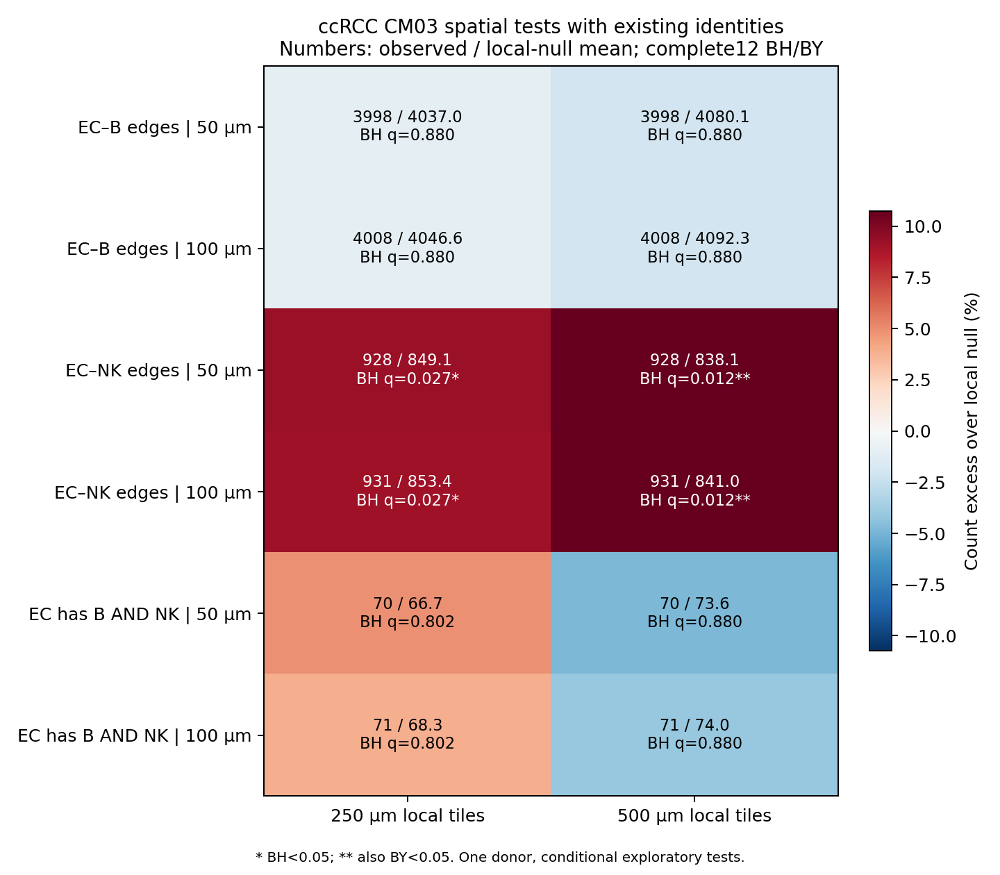
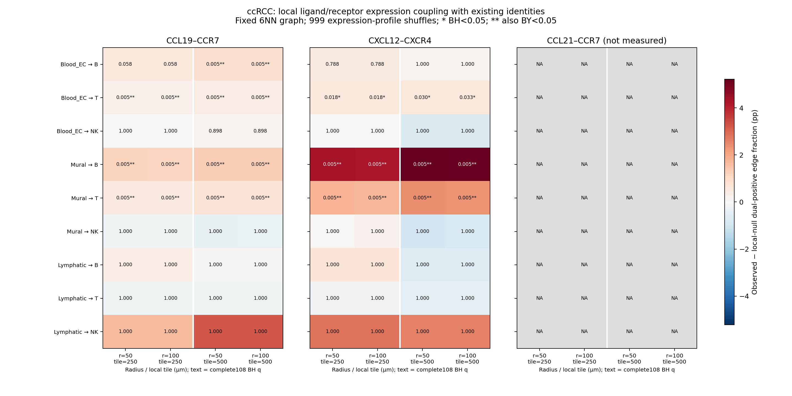

# ccRCC补充探索：沿用现有身份向前推进

**按用户最新要求，身份疑点先登记，不作为继续分析的前置条件。** 主分析固定本轮开始时已有的ccRCC试跑身份文件，SHA `d65cbcb6f8508f2598934d9de3c95a072fde4a53ba2871a13689728a8e262bde`；原标签、QC和坐标不改。新增聚类/一致性视图只留诊断记录，不替换当前身份。

## 已完成与当前任务

- 服务器最小7成员完整验收：原6成员独立SHA/CRC匹配，新增细胞轮廓CRC/大小及新SHA接受；[输入回执](input_acceptance_summary.json)。未下载完整56.7GB，未声称整包MD5验证。
- [原试跑完整重放](baseline_replay_audit.json)一致；358,841个QC保留细胞中B7,376、T57,230、NK1,244、血EC49,600、淋巴管1,682、Mural34,701。[身份未改变回执](current_identity_forward_v1/identity_preservation.json)。
- 新增CM空间**12槽**和LR空间表达**108槽**均完成，[独立数值审核通过](current_identity_forward_v1/independent_forward_audit.json)。
- 原身份六类共151,833细胞的477基因输入已交给空间CellChat2.2.0，四个固定距离参数变体已于2026-11-09 09:00:42 UTC全部完成；2026-11-10 08:41:58 UTC有限MC独立数值审核通过。4/4原生数组及全模型敏感性均已验收，身份未变。

## CM03：目前是哪一部分得到支持

对象为**2026-11-06 V4 CM03**。原两边为B—血管内皮、血管内皮—NK；“B/NK同时围绕同一EC”是额外组织结构问题，不冒充原发现已有三方结构。

以每个B/T/NK细胞的最近6个原QC细胞构图，限50/100μm；在250/500μm网格×RNA深度层内置换免疫身份999次，保留位置和局部免疫构成。单供者条件检验，不把细胞/EC当患者重复。[完整12比较](current_identity_forward_v1/CM03_existing_identity_spatial12.tsv)。

| 50μm结果 | 观察 | 250μm背景期望 / BH q | 500μm背景期望 / BH q | 含义 |
| --- | ---: | --- | --- | --- |
| EC—B近邻边 | 3,998 | 4,037.0 / 0.880 | 4,080.1 / 0.880 | 未见额外增强 |
| EC—NK近邻边 | 928 | 849.1 / 0.027 | 838.1 / 0.012 | 有增强；BY仅500μm背景通过，q=0.0372 |
| 同一EC有B且有NK | 70 | 66.7 / 0.802 | 73.6 / 0.880 | 未支持额外三方聚集 |

100μm方向相同。这里与旧“距任一EC≤50μm的细胞比例”估计对象不同：近邻边密度与是否靠近任何EC不能互相替代。当前支持**部分EC—NK关系**，尚不足以称整个CM03在本例空间复现。共享节点在本检验中是单个EC细胞，不是重建的整条血管；这一阴性不能排除同一血管不同位置的共同组织。

## 通讯：先保留实测且有空间支持的候选

用同一原身份图，检测发送细胞配体与接收细胞受体是否在近邻边上同时检出。表达profile在身份×网格×RNA深度层内置换999次，保持位置/身份及局部检测背景。3发送类×3接收类×3轴×2半径×2网格共108槽，统一BH/BY；CCL21缺测的36槽保留NA/P=1。[完整108槽](current_identity_forward_v1/spatial_expression_communication_complete108.tsv)。

72可测槽中26 BH、22 BY；这是参数组合数，不是26对独立互作。以下5条方向在两种局部背景、两种半径均有BY支持：

| 发送→接收 | 实测轴 | 50μm、250μm背景的双阳性边比例增量 |
| --- | --- | ---: |
| 血EC→T | CCL19–CCR7 | +0.272个百分点 |
| Mural→B | CCL19–CCR7 | +1.153个百分点 |
| Mural→T | CCL19–CCR7 | +0.514个百分点 |
| Mural→B | CXCL12–CXCR4 | +4.352个百分点 |
| Mural→T | CXCL12–CXCR4 | +1.816个百分点 |

另有血EC→B的CCL19–CCR7只在500μm背景通过，血EC→T的CXCL12–CXCR4通过BH但未过BY；NK作为接收者在这两条可测轴下未获校正后支持。它们是**空间表达耦合候选**，不证明配体释放、受体激活或募集因果。Mural沿用当前标签，不进一步硬称特定周细胞亚型。

## 身份问题的处理与下一步

[身份问题登记](identity_issues_deferred.tsv)和[旁支留档](diagnostic_sidebranch_registry.json)保留发现与代码；用户要求后置，本轮没有据此删除细胞或增加身份门槛。IGHD/XCL1缺测，因此此处是大类组成扩展；单例不提供跨患者复现。

空间CellChat四参数及保存数组审核已完成。后续优先围绕Mural—B/T的表达耦合候选与EC—NK邻域线索检查组织位置和跨样本重复；保留B—EC、同一EC三方及NK接收轴的未支持结果。身份诊断图继续后置，不启动新注释作为前置。

[当前主方法](../../../../methods/V4-ccRCC-current-identity-communication-20261109.md) · [运行](../../../../runs/20261109_ccRCC_current_identity_forward_v1.md)。

## 当前展示图

以下只使用已审核聚合表。第一图保留完整12组合；第二图保留完整108含缺测，不仅展示阳性项。色条布局v2经视觉核查，统计输入未变；早期绘图版本保留作历史。

## 空间CellChat最终结果与解释

[完成回执](current_identity_forward_v1/CellChat/complete.json)：4/4变体，各151,833细胞、6类、36条全组件可测蛋白LR，共5,184个发送—接收—LR—参数槽。保留[全部原生值与有限MC敏感性](current_identity_forward_v1/CellChat/all_variants_finite_MC_sensitivity.tsv)，不只展示显著项。

100次原生表达重采样有712槽P=0；按保存超越计数加一得到最小P=1/101，四变体共同BH/BY后，正概率互作均无q<0.05。[敏感性摘要](current_identity_forward_v1/CellChat/finite_MC_sensitivity_summary.json)。这说明当前采样分辨率与全模型校正下缺少工具层面的稳健支持，不能把原生P=0解读为确定通讯，也不能据此证明信号不存在。该敏感性无法重建工具原生并列规则，并非新空间零模型；前述108检验仍是独立的局部空间表达证据。

[固定身份的靶轴读出](current_identity_forward_v1/CellChat/target_axes_readout.tsv)中，CCL19–CCR7的36个可测方向/参数槽prob均为0；[检测率](current_identity_forward_v1/CellChat/current_identity_axis_detection.tsv)显示CCL19在血EC/Mural/淋巴管分别为4.82%/6.65%/7.43%。这与trim0.1在稀疏表达下压低群平均的机制一致，属对工具与局部表达检验差异的解释，未直接验证全部零值成因。CXCL12–CXCR4有正工具分数但未过上述联合敏感性校正。CCL21缺测，不能据此判生物学阴性。目标轴四参数分数相同，因此四参数不提供四份独立重复证据。

原生数组计数与BH读回已通过；原审核末段因CSV舍入使P较1/101小1.73e-18而失败。保留[原退出回执](current_identity_forward_v1/CellChat/controller_terminal.json)，仅将审核容差设为1e-12后重审，[恢复回执](current_identity_forward_v1/CellChat/audit_recovery_v2.json)通过，最大P/BH/BY误差均<5e-16；没有重跑模型或更改身份。[原生数组v2审核](current_identity_forward_v1/CellChat/independent_audit_v2.json)及[有限MC审核](current_identity_forward_v1/CellChat/finite_MC_independent_audit_v2.json)。

[原2/4进度回执](current_identity_forward_v1/CellChat_runtime_checkpoint.json)只作历史快照。当前结论仍是单例探索：部分EC—NK空间关系与Mural→B/T表达候选，尚不能称完整CM03或功能通讯验证通过。
