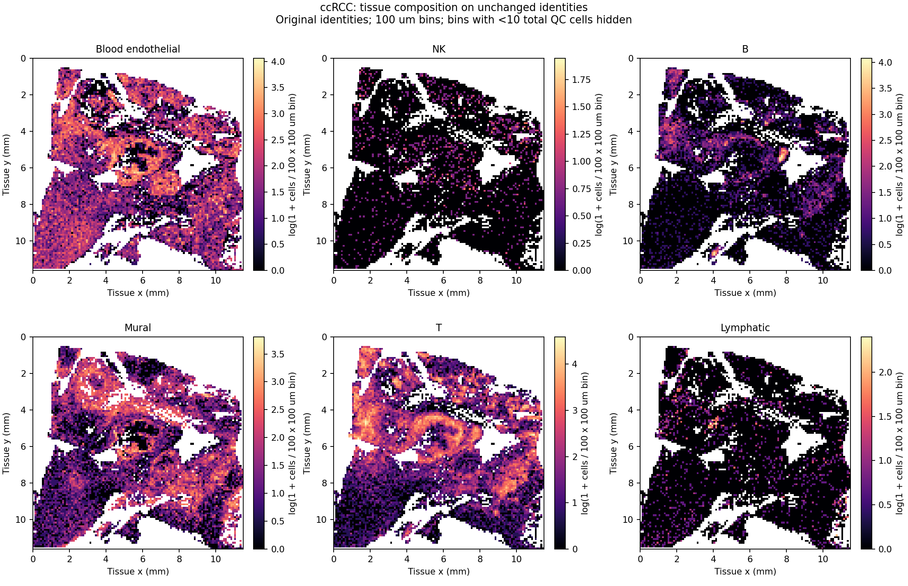
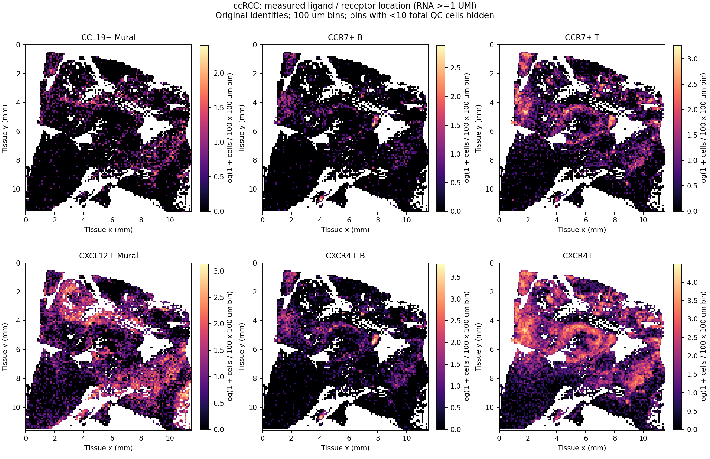
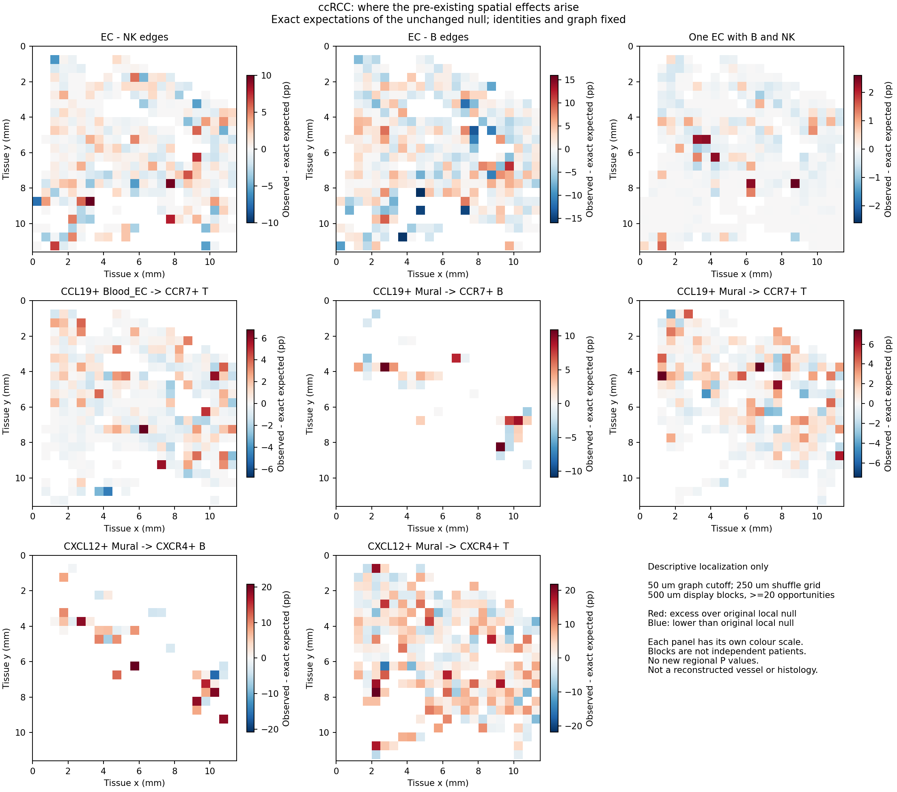

# ccRCC空间定位：沿用现有身份的区域贡献与稳健性

本轮沿用户指定的现有身份继续；身份文件SHA `d65cbcb6f8508f2598934d9de3c95a072fde4a53ba2871a13689728a8e262bde`，358,841原QC细胞、151,833六类细胞及原近邻图全部保留。对象为**2026-11-06 V4 CM03的ccRCC大类扩展**，不是新清理TME重新发现的CM。

本轮结果：EC—NK及此前五条空间表达候选，在固定500μm分区下删除任意单一区域后，总体超额方向仍正。它们存在明显空间异质性；Mural→B/T的CXCL12–CXCR4有更多区域呈正向贡献。B—EC和同一个EC周围B/NK三方结构继续缺少支持。单供者尚不构成跨患者复现，CellChat联合校正未获支持的结论也没有改变。

## 这一轮具体做了什么

上一轮已完成CM12、LR108和CellChat四参数。原图为每个B/T/NK细胞最近6个原QC细胞、排除自身后截断50/100μm的图。本轮复用原图及原身份×局部位置×RNA深度置换规则，求出**原零模型的精确期望**，再将观察数与期望数按500μm空间块分解。LR发送/接收身份互不相同，其原置换独立，边上期望为两端各自分层检出率乘积；共享EC的B/NK身份互斥，使用不放回抽样和容斥，避免误当独立事件。

没有重新置换、拟合通讯模型、改标签或增加区域P值。完整12/108均保留，36个CCL21缺测槽继续NA。原999次置换均值和解析期望的小幅差异来自Monte Carlo近似；原P/q保留为历史结果，并未重新估计。图和稳健性汇总属于描述性定位。

## 1．EC—NK：部分关系分布在多个区域，但并非全组织普遍增强

50μm、250μm分层背景：观察928条EC—NK边，精确期望849.85条，超额78.15条。占全部EC—B/T/NK近邻边的比例超额为**+0.197个百分点**。429个有边空间块中，324块达到≥20条相应机会边；其中129/324（39.8%）呈正向超额。

固定原分层期望、逐一删除每个有边空间块后，超额比例仍为+0.182至+0.213个百分点。这说明该分区下没有单一区域能逆转总体方向；不代表全切片普遍富集，也未排除更大连续组织区域的驱动。

500μm分层背景以及100μm半径下方向同样保留。原BY仅500μm分层背景通过，250μm背景BY q约0.0838，因此继续称**部分空间支持**。B—EC超额为负；共享单EC的B/NK仅比期望多3.25个EC，删除单块可改变方向，原检验也未通过，不能据图命名三方生态位。

[完整12项区域稳健性](CM12_exact_expectation_block_robustness.tsv)。

## 2．通讯候选：CXCL12–CXCR4更适合先做组织位置与外部复现

下表固定50μm半径、250μm分层背景，增量分母是各发送—接收身份的全部相应近邻边，单位为百分点。区域“正向”仅指观察高于精确期望，不是区域显著；≥20机会边仅用于区域方向汇总/显示，不改变全量检验输入。

| 现有身份方向 | 轴 | 双阳性边比例增量（百分点） | 正向区域/≥20边区域 | 固定期望删任一区域后增量范围 |
| --- | --- | ---: | ---: | ---: |
| Blood_EC→T | CCL19–CCR7 | +0.274 | 98/308 | 0.245–0.285 |
| Mural→B | CCL19–CCR7 | +1.140 | 18/37 | 1.046–1.197 |
| Mural→T | CCL19–CCR7 | +0.517 | 108/266 | 0.478–0.534 |
| Mural→B | CXCL12–CXCR4 | +4.373 | 24/37 | 4.152–4.555 |
| Mural→T | CXCL12–CXCR4 | +1.808 | 170/266 | 1.742–1.868 |

五条方向在两种半径×两种分层背景下，逐一删除任一空间块后的总体方向均保留。CCL19方向在达到边数要求的区域中正向比例约31.8%–48.6%，Mural的CXCL12方向约63.9%–64.9%；这支持优先查看后者的多区域分布，但不能通过比较区域比例宣称两轴存在统计学差异。

**下一轮优先顺序：**Mural→B/T的CXCL12–CXCR4作主要空间表达候选；CCL19–CCR7保留为较局部的候选；EC—NK继续作为组成线索，当前两条可测募集轴未给NK接收端校正后支持。Mural只是沿用现有标签，为原CM03三成员之外的扩展发送类，不据这些图改称特定周细胞亚型。

这些仍是配体/受体RNA位置和近邻双检出。上一轮CellChat全5,184槽有限次数敏感性联合BH/BY均无通过项，不能将本轮描述性稳健性升级为工具确认或功能因果。CCL21未测，不能判信号阴性。[完整108项](LR108_exact_expectation_block_robustness.tsv)。

## 3．组织中的位置图

图为服务器原始坐标上的聚合栅格，三张图v2共用原点、毫米尺度、范围和方向。100μm密度栅格隐去总QC细胞<10的空疏区域；效应图以500μm块显示、只画≥20机会的块，各面板色标独立。原细胞坐标和逐区域表不公开。红/蓝为观察相对原零模型的正/负贡献，不是显著性。

已下载7成员不含病理图像。因此这些是表达/组成空间图，不是病理或血管壁重建；本轮没有命名TLS、血管形态或组织区室。[图像校验清单](figures_v2/manifest.json)。

## 4．与既有ccRCC外部结果怎样衔接

重用已审阅GSE273952的19张切片记录，本轮未重新核供者独立性或产生新复现。原精细CM03的B—EC、EC—NK Spearman中位数分别0.357、0.439，正向14/19、16/19；与参考谱相似细胞对相比的超额中位数分别−0.056、−0.028，仅6/19、8/19正向。大类B—EC、EC—NK中位相关0.422、0.540。

因此可连接的证据是“血管/淋巴细胞组成共现，以及本单例的部分EC—NK邻接”；尚不能连接成“精确三亚型生态位已复现”或“Mural募集轴跨患者重复”。后一问题需要具备同类身份、相应基因、可靠几何的独立ccRCC成像样本。[既有证据桥接](existing_ccRCC_evidence_bridge.json)明确区分既有数据与本轮新增分析。

## 验证与边界

真实服务器计算和独立审核均完成，72个可测LR期望逐一独立复算、12/108区域总和守恒、80个共享EC不放回抽样核对、一个完整枚举反例通过；最大算术误差2.73e-12。解析LR期望与原999次均值最大偏差为2.37个Monte Carlo均值标准误，未提示换了零模型。[计算回执](complete.json) · [独立审核](independent_audit.json) · [预设设计](design.json)。

删一块只扣除该块贡献，**固定原分层期望**，不重建剩余组织的置换背景；它不是重拟合检验、置信区间或独立样本验证。空间块可相关，分区原点只有本次固定一套，不能把稳定方向当临床泛化证据。身份疑点按用户要求后置，未进入本轮过滤。

[上一轮完整主报告](../../2026-11-09/ccrcc_followup_v1/README.md) · [当前方法](../../../../methods/V4-ccRCC-localization-existing-identity-20261110.md) · [本轮运行](../../../../runs/20261110_ccRCC_localization_v1.md)。
