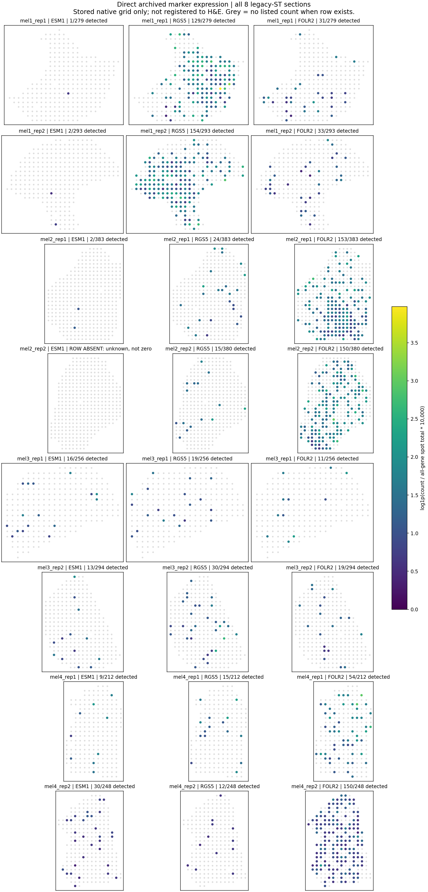

# WEHI R4：直接原始RNA标记测量补充

[完整说明](结果说明.txt) · [直接计数覆盖](direct_marker_coverage.tsv) · [同spot检出](same_spot_codetection.tsv) · [独立原始CSV重放](independent_audit.json)

ESM1在部分legacy-ST切片仅1–2个阳性spot，另1片计数表未列出此基因。24个计划基因×切片组合仅23个可用，24个计划成对比较仅22个可用；缺失保留NA。此结果限制直接标记证据的强度，不将稀疏检出当生物学不存在，也不把同spot检出当细胞接触。

所有输入SHA与既有审计一致，独立CSV重放覆盖全部可用标记行及列联表。图为原生存储网格，无H&E配准或病理区室注释。代码模板需配置NATIVE_COUNTS_ROOT和SPATIAL_RESULTS_ROOT。无新增P值或逐患者/细胞原始数据发布。

作者H&E/spot归档已完整下载到服务器：[完整大小、官方MD5、SHA256与全部ZIP CRC回执](histology_download_audit.json)。[官方来源](https://zenodo.org/records/8215682)。原始942MB归档未上传GitHub，先前下载中回执保留为历史状态。文件完整不等于图像配准或患者验证。

[作者计数/图像清点](histology_count_image_inventory.json)：新归档8份计数与当前分析原始TSV逐字节完全一致，16幅JPEG全部可解码。H&E约32k×29k，spot图20k×20k；预览显示裁切/方向需单独核对，不能直接按尺寸缩放叠图。原始图像及联系图保留服务器，公开只提供清单/哈希；定量网格至像素配准、病理区室及患者桥接仍待。
