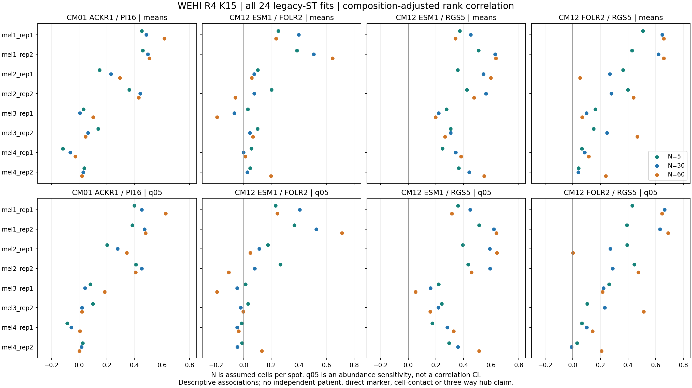

# WEHI R4 K15：24组空间参数敏感性完成

2026-11-20恢复任务后取证：8片 × N=5/30/60的全部模型及审计已齐全。本轮完成1440作者分数、7104边指标、15168匹配差值的完整比较与独立文件重放；原2026-11-19快照保持不变。

[完整结果说明](结果说明.txt) · [全部模块敏感性](all_module_sensitivity_summary.tsv) · [核心边范围](core_edge_ranges.tsv) · [输入和差值审计](complete.json) · [独立读回复核](independent_readback.json)

CM12 ESM1相关内皮—RGS5相关周细胞的means组成校正相关在三种N均8/8为正，范围分别0.247–0.510、0.221–0.630、0.197–0.635；q05同向，但父类内比例校正仍存在反向切片。FOLR2相关边更敏感，不证明完整三方hub或细胞接触。无新增P值、无患者独立性声明、无临床预测验证升级。

全部表为切片/模型/模块级统计，无逐患者/细胞记录或原始矩阵。代码.in是路径脱敏模板，compare脚本需配置SPATIAL_RESULTS_ROOT；review与plot脚本接受结果目录参数。完整拟合与原始输入仍保存在科研服务器。
